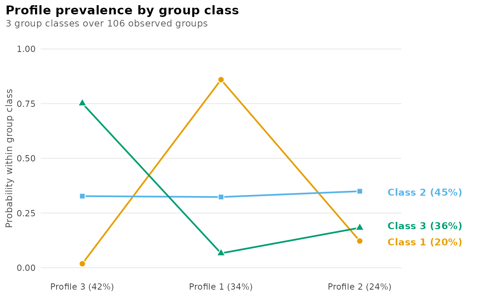
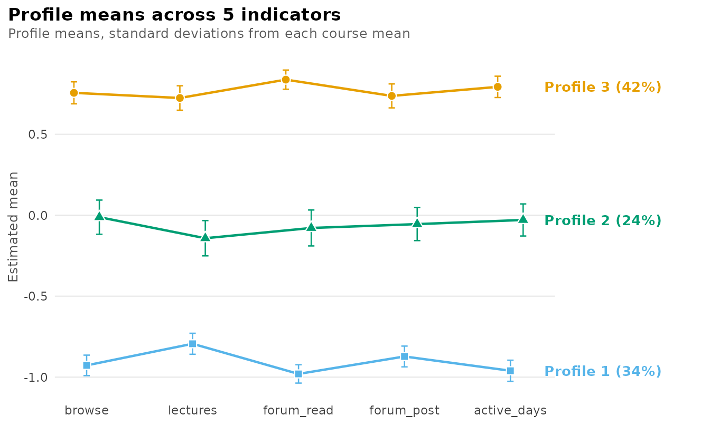
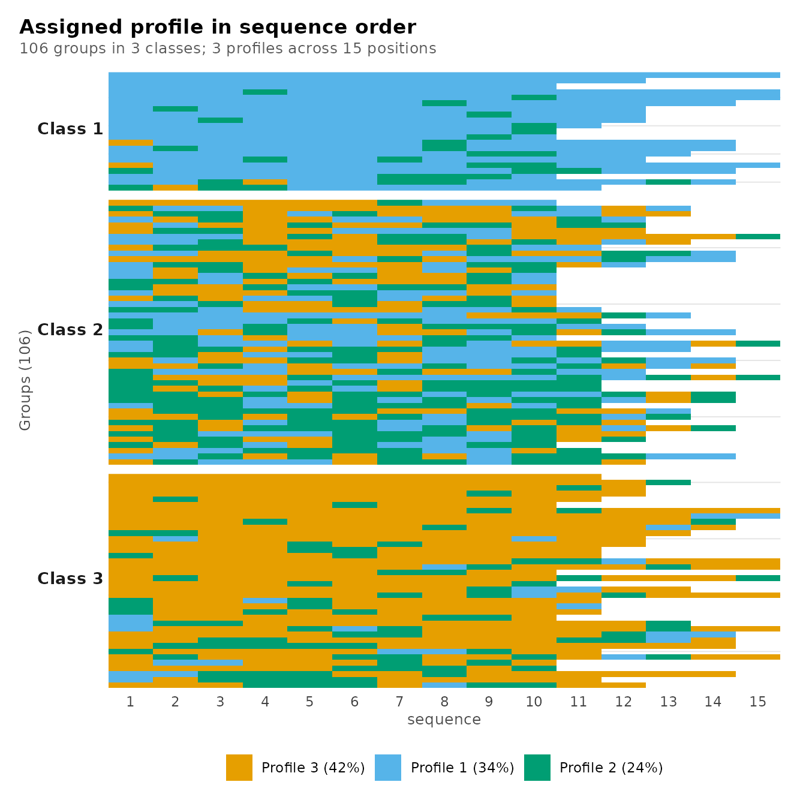

# Case study: Multilevel latent profile analysis of course engagement with the latents R package

Multilevel latent profile analysis (MLPA) is used when observations are
nested within higher-level units and the aim is to identify latent
profiles at the observation level while also describing how the
prevalence of those profiles varies across units. Examples include
repeated measurements nested within persons, students nested within
schools, patients nested within clinics, or employees nested within
organizations. Because observations from the same higher-level unit may
be dependent, MLPA extends standard latent profile analysis by modeling
the data at two levels. Latent profiles are defined at Level 1, whereas
latent classes at Level 2 describe differences between higher-level
units in the composition of those profiles.

Consider a repeated-measures application. A person may occupy different
profiles on different occasions. Let $`C_{it}`$ denote the profile of
person $`i`$ at occasion $`t`$, and let $`G_i`$ denote the person’s
Level-2 latent class. The model estimates the conditional probability
$`P(C_{it}=k\mid G_i=m)`$ that an observation belongs to profile $`k`$
given that the person belongs to class $`m`$. In this way, MLPA
separates variation across repeated observations from variation between
persons in the profiles they tend to occupy.

This distinction is also central to VaSSTra (López-Pernas & Saqr, 2023),
which separates **state diversity** from **person heterogeneity** using
a sequential estimation strategy. VaSSTra first establishes a common
state space across all observations and then summarizes each person’s
repeated observations within that space. MLPA takes a different
approach: the observation-level profiles and person-level classes are
estimated jointly within a single model. Both approaches allow the same
person to occupy several states across repeated observations, but they
differ in how the states and the person-level representation are
constructed.

The `latents` package fits MLPA models using maximum likelihood with
multiple expectation-maximization starting values. This vignette works
through a three-profile, three-student-class example using longitudinal
data on course engagement. The focus is on specifying, estimating, and
interpreting the model. The companion guides cover [model
evaluation](https://pak.dynasite.org/latents/articles/case-engagement-evaluation.md),
[covariates and staged
estimation](https://pak.dynasite.org/latents/articles/case-engagement-covariates.md),
and [latent
transitions](https://pak.dynasite.org/latents/articles/case-engagement-transitions.md).

``` r

library(latents)
```

## Longitudinal course engagement

The engagement example revisits the setting studied by Saqr and
López-Pernas (2021) and López-Pernas and Saqr (2024): the online
engagement of students followed across the courses of a complete study
programme. These studies distinguished engagement states within courses
and longer-term student trajectories across courses. López-Pernas and
Saqr (2024) identified three states (active, average and disengaged) and
three trajectories (engaged, fluctuating and mostly disengaged), and
described the momentum of engaged students, who tend to remain active,
and the inertia of disengaged students, who tend to remain disengaged.
The bundled synthetic `engagement_momentum` data reproduce this nested
longitudinal design: the states and trajectories that generated the data
are known, so the analysis can be checked against them. The purpose of
the example is to illustrate the analytical questions and workflow; the
estimates reported below apply only to the synthetic package data.

Each row represents one student’s enrolment in one course. Enrolments
are therefore the Level-1 observations, while students are the Level-2
units within which those observations are nested. A student who takes
several courses appears on several rows. The variable `student`
identifies the Level-2 unit, `course` identifies the course associated
with each enrolment, and `sequence` records the position of that course
in the student’s observed history. Students need not contribute the same
number of enrolments. The MLPA model accounts for the grouping of
enrolments within students; it does not include a separate course-level
random effect or latent structure.

Five activity indicators describe the student’s engagement during each
enrolment. The indicators are simulated as continuous values
representing a log-count scale, then standardized within course. No raw
counts or [`log1p()`](https://rdrr.io/r/base/Log.html) transformation
are generated. Each value can therefore be interpreted as the
enrolment’s distance from the mean of that particular course, expressed
in course-specific standard deviations. A value above zero indicates
more activity than the course average, whereas a value below zero
indicates less activity than the course average.

This within-course standardization is important for the interpretation
of the profiles. Raw activity volumes can differ substantially across
courses because of differences in course design, duration, or expected
workload. The indicators therefore describe a student’s engagement
relative to other students taking the same course rather than relative
to the cohort as a whole. The profiles identified below are therefore
recurring patterns of **relative engagement within courses**.

| Variable | Definition |
|----|----|
| `browse` | Course page views. |
| `lectures` | Lecture videos viewed. |
| `forum_read` | Forum posts read. |
| `forum_post` | Forum posts written. |
| `active_days` | Days active in the course. |
| `grade` | Standardized grade of the course. |
| `previous_grade` | Standardized grade from the preceding course, with an entry grade at the first course. |
| `state`, `trajectory` | The generating engagement state and student trajectory, used only to check recovery. |

The indicator vector `vars` selects the five measures used to define
engagement profiles. Identifiers, grades and the generating labels stay
outside the measurement model. The package accepts a character vector of
column names.

``` r

vars <- c("browse", "lectures", "forum_read", "forum_post", "active_days")
```

## Descriptive statistics and clustering within students

The
[`descriptives()`](https://pak.dynasite.org/latents/reference/descriptives.md)
function summarizes the distributions of the activity indicators and
estimates their intraclass correlations (ICCs), using `student` as the
grouping variable. The ICC describes how much of the variation in an
indicator is attributable to differences between students rather than
variation across enrolments within the same student. It is defined as

``` math
\mathrm{ICC}
=
\frac{\sigma^2_{\mathrm{between}}}
{\sigma^2_{\mathrm{between}}+\sigma^2_{\mathrm{within}}}.
```

Here, $`\sigma^2_{\mathrm{between}}`$ is the variance between students
and $`\sigma^2_{\mathrm{within}}`$ is the variance across enrolments
within students.

An ICC near zero indicates little between-student variation in an
indicator’s average level, whereas an ICC near one indicates little
variation across enrolments within students. With the one-way
random-effects estimator used here, an estimated ICC can occasionally be
negative because of sampling variation; such estimates are generally
interpreted as indicating little or no detectable between-student
clustering for that indicator.

ICCs describe the clustering of each activity indicator separately. They
do not determine how many Level-1 profiles or Level-2 student classes
should be fitted. In particular, students may differ in the
**composition of their engagement profiles** even when their average
levels on the individual indicators are similar. The ICCs are therefore
descriptive measures of the multilevel structure in the observed
indicators.

The descriptive table reports means, standard deviations, ranges, and
ICCs for the activity indicators, together with sample sizes and
missingness.

``` r

descriptives(engagement_momentum, vars = vars, id = "student")
```

    #>      variable    n n_missing       mean     sd   min  max n_distinct n_groups sd_within
    #> 1      browse 1310         0 -8.397e-05 0.9880 -2.74 2.46        401      106    0.8657
    #> 2    lectures 1310         0 -5.344e-05 0.9882 -2.79 2.96        399      106    0.8847
    #> 3  forum_read 1310         0 -9.924e-05 0.9881 -2.46 2.80        386      106    0.8479
    #> 4  forum_post 1310         0  6.107e-05 0.9880 -2.54 3.06        395      106    0.8782
    #> 5 active_days 1310         0 -9.160e-05 0.9881 -2.62 2.83        392      106    0.8495
    #>   sd_between    icc
    #> 1     0.5344 0.2338
    #> 2     0.5088 0.1998
    #> 3     0.5624 0.2653
    #> 4     0.5180 0.2115
    #> 5     0.5602 0.2626

The data comprise 1,310 enrolments from 106 students, with complete
observations on all activity indicators. Because the indicators were
standardized within course, their pooled means are approximately zero
and their standard deviations are close to one. The estimated ICCs range
from 0.200 for `lectures` to 0.265 for `forum_read`: about 20% to 27% of
the variance in the individual indicators is attributable to differences
between students. Most variation therefore occurs across enrolments
within students, while a meaningful share reflects between-student
differences. This combination of within- and between-student variation
is the structure that the multilevel model is designed to represent.

## Three engagement profiles and three student classes

The
[`multilpa()`](https://pak.dynasite.org/latents/reference/multilpa.md)
function estimates engagement profiles from the five activity indicators
and student classes from the distribution of those profiles across each
student’s enrolments. A **3 × 3 model** contains three Level-1 enrolment
profiles and three Level-2 student classes. Each student class is
characterized by a different set of probabilities for the three
enrolment profiles, while an individual student may contribute
enrolments to more than one profile.

Each engagement profile is defined by a mean and variance for every
activity indicator. These profile-specific parameters are shared across
student classes. Thus, a given profile represents the same pattern of
engagement regardless of which student class it occurs in. What differs
across student classes is the relative frequency with which their
enrolments occupy the profiles.

The conditional profile probabilities introduced above can be written as

``` math
\pi_{k\mid m}=P(C_{it}=k\mid G_i=m),
```

where $`\pi_{k\mid m}`$ is the probability that an enrolment belongs to
profile $`k`$ when the student belongs to class $`m`$. For each student
class, these probabilities range from zero to one and sum to one across
the three profiles. The Level-2 class probability

``` math
\omega_m=P(G_i=m)
```

gives the proportion of students represented by class $`m`$.

The model relies on several distributional and independence assumptions.
Within each profile, the activity indicators are modeled as Gaussian,
and the same profile definitions apply to all students. Students are
treated as independent Level-2 units, and enrolments within a student
are conditionally independent given the student’s latent class. With the
default diagonal covariance structure, the activity indicators are
additionally assumed to be independent within each profile. Substantial
residual associations between indicators after accounting for profile
membership may indicate that this assumption is too restrictive and can
affect the resulting profile solution.

The **3 × 3 model** considered here is one candidate representation of
the latent structure. The [evaluation
vignette](https://pak.dynasite.org/latents/articles/case-engagement-evaluation.md)
shows how this model can be compared with alternatives containing
different numbers of Level-1 profiles and Level-2 student classes.

The model is estimated from ten starts, the first from Ward’s clustering
and the others random, to check whether different initial values lead to
the same likelihood solution. Setting `seed = 1` makes these starts
reproducible while restoring the caller’s random state after estimation.
A tighter convergence criterion, specified through `tol`, is used to
support the subsequent calculation of standard errors. The argument
`time = "sequence"` retains the order of each student’s courses so that
enrolment histories can be displayed in sequence. Course order does not
enter the present model, however: the model describes the **composition
of profiles** across a student’s enrolments. Transitions between
successive profiles are addressed by the separate longitudinal model.

``` r

fit <- multilpa(engagement_momentum, vars, id = "student", time = "sequence",
                n_profiles = 3, n_group_classes = 3, n_starts = 10,
                max_iter = 2000, tol = 1e-10, seed = 1)
```

### Profile means

Printing the fitted model gives a compact summary of the Level-1 profile
solution. Each row represents one engagement profile and reports its
estimated mean on each activity indicator, together with its estimated
enrolment membership.

``` r

fit
```

    #> Two-level latent profile analysis: 3 profiles, 3 group classes
    #> 1310 individuals in 106 groups; varying diagonal residual covariance (VVI)
    #> Log likelihood: -7487.954642 | AIC: 15051.909 | BIC (groups): 15153.120
    #> Converged: TRUE | iterations: 24 | best log likelihood reached by 10 of 10 starts (10 converged)
    #> Smallest standardized Gaussian eigenvalue: 0.3005 (profiles, profile_1); Gaussian mass: 442.5; weight effective n: 476.4.
    #> 
    #> Class sizes   profile_1 33.8% (442)   profile_2 24.4% (320)   profile_3 41.8% (548)
    #> Group classes group_class_1 19.7% (21)   group_class_2 44.6% (47)   group_class_3 35.7% (38)
    #> 
    #> Means
    #>    indicator profile_1 profile_2 profile_3
    #>       browse    -0.928    -0.012     0.756
    #>     lectures    -0.794    -0.142     0.724
    #>   forum_read    -0.980    -0.079     0.837
    #>   forum_post    -0.873    -0.055     0.737
    #>  active_days    -0.961    -0.029     0.793
    #> 
    #> Variances and standard errors: get_results(x, "profiles").
    #> Every other table: get_results(x, what = ), or get_results(x, "all").

Profile 3 has the highest estimated mean on all five activity
indicators, between 0.724 (`lectures`) and 0.837 (`forum_read`) standard
deviations above the course mean. Profile 2 lies close to the course
mean on every indicator (between -0.142 and -0.012), and profile 1 lies
well below it (between -0.980 and -0.794). The profiles therefore
distinguish three levels of recorded activity, with similar separations
on every indicator.

Profile numbers are arbitrary labels assigned during estimation and have
no inherent substantive meaning. In this fitted model, profiles 3, 2 and
1 are referred to as the **active**, **average** and **disengaged**
profiles, respectively, following the states of the original studies.
The numbering may change when the model is fitted again or when a
different specification is estimated. Profile labels should therefore be
based on the estimated indicator means rather than on the profile
numbers themselves.

### Profile and class sizes

The
[`get_results()`](https://pak.dynasite.org/latents/reference/get_results.md)
function extracts result tables from the fitted model. The `"counts"`
table reports **effective membership** at both levels: the estimated
number of enrolments in each Level-1 profile and the estimated number of
students in each Level-2 class. Effective membership is obtained by
summing posterior membership probabilities rather than assigning each
case to its single most likely profile or class. For example, a student
with a posterior probability of 0.80 of belonging to class 2 contributes
0.80 to the effective size of that class. Because these probabilities
are summed across enrolments or students, the resulting counts need not
be whole numbers. Counts based on assigning each case to its most likely
profile or class, by contrast, would always be integers.

``` r

get_results(fit, "counts")
```

    #>         level class effective_count effective_proportion
    #> 1 individuals     1          442.48               0.3378
    #> 2 individuals     2          319.52               0.2439
    #> 3 individuals     3          548.00               0.4183
    #> 4      groups     1           20.83               0.1965
    #> 5      groups     2           47.30               0.4462
    #> 6      groups     3           37.87               0.3573

The **active** profile has the largest effective membership, accounting
for 548.0 enrolments, or 41.8% of the total. The **disengaged** profile
accounts for 442.5 enrolments (33.8%) and the **average** profile for
319.5 (24.4%). At Level 2, student class 2 is the largest, with an
effective membership of 47.3 students, corresponding to 44.6% of the
sample. Classes 3 and 1 have effective memberships of 37.9 and 20.8
students, respectively.

### How students differ in their profile composition

The `"profile_probabilities"` table shows how the three enrolment
profiles are distributed within each student class. For each class, it
reports the probability of an enrolment belonging to each Level-1
profile, together with the prevalence of that Level-2 class among
students. Each row therefore answers two related questions: **which
profiles characterize students in this class, and how common is the
class in the student population?**

``` r

get_results(fit, "profile_probabilities")
```

    #>   group_class profile probability group_class_probability
    #> 1           1       1     0.85963                  0.1965
    #> 2           1       2     0.12215                  0.1965
    #> 3           1       3     0.01822                  0.1965
    #> 4           2       1     0.32323                  0.4462
    #> 5           2       2     0.34957                  0.4462
    #> 6           2       3     0.32720                  0.4462
    #> 7           3       1     0.06601                  0.3573
    #> 8           3       2     0.18266                  0.3573
    #> 9           3       3     0.75132                  0.3573

Student class 3 is characterized mainly by the **active** profile:
conditional on membership in class 3, the probabilities of an enrolment
occupying the active, average and disengaged profiles are 0.751, 0.183
and 0.066. These are the **engaged** students. Student class 2 has a
balanced profile composition, with corresponding probabilities of 0.327,
0.350 and 0.323; these are the **fluctuating** students. Student class 1
is strongly characterized by the **disengaged** profile: an enrolment
from a student in this class has a probability of 0.860 of occupying it,
and only 0.018 of occupying the active profile; these are the **mostly
disengaged** students. The estimated prevalences of student classes 1, 2
and 3 are 0.197, 0.446 and 0.357, respectively.

The probability plot provides a visual comparison of these
class-specific profile compositions on a common scale from zero to one.
Each line represents a student class, and each point shows the
conditional probability of an enrolment occupying a particular profile
within that class. Differences in the shape of the lines therefore show
how the distribution of engagement profiles varies across student
classes.

``` r

plot_prevalence(fit)
```



Class 2 has an almost level line because its probabilities are similar
across the three engagement profiles. In contrast, class 1 rises sharply
to 0.860 for the **disengaged** profile, whereas class 3 rises to 0.751
for the **active** profile and falls to 0.066 for the disengaged one.
These differences illustrate how student classes can have distinct
profile compositions even though students within each class may still
occupy more than one engagement profile across their enrolments.

## Checking the estimation

The `"starts"` table reports the final log likelihood, convergence
status, and variance-boundary status for each random start. Agreement
across starts provides evidence that the estimation is repeatedly
reaching the same solution, although it does not establish that this
solution is the global maximum.

``` r

get_results(fit, "starts")
```

    #>    start log_likelihood converged iterations error boundary
    #> 1      1          -7488      TRUE         24  <NA>    FALSE
    #> 2      2          -7488      TRUE         24  <NA>    FALSE
    #> 3      3          -7488      TRUE         24  <NA>    FALSE
    #> 4      4          -7488      TRUE         24  <NA>    FALSE
    #> 5      5          -7488      TRUE         24  <NA>    FALSE
    #> 6      6          -7488      TRUE         24  <NA>    FALSE
    #> 7      7          -7488      TRUE         24  <NA>    FALSE
    #> 8      8          -7488      TRUE         24  <NA>    FALSE
    #> 9      9          -7488      TRUE         24  <NA>    FALSE
    #> 10    10          -7488      TRUE         24  <NA>    FALSE

All ten starts converge to a log likelihood of approximately -7488.0,
and none has an active variance bound. The identical likelihoods across
starts indicate that the fitted solution is stable with respect to the
starting values used in this analysis.

## Profile means as a plot

[`plot_profiles()`](https://pak.dynasite.org/latents/reference/plot_profiles.md)
displays the estimated profile means across the five activity
indicators. Because the indicators were standardized within course, the
vertical axis is expressed in standard deviations from the corresponding
course mean. Point symbols distinguish the profiles in addition to
colour.

``` r

plot_profiles(fit, subtitle = "Profile means, standard deviations from each course mean")
```



The three profiles retain the same ordering across all five indicators,
with the active profile highest, the average profile intermediate and
the disengaged profile lowest, and the distances between them are
similar on every indicator. Because the profiles differ mainly in
overall elevation rather than in the shape of their indicator patterns,
the principal contrast is the overall amount of recorded activity.

## Reading each student’s course history

The `"sequences"` table arranges each student’s enrolments in course
order and shows the profile assigned to each enrolment. Assignment is
based on the profile with the highest posterior probability, so these
sequences provide a simplified summary of the fitted model and do not
represent classification uncertainty. In the wide format, each row
corresponds to a student and successive observed courses appear in
columns.

``` r

get_results(fit, "sequences", format = "wide") |> head(4)
```

    #>   group group_class sequence_1 sequence_2 sequence_3 sequence_4 sequence_5 sequence_6
    #> 1     1           1          1          1          1          1          1          1
    #> 2     2           2          1          2          2          3          3          3
    #> 3     3           3          2          3          3          1          2          3
    #> 4     4           2          1          3          2          3          3          1
    #>   sequence_7 sequence_8 sequence_9 sequence_10 sequence_11 sequence_12 sequence_13
    #> 1          1          1          1           1           1           1           1
    #> 2          3          1          2           2           3           1        <NA>
    #> 3          3          3          3           3           3        <NA>        <NA>
    #> 4          1          3          3           3           2           1        <NA>
    #>   sequence_14 sequence_15
    #> 1           1           1
    #> 2        <NA>        <NA>
    #> 3        <NA>        <NA>
    #> 4        <NA>        <NA>

Student 1 is assigned to the mostly disengaged class 1 and to the
**disengaged** profile in every one of 15 observed courses. Students 2
and 4 are assigned to the fluctuating class 2, and their enrolments move
between all three profiles. Student 3 is assigned to the engaged class
3, with most enrolments in the **active** profile. These patterns
illustrate the class-specific profile compositions described above, but
they should not be interpreted as estimated transition processes.
Trailing `NA` values indicate courses that were not observed for that
student rather than missing profile assignments within the observed
history.

The sequence plot displays the same information for every student: one
row per student, one cell per course, coloured by the assigned profile,
with the students grouped by their assigned class and ordered within
each class by their most frequent profile.

``` r

plot_sequences(fit)
```



The three classes are clearly visible as three blocks of sequences. The
mostly disengaged students spend long runs of consecutive courses in the
disengaged profile, the engaged students long runs in the active
profile, and the fluctuating students move between all three profiles
from one course to the next.

The `"sequence_summary"` table summarizes the modal student-class
assignments and the amount of longitudinal information available within
each class. It reports the number of students, enrolments, and observed
courses in each assigned class. The `gaps` column counts students with
an unobserved occasion between observed occasions in their sequence;
simply having a shorter observed history does not constitute a gap.

``` r

get_results(fit, "sequence_summary")
```

    #>   group_class groups observations mean_length median_length shortest longest complete gaps
    #> 1           1     21          265       12.62            12       10      15        4    0
    #> 2           2     47          570       12.13            12       10      15        3    0
    #> 3           3     38          475       12.50            12       10      15        8    0

The modal assignments place 21, 47 and 38 students in classes 1, 2 and
3, respectively. Their mean sequence lengths are 12.62, 12.13 and 12.50
observed courses. Thus, the classes have similar amounts of longitudinal
information, even though their profile compositions differ
substantially. None of the observed sequences contains an internal gap.

## Recovery of the generating structure

Because the data are simulated, the fitted profiles and classes can be
compared with the states and trajectories that generated them. The
`truth` argument cross-tabulates the modal assignments with these
labels.

``` r

get_results(fit, "assignments", data = engagement_momentum,
            truth = c("state", "trajectory"))
```

    #>     assignment class      truth             value   n proportion
    #> 1      profile     1      state            active   0    0.00000
    #> 2      profile     2      state            active  39    0.07104
    #> 3      profile     3      state            active 510    0.92896
    #> 4      profile     1      state           average  26    0.08050
    #> 5      profile     2      state           average 258    0.79876
    #> 6      profile     3      state           average  39    0.12074
    #> 7      profile     1      state        disengaged 415    0.94749
    #> 8      profile     2      state        disengaged  23    0.05251
    #> 9      profile     3      state        disengaged   0    0.00000
    #> 10 group_class     1 trajectory           engaged   0    0.00000
    #> 11 group_class     2 trajectory           engaged   6    0.13953
    #> 12 group_class     3 trajectory           engaged  37    0.86047
    #> 13 group_class     1 trajectory       fluctuating   1    0.02439
    #> 14 group_class     2 trajectory       fluctuating  39    0.95122
    #> 15 group_class     3 trajectory       fluctuating   1    0.02439
    #> 16 group_class     1 trajectory mostly_disengaged  20    0.90909
    #> 17 group_class     2 trajectory mostly_disengaged   2    0.09091
    #> 18 group_class     3 trajectory mostly_disengaged   0    0.00000

The active and disengaged profiles contain 92.9% and 94.7% of the
enrolments generated in the corresponding states, and the average
profile 79.9% of the average enrolments, the state that lies between the
other two and is therefore the hardest to classify. At Level 2, the
engaged, fluctuating and mostly disengaged classes contain 86.0%, 95.1%
and 90.9% of the students generated with the corresponding trajectories.
The three-profile, three-class model therefore recovers the structure
that generated the data.

## Interpretation

Profile composition and profile order describe different aspects of the
data. Two students may spend similar proportions of their enrolments in
the same profiles while encountering those profiles in a different
sequence. The MLPA estimated here captures the former by modeling
class-specific profile probabilities, but it does not model the ordering
of profiles over time. The runs visible in the sequence plot, long
stretches of disengaged courses in one class and of active courses in
another, are such an ordering. The [transition
vignette](https://pak.dynasite.org/latents/articles/case-engagement-transitions.md)
models it by estimating the probabilities of moving from one profile to
another across successive courses, which show the inertia of
disengagement and the momentum of engagement directly.

## Limitations

The bundled data are designed to reproduce the structure of the
published case for instructional purposes; they do not provide a
numerical replication of the original study, and their parameter values
are illustrative. The published analyses identified the states first and
modelled the sequences of states afterwards, whereas the present example
fits a joint MLPA model. The resulting three student classes therefore
summarize differences in profile composition across enrolments rather
than the order in which the profiles occur.

The **3 × 3 specification** should also be treated as a candidate model
rather than a definitive representation of the latent structure. Its
adequacy depends on comparisons with alternative numbers of Level-1
profiles and Level-2 classes, as well as on the model’s distributional
assumptions. In particular, the default diagonal covariance structure
assumes that the activity indicators are conditionally independent
within each profile. The synthetic data were generated under this
assumption; in applied data, residual associations among the indicators
may violate it and alter the estimated profile solution. In addition,
modal profile and class assignments simplify the fitted model by
ignoring classification uncertainty. The [evaluation
vignette](https://pak.dynasite.org/latents/articles/case-engagement-evaluation.md)
examines these issues using the same data and candidate specification.

## References

López-Pernas, S., & Saqr, M. (2023). From variables to states to
trajectories (VaSSTra): A method for modelling the longitudinal dynamics
of learning and behaviour. In *Proceedings TEEM 2022: Tenth
International Conference on Technological Ecosystems for Enhancing
Multiculturality* (pp. 1169-1178). Lecture Notes in Educational
Technology. Springer.
[doi:10.1007/978-981-99-0942-1_123](https://doi.org/10.1007/978-981-99-0942-1_123).
[doi:10.1007/978-981-99-0942-1_123](https://doi.org/10.1007/978-981-99-0942-1_123).

López-Pernas, S., & Saqr, M. (2024). How the dynamics of engagement
explain the momentum of achievement and the inertia of disengagement: A
complex systems theory approach. *Computers in Human Behavior, 153*,
108126.
[doi:10.1016/j.chb.2023.108126](https://doi.org/10.1016/j.chb.2023.108126).

Saqr, M., & López-Pernas, S. (2021). The longitudinal trajectories of
online engagement over a full program. *Computers & Education, 175*,
104325.
[doi:10.1016/j.compedu.2021.104325](https://doi.org/10.1016/j.compedu.2021.104325).
