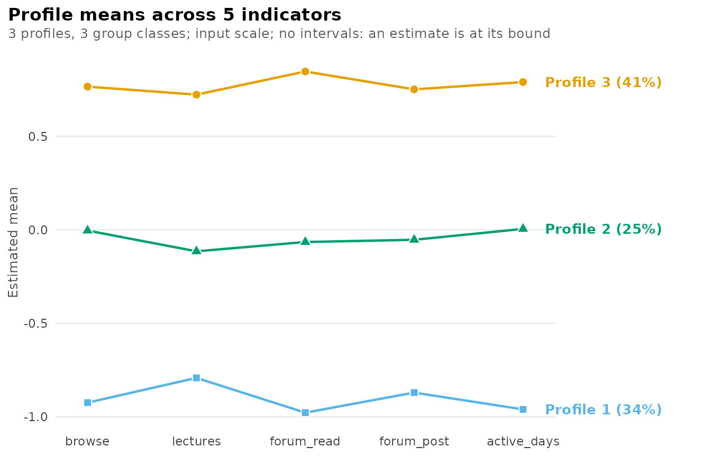
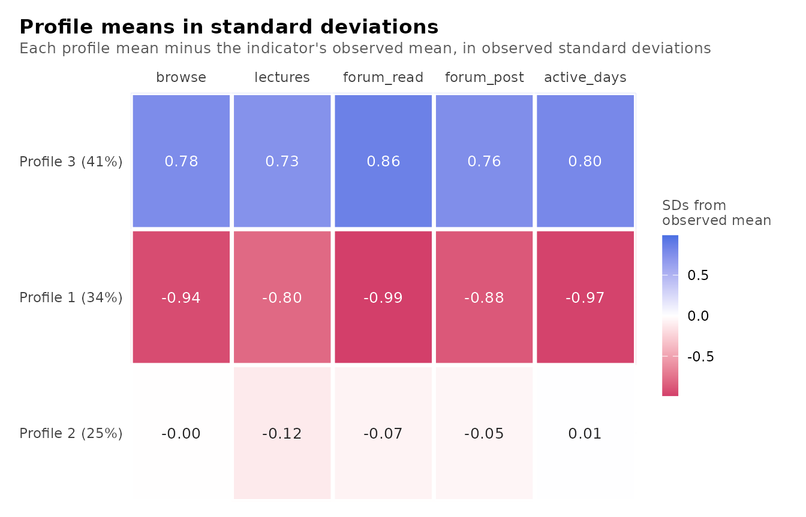
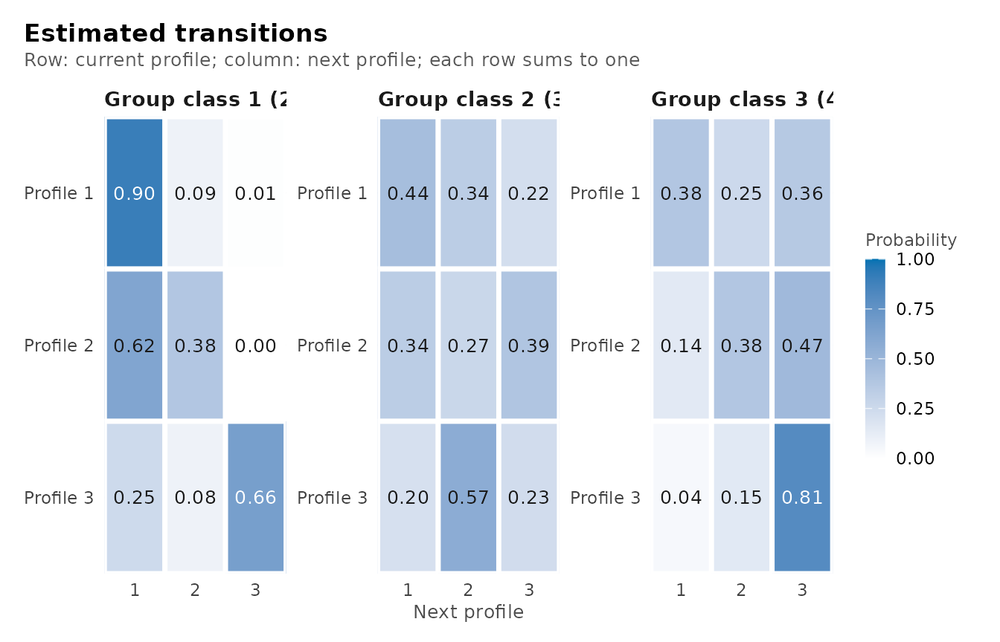
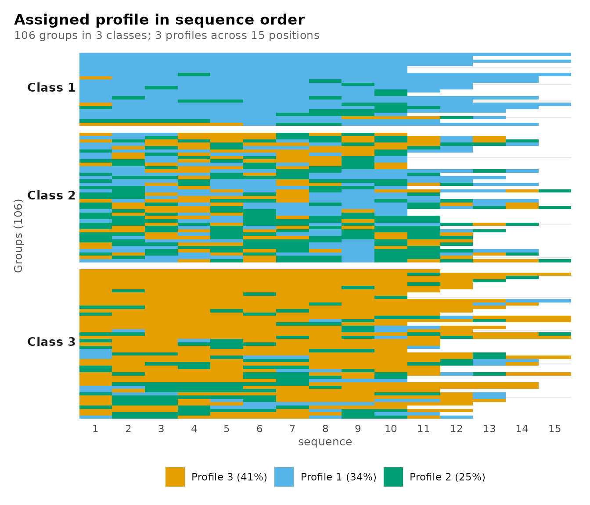
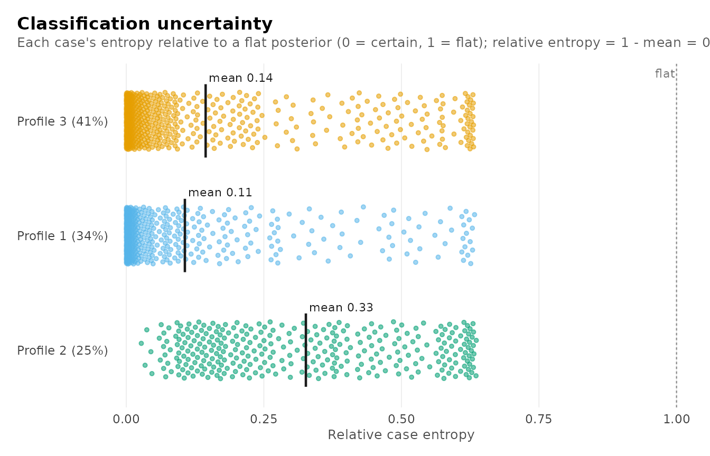
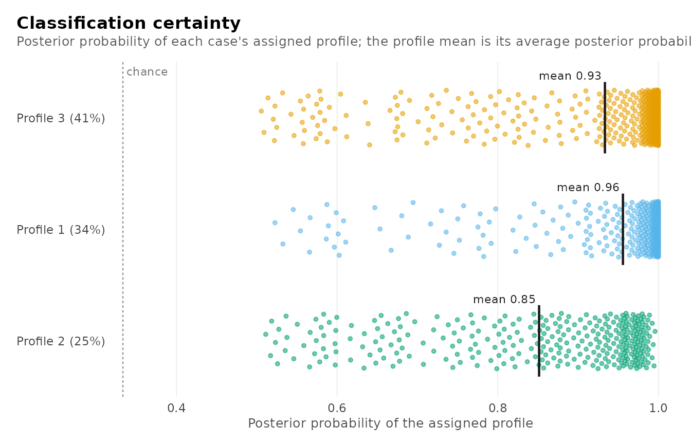
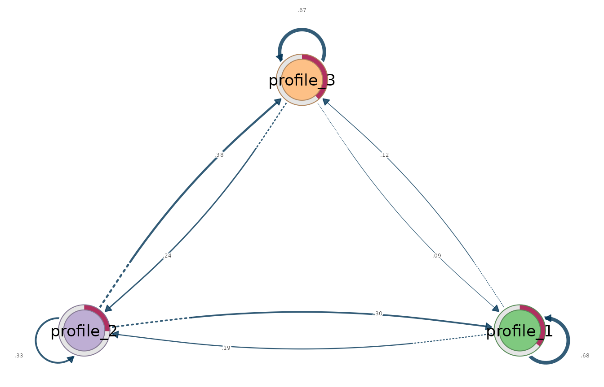
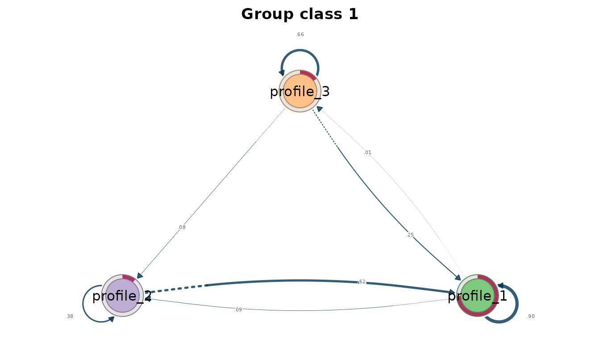
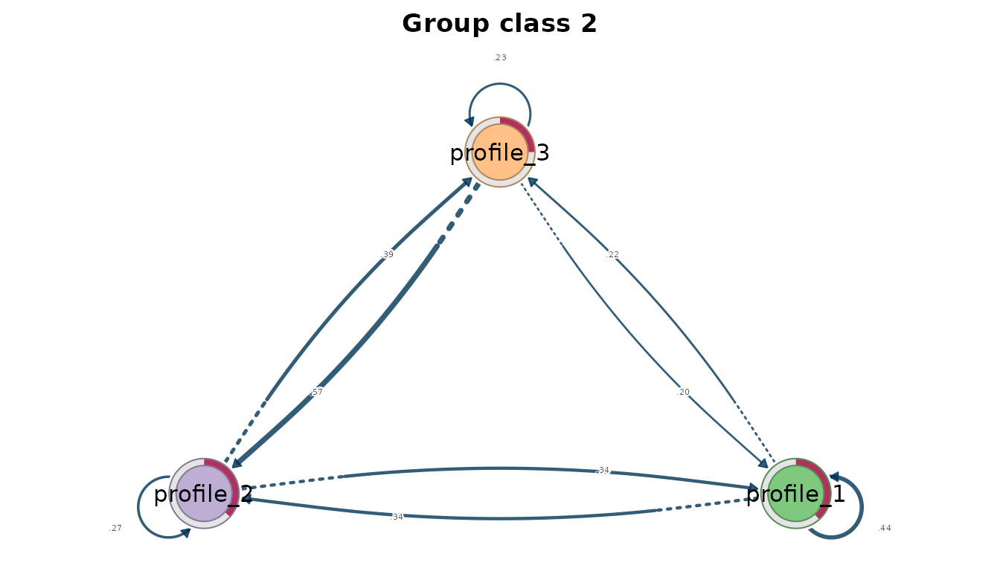
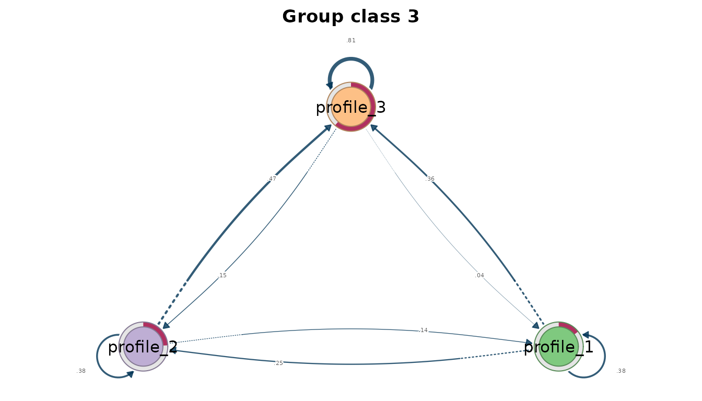

# Case study: Latent transition analysis of course engagement with the latents R package

Latent transition analysis (LTA) estimates the probability of moving
from one latent profile to another between consecutive occasions
(Collins & Lanza, 2010). With group classes, each class has its own
starting distribution and its own transition matrix, so the classes
separate students who differ in how their engagement changes from
students who differ only in where it starts.

## Data and model

`engagement_momentum` holds 1,310 course enrolments of 106 students,
ordered within each student by `sequence`. The five indicators are
simulated as continuous values on a log-activity scale and standardized
within course. The data are synthetic and follow the design of the
engagement studies of Saqr and López-Pernas (2021) and López-Pernas and
Saqr (2024), which identified course-level engagement states with latent
class analysis and followed students’ sequences of states across a
program. In the simulation, each student follows one of three
trajectories (engaged, fluctuating or mostly disengaged), each a
first-order Markov chain over three engagement states (active, average
and disengaged). Engaged students show momentum, in that an active
course tends to be followed by another active course; mostly disengaged
students show inertia, in that a disengaged course tends to be followed
by another disengaged course. Three profiles and three student classes
therefore match the structure from which the data were generated, and
the [evaluation
vignette](https://pak.dynasite.org/latents/articles/case-engagement-evaluation.md)
shows that the BIC selects the same numbers for the multilevel profile
model.

For student $`i`$ at course position $`t`$, $`C_{it}`$ is the latent
profile and $`G_i`$ the student’s class. The model estimates

- the initial probabilities $`\delta_{k\mid m}=P(C_{i1}=k\mid G_i=m)`$,
- the transition probabilities
  $`a_{kl\mid m}=P(C_{i,t+1}=l\mid C_{it}=k,G_i=m)`$, which sum to one
  across destinations $`l`$,
- and a Gaussian mean and variance for each profile and indicator.

The transitions are first order and homogeneous: the next profile
depends only on the current profile and the student’s class, and the
probabilities are the same at every position. Profile means and
variances are shared across positions and classes, so a change of
profile is a change of state. Indicators are independent within a
profile under the default diagonal covariance. The fit can fail to reach
the global maximum from a single start, and a transition that is rare
within a class is estimated from little information; the expected count
of each transition shows how much.

``` r

library(latents)
vars <- c("browse", "lectures", "forum_read", "forum_post", "active_days")

moves <- lta(engagement_momentum, vars, "student", n_profiles = 3,
             n_group_classes = 3, time = "sequence", n_starts = 10, seed = 1)
#> Warning: An initial, transition or group-class probability is at its numerical boundary; Wald
#> inference is withheld.
get_results(moves, "starts")
#>    start log_likelihood converged iterations error
#> 1      1          -7444      TRUE         43  <NA>
#> 2      2          -7444      TRUE         47  <NA>
#> 3      3          -7444      TRUE         30  <NA>
#> 4      4          -7444      TRUE         46  <NA>
#> 5      5          -7444      TRUE         26  <NA>
#> 6      6          -7444      TRUE         38  <NA>
#> 7      7          -7444      TRUE         30  <NA>
#> 8      8          -7444      TRUE         46  <NA>
#> 9      9          -7444      TRUE         30  <NA>
#> 10    10          -7444      TRUE         39  <NA>
```

All ten starts converge to the same log likelihood, so the solution is
replicated within this seed’s starts. The warning reports that one
estimated probability lies at its numerical boundary; the section on
sparse and boundary estimates below identifies it.

## The profiles

[`plot_profiles()`](https://pak.dynasite.org/latents/reference/plot_profiles.md)
draws the profile means across the indicators, and each line’s label
gives the profile’s share of the enrolments.

``` r

plot_profiles(moves)
```



``` r

get_results(moves)
#>    profile   indicator      mean variance standard_deviation mean_standard_error
#> 1        1      browse -0.923714   0.3678             0.6065             0.03168
#> 2        1    lectures -0.791300   0.4152             0.6443             0.03251
#> 3        1  forum_read -0.977232   0.2957             0.5438             0.02844
#> 4        1  forum_post -0.869964   0.3856             0.6210             0.03222
#> 5        1 active_days -0.959655   0.3397             0.5828             0.03129
#> 6        2      browse -0.003945   0.4593             0.6777             0.05270
#> 7        2    lectures -0.114705   0.5683             0.7539             0.05394
#> 8        2  forum_read -0.065051   0.4242             0.6513             0.05302
#> 9        2  forum_post -0.053149   0.4361             0.6604             0.04942
#> 10       2 active_days  0.005032   0.4118             0.6417             0.04873
#> 11       3      browse  0.765447   0.4967             0.7048             0.03439
#> 12       3    lectures  0.722691   0.6362             0.7976             0.03910
#> 13       3  forum_read  0.846368   0.3607             0.6006             0.03040
#> 14       3  forum_post  0.750965   0.5959             0.7719             0.03750
#> 15       3 active_days  0.789730   0.4552             0.6747             0.03422
#>    variance_standard_error
#> 1                  0.02681
#> 2                  0.02908
#> 3                  0.02226
#> 4                  0.02792
#> 5                  0.02642
#> 6                  0.04686
#> 7                  0.05225
#> 8                  0.04176
#> 9                  0.04283
#> 10                 0.04271
#> 11                 0.03299
#> 12                 0.04223
#> 13                 0.02446
#> 14                 0.03863
#> 15                 0.03178
```

Profile 1 is the disengaged state, Profile 2 the average state and
Profile 3 the active state, with means of days active of -0.960, 0.005
and 0.790 standard deviations from the course mean. The heatmap shows
the same means as standard deviations from each indicator’s grand mean.

``` r

plot_profiles(moves, what = "heatmap")
```



The contrast between profiles is present on all five indicators, so the
profiles differ in overall activity more than in its composition.

## Where students start

In the `"initial"` table, `probability` is $`\delta_{k\mid m}`$, the
chance of starting in each profile. `prevalence` is the expected share
of all of a class’s enrolments in that profile, across the whole
history, and `group_class_probability` is the share of students in the
class.

``` r

get_results(moves, "initial")
#>   group_class profile probability prevalence group_class_probability
#> 1           1       1      0.7461    0.82094                  0.2178
#> 2           1       2      0.1063    0.12384                  0.2178
#> 3           1       3      0.1476    0.05522                  0.2178
#> 4           2       1      0.3834    0.33770                  0.3408
#> 5           2       2      0.3665    0.37729                  0.3408
#> 6           2       3      0.2501    0.28501                  0.3408
#> 7           3       1      0.1451    0.10101                  0.4414
#> 8           3       2      0.2421    0.21144                  0.4414
#> 9           3       3      0.6128    0.68755                  0.4414
```

Student class 1, with 21.8% of students, starts in the disengaged
profile with probability 0.746, and 0.821 of its enrolments are expected
there over the whole history. Class 3, with 44.1% of students, starts in
the active profile with probability 0.613, and 0.688 of its enrolments
are expected there. Class 2, with 34.1% of students, starts across all
three profiles, with probabilities 0.383, 0.367 and 0.250, and spends
its enrolments in similar proportions. Class 1 is therefore the mostly
disengaged class, class 2 the fluctuating class and class 3 the engaged
class. In classes 1 and 3, the expected share of enrolments in the
dominant profile exceeds the probability of starting there: over the
program, students drift towards the state that their class favours.

## How engagement changes

The `"transitions"` table gives $`a_{kl\mid m}`$ for every class and
pair of profiles. `stable` marks staying in the same profile.
`expected_count` is the posterior expected number of such transitions in
the data, so it can be fractional, and it shows how much information
supports each estimate. `estimated = FALSE` would mark a row the data
cannot inform, because the profile is never occupied before a student’s
last course; such a row holds uniform placeholder values. Every row is
estimated in this fit.

``` r

get_results(moves, "transitions")
#>    group_class from to probability expected_count origin_expected_count supported stable estimated
#> 1            1    1  1   9.035e-01      1.963e+02                217.22      TRUE   TRUE      TRUE
#> 2            1    1  2   8.718e-02      1.894e+01                217.22      TRUE  FALSE      TRUE
#> 3            1    1  3   9.299e-03      2.020e+00                217.22      TRUE  FALSE      TRUE
#> 4            1    2  1   6.171e-01      2.141e+01                 34.70      TRUE  FALSE      TRUE
#> 5            1    2  2   3.829e-01      1.329e+01                 34.70      TRUE   TRUE      TRUE
#> 6            1    2  3   2.284e-08      4.974e-07                 34.70      TRUE  FALSE      TRUE
#> 7            1    3  1   2.503e-01      4.007e+00                 16.01      TRUE  FALSE      TRUE
#> 8            1    3  2   8.482e-02      1.358e+00                 16.01      TRUE  FALSE      TRUE
#> 9            1    3  3   6.649e-01      1.064e+01                 16.01      TRUE   TRUE      TRUE
#> 10           2    1  1   4.422e-01      5.979e+01                135.23      TRUE   TRUE      TRUE
#> 11           2    1  2   3.376e-01      4.565e+01                135.23      TRUE  FALSE      TRUE
#> 12           2    1  3   2.202e-01      2.978e+01                135.23      TRUE  FALSE      TRUE
#> 13           2    2  1   3.370e-01      5.108e+01                151.58      TRUE  FALSE      TRUE
#> 14           2    2  2   2.700e-01      4.093e+01                151.58      TRUE   TRUE      TRUE
#> 15           2    2  3   3.930e-01      5.957e+01                151.58      TRUE  FALSE      TRUE
#> 16           2    3  1   2.035e-01      2.378e+01                116.83      TRUE  FALSE      TRUE
#> 17           2    3  2   5.657e-01      6.610e+01                116.83      TRUE  FALSE      TRUE
#> 18           2    3  3   2.307e-01      2.695e+01                116.83      TRUE   TRUE      TRUE
#> 19           3    1  1   3.821e-01      1.902e+01                 49.78      TRUE   TRUE      TRUE
#> 20           3    1  2   2.541e-01      1.265e+01                 49.78      TRUE  FALSE      TRUE
#> 21           3    1  3   3.638e-01      1.811e+01                 49.78      TRUE  FALSE      TRUE
#> 22           3    2  1   1.431e-01      1.647e+01                115.06      TRUE  FALSE      TRUE
#> 23           3    2  2   3.835e-01      4.412e+01                115.06      TRUE   TRUE      TRUE
#> 24           3    2  3   4.734e-01      5.447e+01                115.06      TRUE  FALSE      TRUE
#> 25           3    3  1   4.416e-02      1.623e+01                367.59      TRUE  FALSE      TRUE
#> 26           3    3  2   1.479e-01      5.437e+01                367.59      TRUE  FALSE      TRUE
#> 27           3    3  3   8.079e-01      2.970e+02                367.59      TRUE   TRUE      TRUE
#>    group_class_probability
#> 1                   0.2178
#> 2                   0.2178
#> 3                   0.2178
#> 4                   0.2178
#> 5                   0.2178
#> 6                   0.2178
#> 7                   0.2178
#> 8                   0.2178
#> 9                   0.2178
#> 10                  0.3408
#> 11                  0.3408
#> 12                  0.3408
#> 13                  0.3408
#> 14                  0.3408
#> 15                  0.3408
#> 16                  0.3408
#> 17                  0.3408
#> 18                  0.3408
#> 19                  0.4414
#> 20                  0.4414
#> 21                  0.4414
#> 22                  0.4414
#> 23                  0.4414
#> 24                  0.4414
#> 25                  0.4414
#> 26                  0.4414
#> 27                  0.4414
```

The transition plot draws each class’s matrix as a heatmap, with the
origin profile in rows and the destination in columns.

``` r

plot_transitions(moves)
```



In class 1, a disengaged course is followed by another disengaged course
with probability 0.904, estimated from 196 expected transitions, and an
average course is followed by a disengaged one with probability 0.617
(from 34.7 expected transitions): disengagement has inertia, and the
average state leads back into it. In class 3, an active course is
followed by another active course with probability 0.808, estimated from
297 expected transitions, and an average course is followed by an active
one with probability 0.473: engagement has momentum. Class 2 has no
dominant transition; its largest probability, 0.566, takes an active
course to an average one, and its other probabilities lie between 0.20
and 0.44. These are the patterns of the generating model, in which
disengagement and activity persist with probability 0.85 in the
corresponding trajectories, and the fluctuating trajectory moves between
states with probabilities between 0.25 and 0.40.

## Sparse and boundary estimates

Some estimates rest on little information. Students in class 1 rarely
occupy the active profile, so its transitions out of the active profile
rest on 16.0 expected transitions and those out of the average profile
on 34.7. Its probability of moving from the average to the active
profile is at its lower bound, which is why Wald inference is withheld
for this fit. A probability near zero shows that the data carry little
information about that movement, not that the movement is impossible: in
the generating model, mostly disengaged students move from the average
to the active state with probability 0.10. Estimates like these can also
mean that the chosen number of classes divides the available transitions
too finely.

## Assigned sequences

The sequence plot shows each student’s modal profile at each course
position, one row per student. Modal assignment discards classification
uncertainty.

``` r

plot_sequences(moves)
```



``` r

get_results(moves, "sequence_summary")
#>   group_class groups observations mean_length median_length shortest longest complete gaps
#> 1           1     22          278       12.64          12.5       10      15        4    0
#> 2           2     39          473       12.13          12.0       10      15        3    0
#> 3           3     45          559       12.42          12.0       10      15        8    0
```

The summary gives the number of students and courses in each assigned
class: 22 students with 278 courses in class 1, 39 with 473 in class 2
and 45 with 559 in class 3. Sequence lengths range from 10 to 15
courses, so the rows of the plot end at different positions. The long
runs of the disengaged profile in class 1 and of the active profile in
class 3 are the inertia and momentum of the transition table, seen in
the individual histories.

## Classification uncertainty

``` r

get_results(moves, "entropy")
#>         level n_classes n_units entropy_sum relative_entropy
#> 1 individuals         3    1310      252.04           0.8249
#> 2      groups         3     106       26.32           0.7740
```

Relative entropy is 0.825 for enrolments and 0.774 for students. The
entropy plot shows, within each profile, how the per-case entropy
contributions are distributed, and the posterior plot shows the
posterior probability of each case’s assigned profile.

``` r

plot_diagnostics(moves, what = "entropy")
```



``` r

plot_diagnostics(moves, what = "posteriors")
```



Both levels retain uncertainty, so an analysis that replaces the
posteriors by modal assignments treats some enrolments and students as
more certain than the model estimates them to be.

## Transition networks

[`get_tna()`](https://pak.dynasite.org/latents/reference/get_tna.md)
returns the marginal transition matrix as a model of the tna package
(Tikka et al., 2025). It pools the posterior expected transition counts
across classes and normalizes them, so it uses the estimated
transitions, not transitions counted from modal assignments.
[`get_group_tna()`](https://pak.dynasite.org/latents/reference/get_group_tna.md)
returns one network per class.

``` r

network <- get_tna(moves)
plot(network)
```



``` r

per_class <- get_group_tna(moves)
plot(per_class)
```



The class networks show the patterns of the transition table: a dominant
self-loop on the disengaged profile in class 1, movement among all three
profiles in class 2, and a dominant self-loop on the active profile in
class 3.

## Recovery of the generating structure

The same check against the generating states and trajectories as in the
[introductory
vignette](https://pak.dynasite.org/latents/articles/case-engagement-profiles.md)
applies to the transition model.

``` r

get_results(moves, "assignments", data = engagement_momentum,
            truth = c("state", "trajectory"))
#>     assignment class      truth             value   n proportion
#> 1      profile     1      state            active   0    0.00000
#> 2      profile     2      state            active  37    0.06740
#> 3      profile     3      state            active 512    0.93260
#> 4      profile     1      state           average  30    0.09288
#> 5      profile     2      state           average 258    0.79876
#> 6      profile     3      state           average  35    0.10836
#> 7      profile     1      state        disengaged 418    0.95434
#> 8      profile     2      state        disengaged  20    0.04566
#> 9      profile     3      state        disengaged   0    0.00000
#> 10 group_class     1 trajectory           engaged   1    0.02326
#> 11 group_class     2 trajectory           engaged   4    0.09302
#> 12 group_class     3 trajectory           engaged  38    0.88372
#> 13 group_class     1 trajectory       fluctuating   1    0.02439
#> 14 group_class     2 trajectory       fluctuating  33    0.80488
#> 15 group_class     3 trajectory       fluctuating   7    0.17073
#> 16 group_class     1 trajectory mostly_disengaged  20    0.90909
#> 17 group_class     2 trajectory mostly_disengaged   2    0.09091
#> 18 group_class     3 trajectory mostly_disengaged   0    0.00000
```

The transition model recovers the states as well as the multilevel
profile model does: 93.3%, 79.9% and 95.4% of the active, average and
disengaged enrolments, against 92.9%, 79.9% and 94.7%. It recovers the
engaged and mostly disengaged trajectories about as well (88.4% and
90.9%, against 86.0% and 90.9%), but the fluctuating trajectory less
well (80.5%, against 95.1%).

## Limitations

The model assumes constant transition probabilities across course
positions, so change specific to one stage of the program is averaged
over positions; the simulated data satisfy this assumption, but applied
data need not. Transitions are between successive observed courses,
which can differ in duration, content and assessment. Class differences
describe patterns in engagement histories and do not identify their
causes. Wald standard errors are withheld for this fit because class 1’s
probability of moving from the average to the active profile sits at its
lower bound, and the numbers of profiles and classes were not compared
for the transition model here;
[`enumerate_classes()`](https://pak.dynasite.org/latents/reference/enumerate_classes.md)
with `time` compares transition models over a grid of profile and class
counts. Transitions supported by few expected counts, such as those out
of the active profile in class 1, should not be interpreted.

## References

Collins, L. M., & Lanza, S. T. (2010). *Latent class and latent
transition analysis*. Wiley.

López-Pernas, S., & Saqr, M. (2024). How the dynamics of engagement
explain the momentum of achievement and the inertia of disengagement: A
complex systems theory approach. *Computers in Human Behavior, 153*,
108126. <https://doi.org/10.1016/j.chb.2023.108126>

Saqr, M., & López-Pernas, S. (2021). The longitudinal trajectories of
online engagement over a full program. *Computers & Education, 175*,
104325. <https://doi.org/10.1016/j.compedu.2021.104325>

Tikka, S., López-Pernas, S., & Saqr, M. (2025). tna: An R package for
transition network analysis. *Applied Psychological Measurement, 49*(6),
326–328. <https://doi.org/10.1177/01466216251348840>
