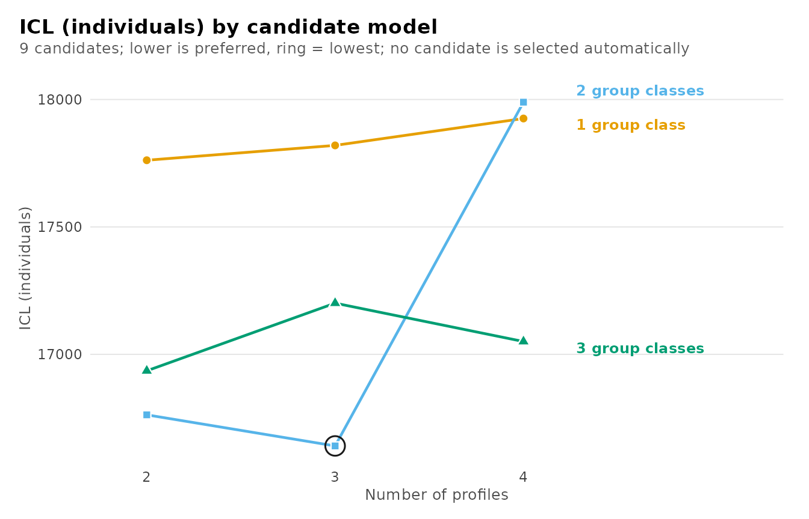
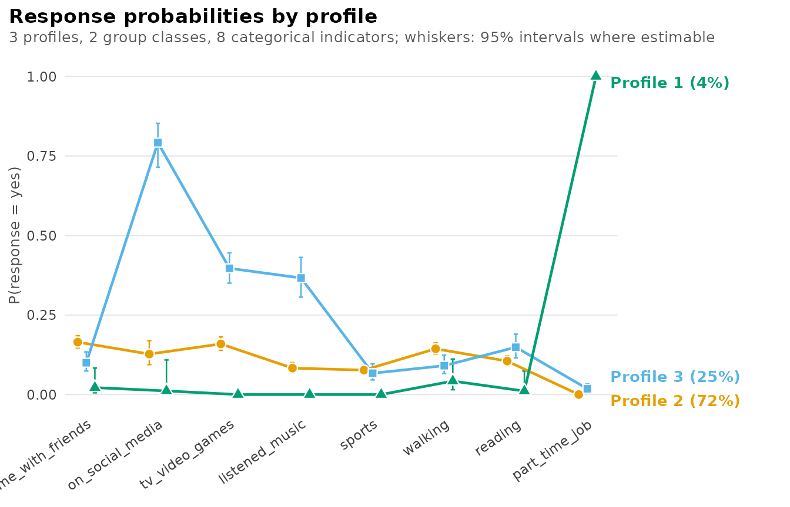
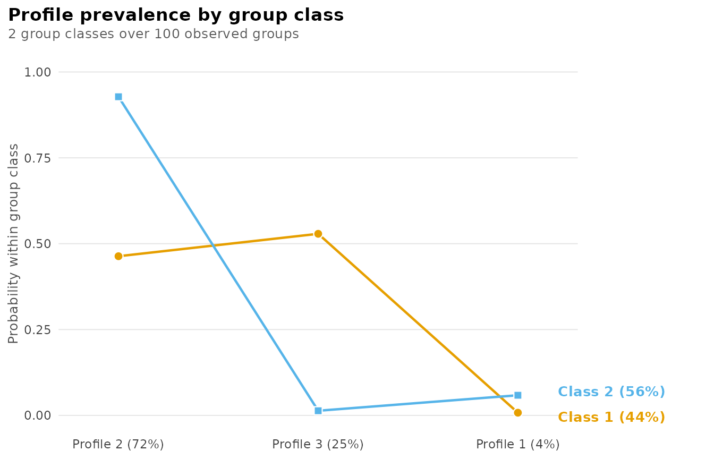

# Case study: Two-level latent class analysis of leisure activities

Two-level latent class analysis estimates latent classes of categorical
responses at the level of single observations and, above them, latent
group classes that differ in how probable each class is for their
observations. In the output the observation-level classes are called
profiles. Each profile is described by the probability of every answer
to every item; the group classes differ only in how often their
observations fall in each profile.

The question here is whether the leisure activities that university
students report in daily life form a small number of recurring patterns,
and whether students differ in how often they are in each pattern.

## Data

`student_esm` holds experience-sampling data from a study of university
students (Neubauer & Schmiedek, 2024). The students answered six prompts
a day for fourteen days. At each prompt when they had not studied since
the previous one, they reported which of eight leisure activities they
had done. The dataset holds these prompts for 100 students: 2,582
prompts, between 15 and 51 per student. Prompts are the observations and
students the groups, so a student contributes many rows.

The eight activities are yes/no items, and they are named once so that
each model can refer to them.

``` r

library(latents)
activities <- c("time_with_friends", "on_social_media", "tv_video_games",
                "listened_music", "sports", "walking", "reading",
                "part_time_job")
```

[`summary()`](https://rdrr.io/r/base/summary.html) counts the answers to
each activity item and summarizes the other variables.

``` r

summary(student_esm)
#>     student           day             beep      time_with_friends on_social_media tv_video_games
#>  Min.   :  1.0   Min.   : 0.00   Min.   :1.00   no :2211          no :1837        no :2033      
#>  1st Qu.: 27.0   1st Qu.: 3.00   1st Qu.:2.00   yes: 371          yes: 745        yes: 549      
#>  Median : 53.0   Median : 6.00   Median :3.00                                                   
#>  Mean   : 52.3   Mean   : 6.48   Mean   :3.06                                                   
#>  3rd Qu.: 79.0   3rd Qu.:10.00   3rd Qu.:4.00                                                   
#>  Max.   :100.0   Max.   :13.00   Max.   :5.00                                                   
#>  listened_music sports     walking    reading    part_time_job     happy         relaxed    
#>  no :2193       no :2397   no :2254   no :2291   no :2479      Min.   :1.00   Min.   :1.00  
#>  yes: 389       yes: 185   yes: 328   yes: 291   yes: 103      1st Qu.:4.00   1st Qu.:4.00  
#>                                                                Median :5.00   Median :5.00  
#>                                                                Mean   :4.88   Mean   :4.63  
#>                                                                3rd Qu.:6.00   3rd Qu.:6.00  
#>                                                                Max.   :7.00   Max.   :7.00  
#>     worried       exhausted   
#>  Min.   :1.00   Min.   :1.00  
#>  1st Qu.:1.00   1st Qu.:2.00  
#>  Median :2.00   Median :3.00  
#>  Mean   :2.29   Mean   :3.31  
#>  3rd Qu.:3.00   3rd Qu.:5.00  
#>  Max.   :7.00   Max.   :7.00
```

Social media is the most frequent activity, reported at 745 of the 2,582
prompts, followed by TV or video games at 549. A part-time job is the
rarest, at 103 prompts. Every item is answered “no” at most prompts, so
a profile is described by how much more often than average its prompts
say “yes”.

## The model

For prompt $`t`$ of student $`i`$, let $`C_{it}`$ be the profile and
$`G_i`$ the student’s class. The model estimates three sets of
probabilities:

- the response probabilities $`\theta_{kjc}=P(Y_{itj}=c\mid C_{it}=k)`$
  of each answer $`c`$ to item $`j`$ in profile $`k`$, the same in every
  student class;
- the profile probabilities $`\pi_{k\mid m}=P(C_{it}=k\mid G_i=m)`$ of
  each student class $`m`$, which sum to one across profiles;
- the class probabilities $`\omega_m=P(G_i=m)`$.

The items are assumed independent given the profile, the prompts of a
student independent given the student’s class, and the students
independent of one another. The likelihood can have several local
maxima, so each model is started from several random values. A rare
answer can drive a response probability to its lower bound, and too many
profiles or classes for the data show up as starts that fail to reach
the same maximum.

## How many profiles and classes

[`enumerate_classes()`](https://pak.dynasite.org/latents/reference/enumerate_classes.md)
fits every combination of two to four profiles and one to three student
classes, each from twenty random starts with a tight convergence
tolerance, and reports the information criteria and the diagnostics of
each fit. It does not choose a model.

``` r

candidates <- enumerate_classes(student_esm, vars = activities,
                                categorical = activities, id = "student",
                                n_profiles = 2:4, n_group_classes = 1:3,
                                n_starts = 20, tol = 1e-10, seed = 1)
#> 2 of 9 candidates reached their best log likelihood from one start only (classes3_groups3, classes4_groups3); refit those you consider with more starts.
as.data.frame(candidates)
#>          candidate n_profiles n_group_classes model log_likelihood n_parameters   aic   kic
#> 1 classes2_groups1          2               1  <NA>          -7892           17 15819 15839
#> 2 classes3_groups1          3               1  <NA>          -7848           26 15749 15778
#> 3 classes4_groups1          4               1  <NA>          -7807           35 15683 15721
#> 4 classes2_groups2          2               2  <NA>          -7740           19 15518 15540
#> 5 classes3_groups2          3               2  <NA>          -7678           29 15414 15446
#> 6 classes4_groups2          4               2  <NA>          -7634           39 15346 15388
#> 7 classes2_groups3          2               3  <NA>          -7710           21 15462 15486
#> 8 classes3_groups3          3               3  <NA>          -7582           32 15228 15263
#> 9 classes4_groups3          4               3  <NA>          -7520           43 15126 15172
#>   bic_groups bic_individual sabic_groups sabic_individual caic_groups caic_individual awe_groups
#> 1      15863          15918        15809            15864       15880           15935      17836
#> 2      15817          15901        15735            15819       15843           15927      17933
#> 3      15774          15888        15664            15777       15809           15923      18078
#> 4      15567          15629        15507            15569       15586           15648      16845
#> 5      15490          15584        15398            15492       15519           15613      16767
#> 6      15447          15574        15324            15450       15486           15613      18159
#> 7      15517          15585        15450            15518       15538           15606      17027
#> 8      15312          15416        15211            15314       15344           15448      17340
#> 9      15238          15377        15102            15241       15281           15420      17238
#>   awe_individual icl_groups icl_individual clc_groups clc_individual profile_entropy group_entropy
#> 1          17946      17706          17762      17628          17628           0.485            NA
#> 2          18102      17735          17820      17616          17616           0.662            NA
#> 3          18305      17812          17925      17650          17650           0.715            NA
#> 4          16969      16701          16763      16613          16613           0.668         0.877
#> 5          16956      16546          16641      16413          16413           0.804         0.878
#> 6          18413      17863          17989      17683          17683           0.652         0.914
#> 7          17163      16867          16935      16770          16770           0.609         0.814
#> 8          17548      17097          17201      16950          16950           0.660         0.914
#> 9          17517      16911          17050      16713          16713           0.745         0.908
#>   avepp_min avepp_max avepp_mean avepp_below group_avepp_min group_avepp_max group_avepp_mean
#> 1     0.705     0.939      0.822           1              NA              NA               NA
#> 2     0.705     0.952      0.863           1              NA              NA               NA
#> 3     0.713     0.955      0.830           2              NA              NA               NA
#> 4     0.859     0.926      0.892           0           0.960           0.980            0.970
#> 5     0.858     0.991      0.927           0           0.952           0.971            0.962
#> 6     0.630     0.992      0.819           1           0.974           0.986            0.980
#> 7     0.878     0.888      0.883           0           0.885           0.931            0.912
#> 8     0.828     0.888      0.853           0           0.941           0.980            0.967
#> 9     0.813     0.991      0.887           0           0.948           0.970            0.957
#>   group_avepp_below converged boundary min_standardized_eigenvalue min_gaussian_mass
#> 1                NA      TRUE    FALSE                          NA                NA
#> 2                NA      TRUE     TRUE                          NA                NA
#> 3                NA      TRUE     TRUE                          NA                NA
#> 4                 0      TRUE    FALSE                          NA                NA
#> 5                 0      TRUE     TRUE                          NA                NA
#> 6                 0      TRUE     TRUE                          NA                NA
#> 7                 0      TRUE    FALSE                          NA                NA
#> 8                 0      TRUE     TRUE                          NA                NA
#> 9                 0      TRUE     TRUE                          NA                NA
#>   n_best_replicated warnings error
#> 1                18           <NA>
#> 2                 5           <NA>
#> 3                 3           <NA>
#> 4                13           <NA>
#> 5                 2           <NA>
#> 6                 2           <NA>
#> 7                20           <NA>
#> 8                 1           <NA>
#> 9                 1           <NA>
get_results(candidates, "best")
#>    criterion  convention        candidate n_profiles n_group_classes model value
#> 1        aic        <NA> classes4_groups3          4               3  <NA> 15126
#> 2        kic        <NA> classes4_groups3          4               3  <NA> 15172
#> 3        bic      groups classes4_groups3          4               3  <NA> 15238
#> 4        bic individuals classes4_groups3          4               3  <NA> 15377
#> 5      sabic      groups classes4_groups3          4               3  <NA> 15102
#> 6      sabic individuals classes4_groups3          4               3  <NA> 15241
#> 7       caic      groups classes4_groups3          4               3  <NA> 15281
#> 8       caic individuals classes4_groups3          4               3  <NA> 15420
#> 9        awe      groups classes3_groups2          3               2  <NA> 16767
#> 10       awe individuals classes3_groups2          3               2  <NA> 16956
#> 11       icl      groups classes3_groups2          3               2  <NA> 16546
#> 12       icl individuals classes3_groups2          3               2  <NA> 16641
#> 13       clc      groups classes3_groups2          3               2  <NA> 16413
#> 14       clc individuals classes3_groups2          3               2  <NA> 16413
```

The criteria disagree, and the diagnostics explain why. BIC with the
number of students keeps falling up to the largest model in the grid,
four profiles and three classes. That model and the one with three
profiles and three classes reach their best solution from a single start
(`n_best_replicated`), so their low BIC rests on solutions that the
starts do not replicate. The criteria that also penalize classification
uncertainty (ICL, AWE and CLC counted over prompts) choose three
profiles and two classes, a model whose best solution recurs in 2 of the
twenty starts.

The number of starts is part of the analysis on these data. With five
starts and the default tolerance, the three-profile, two-class model
stops at a lower maximum of the likelihood, and the same criteria then
choose two profiles and two classes.

The ICL plot shows the choice across the grid.

``` r

plot_enumeration(candidates, what = "icl_individual")
```



The plot marks the minimum at three profiles and two classes, and the
analysis continues with that model.

## The chosen model

[`multilca()`](https://pak.dynasite.org/latents/reference/multilca.md)
fits it, treating every item as categorical, with twenty random starts
and a tight convergence tolerance, which the standard errors below need.

``` r

lca <- multilca(student_esm, vars = activities, id = "student",
                n_profiles = 3, n_group_classes = 2, n_starts = 20,
                tol = 1e-10, seed = 1)
get_results(lca, "model")
#>   n_observations n_informative n_groups n_profiles n_group_classes centering scaling
#> 1           2582          2582      100          3               2      none    none
#>   covariance_structure n_parameters n_parameters_with_measurement log_likelihood   aic bic_groups
#> 1                  VVI           29                            29          -7678 15414      15490
#>   bic_individual converged iterations boundary small_classes best_start n_best_replicated weights
#> 1          15584      TRUE         81    FALSE         FALSE         16                 2    <NA>
```

The fit converges, and 2 of the twenty starts reach the best log
likelihood of -7678.

## Three activity profiles

The `"responses"` table gives the probability of each answer in each
profile, with a “no” and a “yes” row for every item. The “yes” rows
carry the information, since the two probabilities of an item sum to
one.

``` r

get_results(lca, "responses")
#>    profile         indicator category probability threshold probability_standard_error
#> 1        1 time_with_friends       no    9.78e-01     3.801                    0.01531
#> 2        2 time_with_friends       no    8.35e-01     1.622                    0.00972
#> 3        3 time_with_friends       no    9.00e-01     2.196                    0.01522
#> 4        1 time_with_friends      yes    2.19e-02        NA                    0.01531
#> 5        2 time_with_friends      yes    1.65e-01        NA                    0.00972
#> 6        3 time_with_friends      yes    1.00e-01        NA                    0.01522
#> 7        1   on_social_media       no    9.89e-01     4.468                    0.01353
#> 8        2   on_social_media       no    8.73e-01     1.926                    0.01911
#> 9        3   on_social_media       no    2.08e-01    -1.337                    0.03519
#> 10       1   on_social_media      yes    1.13e-02        NA                    0.01353
#> 11       2   on_social_media      yes    1.27e-01        NA                    0.01911
#> 12       3   on_social_media      yes    7.92e-01        NA                    0.03519
#> 13       1    tv_video_games       no    1.00e+00    23.026                         NA
#> 14       2    tv_video_games       no    8.41e-01     1.665                    0.01077
#> 15       3    tv_video_games       no    6.03e-01     0.419                    0.02436
#> 16       1    tv_video_games      yes    1.00e-10        NA                         NA
#> 17       2    tv_video_games      yes    1.59e-01        NA                    0.01077
#> 18       3    tv_video_games      yes    3.97e-01        NA                    0.02436
#> 19       1    listened_music       no    1.00e+00    23.026                         NA
#> 20       2    listened_music       no    9.17e-01     2.402                    0.00821
#> 21       3    listened_music       no    6.34e-01     0.547                    0.03200
#> 22       1    listened_music      yes    1.00e-10        NA                         NA
#> 23       2    listened_music      yes    8.31e-02        NA                    0.00821
#> 24       3    listened_music      yes    3.66e-01        NA                    0.03200
#> 25       1            sports       no    1.00e+00    23.026                         NA
#> 26       2            sports       no    9.23e-01     2.486                    0.00684
#> 27       3            sports       no    9.33e-01     2.634                    0.01269
#> 28       1            sports      yes    1.00e-10        NA                         NA
#> 29       2            sports      yes    7.68e-02        NA                    0.00684
#> 30       3            sports      yes    6.70e-02        NA                    0.01269
#> 31       1           walking       no    9.58e-01     3.120                    0.02162
#> 32       2           walking       no    8.56e-01     1.784                    0.00912
#> 33       3           walking       no    9.09e-01     2.304                    0.01459
#> 34       1           walking      yes    4.23e-02        NA                    0.02162
#> 35       2           walking      yes    1.44e-01        NA                    0.00912
#> 36       3           walking      yes    9.08e-02        NA                    0.01459
#> 37       1           reading       no    9.89e-01     4.508                    0.01088
#> 38       2           reading       no    8.95e-01     2.141                    0.00802
#> 39       3           reading       no    8.51e-01     1.744                    0.01897
#> 40       1           reading      yes    1.09e-02        NA                    0.01088
#> 41       2           reading      yes    1.05e-01        NA                    0.00802
#> 42       3           reading      yes    1.49e-01        NA                    0.01897
#> 43       1     part_time_job       no    5.66e-09   -18.989                         NA
#> 44       2     part_time_job       no    1.00e+00    23.026                         NA
#> 45       3     part_time_job       no    9.82e-01     3.995                    0.00568
#> 46       1     part_time_job      yes    1.00e+00        NA                         NA
#> 47       2     part_time_job      yes    1.00e-10        NA                         NA
#> 48       3     part_time_job      yes    1.81e-02        NA                    0.00568
```

The three profiles differ in media use and in work. At prompts in
profile 3, students used social media with probability 0.792, watched TV
or played video games with probability 0.397, and listened to music with
probability 0.366. In profile 2 the same probabilities are 0.127, 0.159
and 0.083, and time with friends (0.165 against 0.100) and walking
(0.144 against 0.091) are somewhat more likely. Both report sports at
about 0.07. At prompts in profile 1 students worked at a part-time job
with probability 1.000 and reported every other activity with
probability below 0.05. Profile 3 is therefore a media-heavy pattern,
profile 2 a pattern of little media use with the remaining activities at
their usual low rates, and profile 1 a pattern of work with little else.

The response plot draws the same probabilities, one line per profile
across the items.

``` r

plot_responses(lca)
```



The media-heavy and low-media lines separate on the three media items
and nearly coincide on sports, while the work profile stands apart on
the part-time job item.

## Two student classes

The `"counts"` table gives the size of each profile and class, and the
`"profile_probabilities"` table the profile mix of each student class.

``` r

get_results(lca, "counts")
#>         level class effective_count effective_proportion
#> 1 individuals     1            91.4               0.0354
#> 2 individuals     2          1848.0               0.7157
#> 3 individuals     3           642.6               0.2489
#> 4      groups     1            43.6               0.4357
#> 5      groups     2            56.4               0.5643
get_results(lca, "profile_probabilities")
#>   group_class profile probability group_class_probability
#> 1           1       1     0.00778                   0.436
#> 2           1       2     0.46348                   0.436
#> 3           1       3     0.52874                   0.436
#> 4           2       1     0.05862                   0.564
#> 5           2       2     0.92787                   0.564
#> 6           2       3     0.01351                   0.564
```

The low-media profile holds 71.6% of prompts, the media-heavy profile
24.9% and the work profile 3.5%. The student classes differ sharply in
their mix. In class 2, which holds 56.4% of students, 0.928 of prompts
fall in the low-media profile, 0.059 in the work profile and only 0.014
in the media-heavy one. In class 1, with 43.6% of students, the
media-heavy profile is the more common, at 0.529, and the work profile
almost absent, at 0.008. Media-heavy leisure is therefore concentrated
in a minority of students, and for them it is the usual pattern, while
most students almost never report it. Part-time work appears mainly
among the students of the low-media class.

The probability plot compares the two mixes.

``` r

plot_prevalence(lca)
```



Class 2 runs close to one on the low-media profile and close to zero on
the media-heavy one; class 1 divides its prompts between those two
profiles, with the larger share on the media-heavy profile.

## Classification certainty

Profiles and classes are estimated as posterior probabilities. Relative
entropy summarizes how concentrated those probabilities are, from 0 for
no separation to 1 for certain assignment, and the `"classification"`
table reports the average posterior probability of each assigned class.

``` r

get_results(lca, "entropy")
#>         level n_classes n_units entropy_sum relative_entropy
#> 1 individuals         3    2582      556.82            0.804
#> 2      groups         2     100        8.48            0.878
get_results(lca, "classification")
#>         level class n_modal proportion_modal estimated_n estimated_proportion average_posterior
#> 1 individuals     1      92           0.0356        91.4               0.0354             0.991
#> 2 individuals     2    1896           0.7343      1848.0               0.7157             0.930
#> 3 individuals     3     594           0.2301       642.6               0.2489             0.858
#> 4      groups     1      42           0.4200        43.6               0.4357             0.971
#> 5      groups     2      58           0.5800        56.4               0.5643             0.952
#>   odds_correct_classification
#> 1                      3110.0
#> 2                         5.3
#> 3                        18.2
#> 4                        43.6
#> 5                        15.3
```

Relative entropy is 0.804 for prompts and 0.878 for students. A single
prompt answers eight yes/no questions, which leaves its profile less
certain; a student contributes many prompts, which pins down the class.
The average posterior probability is 0.991 for prompts assigned to the
work profile, 0.930 for the low-media profile and 0.858 for the
media-heavy one, and 0.952 and 0.971 for the two student classes.
Conclusions about students are therefore well supported, while an
analysis of individual prompts should carry the posterior probabilities
forward.

## Local independence

The model assumes the items are independent within a profile. The
`"residuals"` table measures the association that each pair of items
keeps within a profile, with a chi-square test for each pair; the ten
largest are shown.

``` r

get_results(lca, "residuals") |> head(10)
#>      profile       indicator_1    indicator_2        kind observed expected residual effective_n
#> 1  profile_1   on_social_media        walking categorical   0.4240 1.22e-17   0.4240        91.4
#> 2  profile_3            sports        walking categorical   0.1661 4.57e-17   0.1661       642.6
#> 3  profile_3 time_with_friends        walking categorical   0.1434 2.13e-16   0.1434       642.6
#> 4  profile_3    listened_music        walking categorical   0.1331 0.00e+00   0.1331       642.6
#> 5  profile_3    listened_music        reading categorical   0.1098 1.52e-16   0.1098       642.6
#> 6  profile_3    listened_music         sports categorical   0.1082 1.45e-16   0.1082       642.6
#> 7  profile_2    tv_video_games        walking categorical   0.0995 1.57e-16   0.0995      1848.0
#> 8  profile_3    tv_video_games  part_time_job categorical   0.0862 1.42e-16   0.0862       642.6
#> 9  profile_2 time_with_friends        reading categorical   0.0790 5.19e-17   0.0790      1848.0
#> 10 profile_2 time_with_friends tv_video_games categorical   0.0707 8.60e-17   0.0707      1848.0
#>    statistic df  p_value p_adjusted
#> 1      16.43  1 5.04e-05    0.00141
#> 2      17.73  1 2.55e-05    0.00107
#> 3      13.21  1 2.79e-04    0.00585
#> 4      11.38  1 7.43e-04    0.01040
#> 5       7.75  1 5.38e-03    0.05022
#> 6       7.52  1 6.09e-03    0.05118
#> 7      18.28  1 1.91e-05    0.00107
#> 8       4.77  1 2.90e-02    0.16212
#> 9      11.52  1 6.89e-04    0.01040
#> 10      9.23  1 2.38e-03    0.02856
```

The largest residual, 0.424, links social media and walking in the work
profile, which holds about 91 prompts, so it rests on few observations.
Next, in the media-heavy profile, come sports and walking (0.166),
friends and walking (0.143) and music and walking (0.133). Physical and
social activities occur together more often than three profiles allow,
which is one reason BIC rewards larger models: extra profiles can absorb
this association.

## Uncertainty in the response probabilities

[`parameter_inference()`](https://pak.dynasite.org/latents/reference/parameter_inference.md)
gives standard errors and 95% Wald intervals for every parameter.
Several response probabilities lie on their bound: the work profile
reports TV or games, music and sports with probability zero and a
part-time job with probability one, and the low-media profile reports a
part-time job with probability zero. Wald inference does not apply at a
bound, so `boundary = "fix"` holds these probabilities at their values,
leaves them out of the table and reports the other parameters
conditionally on them. The intervals of the “yes” probabilities, in the
rows whose `term` ends in `:yes`, show how firmly the profiles are
distinguished.

``` r

parameter_inference(lca, boundary = "fix")
#>          level       outcome                  term   parameter estimate standard_error statistic
#> 1  measurement     profile_1  time_with_friends:no    response  0.97814        0.01531        NA
#> 2  measurement     profile_1 time_with_friends:yes    response  0.02186        0.01531        NA
#> 3  measurement     profile_2  time_with_friends:no    response  0.83512        0.00972        NA
#> 4  measurement     profile_2 time_with_friends:yes    response  0.16488        0.00972        NA
#> 5  measurement     profile_3  time_with_friends:no    response  0.89992        0.01522        NA
#> 6  measurement     profile_3 time_with_friends:yes    response  0.10008        0.01522        NA
#> 7  measurement     profile_1    on_social_media:no    response  0.98866        0.01353        NA
#> 8  measurement     profile_1   on_social_media:yes    response  0.01134        0.01353        NA
#> 9  measurement     profile_2    on_social_media:no    response  0.87283        0.01911        NA
#> 10 measurement     profile_2   on_social_media:yes    response  0.12717        0.01911        NA
#> 11 measurement     profile_3    on_social_media:no    response  0.20802        0.03519        NA
#> 12 measurement     profile_3   on_social_media:yes    response  0.79198        0.03519        NA
#> 13 measurement     profile_2     tv_video_games:no    response  0.84092        0.01077        NA
#> 14 measurement     profile_2    tv_video_games:yes    response  0.15908        0.01077        NA
#> 15 measurement     profile_3     tv_video_games:no    response  0.60316        0.02436        NA
#> 16 measurement     profile_3    tv_video_games:yes    response  0.39684        0.02436        NA
#> 17 measurement     profile_2     listened_music:no    response  0.91695        0.00821        NA
#> 18 measurement     profile_2    listened_music:yes    response  0.08305        0.00821        NA
#> 19 measurement     profile_3     listened_music:no    response  0.63351        0.03200        NA
#> 20 measurement     profile_3    listened_music:yes    response  0.36649        0.03200        NA
#> 21 measurement     profile_2             sports:no    response  0.92319        0.00684        NA
#> 22 measurement     profile_2            sports:yes    response  0.07681        0.00684        NA
#> 23 measurement     profile_3             sports:no    response  0.93301        0.01269        NA
#> 24 measurement     profile_3            sports:yes    response  0.06699        0.01269        NA
#> 25 measurement     profile_1            walking:no    response  0.95770        0.02162        NA
#> 26 measurement     profile_1           walking:yes    response  0.04230        0.02162        NA
#> 27 measurement     profile_2            walking:no    response  0.85617        0.00912        NA
#> 28 measurement     profile_2           walking:yes    response  0.14383        0.00912        NA
#> 29 measurement     profile_3            walking:no    response  0.90921        0.01459        NA
#> 30 measurement     profile_3           walking:yes    response  0.09079        0.01459        NA
#> 31 measurement     profile_1            reading:no    response  0.98910        0.01088        NA
#> 32 measurement     profile_1           reading:yes    response  0.01090        0.01088        NA
#> 33 measurement     profile_2            reading:no    response  0.89480        0.00802        NA
#> 34 measurement     profile_2           reading:yes    response  0.10520        0.00802        NA
#> 35 measurement     profile_3            reading:no    response  0.85126        0.01897        NA
#> 36 measurement     profile_3           reading:yes    response  0.14874        0.01897        NA
#> 37 measurement     profile_3      part_time_job:no    response  0.98193        0.00568        NA
#> 38 measurement     profile_3     part_time_job:yes    response  0.01807        0.00568        NA
#> 39     profile     profile_1         group_class_1 probability  0.00778        0.00276        NA
#> 40     profile     profile_2         group_class_1 probability  0.46348        0.03355        NA
#> 41     profile     profile_3         group_class_1 probability  0.52874        0.03360        NA
#> 42     profile     profile_1         group_class_2 probability  0.05862        0.00718        NA
#> 43     profile     profile_2         group_class_2 probability  0.92787        0.01670        NA
#> 44     profile     profile_3         group_class_2 probability  0.01351        0.01463        NA
#> 45       group group_class_1                  <NA> probability  0.43573        0.06201        NA
#> 46       group group_class_2                  <NA> probability  0.56427        0.06201        NA
#>    p_value p_adjusted conf_low conf_high
#> 1       NA         NA  0.91667    0.9945
#> 2       NA         NA  0.00546    0.0833
#> 3       NA         NA  0.81518    0.8533
#> 4       NA         NA  0.14670    0.1848
#> 5       NA         NA  0.86588    0.9261
#> 6       NA         NA  0.07395    0.1341
#> 7       NA         NA  0.89126    0.9989
#> 8       NA         NA  0.00108    0.1087
#> 9       NA         NA  0.83043    0.9058
#> 10      NA         NA  0.09417    0.1696
#> 11      NA         NA  0.14735    0.2853
#> 12      NA         NA  0.71469    0.8526
#> 13      NA         NA  0.81865    0.8609
#> 14      NA         NA  0.13908    0.1813
#> 15      NA         NA  0.55458    0.6498
#> 16      NA         NA  0.35021    0.4454
#> 17      NA         NA  0.89937    0.9317
#> 18      NA         NA  0.06831    0.1006
#> 19      NA         NA  0.56886    0.6937
#> 20      NA         NA  0.30630    0.4311
#> 21      NA         NA  0.90865    0.9356
#> 22      NA         NA  0.06443    0.0913
#> 23      NA         NA  0.90343    0.9540
#> 24      NA         NA  0.04601    0.0966
#> 25      NA         NA  0.88832    0.9847
#> 26      NA         NA  0.01528    0.1117
#> 27      NA         NA  0.83737    0.8731
#> 28      NA         NA  0.12687    0.1626
#> 29      NA         NA  0.87627    0.9340
#> 30      NA         NA  0.06595    0.1237
#> 31      NA         NA  0.92620    0.9985
#> 32      NA         NA  0.00152    0.0738
#> 33      NA         NA  0.87801    0.9095
#> 34      NA         NA  0.09049    0.1220
#> 35      NA         NA  0.81013    0.8847
#> 36      NA         NA  0.11525    0.1899
#> 37      NA         NA  0.96668    0.9903
#> 38      NA         NA  0.00973    0.0333
#> 39      NA         NA  0.00387    0.0156
#> 40      NA         NA  0.39873    0.5295
#> 41      NA         NA  0.46277    0.5937
#> 42      NA         NA  0.04604    0.0744
#> 43      NA         NA  0.88748    0.9545
#> 44      NA         NA  0.00159    0.1054
#> 45      NA         NA  0.32020    0.5587
#> 46      NA         NA  0.44131    0.6798
```

The profiles are clearly separated on the media items: the interval for
social media is 0.715 to 0.853 in the media-heavy profile and 0.094 to
0.170 in the low-media profile. On sports the two intervals overlap
almost entirely. The part-time job probability in the media-heavy
profile has an interval of 0.010 to 0.033, close to zero, because very
few of its prompts report a job.

## Adding affect

A mixed model adds three affect ratings (happy, relaxed, exhausted, each
from 1 to 7) as continuous indicators. `worried` is left out because
about half of its ratings are 1, which can push a profile’s variance to
its lower bound. The same happens to `exhausted` with three profiles:
one profile collects the prompts rated 1 and its variance reaches the
bound, so the mixed model is fitted with two profiles and two classes.

``` r

mixed <- multilpa(student_esm,
                  vars = c("happy", "relaxed", "exhausted", activities),
                  categorical = activities, id = "student", n_profiles = 2,
                  n_group_classes = 2, n_starts = 10, seed = 1)
get_results(mixed)
#>   profile indicator mean variance standard_deviation mean_standard_error variance_standard_error
#> 1       1     happy 3.59    1.947              1.395              0.0690                  0.0918
#> 2       1   relaxed 3.33    1.855              1.362              0.0598                  0.0856
#> 3       1 exhausted 4.33    2.819              1.679              0.0637                  0.1258
#> 4       2     happy 5.85    0.749              0.865              0.0346                  0.0353
#> 5       2   relaxed 5.59    1.188              1.090              0.0457                  0.0607
#> 6       2 exhausted 2.55    2.246              1.499              0.0498                  0.0952
get_results(mixed, "responses")
#>    profile         indicator category probability threshold probability_standard_error
#> 1        1 time_with_friends       no      0.9158     2.387                    0.00906
#> 2        2 time_with_friends       no      0.8118     1.461                    0.01097
#> 3        1 time_with_friends      yes      0.0842        NA                    0.00906
#> 4        2 time_with_friends      yes      0.1882        NA                    0.01097
#> 5        1   on_social_media       no      0.6848     0.776                    0.01499
#> 6        2   on_social_media       no      0.7314     1.002                    0.01241
#> 7        1   on_social_media      yes      0.3152        NA                    0.01499
#> 8        2   on_social_media      yes      0.2686        NA                    0.01241
#> 9        1    tv_video_games       no      0.7801     1.266                    0.01344
#> 10       2    tv_video_games       no      0.7928     1.342                    0.01117
#> 11       1    tv_video_games      yes      0.2199        NA                    0.01344
#> 12       2    tv_video_games      yes      0.2072        NA                    0.01117
#> 13       1    listened_music       no      0.8680     1.884                    0.01112
#> 14       2    listened_music       no      0.8354     1.624                    0.01014
#> 15       1    listened_music      yes      0.1320        NA                    0.01112
#> 16       2    listened_music      yes      0.1646        NA                    0.01014
#> 17       1            sports       no      0.9537     3.026                    0.00718
#> 18       2            sports       no      0.9093     2.306                    0.00785
#> 19       1            sports      yes      0.0463        NA                    0.00718
#> 20       2            sports      yes      0.0907        NA                    0.00785
#> 21       1           walking       no      0.9042     2.244                    0.00948
#> 22       2           walking       no      0.8496     1.732                    0.00974
#> 23       1           walking      yes      0.0958        NA                    0.00948
#> 24       2           walking      yes      0.1504        NA                    0.00974
#> 25       1           reading       no      0.8823     2.014                    0.01050
#> 26       2           reading       no      0.8911     2.102                    0.00862
#> 27       1           reading      yes      0.1177        NA                    0.01050
#> 28       2           reading      yes      0.1089        NA                    0.00862
#> 29       1     part_time_job       no      0.9490     2.924                    0.00708
#> 30       2     part_time_job       no      0.9684     3.423                    0.00491
#> 31       1     part_time_job      yes      0.0510        NA                    0.00708
#> 32       2     part_time_job      yes      0.0316        NA                    0.00491
get_results(mixed, "profile_probabilities")
#>   group_class profile probability group_class_probability
#> 1           1       1       0.874                   0.369
#> 2           1       2       0.126                   0.369
#> 3           2       1       0.167                   0.631
#> 4           2       2       0.833                   0.631
```

With affect included, the profiles become profiles of mood. Profile 1
has mean ratings of 5.85 for happy, 5.59 for relaxed and 2.55 for
exhausted; profile 2 has 3.59, 3.33 and 4.33. The activities now differ
less and in a different way: time with friends is reported at 0.188 of
profile-1 prompts and 0.084 of profile-2 prompts, social media at 0.269
and 0.315. Good mood goes with social time more than with media use. The
student classes remain distinct: 0.874 of the prompts of class 1 fall in
the low-mood profile, and 0.833 of those of class 2 in the good-mood
profile. The profiles a model finds are set by the indicators it is
given, so the choice of indicators is part of the question.

## Interpretation

Students’ leisure at non-study prompts falls into three patterns: one
defined by social media, TV and music, one with little media use, and a
small one of part-time work with little else. The distinction that
matters most is between students: a majority almost never reports the
media-heavy pattern, and a minority reports it at more than half of
their prompts. Part-time work appears mainly among the majority. That
student-level result is well supported by the classification
diagnostics, while the assignment of any single prompt is less certain.

## Limitations

The data contain only prompts at which the student had not studied, so
the patterns describe leisure time, not the whole day. The three-profile
model leaves association between physical and social activities within
its profiles, and larger models fit better by BIC but are not stable
across starts on these data. The choice of three profiles itself depends
on enough starts: with few, the model stops at a lower maximum and two
profiles are chosen. Prompts are treated as independent given the
student’s class, so the model ignores the order of prompts within a day.
The associations are observational and say nothing about causes.

## Reference

Neubauer, A. B., & Schmiedek, F. (2024). Approaching academic adjustment
on multiple time scales. *Zeitschrift für Erziehungswissenschaft,
27*(1), 147-168. <https://doi.org/10.1007/s11618-023-01182-8>
