# Class enumeration in mixture models

Finite mixture models represent population heterogeneity as a small
number of unobserved subpopulations, the latent classes, each
characterized by its own distribution of the observed indicators
(McLachlan and Peel, 2000). In latent profile analysis the
class-specific parameters are the means and variances of continuous
indicators; in latent class analysis they are the response probabilities
of categorical indicators. When observations are nested within
higher-level units, the units may themselves differ in the distribution
of classes. In the data used here, course enrolments are nested within
students, and students differ in the proportion of their enrolments that
show a given pattern of engagement. The two-level mixture model of
Vermunt (2003) represents this variation with a second, higher-level
latent variable whose categories, the group classes, are defined by
their distributions over the lower-level profiles. For a fixed number of
classes, estimation yields the class sizes and the class-specific
parameters. The number of classes, however, is not a parameter of the
model: it is specified before estimation, at both levels in a two-level
model, and every subsequent inference is conditional on that
specification.

Determining the number of classes is difficult because each conventional
criterion for model comparison is deficient in a specific respect. The
maximized likelihood is non-decreasing in the number of classes, since a
model with k + 1 classes contains the model with k classes as a special
case. The likelihood ratio test of k against k + 1 classes does not have
its usual chi-square reference distribution, because the null hypothesis
places a mixing proportion on the boundary of the parameter space and
leaves the parameters of the omitted class unidentified (McLachlan and
Peel, 2000). Valid p-values can be obtained by parametric bootstrap
(McLachlan, 1987), at the cost of refitting both models to many
simulated data sets. Information criteria avoid hypothesis testing by
penalizing the deviance for the number of estimated parameters; criteria
with a weaker penalty, such as the Akaike information criterion, select
more classes than criteria with a stronger penalty, such as the Bayesian
information criterion (Nylund, Asparouhov and Muthén, 2007).

Applied data introduce further complications. In large samples the
Bayesian information criterion frequently continues to decrease as
classes are added, because minor misspecifications become detectable and
each additional class absorbs part of them. The minimum then falls at
the largest model fitted, and the magnitude of successive improvements
is more informative than the location of the minimum. In a two-level
model the numbers of lower- and higher-level classes must be determined
jointly, and the penalty of the Bayesian information criterion depends
on whether the sample size is taken as the number of higher-level units
or of lower-level observations (Lukočienė, Varriale and Vermunt, 2010).
Moreover, a model may fit well yet separate its classes poorly, and the
reported solution may be a local rather than the global maximum of the
likelihood.

This article applies class enumeration to a two-level latent profile
model. All combinations of the specified numbers of profiles and group
classes are estimated with
[`enumerate_classes()`](https://pak.dynasite.org/latents/reference/enumerate_classes.md),
and every fitted model is retained. Each candidate is characterized by
its information criteria under both definitions of the sample size, by
the change in a criterion with each additional profile and group class,
by the knee of each resulting curve, by the certainty of its
classification and by diagnostics of its estimation. Selected candidates
are then compared directly, and the chosen candidate is extracted for
substantive analysis.

The full evidence is reported because no single statistic determines the
number of classes. Considered jointly, the criteria, the changes between
neighbouring candidates and the indices of classification quality
indicate where additional classes cease to improve the model, and a
decision based on them can be stated, justified and reproduced from the
reported tables. [Model
selection](https://pak.dynasite.org/latents/articles/model-selection.md)
defines each source of evidence and discusses its interpretation and
limitations.

``` r

library(latents)
```

## Data

The examples use `course_engagement`, a long-format data frame with one
row per course enrolment, comprising 1,422 enrolments of 106 students.
Five measures of course activity serve as indicators: browsing of the
course site, lecture viewing, forum reading, forum posting and
attendance. Each measure is standardized within its course, so that zero
denotes the course mean. The column `student` identifies the student to
whom each enrolment belongs.

``` r

head(course_engagement)
#>   student course sequence browse lectures forum_read forum_post attendance previous_grade
#> 1       1     23        1   0.73    -0.08       0.30       0.67       0.72           0.54
#> 2       1     19        2   0.68     0.53      -0.02      -0.55       0.70          -0.71
#> 3       1      4        3  -1.51    -0.51      -0.91      -0.80      -0.97           1.98
#> 4       1     18        4   0.64    -1.02      -1.62      -1.20      -1.26          -1.42
#> 5       1     16        5  -0.94    -0.37      -0.71      -0.28      -1.52          -0.67
#> 6       1     29        6  -0.36    -0.46      -0.77      -0.43      -1.34          -0.40
#>   engagement student_type
#> 1    engaged     wavering
#> 2    engaged     wavering
#> 3 disengaged     wavering
#> 4 disengaged     wavering
#> 5 disengaged     wavering
#> 6 disengaged     wavering
```

Because enrolments are nested within students, the profiles describe
patterns of activity within a single course, and the group classes
describe students by the distribution of their enrolments over those
patterns.

## Fitting the candidate models

[`enumerate_classes()`](https://pak.dynasite.org/latents/reference/enumerate_classes.md)
takes the data, the indicators (`vars`) and the group identifier (`id`).
The arguments `n_profiles` and `n_group_classes` specify the numbers of
classes to be considered, and one model is estimated for each
combination; here the number of profiles ranges from one to six and the
number of group classes from one to four. The argument `model` specifies
the within-profile covariance structure. `"VVI"` assigns each profile
its own variances and constrains the covariances to zero; when `model`
is omitted, the four basic structures are estimated for every
combination.

The likelihood of a mixture model is multimodal, so each model is
estimated from several random starts and the solution with the highest
likelihood is retained. The number of starts is set by `n_starts`,
which, like every other estimation argument, applies identically to all
candidates. Three starts per model are used here to limit computation;
applied analyses should use at least ten, and a grid is re-estimated in
its entirety when more starts are required, so that every candidate has
the same opportunity to reach its maximum. The argument `seed` makes the
starts reproducible. When many starts are used, a candidate with more
profiles than the data support can reach a degenerate solution in which
one profile collapses on a single observation with every variance at its
lower bound; its likelihood, and hence its criteria, then depend on
`min_variance` rather than on the data. `boundary = "exclude"` sets such
starts aside for every candidate (see *Diagnostics of the estimation*).
A profile can also be spurious without reaching the bound, when a few
nearly coincident observations give it variances close to zero
(McLachlan and Peel, 2000, section 3.10). A profile with fewer effective
members than its own means and variances is therefore reported by a
`latents_thin_profiles` warning. When every profile shares one
covariance matrix (EII, EEI, EEE), the default search is emEM: it
screens five times `n_starts` starts by a short EM run each and
continues the best `n_starts` to convergence (Biernacki, Celeux and
Govaert, 2003). The other structures start from k-means, because with
profile-specific variances emEM also reaches spurious maxima more often.
`search = "emEM"` or `"kmeans"` overrides either default.

``` r

activity <- c("browse", "lectures", "forum_read", "forum_post", "attendance")
models <- enumerate_classes(course_engagement, activity, "student",
                            n_profiles = 1:6, n_group_classes = 1:4,
                            model = "VVI", n_starts = 3, seed = 1)
#> Warning: Profile 4: 4.9 Gaussian membership mass for 10 free means and variances. This is a
#> conservative diagnostic, not an identification test; inspect the Gaussian covariance diagnostics.
#> Warning: Profile 6: 9.1 Gaussian membership mass for 10 free means and variances. This is a
#> conservative diagnostic, not an identification test; inspect the Gaussian covariance diagnostics.
models
#> Class enumeration: 24 candidate models (LPA)
#>          candidate n_profiles n_group_classes model log_likelihood n_parameters   aic bic_groups
#>  profiles1_groups1          1               1   VVI         -10007           10 20035      20062
#>  profiles2_groups1          2               1   VVI          -8615           21 17272      17328
#>  profiles3_groups1          3               1   VVI          -8537           32 17137      17222
#>  profiles4_groups1          4               1   VVI          -8501           43 17088      17203
#>  profiles5_groups1          5               1   VVI          -8484           54 17077      17220
#>  profiles6_groups1          6               1   VVI          -8481           65 17093      17266
#>  profiles1_groups2          1               2   VVI             NA           NA    NA         NA
#>  profiles2_groups2          2               2   VVI          -8440           23 16926      16987
#>  profiles3_groups2          3               2   VVI          -8365           35 16799      16892
#>  profiles4_groups2          4               2   VVI          -8326           47 16746      16872
#>  profiles5_groups2          5               2   VVI          -8309           59 16735      16892
#>  profiles6_groups2          6               2   VVI          -8297           71 16737      16926
#>  profiles1_groups3          1               3   VVI             NA           NA    NA         NA
#>  profiles2_groups3          2               3   VVI          -8421           25 16892      16959
#>  profiles3_groups3          3               3   VVI          -8348           38 16773      16874
#>  profiles4_groups3          4               3   VVI          -8307           51 16716      16852
#>  profiles5_groups3          5               3   VVI          -8290           64 16708      16879
#>  profiles6_groups3          6               3   VVI          -8277           77 16707      16912
#>  profiles1_groups4          1               4   VVI             NA           NA    NA         NA
#>  profiles2_groups4          2               4   VVI          -8415           27 16884      16956
#>  profiles3_groups4          3               4   VVI          -8343           41 16767      16876
#>  profiles4_groups4          4               4   VVI          -8301           55 16711      16858
#>  profiles5_groups4          5               4   VVI          -8283           69 16704      16887
#>  profiles6_groups4          6               4   VVI          -8268           83 16703      16924
#>  bic_individual icl_individual profile_entropy group_entropy avepp_min avepp_max avepp_mean
#>           20088          20088              NA            NA        NA        NA         NA
#>           17383          17537           0.922            NA     0.974     0.982      0.978
#>           17306          18017           0.772            NA     0.832     0.964      0.886
#>           17314          18359           0.735            NA     0.803     0.849      0.835
#>           17361          18400           0.773            NA     0.804     0.962      0.861
#>           17435          19124           0.668            NA     0.628     0.811      0.729
#>              NA             NA              NA            NA        NA        NA         NA
#>           17047          17176           0.938         0.940     0.982     0.985      0.983
#>           16983          17646           0.790         0.943     0.849     0.979      0.893
#>           16994          18027           0.739         0.937     0.791     0.859      0.835
#>           17045          18066           0.775         0.965     0.803     0.860      0.839
#>           17110          18454           0.733         0.946     0.698     0.845      0.780
#>              NA             NA              NA            NA        NA        NA         NA
#>           17024          17180           0.940         0.816     0.982     0.986      0.984
#>           16973          17663           0.792         0.797     0.843     0.978      0.892
#>           16985          18045           0.739         0.823     0.801     0.853      0.836
#>           17045          18259           0.736         0.844     0.702     0.848      0.799
#>           17112          18571           0.716         0.836     0.664     0.872      0.792
#>              NA             NA              NA            NA        NA        NA         NA
#>           17026          17193           0.942         0.798     0.984     0.986      0.985
#>           16983          17690           0.793         0.772     0.844     0.980      0.892
#>           17000          18071           0.740         0.803     0.801     0.853      0.837
#>           17067          18213           0.751         0.830     0.786     0.853      0.820
#>           17139          18496           0.726         0.851     0.654     0.847      0.783
#>  avepp_below group_avepp_min group_avepp_max group_avepp_mean group_avepp_below converged boundary
#>           NA              NA              NA               NA                NA      TRUE    FALSE
#>            0              NA              NA               NA                NA      TRUE    FALSE
#>            0              NA              NA               NA                NA      TRUE    FALSE
#>            0              NA              NA               NA                NA      TRUE    FALSE
#>            0              NA              NA               NA                NA      TRUE    FALSE
#>            5              NA              NA               NA                NA      TRUE    FALSE
#>           NA              NA              NA               NA                NA     FALSE       NA
#>            0           0.969           0.992            0.980                 0      TRUE    FALSE
#>            0           0.977           0.992            0.985                 0      TRUE    FALSE
#>            1           0.975           0.990            0.983                 0      TRUE    FALSE
#>            0           0.990           0.996            0.993                 0      TRUE    FALSE
#>            4           0.972           0.987            0.979                 0      TRUE    FALSE
#>           NA              NA              NA               NA                NA     FALSE       NA
#>            0           0.900           0.962            0.923                 0      TRUE    FALSE
#>            0           0.864           0.977            0.913                 0      TRUE    FALSE
#>            0           0.861           0.981            0.922                 0      TRUE    FALSE
#>            1           0.889           0.979            0.930                 0      TRUE    FALSE
#>            2           0.899           0.978            0.933                 0      TRUE    FALSE
#>           NA              NA              NA               NA                NA     FALSE       NA
#>            0           0.851           0.912            0.877                 0      TRUE    FALSE
#>            0           0.841           0.902            0.864                 0      TRUE    FALSE
#>            0           0.867           0.903            0.885                 0      TRUE    FALSE
#>            1           0.882           0.926            0.904                 0      TRUE    FALSE
#>            3           0.907           0.930            0.918                 0      TRUE    FALSE
#>  n_best_replicated
#>                  3
#>                  3
#>                  3
#>                  3
#>                  1
#>                  1
#>                 NA
#>                  3
#>                  3
#>                  3
#>                  1
#>                  1
#>                 NA
#>                  3
#>                  3
#>                  3
#>                  1
#>                  1
#>                 NA
#>                  3
#>                  2
#>                  1
#>                  2
#>                  2
#> Every column, unrounded: as.data.frame(x).
#> 3 candidate(s) failed to fit; the `error` column of as.data.frame(x) gives the reason.
#> No candidate is selected automatically. Compare one convention consistently.
```

The result contains 24 candidates. Each is named by its numbers of
profiles and group classes (`profiles4_groups3` denotes four profiles
and three group classes), and this name identifies the candidate in all
subsequent functions. The 3 candidates with a single profile and more
than one group class are not identified: group classes are defined by
differences in the distribution of profiles, and with a single profile
no such differences exist. These candidates are retained in the table
together with the error that terminated their estimation.

## The table of candidates

[`as.data.frame()`](https://rdrr.io/r/base/as.data.frame.html) returns
one row per candidate.

``` r

as.data.frame(models)
#>            candidate n_profiles n_group_classes model log_likelihood n_parameters   aic   kic
#> 1  profiles1_groups1          1               1   VVI         -10007           10 20035 20048
#> 2  profiles2_groups1          2               1   VVI          -8615           21 17272 17296
#> 3  profiles3_groups1          3               1   VVI          -8537           32 17137 17172
#> 4  profiles4_groups1          4               1   VVI          -8501           43 17088 17134
#> 5  profiles5_groups1          5               1   VVI          -8484           54 17077 17134
#> 6  profiles6_groups1          6               1   VVI          -8481           65 17093 17161
#> 7  profiles1_groups2          1               2   VVI             NA           NA    NA    NA
#> 8  profiles2_groups2          2               2   VVI          -8440           23 16926 16952
#> 9  profiles3_groups2          3               2   VVI          -8365           35 16799 16837
#> 10 profiles4_groups2          4               2   VVI          -8326           47 16746 16796
#> 11 profiles5_groups2          5               2   VVI          -8309           59 16735 16797
#> 12 profiles6_groups2          6               2   VVI          -8297           71 16737 16811
#> 13 profiles1_groups3          1               3   VVI             NA           NA    NA    NA
#> 14 profiles2_groups3          2               3   VVI          -8421           25 16892 16920
#> 15 profiles3_groups3          3               3   VVI          -8348           38 16773 16814
#> 16 profiles4_groups3          4               3   VVI          -8307           51 16716 16770
#> 17 profiles5_groups3          5               3   VVI          -8290           64 16708 16775
#> 18 profiles6_groups3          6               3   VVI          -8277           77 16707 16787
#> 19 profiles1_groups4          1               4   VVI             NA           NA    NA    NA
#> 20 profiles2_groups4          2               4   VVI          -8415           27 16884 16914
#> 21 profiles3_groups4          3               4   VVI          -8343           41 16767 16811
#> 22 profiles4_groups4          4               4   VVI          -8301           55 16711 16769
#> 23 profiles5_groups4          5               4   VVI          -8283           69 16704 16776
#> 24 profiles6_groups4          6               4   VVI          -8268           83 16703 16789
#>    bic_groups bic_individual sabic_groups sabic_individual caic_groups caic_individual awe_groups
#> 1       20062          20088        20030            20056       20072           20098      20138
#> 2       17328          17383        17262            17316       17349           17404      17644
#> 3       17222          17306        17121            17204       17254           17338      18179
#> 4       17203          17314        17067            17178       17246           17357      18577
#> 5       17220          17361        17050            17189       17274           17415      18674
#> 6       17266          17435        17061            17228       17331           17500      19453
#> 7          NA             NA           NA               NA          NA              NA         NA
#> 8       16987          17047        16914            16974       17010           17070      17292
#> 9       16892          16983        16782            16872       16927           17018      17824
#> 10      16872          16994        16723            16844       16919           17041      18265
#> 11      16892          17045        16706            16858       16951           17104      18365
#> 12      16926          17110        16701            16884       16997           17181      18814
#> 13         NA             NA           NA               NA          NA              NA         NA
#> 14      16959          17024        16880            16944       16984           17049      17306
#> 15      16874          16973        16754            16852       16912           17011      17856
#> 16      16852          16985        16691            16823       16903           17036      18303
#> 17      16879          17045        16677            16842       16943           17109      18583
#> 18      16912          17112        16669            16868       16989           17189      18961
#> 19         NA             NA           NA               NA          NA              NA         NA
#> 20      16956          17026        16871            16941       16983           17053      17330
#> 21      16876          16983        16747            16853       16917           17024      17897
#> 22      16858          17000        16684            16826       16913           17055      18350
#> 23      16887          17067        16669            16847       16956           17136      18563
#> 24      16924          17139        16661            16876       17007           17222      18917
#>    awe_individual icl_groups icl_individual clc_groups clc_individual profile_entropy group_entropy
#> 1           20190      20062          20088      20015          20015              NA            NA
#> 2           17753      17483          17537      17385          17385           0.922            NA
#> 3           18345      17934          18017      17785          17785           0.772            NA
#> 4           18800      18247          18359      18047          18047           0.735            NA
#> 5           18955      18260          18400      18008          18008           0.773            NA
#> 6           19791      18955          19124      18652          18652           0.668            NA
#> 7              NA         NA             NA         NA             NA              NA            NA
#> 8           17412      17116          17176      17009          17009           0.938         0.940
#> 9           18005      17556          17646      17392          17392           0.790         0.943
#> 10          18509      17905          18027      17686          17686           0.739         0.937
#> 11          18672      17913          18066      17638          17638           0.775         0.965
#> 12          19183      18270          18454      17939          17939           0.733         0.946
#> 13             NA         NA             NA         NA             NA              NA            NA
#> 14          17436      17115          17180      16998          16998           0.940         0.816
#> 15          18053      17565          17663      17388          17388           0.792         0.797
#> 16          18568      17913          18045      17675          17675           0.739         0.823
#> 17          18915      18092          18259      17794          17794           0.736         0.844
#> 18          19361      18371          18571      18012          18012           0.716         0.836
#> 19             NA         NA             NA         NA             NA              NA            NA
#> 20          17470      17123          17193      16997          16997           0.942         0.798
#> 21          18110      17583          17690      17392          17392           0.793         0.772
#> 22          18636      17929          18071      17672          17672           0.740         0.803
#> 23          18921      18034          18213      17713          17713           0.751         0.830
#> 24          19348      18281          18496      17893          17893           0.726         0.851
#>    avepp_min avepp_max avepp_mean avepp_below group_avepp_min group_avepp_max group_avepp_mean
#> 1         NA        NA         NA          NA              NA              NA               NA
#> 2      0.974     0.982      0.978           0              NA              NA               NA
#> 3      0.832     0.964      0.886           0              NA              NA               NA
#> 4      0.803     0.849      0.835           0              NA              NA               NA
#> 5      0.804     0.962      0.861           0              NA              NA               NA
#> 6      0.628     0.811      0.729           5              NA              NA               NA
#> 7         NA        NA         NA          NA              NA              NA               NA
#> 8      0.982     0.985      0.983           0           0.969           0.992            0.980
#> 9      0.849     0.979      0.893           0           0.977           0.992            0.985
#> 10     0.791     0.859      0.835           1           0.975           0.990            0.983
#> 11     0.803     0.860      0.839           0           0.990           0.996            0.993
#> 12     0.698     0.845      0.780           4           0.972           0.987            0.979
#> 13        NA        NA         NA          NA              NA              NA               NA
#> 14     0.982     0.986      0.984           0           0.900           0.962            0.923
#> 15     0.843     0.978      0.892           0           0.864           0.977            0.913
#> 16     0.801     0.853      0.836           0           0.861           0.981            0.922
#> 17     0.702     0.848      0.799           1           0.889           0.979            0.930
#> 18     0.664     0.872      0.792           2           0.899           0.978            0.933
#> 19        NA        NA         NA          NA              NA              NA               NA
#> 20     0.984     0.986      0.985           0           0.851           0.912            0.877
#> 21     0.844     0.980      0.892           0           0.841           0.902            0.864
#> 22     0.801     0.853      0.837           0           0.867           0.903            0.885
#> 23     0.786     0.853      0.820           1           0.882           0.926            0.904
#> 24     0.654     0.847      0.783           3           0.907           0.930            0.918
#>    group_avepp_below converged boundary min_standardized_eigenvalue min_gaussian_mass
#> 1                 NA      TRUE    FALSE                      1.0000           1422.00
#> 2                 NA      TRUE    FALSE                      0.3750            589.08
#> 3                 NA      TRUE    FALSE                      0.1932            418.21
#> 4                 NA      TRUE    FALSE                      0.1892            172.06
#> 5                 NA      TRUE    FALSE                      0.0036              4.89
#> 6                 NA      TRUE    FALSE                      0.1556             95.11
#> 7                 NA     FALSE       NA                          NA                NA
#> 8                  0      TRUE    FALSE                      0.3715            587.90
#> 9                  0      TRUE    FALSE                      0.2000            382.61
#> 10                 0      TRUE    FALSE                      0.2003            177.99
#> 11                 0      TRUE    FALSE                      0.0636             36.78
#> 12                 0      TRUE    FALSE                      0.0849             40.14
#> 13                NA     FALSE       NA                          NA                NA
#> 14                 0      TRUE    FALSE                      0.3748            591.09
#> 15                 0      TRUE    FALSE                      0.2002            369.36
#> 16                 0      TRUE    FALSE                      0.1951            201.50
#> 17                 0      TRUE    FALSE                      0.1131             78.19
#> 18                 0      TRUE    FALSE                      0.0175              9.14
#> 19                NA     FALSE       NA                          NA                NA
#> 20                 0      TRUE    FALSE                      0.3747            592.09
#> 21                 0      TRUE    FALSE                      0.2006            369.51
#> 22                 0      TRUE    FALSE                      0.1967            201.54
#> 23                 0      TRUE    FALSE                      0.0994             61.40
#> 24                 0      TRUE    FALSE                      0.1224            114.83
#>    n_best_replicated
#> 1                  3
#> 2                  3
#> 3                  3
#> 4                  3
#> 5                  1
#> 6                  1
#> 7                 NA
#> 8                  3
#> 9                  3
#> 10                 3
#> 11                 1
#> 12                 1
#> 13                NA
#> 14                 3
#> 15                 3
#> 16                 3
#> 17                 1
#> 18                 1
#> 19                NA
#> 20                 3
#> 21                 2
#> 22                 1
#> 23                 2
#> 24                 2
#>                                                                                                                                                                                warnings
#> 1                                                                                                                                                                                      
#> 2                                                                                                                                                                                      
#> 3                                                                                                                                                                                      
#> 4                                                                                                                                                                                      
#> 5  Profile 4: 4.9 Gaussian membership mass for 10 free means and variances. This is a conservative diagnostic, not an identification test; inspect the Gaussian covariance diagnostics.
#> 6                                                                                                                                                                                      
#> 7                                                                                                                                                                                      
#> 8                                                                                                                                                                                      
#> 9                                                                                                                                                                                      
#> 10                                                                                                                                                                                     
#> 11                                                                                                                                                                                     
#> 12                                                                                                                                                                                     
#> 13                                                                                                                                                                                     
#> 14                                                                                                                                                                                     
#> 15                                                                                                                                                                                     
#> 16                                                                                                                                                                                     
#> 17                                                                                                                                                                                     
#> 18 Profile 6: 9.1 Gaussian membership mass for 10 free means and variances. This is a conservative diagnostic, not an identification test; inspect the Gaussian covariance diagnostics.
#> 19                                                                                                                                                                                     
#> 20                                                                                                                                                                                     
#> 21                                                                                                                                                                                     
#> 22                                                                                                                                                                                     
#> 23                                                                                                                                                                                     
#> 24                                                                                                                                                                                     
#>                                                                                     error
#> 1                                                                                    <NA>
#> 2                                                                                    <NA>
#> 3                                                                                    <NA>
#> 4                                                                                    <NA>
#> 5                                                                                    <NA>
#> 6                                                                                    <NA>
#> 7  Multiple group classes are not identifiable with one profile or only singleton groups.
#> 8                                                                                    <NA>
#> 9                                                                                    <NA>
#> 10                                                                                   <NA>
#> 11                                                                                   <NA>
#> 12                                                                                   <NA>
#> 13 Multiple group classes are not identifiable with one profile or only singleton groups.
#> 14                                                                                   <NA>
#> 15                                                                                   <NA>
#> 16                                                                                   <NA>
#> 17                                                                                   <NA>
#> 18                                                                                   <NA>
#> 19 Multiple group classes are not identifiable with one profile or only singleton groups.
#> 20                                                                                   <NA>
#> 21                                                                                   <NA>
#> 22                                                                                   <NA>
#> 23                                                                                   <NA>
#> 24                                                                                   <NA>
```

The columns form the following groups.

| Columns | Content |
|----|----|
| `candidate`, `n_profiles`, `n_group_classes`, `model` | Identity of the candidate |
| `log_likelihood`, `n_parameters` | Fit and size |
| `aic`, `kic`, `bic_*`, `sabic_*`, `caic_*`, `awe_*`, `icl_*`, `clc_*` | Information criteria |
| `profile_entropy`, `group_entropy` | Relative entropy at each level |
| `avepp_min`, `avepp_max`, `avepp_mean`, `avepp_below` | Average posterior probability of the profiles |
| `group_avepp_min`, `group_avepp_max`, `group_avepp_mean`, `group_avepp_below` | Average posterior probability of the group classes |
| `converged`, `boundary`, `n_best_replicated`, `warnings`, `error` | Diagnostics of the estimation |

## Information criteria

An information criterion is the deviance, minus twice the maximized
log-likelihood, plus a penalty for the estimated parameters; lower
values indicate a more favourable balance of fit and complexity. In a
two-level model the penalty of several criteria depends on the sample
size. Criteria with the suffix `_groups` treat the 106 students as the
independent units, and criteria with the suffix `_individual` the 1,422
enrolments (Lukočienė, Varriale and Vermunt, 2010). A single convention
should be used throughout an analysis.

For ICL and AWE, either convention charges the complete-data
classification entropy: uncertainty about group classes plus the
conditional uncertainty about profiles within those classes. The
sample-size convention changes the parameter penalty, not which
classification level contributes uncertainty.

The candidate that minimizes each criterion:

``` r

get_results(models, "best")
#>    criterion  convention         candidate n_profiles n_group_classes model value
#> 1        aic        <NA> profiles6_groups4          6               4   VVI 16703
#> 2        kic        <NA> profiles4_groups4          4               4   VVI 16769
#> 3        bic      groups profiles4_groups3          4               3   VVI 16852
#> 4        bic individuals profiles3_groups3          3               3   VVI 16973
#> 5      sabic      groups profiles6_groups4          6               4   VVI 16661
#> 6      sabic individuals profiles4_groups3          4               3   VVI 16823
#> 7       caic      groups profiles4_groups3          4               3   VVI 16903
#> 8       caic individuals profiles3_groups3          3               3   VVI 17011
#> 9        awe      groups profiles2_groups2          2               2   VVI 17292
#> 10       awe individuals profiles2_groups2          2               2   VVI 17412
#> 11       icl      groups profiles2_groups3          2               3   VVI 17115
#> 12       icl individuals profiles2_groups2          2               2   VVI 17176
#> 13       clc      groups profiles2_groups4          2               4   VVI 16997
#> 14       clc individuals profiles2_groups4          2               4   VVI 16997
```

The criteria do not agree. With students as the units, the Bayesian
information criterion (BIC; Schwarz, 1978) is minimized by
profiles4_groups3, the integrated completed likelihood (ICL; Biernacki,
Celeux and Govaert, 2000) by profiles2_groups3 and the approximate
weight of evidence (AWE; Banfield and Raftery, 1993) by
profiles2_groups2. With enrolments as the units, BIC is minimized by
profiles3_groups3. The Akaike information criterion (AIC; Akaike, 1974)
is minimized by profiles6_groups4, the largest candidate, because its
weak penalty leaves it decreasing over the entire range. ICL and AWE
penalize classification uncertainty in addition to the number of
parameters and therefore favour fewer, better separated classes.

The criteria are plotted against the number of profiles, with one line
per number of group classes and the minimum of each criterion circled.

``` r

plot_enumeration(models)
```


A minimum at the largest number of profiles or group classes considered
indicates that the criterion is still decreasing at the boundary of the
grid, which should then be extended until the minimum is interior. Any
criterion can be plotted by name, and `what = "all"` plots all of them.

``` r

plot_enumeration(models, what = "bic_groups")
```


The clustering tree (Zappia and Oshlack, 2018) shows how the profiles
divide as their number increases: each profile of a model is linked to
the profiles of the next larger model that receive its observations.
Each number of group classes has its own tree, selected with
`n_group_classes`; without it, every tree is returned as a separate
plot. The guide *Tree plot* covers the comparison of solutions at one
number of profiles and the tree of group classes.

``` r

plot_tree(models, n_group_classes = 1)
```


## Change with each additional class

When a criterion decreases over the entire range, the magnitude of each
decrease constitutes the evidence. For each candidate, the table reports
the decrease in BIC relative to the candidate with one profile fewer and
the same number of group classes, and relative to the candidate with one
group class fewer and the same number of profiles. A positive value
indicates that the additional class lowered the criterion. Another
criterion is selected with `using`.

``` r

get_results(models, "deltas")
#>            candidate n_profiles n_group_classes model  criterion value delta_profile
#> 1  profiles1_groups1          1               1   VVI bic_groups 20062            NA
#> 2  profiles2_groups1          2               1   VVI bic_groups 17328        2733.2
#> 3  profiles3_groups1          3               1   VVI bic_groups 17222         105.9
#> 4  profiles4_groups1          4               1   VVI bic_groups 17203          19.9
#> 5  profiles5_groups1          5               1   VVI bic_groups 17220         -17.9
#> 6  profiles6_groups1          6               1   VVI bic_groups 17266         -45.6
#> 7  profiles1_groups2          1               2   VVI bic_groups    NA            NA
#> 8  profiles2_groups2          2               2   VVI bic_groups 16987            NA
#> 9  profiles3_groups2          3               2   VVI bic_groups 16892          94.6
#> 10 profiles4_groups2          4               2   VVI bic_groups 16872          20.7
#> 11 profiles5_groups2          5               2   VVI bic_groups 16892         -20.6
#> 12 profiles6_groups2          6               2   VVI bic_groups 16926         -33.5
#> 13 profiles1_groups3          1               3   VVI bic_groups    NA            NA
#> 14 profiles2_groups3          2               3   VVI bic_groups 16959            NA
#> 15 profiles3_groups3          3               3   VVI bic_groups 16874          84.6
#> 16 profiles4_groups3          4               3   VVI bic_groups 16852          21.9
#> 17 profiles5_groups3          5               3   VVI bic_groups 16879         -26.7
#> 18 profiles6_groups3          6               3   VVI bic_groups 16912         -33.6
#> 19 profiles1_groups4          1               4   VVI bic_groups    NA            NA
#> 20 profiles2_groups4          2               4   VVI bic_groups 16956            NA
#> 21 profiles3_groups4          3               4   VVI bic_groups 16876          79.9
#> 22 profiles4_groups4          4               4   VVI bic_groups 16858          18.8
#> 23 profiles5_groups4          5               4   VVI bic_groups 16887         -29.7
#> 24 profiles6_groups4          6               4   VVI bic_groups 16924         -36.3
#>         from_profile delta_group_class  from_group_class
#> 1               <NA>                NA              <NA>
#> 2  profiles1_groups1                NA              <NA>
#> 3  profiles2_groups1                NA              <NA>
#> 4  profiles3_groups1                NA              <NA>
#> 5  profiles4_groups1                NA              <NA>
#> 6  profiles5_groups1                NA              <NA>
#> 7               <NA>                NA              <NA>
#> 8               <NA>            341.51 profiles2_groups1
#> 9  profiles2_groups2            330.20 profiles3_groups1
#> 10 profiles3_groups2            330.96 profiles4_groups1
#> 11 profiles4_groups2            328.23 profiles5_groups1
#> 12 profiles5_groups2            340.42 profiles6_groups1
#> 13              <NA>                NA              <NA>
#> 14              <NA>             28.18 profiles2_groups2
#> 15 profiles2_groups3             18.19 profiles3_groups2
#> 16 profiles3_groups3             19.43 profiles4_groups2
#> 17 profiles4_groups3             13.29 profiles5_groups2
#> 18 profiles5_groups3             13.15 profiles6_groups2
#> 19              <NA>                NA              <NA>
#> 20              <NA>              2.37 profiles2_groups3
#> 21 profiles2_groups4             -2.43 profiles3_groups3
#> 22 profiles3_groups4             -5.54 profiles4_groups3
#> 23 profiles4_groups4             -8.53 profiles5_groups3
#> 24 profiles5_groups4            -11.25 profiles6_groups3
```

With three group classes, a third profile lowers BIC by 85 and a fourth
by 22, whereas a fifth raises it by 27, which the table reports as a
negative decrease. The decreases are plotted in both directions, along
the number of profiles (left) and along the number of group classes
(right).

``` r

plot_selection(models, what = "deltas")
```


The knee summary rescales both axes of a curve to the unit interval and
identifies the candidate at the greatest perpendicular distance below
the chord joining the first and last points. The rule follows the
geometric definition of Kneedle (Satopää et al., 2011) without its
smoothing and sensitivity threshold. A nearly linear curve yields a
small maximum distance, so the reported distance indicates the strength
of the bend as well as its location. Knees are computed along the number
of profiles for each number of group classes, along the number of group
classes for each number of profiles, and across all candidates ordered
by their number of parameters.

``` r

get_results(models, "knees")
#>        direction            line  criterion              from                to n_points
#> 1       profiles   1 group class bic_groups profiles1_groups1 profiles6_groups1        6
#> 2       profiles 2 group classes bic_groups profiles2_groups2 profiles6_groups2        5
#> 3       profiles 3 group classes bic_groups profiles2_groups3 profiles6_groups3        5
#> 4       profiles 4 group classes bic_groups profiles2_groups4 profiles6_groups4        5
#> 5  group_classes       1 profile bic_groups profiles1_groups1 profiles1_groups1        1
#> 6  group_classes      2 profiles bic_groups profiles2_groups1 profiles2_groups4        4
#> 7  group_classes      3 profiles bic_groups profiles3_groups1 profiles3_groups4        4
#> 8  group_classes      4 profiles bic_groups profiles4_groups1 profiles4_groups4        4
#> 9  group_classes      5 profiles bic_groups profiles5_groups1 profiles5_groups4        4
#> 10 group_classes      6 profiles bic_groups profiles6_groups1 profiles6_groups4        4
#> 11    parameters  all candidates bic_groups profiles1_groups1 profiles6_groups4       21
#>       knee_candidate distance knee_without_largest stable                               note
#> 1  profiles2_groups1    0.544    profiles2_groups1   TRUE                                   
#> 2  profiles4_groups2    0.648    profiles3_groups2  FALSE moves when the largest is left out
#> 3  profiles4_groups3    0.718    profiles3_groups3  FALSE moves when the largest is left out
#> 4  profiles4_groups4    0.792    profiles3_groups4  FALSE moves when the largest is left out
#> 5               <NA>       NA                 <NA>     NA        fewer than three candidates
#> 6  profiles2_groups2    0.413    profiles2_groups2   TRUE                                   
#> 7  profiles3_groups2    0.438    profiles3_groups2   TRUE                                   
#> 8  profiles4_groups2    0.439    profiles4_groups2   TRUE                                   
#> 9  profiles5_groups2    0.455    profiles5_groups2   TRUE                                   
#> 10 profiles6_groups2    0.460    profiles6_groups2   TRUE                                   
#> 11 profiles2_groups2    0.561    profiles2_groups2   TRUE
```

With three group classes, the knee along the number of profiles is
profiles4_groups3. Because the chord terminates at the largest
candidate, the knee depends on the range of the grid; with the largest
candidate omitted it is profiles3_groups3, as recorded in the columns
`stable` and `note`. Along the number of group classes with four
profiles, the knee is profiles4_groups2.

The criterion across all candidates simultaneously, expressed as the
distance of each from the minimum:

``` r

plot_selection(models, what = "heatmap")
```

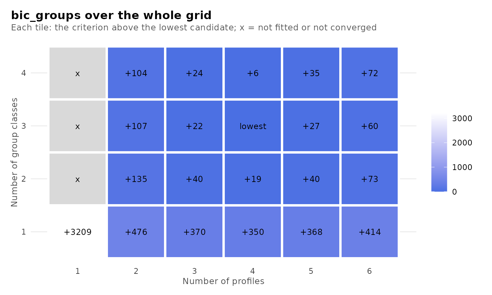

## Classification quality

Each observation has a posterior probability of membership in each
class. Relative entropy (Ramaswamy et al., 1993) summarizes these
probabilities over all observations; it equals 0 when every observation
is equally likely to belong to every class and 1 when every observation
is assigned to one class with certainty. The average posterior
probability (AvePP) of a class is the mean posterior probability of that
class among the observations modally assigned to it (Nagin, 2005).
Values of at least 0.7 to 0.8 are conventionally regarded as indicating
adequate separation. The table of candidates reports the minimum,
maximum and mean AvePP at each level and the number of classes below a
cutoff, 0.8 by default, which is set with `cutoff`.

``` r

plot_selection(models, what = "diagnostics")
```


The AvePP of every class of every candidate, together with its size and
the relative entropy of its level:

``` r

get_results(models, "classification")
#>             candidate n_profiles n_group_classes model       level class n_modal proportion_modal
#> 1   profiles2_groups1          2               1   VVI individuals     1     833          0.58579
#> 2   profiles2_groups1          2               1   VVI individuals     2     589          0.41421
#> 3   profiles3_groups1          3               1   VVI individuals     1     452          0.31786
#> 4   profiles3_groups1          3               1   VVI individuals     2     555          0.39030
#> 5   profiles3_groups1          3               1   VVI individuals     3     415          0.29184
#> 6   profiles4_groups1          4               1   VVI individuals     1     481          0.33826
#> 7   profiles4_groups1          4               1   VVI individuals     2     157          0.11041
#> 8   profiles4_groups1          4               1   VVI individuals     3     419          0.29466
#> 9   profiles4_groups1          4               1   VVI individuals     4     365          0.25668
#> 10  profiles5_groups1          5               1   VVI individuals     1     354          0.24895
#> 11  profiles5_groups1          5               1   VVI individuals     2     419          0.29466
#> 12  profiles5_groups1          5               1   VVI individuals     3     487          0.34248
#> 13  profiles5_groups1          5               1   VVI individuals     4       5          0.00352
#> 14  profiles5_groups1          5               1   VVI individuals     5     157          0.11041
#> 15  profiles6_groups1          6               1   VVI individuals     1     372          0.26160
#> 16  profiles6_groups1          6               1   VVI individuals     2     157          0.11041
#> 17  profiles6_groups1          6               1   VVI individuals     3     378          0.26582
#> 18  profiles6_groups1          6               1   VVI individuals     4      62          0.04360
#> 19  profiles6_groups1          6               1   VVI individuals     5     337          0.23699
#> 20  profiles6_groups1          6               1   VVI individuals     6     116          0.08158
#> 21  profiles2_groups2          2               2   VVI individuals     1     836          0.58790
#> 22  profiles2_groups2          2               2   VVI individuals     2     586          0.41210
#> 23  profiles2_groups2          2               2   VVI      groups     1      35          0.33019
#> 24  profiles2_groups2          2               2   VVI      groups     2      71          0.66981
#> 25  profiles3_groups2          3               2   VVI individuals     1     472          0.33193
#> 26  profiles3_groups2          3               2   VVI individuals     2     570          0.40084
#> 27  profiles3_groups2          3               2   VVI individuals     3     380          0.26723
#> 28  profiles3_groups2          3               2   VVI      groups     1      35          0.33019
#> 29  profiles3_groups2          3               2   VVI      groups     2      71          0.66981
#> 30  profiles4_groups2          4               2   VVI individuals     1     490          0.34459
#> 31  profiles4_groups2          4               2   VVI individuals     2     166          0.11674
#> 32  profiles4_groups2          4               2   VVI individuals     3     418          0.29395
#> 33  profiles4_groups2          4               2   VVI individuals     4     348          0.24473
#> 34  profiles4_groups2          4               2   VVI      groups     1      35          0.33019
#> 35  profiles4_groups2          4               2   VVI      groups     2      71          0.66981
#> 36  profiles5_groups2          5               2   VVI individuals     1     327          0.22996
#> 37  profiles5_groups2          5               2   VVI individuals     2     423          0.29747
#> 38  profiles5_groups2          5               2   VVI individuals     3      31          0.02180
#> 39  profiles5_groups2          5               2   VVI individuals     4     483          0.33966
#> 40  profiles5_groups2          5               2   VVI individuals     5     158          0.11111
#> 41  profiles5_groups2          5               2   VVI      groups     1      72          0.67925
#> 42  profiles5_groups2          5               2   VVI      groups     2      34          0.32075
#> 43  profiles6_groups2          6               2   VVI individuals     1     465          0.32700
#> 44  profiles6_groups2          6               2   VVI individuals     2     171          0.12025
#> 45  profiles6_groups2          6               2   VVI individuals     3     317          0.22293
#> 46  profiles6_groups2          6               2   VVI individuals     4      90          0.06329
#> 47  profiles6_groups2          6               2   VVI individuals     5     343          0.24121
#> 48  profiles6_groups2          6               2   VVI individuals     6      36          0.02532
#> 49  profiles6_groups2          6               2   VVI      groups     1      37          0.34906
#> 50  profiles6_groups2          6               2   VVI      groups     2      69          0.65094
#> 51  profiles2_groups3          2               3   VVI individuals     1     832          0.58509
#> 52  profiles2_groups3          2               3   VVI individuals     2     590          0.41491
#> 53  profiles2_groups3          2               3   VVI      groups     1      31          0.29245
#> 54  profiles2_groups3          2               3   VVI      groups     2      25          0.23585
#> 55  profiles2_groups3          2               3   VVI      groups     3      50          0.47170
#> 56  profiles3_groups3          3               3   VVI individuals     1     476          0.33474
#> 57  profiles3_groups3          3               3   VVI individuals     2     576          0.40506
#> 58  profiles3_groups3          3               3   VVI individuals     3     370          0.26020
#> 59  profiles3_groups3          3               3   VVI      groups     1      30          0.28302
#> 60  profiles3_groups3          3               3   VVI      groups     2      25          0.23585
#> 61  profiles3_groups3          3               3   VVI      groups     3      51          0.48113
#> 62  profiles4_groups3          4               3   VVI individuals     1     509          0.35795
#> 63  profiles4_groups3          4               3   VVI individuals     2     191          0.13432
#> 64  profiles4_groups3          4               3   VVI individuals     3     402          0.28270
#> 65  profiles4_groups3          4               3   VVI individuals     4     320          0.22504
#> 66  profiles4_groups3          4               3   VVI      groups     1      30          0.28302
#> 67  profiles4_groups3          4               3   VVI      groups     2      29          0.27358
#> 68  profiles4_groups3          4               3   VVI      groups     3      47          0.44340
#> 69  profiles5_groups3          5               3   VVI individuals     1     308          0.21660
#> 70  profiles5_groups3          5               3   VVI individuals     2     395          0.27778
#> 71  profiles5_groups3          5               3   VVI individuals     3      50          0.03516
#> 72  profiles5_groups3          5               3   VVI individuals     4     472          0.33193
#> 73  profiles5_groups3          5               3   VVI individuals     5     197          0.13854
#> 74  profiles5_groups3          5               3   VVI      groups     1      47          0.44340
#> 75  profiles5_groups3          5               3   VVI      groups     2      27          0.25472
#> 76  profiles5_groups3          5               3   VVI      groups     3      32          0.30189
#> 77  profiles6_groups3          6               3   VVI individuals     1     210          0.14768
#> 78  profiles6_groups3          6               3   VVI individuals     2     400          0.28129
#> 79  profiles6_groups3          6               3   VVI individuals     3     323          0.22714
#> 80  profiles6_groups3          6               3   VVI individuals     4     285          0.20042
#> 81  profiles6_groups3          6               3   VVI individuals     5     195          0.13713
#> 82  profiles6_groups3          6               3   VVI individuals     6       9          0.00633
#> 83  profiles6_groups3          6               3   VVI      groups     1      28          0.26415
#> 84  profiles6_groups3          6               3   VVI      groups     2      30          0.28302
#> 85  profiles6_groups3          6               3   VVI      groups     3      48          0.45283
#> 86  profiles2_groups4          2               4   VVI individuals     1     832          0.58509
#> 87  profiles2_groups4          2               4   VVI individuals     2     590          0.41491
#> 88  profiles2_groups4          2               4   VVI      groups     1      12          0.11321
#> 89  profiles2_groups4          2               4   VVI      groups     2      25          0.23585
#> 90  profiles2_groups4          2               4   VVI      groups     3      22          0.20755
#> 91  profiles2_groups4          2               4   VVI      groups     4      47          0.44340
#> 92  profiles3_groups4          3               4   VVI individuals     1     369          0.25949
#> 93  profiles3_groups4          3               4   VVI individuals     2     477          0.33544
#> 94  profiles3_groups4          3               4   VVI individuals     3     576          0.40506
#> 95  profiles3_groups4          3               4   VVI      groups     1      15          0.14151
#> 96  profiles3_groups4          3               4   VVI      groups     2      25          0.23585
#> 97  profiles3_groups4          3               4   VVI      groups     3      20          0.18868
#> 98  profiles3_groups4          3               4   VVI      groups     4      46          0.43396
#> 99  profiles4_groups4          4               4   VVI individuals     1     321          0.22574
#> 100 profiles4_groups4          4               4   VVI individuals     2     400          0.28129
#> 101 profiles4_groups4          4               4   VVI individuals     3     191          0.13432
#> 102 profiles4_groups4          4               4   VVI individuals     4     510          0.35865
#> 103 profiles4_groups4          4               4   VVI      groups     1      25          0.23585
#> 104 profiles4_groups4          4               4   VVI      groups     2      24          0.22642
#> 105 profiles4_groups4          4               4   VVI      groups     3      46          0.43396
#> 106 profiles4_groups4          4               4   VVI      groups     4      11          0.10377
#> 107 profiles5_groups4          5               4   VVI individuals     1     189          0.13291
#> 108 profiles5_groups4          5               4   VVI individuals     2     302          0.21238
#> 109 profiles5_groups4          5               4   VVI individuals     3     491          0.34529
#> 110 profiles5_groups4          5               4   VVI individuals     4     402          0.28270
#> 111 profiles5_groups4          5               4   VVI individuals     5      38          0.02672
#> 112 profiles5_groups4          5               4   VVI      groups     1      23          0.21698
#> 113 profiles5_groups4          5               4   VVI      groups     2      11          0.10377
#> 114 profiles5_groups4          5               4   VVI      groups     3      25          0.23585
#> 115 profiles5_groups4          5               4   VVI      groups     4      47          0.44340
#> 116 profiles6_groups4          6               4   VVI individuals     1     341          0.23980
#> 117 profiles6_groups4          6               4   VVI individuals     2     149          0.10478
#> 118 profiles6_groups4          6               4   VVI individuals     3     159          0.11181
#> 119 profiles6_groups4          6               4   VVI individuals     4     107          0.07525
#> 120 profiles6_groups4          6               4   VVI individuals     5     175          0.12307
#> 121 profiles6_groups4          6               4   VVI individuals     6     491          0.34529
#> 122 profiles6_groups4          6               4   VVI      groups     1      14          0.13208
#> 123 profiles6_groups4          6               4   VVI      groups     2      23          0.21698
#> 124 profiles6_groups4          6               4   VVI      groups     3      25          0.23585
#> 125 profiles6_groups4          6               4   VVI      groups     4      44          0.41509
#>     estimated_n estimated_proportion average_posterior odds_correct_classification relative_entropy
#> 1        832.92              0.58574             0.982                       37.75            0.922
#> 2        589.08              0.41426             0.974                       53.24            0.922
#> 3        452.68              0.31834             0.832                       10.61            0.772
#> 4        551.11              0.38756             0.964                       42.39            0.772
#> 5        418.21              0.29410             0.863                       15.17            0.772
#> 6        477.89              0.33607             0.842                       10.50            0.735
#> 7        172.06              0.12100             0.803                       29.60            0.735
#> 8        405.38              0.28508             0.849                       14.15            0.735
#> 9        366.66              0.25785             0.847                       15.88            0.735
#> 10       358.75              0.25229             0.848                       16.50            0.773
#> 11       405.25              0.28499             0.849                       14.13            0.773
#> 12       480.80              0.33812             0.841                       10.38            0.773
#> 13         4.89              0.00344             0.962                     7362.68            0.773
#> 14       172.31              0.12117             0.804                       29.66            0.773
#> 15       340.74              0.23962             0.734                        8.77            0.668
#> 16       165.77              0.11658             0.784                       27.55            0.668
#> 17       348.87              0.24534             0.780                       10.89            0.668
#> 18        95.11              0.06689             0.637                       24.43            0.668
#> 19       321.48              0.22608             0.811                       14.73            0.668
#> 20       150.02              0.10550             0.628                       14.29            0.668
#> 21       834.10              0.58657             0.985                       46.08            0.938
#> 22       587.90              0.41343             0.982                       76.35            0.938
#> 23        34.48              0.32530             0.969                       64.80            0.940
#> 24        71.52              0.67470             0.992                       59.89            0.940
#> 25       469.54              0.33020             0.849                       11.40            0.790
#> 26       569.85              0.40074             0.979                       68.94            0.790
#> 27       382.61              0.26907             0.851                       15.46            0.790
#> 28        34.75              0.32787             0.977                       87.77            0.943
#> 29        71.25              0.67213             0.992                       62.14            0.943
#> 30       480.20              0.33769             0.845                       10.71            0.739
#> 31       177.99              0.12517             0.791                       26.46            0.739
#> 32       407.84              0.28680             0.859                       15.11            0.739
#> 33       355.98              0.25033             0.846                       16.41            0.739
#> 34        34.84              0.32868             0.975                       80.78            0.937
#> 35        71.16              0.67132             0.990                       48.95            0.937
#> 36       337.69              0.23747             0.848                       17.88            0.775
#> 37       408.11              0.28700             0.860                       15.27            0.775
#> 38        36.78              0.02587             0.838                      195.11            0.775
#> 39       464.27              0.32649             0.846                       11.34            0.775
#> 40       175.14              0.12317             0.803                       28.94            0.775
#> 41        71.40              0.67360             0.990                       48.04            0.965
#> 42        34.60              0.32640             0.996                      581.73            0.965
#> 43       444.92              0.31288             0.836                       11.23            0.733
#> 44       173.92              0.12231             0.781                       25.61            0.733
#> 45       295.07              0.20750             0.729                       10.26            0.733
#> 46       117.94              0.08294             0.698                       25.59            0.733
#> 47       350.01              0.24614             0.845                       16.74            0.733
#> 48        40.14              0.02823             0.789                      128.55            0.733
#> 49        36.90              0.34809             0.972                       65.69            0.946
#> 50        69.10              0.65191             0.987                       39.40            0.946
#> 51       830.91              0.58433             0.986                       49.28            0.940
#> 52       591.09              0.41567             0.982                       75.73            0.940
#> 53        30.78              0.29035             0.962                       62.25            0.816
#> 54        26.66              0.25147             0.905                       28.33            0.816
#> 55        48.57              0.45818             0.900                       10.69            0.816
#> 56       477.70              0.33593             0.855                       11.63            0.792
#> 57       574.94              0.40432             0.978                       64.96            0.792
#> 58       369.36              0.25975             0.843                       15.29            0.792
#> 59        31.03              0.29271             0.977                      104.15            0.797
#> 60        27.65              0.26086             0.898                       24.87            0.797
#> 61        47.32              0.44643             0.864                        7.90            0.797
#> 62       496.81              0.34937             0.853                       10.79            0.739
#> 63       201.50              0.14170             0.801                       24.37            0.739
#> 64       392.63              0.27611             0.849                       14.69            0.739
#> 65       331.06              0.23281             0.842                       17.60            0.739
#> 66        30.60              0.28866             0.981                      127.46            0.823
#> 67        27.40              0.25845             0.861                       17.82            0.823
#> 68        48.01              0.45290             0.924                       14.63            0.823
#> 69       305.11              0.21457             0.824                       17.18            0.736
#> 70       386.77              0.27199             0.848                       14.89            0.736
#> 71        78.19              0.05499             0.702                       40.55            0.736
#> 72       443.05              0.31157             0.813                        9.62            0.736
#> 73       208.87              0.14688             0.806                       24.09            0.736
#> 74        47.06              0.44401             0.923                       15.04            0.844
#> 75        27.25              0.25708             0.889                       23.20            0.844
#> 76        31.69              0.29892             0.979                      106.79            0.844
#> 77       216.03              0.15192             0.803                       22.77            0.716
#> 78       386.49              0.27180             0.841                       14.21            0.716
#> 79       319.17              0.22445             0.770                       11.54            0.716
#> 80       284.53              0.20009             0.664                        7.90            0.716
#> 81       206.64              0.14531             0.803                       24.04            0.716
#> 82         9.14              0.00643             0.872                     1049.37            0.716
#> 83        29.69              0.28010             0.922                       30.30            0.836
#> 84        30.29              0.28571             0.978                      110.58            0.836
#> 85        46.02              0.43419             0.899                       11.65            0.836
#> 86       829.91              0.58362             0.986                       50.19            0.942
#> 87       592.09              0.41638             0.984                       85.01            0.942
#> 88        11.33              0.10689             0.851                       47.77            0.798
#> 89        24.59              0.23201             0.868                       21.73            0.798
#> 90        22.34              0.21072             0.877                       26.81            0.798
#> 91        47.74              0.45039             0.912                       12.62            0.798
#> 92       369.51              0.25985             0.844                       15.35            0.793
#> 93       476.20              0.33488             0.853                       11.50            0.793
#> 94       576.28              0.40526             0.980                       70.31            0.793
#> 95        13.62              0.12846             0.841                       35.91            0.772
#> 96        24.38              0.22998             0.843                       17.98            0.772
#> 97        20.96              0.19777             0.868                       26.75            0.772
#> 98        47.04              0.44380             0.902                       11.51            0.772
#> 99       333.00              0.23418             0.843                       17.58            0.740
#> 100      393.46              0.27670             0.853                       15.17            0.740
#> 101      201.54              0.14173             0.801                       24.37            0.740
#> 102      494.00              0.34740             0.850                       10.64            0.740
#> 103       25.30              0.23872             0.872                       21.82            0.803
#> 104       22.90              0.21603             0.867                       23.72            0.803
#> 105       46.89              0.44233             0.903                       11.76            0.803
#> 106       10.91              0.10292             0.898                       76.59            0.803
#> 107      201.06              0.14140             0.803                       24.78            0.751
#> 108      305.31              0.21471             0.831                       17.96            0.751
#> 109      461.42              0.32448             0.826                        9.90            0.751
#> 110      392.81              0.27624             0.853                       15.15            0.751
#> 111       61.40              0.04318             0.786                       81.56            0.751
#> 112       23.02              0.21714             0.926                       44.87            0.830
#> 113       11.14              0.10505             0.899                       75.63            0.830
#> 114       25.69              0.24240             0.882                       23.27            0.830
#> 115       46.15              0.43542             0.909                       12.98            0.830
#> 116      320.63              0.22548             0.806                       14.24            0.726
#> 117      167.52              0.11781             0.765                       24.39            0.726
#> 118      158.37              0.11137             0.654                       15.05            0.726
#> 119      114.83              0.08075             0.847                       63.11            0.726
#> 120      193.25              0.13590             0.797                       24.99            0.726
#> 121      467.40              0.32869             0.831                       10.03            0.726
#> 122       13.24              0.12489             0.907                       68.44            0.851
#> 123       23.34              0.22015             0.919                       40.30            0.851
#> 124       25.05              0.23636             0.914                       34.51            0.851
#> 125       44.37              0.41860             0.930                       18.41            0.851
```

For profiles4_groups3, the relative entropy is 0.74 for the profiles and
0.82 for the group classes; the minimum AvePP is 0.8 among the profiles
and 0.86 among the group classes.

## Diagnostics of the estimation

A maximum reached from several random starts is more credible than one
reached once, since a single start may terminate at a local maximum. An
estimate on the boundary of the parameter space, such as a variance at
its lower bound, indicates a model too complex for the data, and a class
containing a very small proportion of the observations is difficult to
interpret and to replicate. The following plots report these diagnostics
for every candidate.

``` r

plot_selection(models, what = "trust")
```

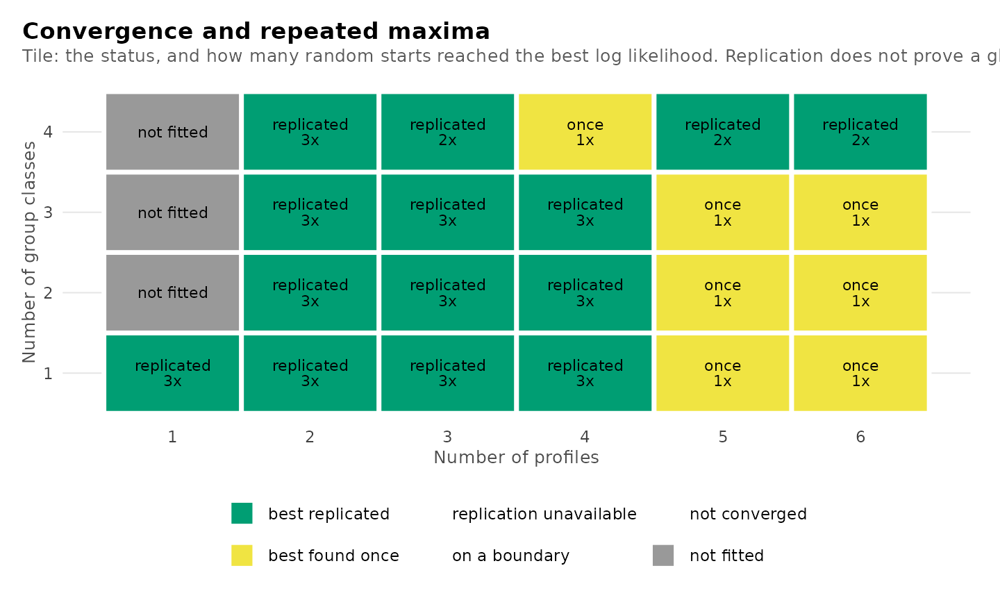

``` r

plot_selection(models, what = "smallest")
```


`plot_selection(models)` displays all plots relevant to the choice of
the number of classes jointly.

A candidate on a boundary whose smallest profile holds about one
observation is a degenerate solution, not a profile: a Gaussian profile
centred on one observation raises the likelihood without limit as its
variances shrink, so the reported likelihood is fixed by `min_variance`.
The default, `boundary = "allow"`, reports it, as Mplus does, with a
warning. `boundary = "exclude"` retains for each candidate the best
start with no variance at its lower bound, and is advisable when many
starts are used, since each additional start increases the chance of
reaching such a solution. Categorical indicators are unaffected.

``` r

models <- enumerate_classes(course_engagement, activity, "student",
                            n_profiles = 1:5, n_group_classes = 1:3,
                            model = "VVI", n_starts = 200,
                            boundary = "exclude", seed = 1)
```

## Comparing candidates

[`compare_models()`](https://pak.dynasite.org/latents/reference/compare_models.md)
tabulates selected candidates side by side. Candidates are specified by
name, by their numbers of classes, or by a number of profiles or group
classes. The comparison adds the difference in BIC from the minimum
among the compared candidates and the BIC weight, `exp(-delta_bic / 2)`
normalized to sum to one, which approximates the posterior probability
of each candidate under equal prior probabilities (Wagenmakers and
Farrell, 2004).

The candidates preferred by BIC, ICL and AWE with students as the units:

``` r

compare_models(models, bic_groups_pick, icl_groups_pick, awe_groups_pick)
#> Model comparison
#> 
#> Model              Profiles  Group classes   k    LogLik       BIC    ΔBIC  Weight       ICL  Entropy  Min AvePP  < 0.8  Group entropy  Group min AvePP
#> -----------------  --------  -------------  --  --------  --------  ------  ------  --------  -------  ---------  -----  -------------  ---------------
#> profiles4_groups3         4              3  51  -8307.15  16852.14    0.00   1.000  18045.06     0.74       0.80      0           0.82             0.86
#> profiles2_groups3         2              3  25  -8421.06  16958.72  106.57   0.000  17179.59     0.94       0.98      0           0.82             0.90
#> profiles2_groups2         2              2  23  -8439.82  16986.89  134.75   0.000  17175.69     0.94       0.98      0           0.94             0.97
```

The same candidates specified by their numbers of classes, with labels:

``` r

compare_models(models, bic = c(4, 3), icl = c(2, 3), awe = c(2, 2))
#> Model comparison
#> 
#> Model  Profiles  Group classes   k    LogLik       BIC    ΔBIC  Weight       ICL  Entropy  Min AvePP  < 0.8  Group entropy  Group min AvePP
#> -----  --------  -------------  --  --------  --------  ------  ------  --------  -------  ---------  -----  -------------  ---------------
#> bic           4              3  51  -8307.15  16852.14    0.00   1.000  18045.06     0.74       0.80      0           0.82             0.86
#> icl           2              3  25  -8421.06  16958.72  106.57   0.000  17179.59     0.94       0.98      0           0.82             0.90
#> awe           2              2  23  -8439.82  16986.89  134.75   0.000  17175.69     0.94       0.98      0           0.94             0.97
```

All candidates with four profiles, which isolates the contribution of
the group classes:

``` r

comparison <- compare_models(models, n_profiles = 4)
comparison
#> Model comparison
#> 
#> Model              Profiles  Group classes   k    LogLik       BIC    ΔBIC  Weight       ICL  Entropy  Min AvePP  < 0.8  Group entropy  Group min AvePP
#> -----------------  --------  -------------  --  --------  --------  ------  ------  --------  -------  ---------  -----  -------------  ---------------
#> profiles4_groups1         4              1  43  -8501.00  17202.53  350.38   0.000  18358.76     0.74       0.80      0                                
#> profiles4_groups2         4              2  47  -8326.19  16871.57   19.43   0.000  18027.20     0.74       0.79      1           0.94             0.98
#> profiles4_groups3         4              3  51  -8307.15  16852.14    0.00   0.941  18045.06     0.74       0.80      0           0.82             0.86
#> profiles4_groups4         4              4  55  -8300.60  16857.69    5.54   0.059  18071.32     0.74       0.80      0           0.80             0.87
plot(comparison)
```

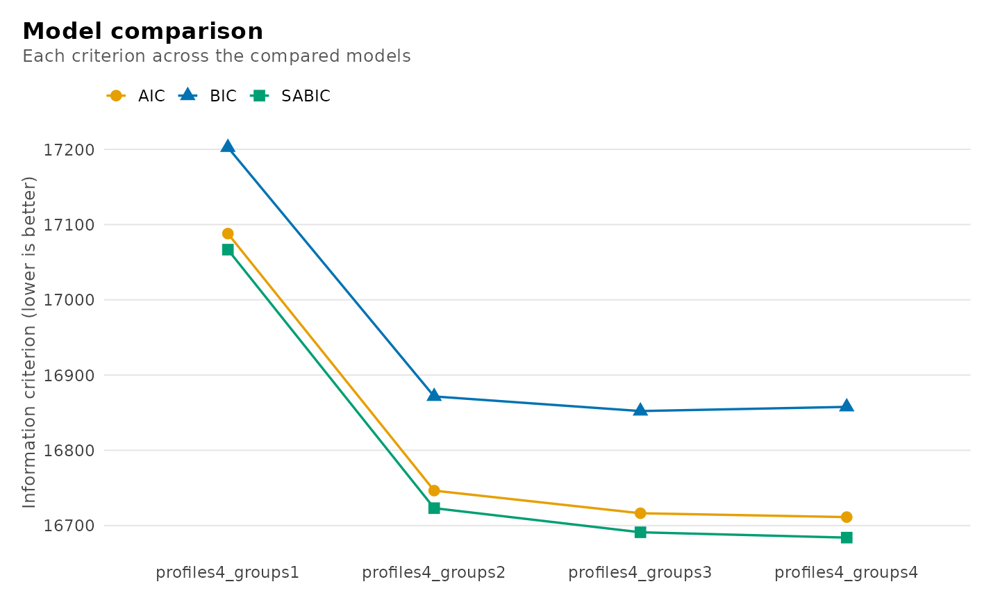

The comparison retains the fitted models.
[`get_results()`](https://pak.dynasite.org/latents/reference/get_results.md)
returns the AvePP of every class of every compared model, and
[`get_candidate()`](https://pak.dynasite.org/latents/reference/get_candidate.md)
the model underlying a row.

``` r

get_results(comparison, "classification")
#>                model       level class n_modal proportion_modal estimated_n estimated_proportion
#> 1  profiles4_groups1 individuals     1     481            0.338       477.9                0.336
#> 2  profiles4_groups1 individuals     2     157            0.110       172.1                0.121
#> 3  profiles4_groups1 individuals     3     419            0.295       405.4                0.285
#> 4  profiles4_groups1 individuals     4     365            0.257       366.7                0.258
#> 5  profiles4_groups2 individuals     1     490            0.345       480.2                0.338
#> 6  profiles4_groups2 individuals     2     166            0.117       178.0                0.125
#> 7  profiles4_groups2 individuals     3     418            0.294       407.8                0.287
#> 8  profiles4_groups2 individuals     4     348            0.245       356.0                0.250
#> 9  profiles4_groups2      groups     1      35            0.330        34.8                0.329
#> 10 profiles4_groups2      groups     2      71            0.670        71.2                0.671
#> 11 profiles4_groups3 individuals     1     509            0.358       496.8                0.349
#> 12 profiles4_groups3 individuals     2     191            0.134       201.5                0.142
#> 13 profiles4_groups3 individuals     3     402            0.283       392.6                0.276
#> 14 profiles4_groups3 individuals     4     320            0.225       331.1                0.233
#> 15 profiles4_groups3      groups     1      30            0.283        30.6                0.289
#> 16 profiles4_groups3      groups     2      29            0.274        27.4                0.258
#> 17 profiles4_groups3      groups     3      47            0.443        48.0                0.453
#> 18 profiles4_groups4 individuals     1     321            0.226       333.0                0.234
#> 19 profiles4_groups4 individuals     2     400            0.281       393.5                0.277
#> 20 profiles4_groups4 individuals     3     191            0.134       201.5                0.142
#> 21 profiles4_groups4 individuals     4     510            0.359       494.0                0.347
#> 22 profiles4_groups4      groups     1      25            0.236        25.3                0.239
#> 23 profiles4_groups4      groups     2      24            0.226        22.9                0.216
#> 24 profiles4_groups4      groups     3      46            0.434        46.9                0.442
#> 25 profiles4_groups4      groups     4      11            0.104        10.9                0.103
#>    average_posterior odds_correct_classification relative_entropy
#> 1              0.842                        10.5            0.735
#> 2              0.803                        29.6            0.735
#> 3              0.849                        14.2            0.735
#> 4              0.847                        15.9            0.735
#> 5              0.845                        10.7            0.739
#> 6              0.791                        26.5            0.739
#> 7              0.859                        15.1            0.739
#> 8              0.846                        16.4            0.739
#> 9              0.975                        80.8            0.937
#> 10             0.990                        49.0            0.937
#> 11             0.853                        10.8            0.739
#> 12             0.801                        24.4            0.739
#> 13             0.849                        14.7            0.739
#> 14             0.842                        17.6            0.739
#> 15             0.981                       127.5            0.823
#> 16             0.861                        17.8            0.823
#> 17             0.924                        14.6            0.823
#> 18             0.843                        17.6            0.740
#> 19             0.853                        15.2            0.740
#> 20             0.801                        24.4            0.740
#> 21             0.850                        10.6            0.740
#> 22             0.872                        21.8            0.803
#> 23             0.867                        23.7            0.803
#> 24             0.903                        11.8            0.803
#> 25             0.898                        76.6            0.803
```

## Analysis of the chosen candidate

The analysis proceeds with profiles4_groups3, the candidate that
minimizes BIC with students as the units. It is extracted by name with
[`get_candidate()`](https://pak.dynasite.org/latents/reference/get_candidate.md);
specifying the numbers of classes, as in `get_candidate(models, 4, 3)`,
returns the same model.

``` r

chosen <- get_candidate(models, "profiles4_groups3")
chosen
#> Two-level latent profile analysis: 4 profiles, 3 group classes
#> 1422 individuals in 106 groups; varying diagonal residual covariance (VVI)
#> Log likelihood: -8307.154420 | AIC: 16716.309 | BIC (groups): 16852.144
#> Converged: TRUE | iterations: 70 | best log likelihood reached by 3 of 3 starts (3 converged)
#> Smallest standardized Gaussian eigenvalue: 0.1951 (profiles, profile_4); Gaussian mass: 331.1; weight effective n: 435.2.
#> 
#> Class sizes   profile_1 34.9% (497)   profile_2 14.2% (201)   profile_3 27.6% (393)   profile_4 23.3% (331)
#> Group classes group_class_1 28.9% (31)   group_class_2 25.8% (27)   group_class_3 45.3% (48)
#> 
#> Means
#>   indicator profile_1 profile_2 profile_3 profile_4
#>      browse     0.412    -1.114    -0.564     0.728
#>    lectures     0.232    -0.685    -0.562     0.734
#>  forum_read     0.490    -1.201    -0.695     0.821
#>  forum_post     0.383    -0.880    -0.676     0.763
#>  attendance     0.309    -1.418    -0.657     1.180
#> 
#> Variances and standard errors: get_results(x, "profiles").
#> Every other table: get_results(x, what = ), or get_results(x, "all").
```

`chosen` is an object of the class returned by
[`multilpa()`](https://pak.dynasite.org/latents/reference/multilpa.md).
Its summary reports the estimates with their standard errors.

``` r

summary(chosen)
#> Two-level latent profile analysis: 4 profiles, 3 group classes
#> Individuals: 1422; groups: 106; parameters: 51; converged: TRUE
#> Log likelihood: -8307.154420; AIC: 16716.309
#> BIC (groups): 16852.144; BIC (individuals): 16984.560
#> Best likelihood replicated in 3/3 starts (absolute tolerance 0.00711).
#> 
#> -- profiles --------------------------------------------------------
#>  profile  indicator    mean variance standard_deviation mean_standard_error variance_standard_error
#>        1     browse  0.4123   0.6154             0.7845             0.04316                 0.04353
#>        1   lectures  0.2322   0.7595             0.8715             0.05528                 0.05726
#>        1 forum_read  0.4901   0.4509             0.6715             0.04120                 0.03455
#>        1 forum_post  0.3831   0.7046             0.8394             0.05052                 0.05368
#>        1 attendance  0.3089   0.1975             0.4444             0.05097                 0.02207
#>        2     browse -1.1141   0.3844             0.6200             0.10708                 0.09409
#>        2   lectures -0.6846   0.5119             0.7155             0.06386                 0.06373
#>        2 forum_read -1.2010   0.3150             0.5612             0.07575                 0.04066
#>        2 forum_post -0.8797   0.3361             0.5797             0.05396                 0.04137
#>        2 attendance -1.4181   0.2221             0.4713             0.07961                 0.03282
#>    ... 10 more rows.  get_results(x, what = "profiles")
#> 
#> -- responses -------------------------------------------------------
#>    (no rows)
#> 
#> -- covariances -----------------------------------------------------
#>  profile  indicator indicator_2 covariance
#>        1     browse      browse     0.6154
#>        1   lectures      browse     0.0000
#>        1 forum_read      browse     0.0000
#>        1 forum_post      browse     0.0000
#>        1 attendance      browse     0.0000
#>        1     browse    lectures     0.0000
#>        1   lectures    lectures     0.7595
#>        1 forum_read    lectures     0.0000
#>        1 forum_post    lectures     0.0000
#>        1 attendance    lectures     0.0000
#>    ... 90 more rows.  get_results(x, what = "covariances")
#> 
#> -- gaussian_diagnostics --------------------------------------------
#>   context   profile gaussian_mass positive_rows weight_effective_n min_variance_ratio
#>  profiles profile_1         496.8          1422              618.8             0.2021
#>  profiles profile_2         201.5          1422              289.6             0.2272
#>  profiles profile_3         392.6          1422              493.6             0.2629
#>  profiles profile_4         331.1          1422              435.2             0.1951
#>  min_standardized_eigenvalue boundary
#>                       0.2021    FALSE
#>                       0.2272    FALSE
#>                       0.2629    FALSE
#>                       0.1951    FALSE
#> 
#> -- profile_probabilities -------------------------------------------
#>  group_class profile probability group_class_probability
#>            1       1     0.05321                  0.2887
#>            1       2     0.29927                  0.2887
#>            1       3     0.56590                  0.2887
#>            1       4     0.08162                  0.2887
#>            2       1     0.60604                  0.2584
#>            2       2     0.03258                  0.2584
#>            2       3     0.02202                  0.2584
#>            2       4     0.33936                  0.2584
#>            3       1     0.39263                  0.4529
#>            3       2     0.10321                  0.4529
#>    ... 2 more rows.  get_results(x, what = "profile_probabilities")
#> 
#> -- counts ----------------------------------------------------------
#>        level class effective_count effective_proportion
#>  individuals     1          496.81               0.3494
#>  individuals     2          201.50               0.1417
#>  individuals     3          392.63               0.2761
#>  individuals     4          331.06               0.2328
#>       groups     1           30.60               0.2887
#>       groups     2           27.40               0.2584
#>       groups     3           48.01               0.4529
#> 
#> -- posteriors ------------------------------------------------------
#>  row group profile posterior modal
#>    1     1       1 4.981e-01 FALSE
#>    2     1       1 6.730e-01  TRUE
#>    3     1       1 2.026e-06 FALSE
#>    4     1       1 1.729e-06 FALSE
#>    5     1       1 7.378e-07 FALSE
#>    6     1       1 5.220e-06 FALSE
#>    7     1       1 1.013e-05 FALSE
#>    8     1       1 8.750e-06 FALSE
#>    9     1       1 4.319e-07 FALSE
#>   10     1       1 2.376e-06 FALSE
#>    ... 5678 more rows.  get_results(x, what = "posteriors")
#> 
#> -- group_posteriors ------------------------------------------------
#>  group group_size log_likelihood group_class posterior modal
#>      1         13         -64.40           1 9.983e-01  TRUE
#>      2         13         -70.85           1 1.000e+00  TRUE
#>      3         14         -75.11           1 1.425e-12 FALSE
#>      4         13         -66.48           1 6.979e-12 FALSE
#>      5         14         -75.41           1 9.999e-01  TRUE
#>      6         12         -76.75           1 1.518e-02 FALSE
#>      7         15         -87.20           1 4.802e-12 FALSE
#>      8         14         -83.85           1 9.468e-01  TRUE
#>      9         14         -81.97           1 3.327e-12 FALSE
#>     10         15         -82.36           1 9.998e-01  TRUE
#>    ... 308 more rows.  get_results(x, what = "group_posteriors")
#> 
#> -- assignments -----------------------------------------------------
#>  student browse lectures forum_read forum_post attendance profile group_class uncertainty
#>        1   0.73    -0.08       0.30       0.67       0.72       4           1      0.5001
#>        1   0.68     0.53      -0.02      -0.55       0.70       1           1      0.3270
#>        1  -1.51    -0.51      -0.91      -0.80      -0.97       2           1      0.4762
#>        1   0.64    -1.02      -1.62      -1.20      -1.26       3           1      0.2935
#>        1  -0.94    -0.37      -0.71      -0.28      -1.52       2           1      0.3791
#>        1  -0.36    -0.46      -0.77      -0.43      -1.34       3           1      0.3577
#>        1   0.38    -1.85      -0.84      -1.09      -1.12       3           1      0.1280
#>        1  -1.44     0.66      -0.67      -1.67      -1.00       3           1      0.3786
#>        1  -0.76    -0.43      -1.04      -0.69      -1.37       2           1      0.3352
#>        1   0.26    -0.95      -0.51      -1.89      -1.45       3           1      0.2049
#>  posterior_profile_1 posterior_profile_2 posterior_profile_3 posterior_profile_4
#>            4.981e-01           3.079e-09            0.002021           4.999e-01
#>            6.730e-01           5.348e-07            0.049001           2.780e-01
#>            2.026e-06           5.238e-01            0.476161           1.150e-11
#>            1.729e-06           2.935e-01            0.706491           5.795e-12
#>            7.378e-07           6.209e-01            0.379095           1.147e-12
#>            5.220e-06           3.577e-01            0.642283           2.791e-11
#>            1.013e-05           1.280e-01            0.871997           6.812e-11
#>            8.750e-06           3.786e-01            0.621373           3.932e-11
#>            4.319e-07           6.648e-01            0.335209           9.181e-13
#>            2.376e-06           2.049e-01            0.795128           2.019e-12
#>    ... 1412 more rows.  get_results(x, what = "assignments")
#> 
#> -- classification --------------------------------------------------
#>        level class n_modal proportion_modal estimated_n estimated_proportion average_posterior
#>  individuals     1     509           0.3579      496.81               0.3494            0.8528
#>  individuals     2     191           0.1343      201.50               0.1417            0.8009
#>  individuals     3     402           0.2827      392.63               0.2761            0.8485
#>  individuals     4     320           0.2250      331.06               0.2328            0.8423
#>       groups     1      30           0.2830       30.60               0.2887            0.9810
#>       groups     2      29           0.2736       27.40               0.2584            0.8613
#>       groups     3      47           0.4434       48.01               0.4529            0.9237
#>  odds_correct_classification
#>                        10.79
#>                        24.37
#>                        14.69
#>                        17.60
#>                       127.46
#>                        17.82
#>                        14.63
#> 
#> -- average_posteriors ----------------------------------------------
#>        level assigned_class class n_assigned average_posterior
#>  individuals              1     1        509         8.528e-01
#>  individuals              1     2        509         2.586e-05
#>  individuals              1     3        509         2.652e-02
#>  individuals              1     4        509         1.207e-01
#>  individuals              2     1        191         6.611e-06
#>  individuals              2     2        191         8.009e-01
#>  individuals              2     3        191         1.991e-01
#>  individuals              2     4        191         1.821e-11
#>  individuals              3     1        402         3.056e-02
#>  individuals              3     2        402         1.207e-01
#>    ... 15 more rows.  get_results(x, what = "average_posteriors")
#> 
#> -- classification_errors -------------------------------------------
#>        level true_class assigned_class probability
#>  individuals          1              1   8.737e-01
#>  individuals          1              2   2.542e-06
#>  individuals          1              3   2.473e-02
#>  individuals          1              4   1.015e-01
#>  individuals          2              1   6.533e-05
#>  individuals          2              2   7.592e-01
#>  individuals          2              3   2.407e-01
#>  individuals          2              4   6.982e-11
#>  individuals          3              1   3.438e-02
#>  individuals          3              2   9.684e-02
#>    ... 15 more rows.  get_results(x, what = "classification_errors")
#> 
#> -- bch_weights -----------------------------------------------------
#>        level unit assigned_class class     weight
#>  individuals    1              4     1 -0.2681780
#>  individuals    1              4     2 -0.0009488
#>  individuals    1              4     3  0.0074455
#>  individuals    1              4     4  1.2616813
#>  individuals    2              1     1  1.1770643
#>  individuals    2              1     2  0.0044189
#>  individuals    2              1     3 -0.0346742
#>  individuals    2              1     4 -0.1468089
#>  individuals    3              2     1  0.0152037
#>  individuals    3              2     2  1.3655002
#>    ... 5996 more rows.  get_results(x, what = "bch_weights")
#> 
#> -- entropy ---------------------------------------------------------
#>        level n_classes n_units entropy_sum relative_entropy
#>  individuals         4    1422      514.47           0.7390
#>       groups         3     106       20.65           0.8227
#> 
#> -- replication -----------------------------------------------------
#>  n_starts n_screened n_converged n_failed n_best_replicated share tolerance best_start
#>         3          0           3        0                 3     1   0.00711          1
#>  log_likelihood
#>           -8307
#> 
#> -- residuals -------------------------------------------------------
#>    profile indicator_1 indicator_2     kind observed expected residual effective_n statistic df
#>  profile_2    lectures  forum_post gaussian -0.11533        0 -0.11533       201.5    -1.632 NA
#>  profile_1      browse  forum_post gaussian -0.10178        0 -0.10178       496.8    -2.270 NA
#>  profile_3    lectures  attendance gaussian  0.10077        0  0.10077       392.6     1.996 NA
#>  profile_2      browse  forum_post gaussian  0.09825        0  0.09825       201.5     1.389 NA
#>  profile_1    lectures  attendance gaussian  0.09575        0  0.09575       496.8     2.134 NA
#>  profile_1      browse    lectures gaussian -0.09388        0 -0.09388       496.8    -2.092 NA
#>  profile_2      browse    lectures gaussian -0.09314        0 -0.09314       201.5    -1.316 NA
#>  profile_3      browse  forum_post gaussian -0.08847        0 -0.08847       392.6    -1.751 NA
#>  profile_4      browse  attendance gaussian  0.08654        0  0.08654       331.1     1.571 NA
#>  profile_2    lectures  attendance gaussian  0.08412        0  0.08412       201.5     1.188 NA
#>  p_value p_adjusted
#>  0.10265    0.10265
#>  0.02323    0.02323
#>  0.04594    0.04594
#>  0.16491    0.16491
#>  0.03283    0.03283
#>  0.03640    0.03640
#>  0.18813    0.18813
#>  0.07995    0.07995
#>  0.11609    0.11609
#>  0.23486    0.23486
#>    ... 30 more rows.  get_results(x, what = "residuals")
#> 
#> -- information_criteria --------------------------------------------
#>  log_likelihood n_parameters   aic   kic bic_groups bic_individual sabic_groups sabic_individual
#>           -8307           51 16716 16770      16852          16985        16691            16823
#>  caic_groups caic_individual awe_groups awe_individual icl_groups icl_individual clc_groups
#>        16903           17036      18303          18568      17913          18045      17675
#>  clc_individual
#>           17675
#> 
#> -- model -----------------------------------------------------------
#>  n_observations n_informative n_groups n_profiles n_group_classes centering scaling
#>            1422          1422      106          4               3      none    none
#>  covariance_structure n_parameters n_parameters_with_measurement log_likelihood   aic bic_groups
#>                   VVI           51                            51          -8307 16716      16852
#>  bic_individual converged iterations boundary small_classes best_start n_best_replicated weights
#>           16985      TRUE         70    FALSE         FALSE          1                 3    <NA>
#> 
#> -- stages ----------------------------------------------------------
#>  stage group_classes fixed log_likelihood parameters parameters_with_measurement converged
#>  joint             3  <NA>          -8307         51                          51      TRUE
#> 
#> -- starts ----------------------------------------------------------
#>  start log_likelihood converged iterations error boundary
#>      1          -8307      TRUE         70  <NA>    FALSE
#>      2          -8307      TRUE         53  <NA>    FALSE
#>      3          -8307      TRUE         42  <NA>    FALSE
#> 
#> -- data ------------------------------------------------------------
#>  student browse lectures forum_read forum_post attendance
#>        1   0.73    -0.08       0.30       0.67       0.72
#>        1   0.68     0.53      -0.02      -0.55       0.70
#>        1  -1.51    -0.51      -0.91      -0.80      -0.97
#>        1   0.64    -1.02      -1.62      -1.20      -1.26
#>        1  -0.94    -0.37      -0.71      -0.28      -1.52
#>        1  -0.36    -0.46      -0.77      -0.43      -1.34
#>        1   0.38    -1.85      -0.84      -1.09      -1.12
#>        1  -1.44     0.66      -0.67      -1.67      -1.00
#>        1  -0.76    -0.43      -1.04      -0.69      -1.37
#>        1   0.26    -0.95      -0.51      -1.89      -1.45
#>    ... 1412 more rows.  get_results(x, what = "data")
#> 
#> 21 tables above, truncated to fit. get_results(x, what = ) returns any
#> of them whole, and get_results(x, what = "all") returns every one.
```

The profiles are displayed as their means on the five indicators.

``` r

plot_profiles(chosen)
```

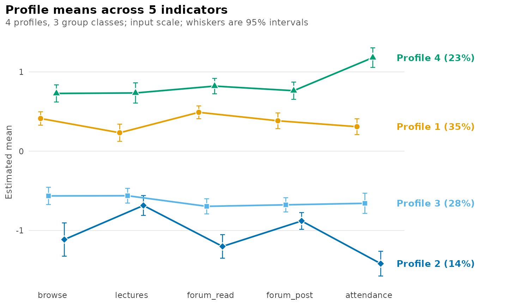

Each group class has its own distribution over the four profiles.

``` r

plot_prevalence(chosen)
```

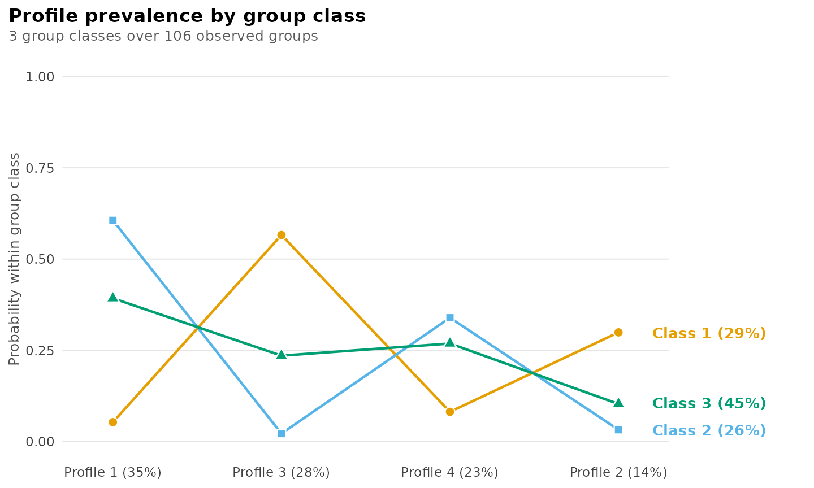

The classification diagnostics of the chosen model:

``` r

diagnostics(chosen)
```

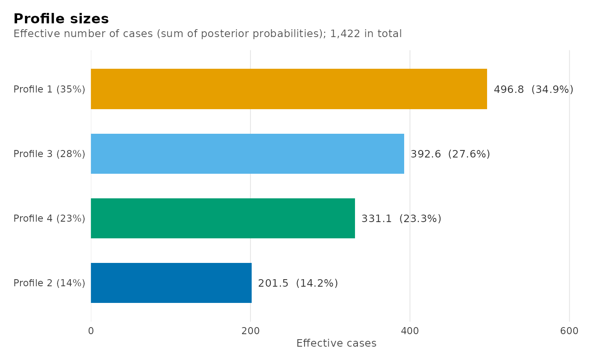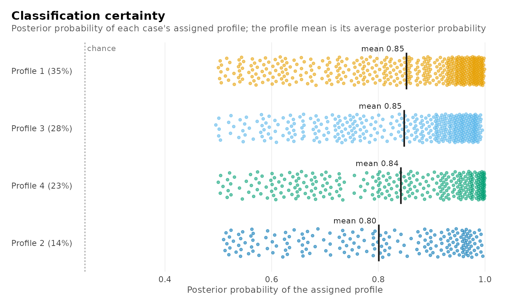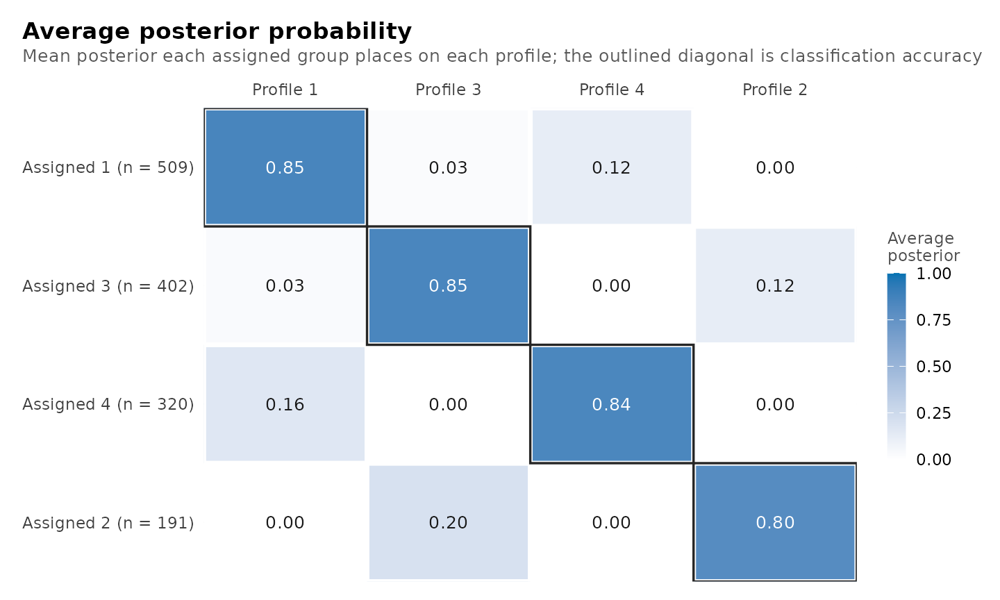

    #> Diagnostics: Two-level latent profile analysis, 4 profiles, 3 group classes
    #> 1 check needs attention: pairs dependent within a class
    #> 
    #> Estimation
    #>   ok     best start converged                                yes                      
    #>   info   best log likelihood reached by                      3 of 3 starts            
    #>   ok     starts failed or unfinished                         0 of 3                   
    #>   ok     estimates at a bound                                no                       
    #> 
    #> Class size
    #>   info   smallest class                         individuals  14.2% (n = 201, class 2) 
    #>   info   modal vs estimated proportions         individuals  largest gap 0.009        
    #>   ok     classes with no assigned unit          individuals  0 of 4                   
    #>   info   smallest class                         groups       25.8% (n = 27, class 2)  
    #>   info   modal vs estimated proportions         groups       largest gap 0.015        
    #>   ok     classes with no assigned group         groups       0 of 3                   
    #> 
    #> Classification
    #>   info   relative entropy                       individuals  0.739                    
    #>   info   lowest average posterior               individuals  0.801 (class 2)          
    #>   info   lowest odds of correct classification  individuals  10.8 (class 1)           
    #>   info   relative entropy                       groups       0.823                    
    #>   info   lowest average posterior               groups       0.861 (class 2)          
    #>   info   lowest odds of correct classification  groups       14.6 (class 3)           
    #> 
    #> Local independence
    #>   check  pairs dependent within a class                      4 of 40 tested pairs     BH-adjusted p < 0.05
    #>          largest: browse x forum_post in profile_1, residual -0.102, adjusted p 0.023; consider local_dependence = or a full covariance model
    #> 
    #> Information
    #>   info   log likelihood, parameters, BIC                     -8307.15, 51, 16852.14   
    #> 
    #> Every check with its reference: get_results(x, "checks"). Other tables: get_results(x, what = ).

``` r

plot_diagnostics(chosen)
```

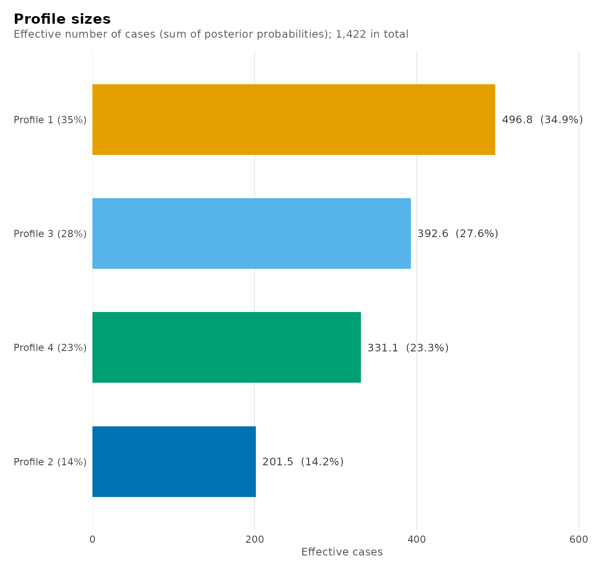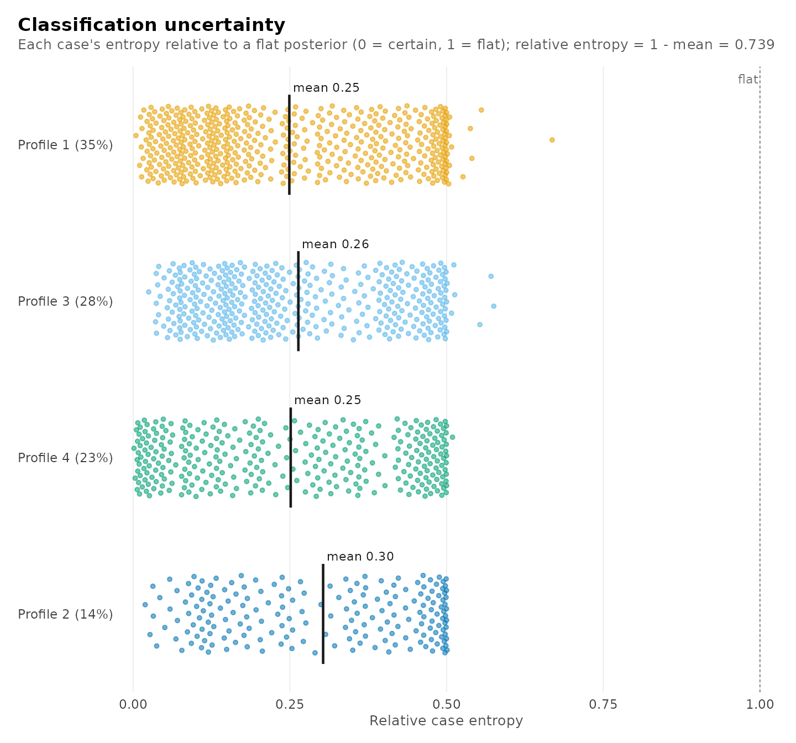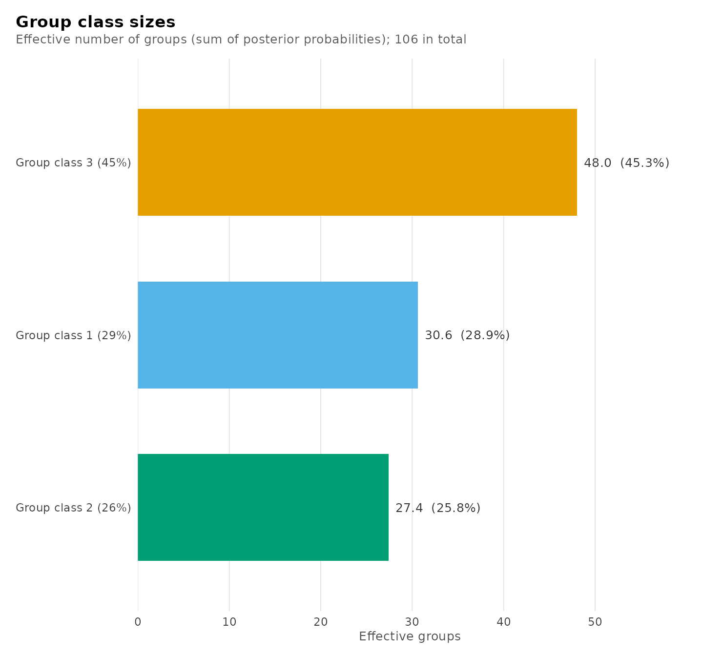

With two or more group classes, the four views for the enrolments in
their profiles are followed by the same views for the students in their
group classes. Because a student is classified from all of their
enrolments jointly, the group classes are typically far better separated
than the profiles. A single view is selected with `what`, for example
`plot_diagnostics(chosen, what = "group_posteriors")`.

Each enrolment with its modal profile, the group class of its student
and its posterior probabilities:

``` r

head(get_results(chosen, "assignments", data = course_engagement))
#>   student course sequence browse lectures forum_read forum_post attendance previous_grade
#> 1       1     23        1   0.73    -0.08       0.30       0.67       0.72           0.54
#> 2       1     19        2   0.68     0.53      -0.02      -0.55       0.70          -0.71
#> 3       1      4        3  -1.51    -0.51      -0.91      -0.80      -0.97           1.98
#> 4       1     18        4   0.64    -1.02      -1.62      -1.20      -1.26          -1.42
#> 5       1     16        5  -0.94    -0.37      -0.71      -0.28      -1.52          -0.67
#> 6       1     29        6  -0.36    -0.46      -0.77      -0.43      -1.34          -0.40
#>   engagement student_type profile group_class uncertainty posterior_profile_1 posterior_profile_2
#> 1    engaged     wavering       4           1       0.500            4.98e-01            3.08e-09
#> 2    engaged     wavering       1           1       0.327            6.73e-01            5.35e-07
#> 3 disengaged     wavering       2           1       0.476            2.03e-06            5.24e-01
#> 4 disengaged     wavering       3           1       0.294            1.73e-06            2.94e-01
#> 5 disengaged     wavering       2           1       0.379            7.38e-07            6.21e-01
#> 6 disengaged     wavering       3           1       0.358            5.22e-06            3.58e-01
#>   posterior_profile_3 posterior_profile_4
#> 1             0.00202            5.00e-01
#> 2             0.04900            2.78e-01
#> 3             0.47616            1.15e-11
#> 4             0.70649            5.80e-12
#> 5             0.37910            1.15e-12
#> 6             0.64228            2.79e-11
```

The profiles can be related to external variables. The mean of
`previous_grade` in each profile is estimated with
[`three_step()`](https://pak.dynasite.org/latents/reference/three_step.md),
which corrects for classification error by the BCH method (Bolck, Croon
and Hagenaars, 2004; Vermunt, 2010).

``` r

three_step(chosen, data = course_engagement, outcome = "previous_grade")
#> Distal outcome by class (bch, 95% CI)
#> 
#> Class   Mean          95% CI     SE  Effective n
#> -----  -----  --------------  -----  -----------
#>     1   0.17  [ 0.07,  0.27]  0.050       338.48
#>     2  -0.37  [-0.53, -0.20]  0.084       111.09
#>     3  -0.30  [-0.41, -0.18]  0.058       256.17
#>     4   0.31  [ 0.18,  0.45]  0.069       210.62
```

## Testing neighbouring candidates

The bootstrap likelihood ratio test (McLachlan, 1987) compares two
candidates that differ by one class. Data sets are simulated from the
smaller candidate and both candidates are re-estimated on each. With `B`
simulated data sets, of which `b` yield a likelihood ratio at least as
large as the observed one, the p-value is `(b + 1) / (B + 1)` (Davison
and Hinkley, 1997); the additional count includes the observed statistic
and precludes a p-value of zero from a finite simulation. The p-value is
withheld unless every replicate satisfies the estimation checks. The
test below compares three and four profiles with three group classes.
Nineteen simulated data sets keep the example brief; the smallest
attainable p-value is then 1/20 = 0.05, and applied analyses should use
at least 99.

``` r

smaller <- get_candidate(models, "profiles3_groups3")
larger <- get_candidate(models, "profiles4_groups3")
test <- bootstrap_lrt(smaller, larger, data = course_engagement,
                      iter = 19, n_starts = 2, seed = 1)
#> Warning: Profile 4: 7.2 Gaussian membership mass for 10 free means and variances. This is a
#> conservative diagnostic, not an identification test; inspect the Gaussian covariance diagnostics.
test
#> Parametric bootstrap likelihood-ratio comparison
#> Null: 3 profiles, 3 group classes; alternative: 4 profiles, 3 group classes
#> Observed statistic: 82.548643
#> p-value: 0.05 (Monte Carlo SE 0.0487) from 19 of 19 valid replicates (0 invalid)
plot(test)
```


## Other model types

### Latent class models

`student_esm` contains 2,582 momentary reports from students, with eight
activities recorded as present or absent. Declaring the indicators in
`categorical` makes every candidate a latent class model, and the
candidates are named with `classes` in place of `profiles`.

``` r

activities <- c("time_with_friends", "on_social_media", "tv_video_games",
                "listened_music", "sports", "walking", "reading",
                "part_time_job")
lca_models <- enumerate_classes(student_esm, activities, "student",
                                n_profiles = 2:4, n_group_classes = 1:2,
                                categorical = activities, n_starts = 5,
                                seed = 1)
lca_models
#> Class enumeration: 6 candidate models (LCA)
#>         candidate n_profiles n_group_classes log_likelihood n_parameters   aic bic_groups
#>  classes2_groups1          2               1          -7892           17 15819      15863
#>  classes3_groups1          3               1          -7848           26 15749      15817
#>  classes4_groups1          4               1          -7811           35 15692      15783
#>  classes2_groups2          2               2          -7740           19 15518      15567
#>  classes3_groups2          3               2          -7695           29 15448      15524
#>  classes4_groups2          4               2          -7653           39 15383      15485
#>  bic_individual icl_individual profile_entropy group_entropy avepp_min avepp_max avepp_mean
#>           15918          17748           0.489            NA     0.704     0.941      0.822
#>           15901          17820           0.662            NA     0.704     0.952      0.863
#>           15897          18112           0.691            NA     0.723     0.997      0.814
#>           15629          16763           0.668         0.877     0.859     0.926      0.892
#>           15618          18204           0.529         0.910     0.647     0.846      0.778
#>           15612          18012           0.651         0.900     0.635     0.883      0.793
#>  avepp_below group_avepp_min group_avepp_max group_avepp_mean group_avepp_below converged boundary
#>            1              NA              NA               NA                NA      TRUE    FALSE
#>            1              NA              NA               NA                NA      TRUE    FALSE
#>            3              NA              NA               NA                NA      TRUE    FALSE
#>            0           0.960           0.980            0.970                 0      TRUE    FALSE
#>            1           0.974           0.984            0.979                 0      TRUE    FALSE
#>            1           0.966           0.976            0.971                 0      TRUE    FALSE
#>  n_best_replicated
#>                  5
#>                  2
#>                  1
#>                  4
#>                  1
#>                  1
#> Every column, unrounded: as.data.frame(x).
#> No candidate is selected automatically. Compare one convention consistently.
plot_selection(lca_models, what = "diagnostics")
```

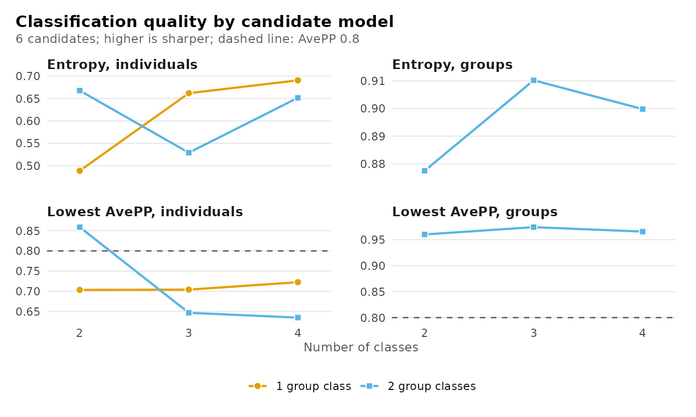

``` r

compare_models(lca_models, n_profiles = 3)
#> Model comparison
#> 
#> Model             Classes  Group classes   k    LogLik       BIC    ΔBIC  Weight       ICL  Entropy  Min AvePP  < 0.8  Group entropy  Group min AvePP
#> ----------------  -------  -------------  --  --------  --------  ------  ------  --------  -------  ---------  -----  -------------  ---------------
#> classes3_groups1        3              1  26  -7848.45  15816.64  293.10   0.000  17819.69     0.66       0.70      1                                
#> classes3_groups2        3              2  29  -7695.00  15523.55    0.00   1.000  18203.66     0.53       0.65      1           0.91             0.97
```

Among the three-class models, the model with two group classes has the
lower BIC. Its relative entropy is 0.53, and its least distinct class
has an AvePP of 0.65. The classes of this model overlap substantially,
which limits their substantive interpretation.

### Single-level models

Observations without a grouping structure are modelled with
[`enumerate_lpa()`](https://pak.dynasite.org/latents/reference/enumerate_lpa.md)
for continuous indicators and
[`enumerate_lca()`](https://pak.dynasite.org/latents/reference/enumerate_lca.md)
for categorical indicators. The candidates are named by their numbers of
profiles or classes alone.

``` r

srl_models <- enumerate_lpa(srl, c("cognitive_strategies", "intrinsic_value",
                                   "self_efficacy", "self_regulation",
                                   "test_anxiety"),
                            n_profiles = 1:8, model = "VVI", n_starts = 10,
                            seed = 1)
#> Warning: Profile 4: 9.8 Gaussian membership mass for 10 free means and variances. This is a
#> conservative diagnostic, not an identification test; inspect the Gaussian covariance diagnostics.
#> Warning: A variance reached min_variance; this is a bound-active constrained fit.
#> Warning: Profile 3: 3.0 Gaussian membership mass for 10 free means and variances. This is a
#> conservative diagnostic, not an identification test; inspect the Gaussian covariance diagnostics.
#> Warning: A variance reached min_variance; this is a bound-active constrained fit.
#> Warning: Profiles 3, 4: 1.0, 2.0 Gaussian membership mass for 10 free means and variances each.
#> This is a conservative diagnostic, not an identification test; inspect the Gaussian covariance
#> diagnostics.
srl_models
#> Class enumeration: 8 candidate models (LPA)
#>  candidate n_profiles model log_likelihood n_parameters  aic bic_groups icl_individual
#>  profiles1          1   VVI          -1247           10 2515       2552           2552
#>  profiles2          2   VVI           -889           21 1821       1898           1940
#>  profiles3          3   VVI           -736           32 1535       1654           1714
#>  profiles4          4   VVI           -683           43 1451       1611           1728
#>  profiles5          5   VVI           -644           54 1397       1597           1684
#>  profiles6          6   VVI           -611           65 1351       1592           1708
#>  profiles7          7   VVI           -553           76 1258       1539           1648
#>  profiles8          8   VVI           -556           87 1285       1608           1736
#>  profile_entropy avepp_min avepp_max avepp_mean avepp_below converged boundary n_best_replicated
#>               NA        NA        NA         NA          NA      TRUE    FALSE                10
#>            0.899     0.969     0.979      0.974           0      TRUE    FALSE                10
#>            0.909     0.936     0.975      0.959           0      TRUE    FALSE                10
#>            0.859     0.885     0.954      0.917           0      TRUE    FALSE                 8
#>            0.909     0.921     0.949      0.938           0      TRUE    FALSE                 7
#>            0.892     0.886     0.959      0.934           0      TRUE    FALSE                 5
#>            0.907     0.904     0.995      0.949           0      TRUE     TRUE                 1
#>            0.897     0.896     1.000      0.937           0      TRUE     TRUE                 1
#> Every column, unrounded: as.data.frame(x).
#> No candidate is selected automatically. Compare one convention consistently.
compare_models(srl_models, "profiles5", "profiles6", "profiles7")
#> Model comparison
#> 
#> Model      Profiles   k   LogLik      BIC   ΔBIC  Weight      ICL  Entropy  Min AvePP  < 0.8
#> ---------  --------  --  -------  -------  -----  ------  -------  -------  ---------  -----
#> profiles5         5  54  -644.38  1596.76  57.27   0.000  1684.32     0.91       0.92      0
#> profiles6         6  65  -610.52  1591.78  52.30   0.000  1707.76     0.89       0.89      0
#> profiles7         7  76  -553.00  1539.48   0.00   1.000  1648.49     0.91       0.90      0
plot_selection(srl_models, what = "deltas")
```

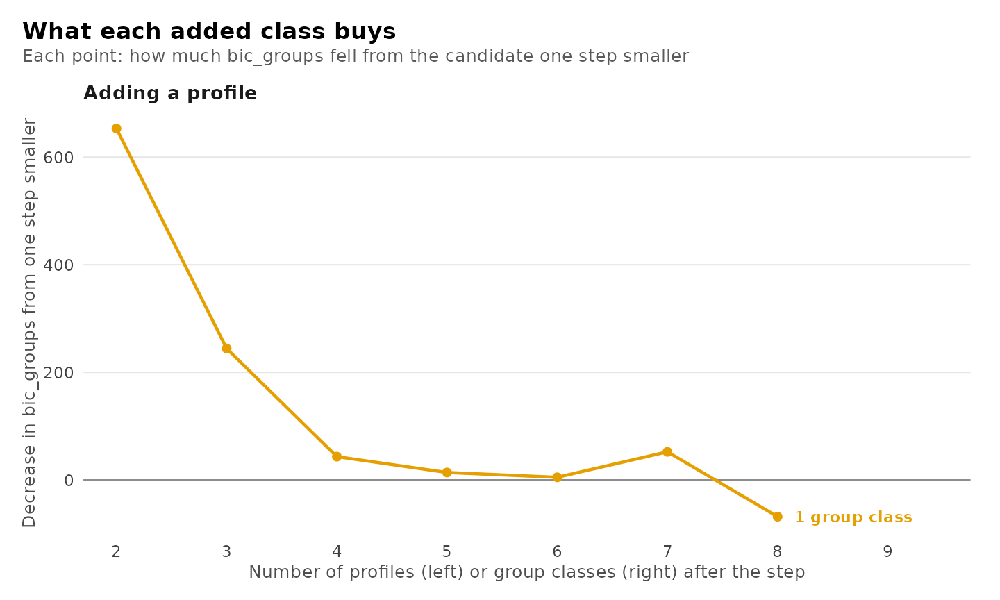

BIC is minimized by profiles7, but that candidate is a boundary fit: a
variance reached its lower bound, and one profile holds about 3
observations. Its low BIC reflects a nearly degenerate component, not a
better description of the data. The six-profile candidate is the best
fit that is not on the boundary, but it too has a profile of about 10
observations, too few to determine its own ten means and variances. The
enumeration reports both with a `latents_thin_profiles` warning; such a
profile may be a spurious maximum, and the choice should be weighed
against the five-profile candidate, which
[`compare_models()`](https://pak.dynasite.org/latents/reference/compare_models.md)
shows beside them. The eight-profile candidate is also on the boundary,
with two nearly empty profiles, which marks the limit of what 300
observations can support. Every warning issued during the enumeration is
retained in the `warnings` column of the table.

### Missing values and scaled indicators

Two arguments alter the data to which the candidates are fitted and,
like `n_starts`, apply to all candidates. With `missing = "fiml"`, rows
with some indicators missing contribute through the indicators observed
(full information maximum likelihood); rows with every indicator missing
are excluded from the individual sample size, entropy and AvePP, since
they carry no information on class membership. `centering` subtracts and
`scaling` divides by a mean or standard deviation computed over the
sample (`"grand"`) or within each group (`"person"`); combined, they
yield grand or within-person z-scores. Information criteria are
comparable only among candidates fitted under the same settings. [Model
selection](https://pak.dynasite.org/latents/articles/model-selection.md)
describes both with examples.

### Multiple covariance structures

Specifying several structures in `model` multiplies the candidates, and
the structure is appended to each name. Because the numbers of classes
then match several candidates, a candidate must be specified by its full
name.

``` r

crossed_models <- enumerate_lpa(srl, c("cognitive_strategies",
                                       "intrinsic_value", "self_efficacy",
                                       "self_regulation", "test_anxiety"),
                                n_profiles = 2:4, model = c("VVI", "EEE"),
                                n_starts = 5, seed = 1)
crossed_models
#> Class enumeration: 6 candidate models (LPA)
#>      candidate n_profiles model log_likelihood n_parameters  aic bic_groups icl_individual
#>  profiles2_VVI          2   VVI           -889           21 1821       1898           1940
#>  profiles3_VVI          3   VVI           -736           32 1535       1654           1714
#>  profiles4_VVI          4   VVI           -683           43 1451       1611           1728
#>  profiles2_EEE          2   EEE           -601           26 1254       1350           1457
#>  profiles3_EEE          3   EEE           -593           32 1250       1369           1609
#>  profiles4_EEE          4   EEE           -582           38 1240       1381           1574
#>  profile_entropy avepp_min avepp_max avepp_mean avepp_below converged boundary n_best_replicated
#>            0.899     0.969     0.979      0.974           0      TRUE    FALSE                 5
#>            0.909     0.936     0.975      0.959           0      TRUE    FALSE                 5
#>            0.859     0.885     0.954      0.917           0      TRUE    FALSE                 3
#>            0.744     0.880     0.954      0.917           0      TRUE    FALSE                 5
#>            0.635     0.796     0.881      0.834           1      TRUE    FALSE                 2
#>            0.769     0.818     0.918      0.878           0      TRUE    FALSE                 1
#> Every column, unrounded: as.data.frame(x).
#> No candidate is selected automatically. Compare one convention consistently.
compare_models(crossed_models, "profiles3_VVI", "profiles3_EEE")
#> Model comparison
#> 
#> Model          Profiles   k   LogLik      BIC    ΔBIC  Weight      ICL  Entropy  Min AvePP  < 0.8
#> -------------  --------  --  -------  -------  ------  ------  -------  -------  ---------  -----
#> profiles3_VVI         3  32  -735.74  1654.00  285.32   0.000  1714.03     0.91       0.94      0
#> profiles3_EEE         3  32  -593.08  1368.68    0.00   1.000  1609.46     0.63       0.80      1
```

### Latent transition models

With `time`, every candidate is a latent transition model over the
occasions, here the order of each student’s enrolments in `sequence`.
The six-profile model requires more than the default 1,000 EM iterations
to meet the convergence tolerance, so `max_iter` is increased.

``` r

transition_models <- enumerate_classes(course_engagement, activity, "student",
                                       time = "sequence", n_profiles = 2:6,
                                       n_group_classes = 1, n_starts = 3,
                                       max_iter = 2000, seed = 1)
transition_models
#> Transition-model enumeration: 5 candidates (LTA)
#>          candidate n_profiles n_group_classes model log_likelihood n_parameters   bic   aic entropy
#>  profiles2_groups1          2               1  <NA>          -8335           23 16778 16717  0.9611
#>  profiles3_groups1          3               1  <NA>          -8262           38 16701 16600  0.8006
#>  profiles4_groups1          4               1  <NA>          -8219           55 16695 16548  0.7352
#>  profiles5_groups1          5               1  <NA>          -8195           74 16736 16538  0.7793
#>  profiles6_groups1          6               1  <NA>          -8180           95 16804 16551  0.7020
#>  converged boundary
#>       TRUE    FALSE
#>       TRUE    FALSE
#>       TRUE    FALSE
#>       TRUE    FALSE
#>       TRUE    FALSE
#> Pick one by its name: get_candidate(x, "<candidate>").
compare_models(transition_models)
#> Model comparison
#> 
#> Model              Profiles   k    LogLik       BIC    ΔBIC  Weight       ICL  Entropy  Min AvePP  < 0.8
#> -----------------  --------  --  --------  --------  ------  ------  --------  -------  ---------  -----
#> profiles2_groups1         2  23  -8335.29  16777.83   83.11   0.000  16914.15     0.96       0.99      0
#> profiles3_groups1         3  38  -8261.98  16701.16    6.43   0.039  17422.86     0.80       0.84      0
#> profiles4_groups1         4  55  -8219.12  16694.73    0.00   0.961  17881.60     0.74       0.82      0
#> profiles5_groups1         5  74  -8195.25  16735.59   40.86   0.000  17937.99     0.78       0.81      0
#> profiles6_groups1         6  95  -8180.49  16804.01  109.28   0.000  18569.25     0.70       0.69      4
```

## Functions

| Call | Result |
|:---|:---|
| enumerate_classes(data, vars, id, n_profiles, n_group_classes, model) | The fitted candidate models |
| enumerate_classes(…, n_starts = , missing = “fiml”, centering = , scaling = ) | The same starts, missing-data handling, centring and scaling for every candidate |
| enumerate_classes(…, boundary = “exclude”) | Starts with a variance at its lower bound set aside for every candidate |
| as.data.frame(models) | One row per candidate with every column |
| get_results(models, “best”) | The candidate at the minimum of each criterion |
| get_results(models, “classification”) | Size, AvePP and entropy of every class of every candidate |
| get_results(models, “candidates”, cutoff = 0.9) | The table of candidates with another AvePP cutoff |
| get_results(models, “deltas”, using = ) | Decrease in a criterion from one profile fewer and one group class fewer |
| get_results(models, “knees”, using = ) | Maximum chord-distance knee of each line, its range and its stability |
| plot_enumeration(models), plot_enumeration(models, what = “bic_groups”), what = “all” | Information criteria across the candidates |
| plot_tree(models) | Division of profiles as more are added |
| plot_enumeration(models, what = “entropy”, “avepp” or “diagnostics”, cutoff = ) | Entropy and lowest AvePP across the candidates |
| plot_selection(models, what = “deltas”, “heatmap”, “smallest” or “trust”, using = ) | Decreases, distance from the lowest criterion, smallest class, estimation checks |
| plot_selection(models) | All of the plots for choosing the number of classes |
| get_candidate(models, “profiles4_groups3”), get_candidate(models, 4, 3) | One fitted candidate |
| compare_models(models, “name”, c(4, 2), …) | Named candidates side by side |
| compare_models(models, n_profiles = , n_group_classes = ) | All candidates with the given numbers of classes |
| compare_models(name = fit, name = fit) | Fitted models side by side, on the same data |
| get_candidate(comparison, “name”) | The model behind a row of a comparison |
| get_results(comparison, “classification”) | Every class of every compared model |

## References

Akaike, H. (1974). A new look at the statistical model identification.
*IEEE Transactions on Automatic Control*, 19, 716–723.

Banfield, J. D., & Raftery, A. E. (1993). Model-based Gaussian and
non-Gaussian clustering. *Biometrics*, 49, 803–821.

Biernacki, C., Celeux, G., & Govaert, G. (2000). Assessing a mixture
model for clustering with the integrated completed likelihood. *IEEE
Transactions on Pattern Analysis and Machine Intelligence*, 22, 719–725.

Biernacki, C., Celeux, G., & Govaert, G. (2003). Choosing starting
values for the EM algorithm for getting the highest likelihood in
multivariate Gaussian mixture models. *Computational Statistics & Data
Analysis*, 41, 561–575.

Bolck, A., Croon, M., & Hagenaars, J. (2004). Estimating latent
structure models with categorical variables: One-step versus three-step
estimators. *Political Analysis*, 12, 3–27.

Davison, A. C., & Hinkley, D. V. (1997). *Bootstrap methods and their
application*. Cambridge University Press.

Lukočienė, O., Varriale, R., & Vermunt, J. K. (2010). The simultaneous
decision(s) about the number of lower- and higher-level classes in
multilevel latent class analysis. *Sociological Methodology*, 40,
247–283.

McLachlan, G. J. (1987). On bootstrapping the likelihood ratio test
statistic for the number of components in a normal mixture. *Applied
Statistics*, 36, 318–324.

McLachlan, G. J., & Peel, D. (2000). *Finite mixture models*. Wiley.

Nagin, D. S. (2005). *Group-based modeling of development*. Harvard
University Press.

Nylund, K. L., Asparouhov, T., & Muthén, B. O. (2007). Deciding on the
number of classes in latent class analysis and growth mixture modeling:
A Monte Carlo simulation study. *Structural Equation Modeling*, 14,
535–569.

Ramaswamy, V., DeSarbo, W. S., Reibstein, D. J., & Robinson, W. T.
(1993). An empirical pooling approach for estimating marketing mix
elasticities with PIMS data. *Marketing Science*, 12, 103–124.

Satopää, V., Albrecht, J., Irwin, D., & Raghavan, B. (2011). Finding a
“kneedle” in a haystack: Detecting knee points in system behavior. In
*31st International Conference on Distributed Computing Systems
Workshops* (pp. 166–171). IEEE.

Schwarz, G. (1978). Estimating the dimension of a model. *The Annals of
Statistics*, 6, 461–464.

Vermunt, J. K. (2003). Multilevel latent class models. *Sociological
Methodology*, 33, 213–239.

Vermunt, J. K. (2010). Latent class modeling with covariates: Two
improved three-step approaches. *Political Analysis*, 18, 450–469.

Wagenmakers, E.-J., & Farrell, S. (2004). AIC model selection using
Akaike weights. *Psychonomic Bulletin & Review*, 11, 192–196.

Zappia, L., & Oshlack, A. (2018). Clustering trees: A visualization for
evaluating clusterings at multiple resolutions. *GigaScience*, 7(7),
giy083.
