# Class enumeration

Mixture models explain heterogeneity in a population by assuming that it
consists of a small number of unobserved subpopulations, the latent
classes, each with its own pattern of responses. In latent profile
analysis the pattern is a set of means of continuous indicators, and in
latent class analysis it is a set of response probabilities of
categorical indicators. When observations are nested in groups, the
groups themselves can differ. Course enrolments, for example, are nested
within students, and one student may be engaged in most of their courses
while another is engaged in few. A two-level model captures such
differences with a second set of latent classes, the group classes. Each
group class is a type of student, defined by the proportions of the
student’s enrolments that fall in each profile. For a given number of
classes, the model estimates how large each class is and what its
response pattern looks like. The number of classes itself is an input to
the estimation, and the model returns no estimate of it. The analyst
fixes the number of profiles, and in a two-level model the number of
group classes, before estimation, and every substantive conclusion of
the analysis depends on that choice.

Choosing the number of classes is difficult because the usual tools for
comparing models each fall short in a specific way. Fit alone always
favours more classes, since a model with one more class can reproduce
the smaller model and improve on it. The likelihood ratio test, which
compares nested models in most settings, gives invalid p-values here. A
model with k classes is a model with k + 1 classes in which one class
has size zero, and at that edge of the parameter space the test
statistic loses its usual reference distribution. Valid p-values then
require simulating many data sets from the smaller model and refitting
both models to each, which is slow when many candidates are compared.
Information criteria avoid testing altogether and instead balance fit
against a charge for every estimated parameter. The criteria differ in
that charge, so the Akaike information criterion, with a light charge,
tends to favour more classes than the Bayesian information criterion,
with a heavier one.

Applied data raise further problems. In large samples even the Bayesian
information criterion often keeps decreasing as classes are added,
because small departures from the model become detectable and each new
class absorbs some of them. The lowest value then falls on the largest
model that was fitted, and the size of each improvement says more than
the position of the minimum. In a two-level model the number of profiles
and the number of group classes are chosen together, and the charge of
the Bayesian information criterion depends on whether the sample size
counts the students or their enrolments. Finally, a model can fit the
data well and still separate its classes poorly, so that many enrolments
or students sit between classes, and its estimate can be a local maximum
of the likelihood that a different starting point would improve.

This document applies class enumeration to a two-level latent profile
model. Every combination of the requested numbers of profiles and group
classes is fitted with
[`enumerate_classes()`](https://pak.dynasite.org/latents/reference/enumerate_classes.md),
and every fitted model is kept. Each candidate is described by its
information criteria under both definitions of the sample size, by the
decrease of a criterion with each added profile and each added group
class, by the knee of each of these curves, by the certainty of its
classification and by checks of its estimation. Selected candidates are
then compared side by side. The chosen candidate is taken from the
fitted candidates for further analysis.

The evidence is reported in full because no single statistic determines
the number of classes. The criteria, the changes between candidates and
the classification quality together show where additional classes stop
improving the model. A choice made from this evidence can be stated,
justified and reproduced from the reported tables.

``` r

library(latents)
```

## Data

The examples use `course_engagement`, a data frame in long format with
one row per course enrolment. It contains 1,422 enrolments of 106
students. Five measures of activity in each course serve as indicators:
browsing of the course site, lecture viewing, reading of the forum,
posting to the forum and attendance. Each measure is standardized within
its course, so a value of zero is the course average. The column
`student` identifies the student to whom each enrolment belongs.

``` r

head(course_engagement)
#>   student course sequence browse lectures forum_read forum_post attendance previous_grade
#> 1       1     23        1   0.73    -0.08       0.30       0.67       0.72           0.54
#> 2       1     19        2   0.68     0.53      -0.02      -0.55       0.70          -0.71
#> 3       1      4        3  -1.51    -0.51      -0.91      -0.80      -0.97           1.98
#> 4       1     18        4   0.64    -1.02      -1.62      -1.20      -1.26          -1.42
#> 5       1     16        5  -0.94    -0.37      -0.71      -0.28      -1.52          -0.67
#> 6       1     29        6  -0.36    -0.46      -0.77      -0.43      -1.34          -0.40
#>   engagement student_type
#> 1    engaged     wavering
#> 2    engaged     wavering
#> 3 disengaged     wavering
#> 4 disengaged     wavering
#> 5 disengaged     wavering
#> 6 disengaged     wavering
```

Enrolments are nested in students. The profiles therefore describe
patterns of activity in a single course, and the group classes describe
students by how their enrolments are distributed across those patterns.

## Fitting the candidate models

The candidates are fitted with
[`enumerate_classes()`](https://pak.dynasite.org/latents/reference/enumerate_classes.md)
from the data, the indicators in `vars` and the group identifier in
`id`. The arguments `n_profiles` and `n_group_classes` give the numbers
of classes to try, and one model is fitted for every combination of
them. Here the numbers of profiles run from one to six and the numbers
of group classes from one to four. The argument `model` sets the
covariance structure of the profiles. The value `"VVI"` gives every
profile its own variances and fixes the covariances at zero. Without
`model`, the four basic structures are fitted for every combination.

The likelihood of a mixture model has several local maxima, so each
model is estimated from several random starts and the solution with the
highest likelihood is kept. The argument `n_starts` sets the number of
starts. The example uses three starts per model to keep the computation
short. Applied analyses use ten or more. The argument `seed` makes the
starts reproducible. With many starts, a candidate with too many
profiles can reach a solution in which one profile sits on a single
observation with every variance at its lower bound; its likelihood is
then set by `min_variance`, not by the data. `boundary = "exclude"` sets
such starts aside (see *Checks of the estimation*). A profile with fewer
members than its own means and variances is reported by a
`latents_thin_profiles` warning, as in the grid below; its means and
variances rest on few observations. When every profile shares one
covariance matrix (EII, EEI, EEE), the default search is emEM: it
screens five times as many starts by short EM runs and continues the
best. The other structures start from k-means, because with
profile-specific variances emEM also reaches spurious maxima more often.
`search = "emEM"` or `"kmeans"` overrides either default. Large grids
take time; `cores` fits the candidates in parallel and returns the same
result as one core.

``` r

activity <- c("browse", "lectures", "forum_read", "forum_post", "attendance")
models <- enumerate_classes(course_engagement, activity, "student",
                            n_profiles = 1:6, n_group_classes = 1:4,
                            model = "VVI", n_starts = 3, seed = 1)
#> Warning: Profile 4: 4.9 Gaussian membership mass for 10 free means and variances. This is a
#> conservative diagnostic, not an identification test; inspect the Gaussian covariance diagnostics.
models
#> Class enumeration: 24 candidate models (LPA)
#>          candidate n_profiles n_group_classes model log_likelihood n_parameters   aic bic_groups
#>  profiles1_groups1          1               1   VVI         -10007           10 20035      20062
#>  profiles2_groups1          2               1   VVI          -8615           21 17272      17328
#>  profiles3_groups1          3               1   VVI          -8537           32 17137      17222
#>  profiles4_groups1          4               1   VVI          -8501           43 17088      17203
#>  profiles5_groups1          5               1   VVI          -8484           54 17077      17220
#>  profiles6_groups1          6               1   VVI          -8481           65 17093      17266
#>  profiles1_groups2          1               2   VVI             NA           NA    NA         NA
#>  profiles2_groups2          2               2   VVI          -8440           23 16926      16987
#>  profiles3_groups2          3               2   VVI          -8365           35 16799      16892
#>  profiles4_groups2          4               2   VVI          -8326           47 16746      16872
#>  profiles5_groups2          5               2   VVI          -8309           59 16735      16892
#>  profiles6_groups2          6               2   VVI          -8297           71 16737      16926
#>  profiles1_groups3          1               3   VVI             NA           NA    NA         NA
#>  profiles2_groups3          2               3   VVI          -8421           25 16892      16959
#>  profiles3_groups3          3               3   VVI          -8348           38 16773      16874
#>  profiles4_groups3          4               3   VVI          -8307           51 16716      16852
#>  profiles5_groups3          5               3   VVI          -8291           64 16709      16880
#>  profiles6_groups3          6               3   VVI          -8279           77 16712      16917
#>  profiles1_groups4          1               4   VVI             NA           NA    NA         NA
#>  profiles2_groups4          2               4   VVI          -8415           27 16884      16956
#>  profiles3_groups4          3               4   VVI          -8343           41 16767      16876
#>  profiles4_groups4          4               4   VVI          -8301           55 16711      16858
#>  profiles5_groups4          5               4   VVI          -8283           69 16704      16887
#>  profiles6_groups4          6               4   VVI          -8268           83 16703      16924
#>  bic_individual icl_individual profile_entropy group_entropy avepp_min avepp_max avepp_mean
#>           20088          20088              NA            NA        NA        NA         NA
#>           17383          17537           0.922            NA     0.974     0.982      0.978
#>           17306          18017           0.772            NA     0.832     0.964      0.886
#>           17314          18359           0.735            NA     0.803     0.849      0.835
#>           17361          18401           0.773            NA     0.804     0.962      0.861
#>           17435          19124           0.669            NA     0.627     0.812      0.729
#>              NA             NA              NA            NA        NA        NA         NA
#>           17047          17168           0.938         0.940     0.982     0.985      0.983
#>           16983          17640           0.790         0.943     0.849     0.979      0.893
#>           16994          18021           0.739         0.937     0.791     0.858      0.835
#>           17045          18076           0.775         0.965     0.803     0.860      0.839
#>           17110          18476           0.732         0.946     0.699     0.845      0.780
#>              NA             NA              NA            NA        NA        NA         NA
#>           17024          17142           0.940         0.816     0.982     0.986      0.984
#>           16973          17622           0.792         0.797     0.845     0.978      0.892
#>           16985          18014           0.739         0.823     0.801     0.854      0.836
#>           17046          18353           0.714         0.854     0.628     0.843      0.779
#>           17117          18780           0.674         0.853     0.655     0.795      0.743
#>              NA             NA              NA            NA        NA        NA         NA
#>           17026          17140           0.942         0.798     0.984     0.986      0.985
#>           16983          17630           0.793         0.772     0.843     0.980      0.892
#>           17000          18027           0.740         0.803     0.801     0.853      0.837
#>           17067          18207           0.751         0.830     0.786     0.853      0.820
#>           17139          18540           0.725         0.851     0.654     0.847      0.783
#>  avepp_below group_avepp_min group_avepp_max group_avepp_mean group_avepp_below converged boundary
#>           NA              NA              NA               NA                NA      TRUE    FALSE
#>            0              NA              NA               NA                NA      TRUE    FALSE
#>            0              NA              NA               NA                NA      TRUE    FALSE
#>            0              NA              NA               NA                NA      TRUE    FALSE
#>            0              NA              NA               NA                NA      TRUE    FALSE
#>            5              NA              NA               NA                NA      TRUE    FALSE
#>           NA              NA              NA               NA                NA     FALSE       NA
#>            0           0.969           0.992            0.980                 0      TRUE    FALSE
#>            0           0.977           0.992            0.985                 0      TRUE    FALSE
#>            1           0.975           0.990            0.983                 0      TRUE    FALSE
#>            0           0.990           0.996            0.993                 0      TRUE    FALSE
#>            4           0.972           0.987            0.979                 0      TRUE    FALSE
#>           NA              NA              NA               NA                NA     FALSE       NA
#>            0           0.900           0.962            0.923                 0      TRUE    FALSE
#>            0           0.864           0.977            0.913                 0      TRUE    FALSE
#>            0           0.874           0.981            0.923                 0      TRUE    FALSE
#>            1           0.917           0.987            0.941                 0      TRUE    FALSE
#>            6           0.915           0.984            0.941                 0      TRUE    FALSE
#>           NA              NA              NA               NA                NA     FALSE       NA
#>            0           0.851           0.912            0.877                 0      TRUE    FALSE
#>            0           0.841           0.902            0.864                 0      TRUE    FALSE
#>            0           0.867           0.903            0.885                 0      TRUE    FALSE
#>            1           0.882           0.926            0.904                 0      TRUE    FALSE
#>            3           0.898           0.940            0.916                 0      TRUE    FALSE
#>  n_best_replicated
#>                  3
#>                  3
#>                  3
#>                  3
#>                  1
#>                  1
#>                 NA
#>                  3
#>                  3
#>                  3
#>                  2
#>                  1
#>                 NA
#>                  3
#>                  3
#>                  3
#>                  2
#>                  2
#>                 NA
#>                  3
#>                  3
#>                  2
#>                  1
#>                  1
#> 3 candidate(s) did not converge; see as.data.frame(x).
#> No candidate is selected automatically. Compare one convention consistently.
```

The result holds 24 fitted candidates. Each candidate is named by its
numbers of profiles and group classes, so that `profiles4_groups3` has
four profiles and three group classes, and the name identifies the
candidate in every function that follows. The 3 candidates with one
profile and several group classes could not be estimated. Group classes
are defined by differences in the distribution of profiles, and a model
with a single profile has no such differences. These candidates remain
in the table with the error that stopped them.

## The table of candidates

The table of candidates has one row per candidate and is returned by
[`as.data.frame()`](https://rdrr.io/r/base/as.data.frame.html).

``` r

as.data.frame(models)
#>            candidate n_profiles n_group_classes model log_likelihood n_parameters   aic   kic
#> 1  profiles1_groups1          1               1   VVI         -10007           10 20035 20048
#> 2  profiles2_groups1          2               1   VVI          -8615           21 17272 17296
#> 3  profiles3_groups1          3               1   VVI          -8537           32 17137 17172
#> 4  profiles4_groups1          4               1   VVI          -8501           43 17088 17134
#> 5  profiles5_groups1          5               1   VVI          -8484           54 17077 17134
#> 6  profiles6_groups1          6               1   VVI          -8481           65 17093 17161
#> 7  profiles1_groups2          1               2   VVI             NA           NA    NA    NA
#> 8  profiles2_groups2          2               2   VVI          -8440           23 16926 16952
#> 9  profiles3_groups2          3               2   VVI          -8365           35 16799 16837
#> 10 profiles4_groups2          4               2   VVI          -8326           47 16746 16796
#> 11 profiles5_groups2          5               2   VVI          -8309           59 16735 16797
#> 12 profiles6_groups2          6               2   VVI          -8297           71 16737 16811
#> 13 profiles1_groups3          1               3   VVI             NA           NA    NA    NA
#> 14 profiles2_groups3          2               3   VVI          -8421           25 16892 16920
#> 15 profiles3_groups3          3               3   VVI          -8348           38 16773 16814
#> 16 profiles4_groups3          4               3   VVI          -8307           51 16716 16770
#> 17 profiles5_groups3          5               3   VVI          -8291           64 16709 16776
#> 18 profiles6_groups3          6               3   VVI          -8279           77 16712 16792
#> 19 profiles1_groups4          1               4   VVI             NA           NA    NA    NA
#> 20 profiles2_groups4          2               4   VVI          -8415           27 16884 16914
#> 21 profiles3_groups4          3               4   VVI          -8343           41 16767 16811
#> 22 profiles4_groups4          4               4   VVI          -8301           55 16711 16769
#> 23 profiles5_groups4          5               4   VVI          -8283           69 16704 16776
#> 24 profiles6_groups4          6               4   VVI          -8268           83 16703 16789
#>    bic_groups bic_individual sabic_groups sabic_individual caic_groups caic_individual awe_groups
#> 1       20062          20088        20030            20056       20072           20098      20138
#> 2       17328          17383        17262            17316       17349           17404      17489
#> 3       17222          17306        17121            17204       17254           17338      17468
#> 4       17203          17314        17067            17178       17246           17357      17532
#> 5       17220          17361        17050            17189       17274           17415      17634
#> 6       17266          17435        17061            17228       17331           17500      17764
#> 7          NA             NA           NA               NA          NA              NA         NA
#> 8       16987          17047        16914            16974       17010           17070      17172
#> 9       16892          16983        16782            16872       16927           17018      17169
#> 10      16872          16994        16723            16844       16919           17041      17241
#> 11      16892          17045        16706            16858       16951           17104      17350
#> 12      16926          17110        16701            16884       16997           17181      17478
#> 13         NA             NA           NA               NA          NA              NA         NA
#> 14      16959          17024        16880            16944       16984           17049      17193
#> 15      16874          16973        16754            16852       16912           17011      17212
#> 16      16852          16985        16691            16823       16903           17036      17284
#> 17      16880          17046        16677            16842       16944           17110      17404
#> 18      16917          17117        16674            16872       16994           17194      17541
#> 19         NA             NA           NA               NA          NA              NA         NA
#> 20      16956          17026        16871            16941       16983           17053      17223
#> 21      16876          16983        16747            16853       16917           17024      17258
#> 22      16858          17000        16684            16826       16913           17055      17337
#> 23      16887          17067        16669            16847       16956           17136      17466
#> 24      16924          17139        16661            16876       17007           17222      17604
#>    awe_individual icl_groups icl_individual clc_groups clc_individual profile_entropy group_entropy
#> 1           20190      20062          20088      20015          20015              NA            NA
#> 2           17753      17328          17537      17230          17385           0.922            NA
#> 3           18345      17222          18017      17073          17785           0.772            NA
#> 4           18800      17203          18359      17002          18047           0.735            NA
#> 5           18955      17220          18401      16969          18009           0.773            NA
#> 6           19791      17266          19124      16963          18652           0.669            NA
#> 7              NA         NA             NA         NA             NA              NA            NA
#> 8           17404      16996          17168      16889          17002           0.938         0.940
#> 9           18000      16901          17640      16737          17386           0.790         0.943
#> 10          18503      16881          18021      16662          17680           0.739         0.937
#> 11          18682      16897          18076      16622          17648           0.775         0.965
#> 12          19205      16934          18476      16602          17961           0.732         0.946
#> 13             NA         NA             NA         NA             NA              NA            NA
#> 14          17398      17001          17142      16885          16960           0.940         0.816
#> 15          18012      16921          17622      16744          17346           0.792         0.797
#> 16          18537      16893          18014      16656          17644           0.739         0.823
#> 17          19010      16914          18353      16615          17888           0.714         0.854
#> 18          19570      16951          18780      16592          18221           0.674         0.853
#> 19             NA         NA             NA         NA             NA              NA            NA
#> 20          17417      17016          17140      16890          16944           0.942         0.798
#> 21          18051      16943          17630      16752          17332           0.793         0.772
#> 22          18592      16916          18027      16659          17628           0.740         0.803
#> 23          18915      16937          18207      16616          17706           0.751         0.830
#> 24          19392      16967          18540      16580          17938           0.725         0.851
#>    avepp_min avepp_max avepp_mean avepp_below group_avepp_min group_avepp_max group_avepp_mean
#> 1         NA        NA         NA          NA              NA              NA               NA
#> 2      0.974     0.982      0.978           0              NA              NA               NA
#> 3      0.832     0.964      0.886           0              NA              NA               NA
#> 4      0.803     0.849      0.835           0              NA              NA               NA
#> 5      0.804     0.962      0.861           0              NA              NA               NA
#> 6      0.627     0.812      0.729           5              NA              NA               NA
#> 7         NA        NA         NA          NA              NA              NA               NA
#> 8      0.982     0.985      0.983           0           0.969           0.992            0.980
#> 9      0.849     0.979      0.893           0           0.977           0.992            0.985
#> 10     0.791     0.858      0.835           1           0.975           0.990            0.983
#> 11     0.803     0.860      0.839           0           0.990           0.996            0.993
#> 12     0.699     0.845      0.780           4           0.972           0.987            0.979
#> 13        NA        NA         NA          NA              NA              NA               NA
#> 14     0.982     0.986      0.984           0           0.900           0.962            0.923
#> 15     0.845     0.978      0.892           0           0.864           0.977            0.913
#> 16     0.801     0.854      0.836           0           0.874           0.981            0.923
#> 17     0.628     0.843      0.779           1           0.917           0.987            0.941
#> 18     0.655     0.795      0.743           6           0.915           0.984            0.941
#> 19        NA        NA         NA          NA              NA              NA               NA
#> 20     0.984     0.986      0.985           0           0.851           0.912            0.877
#> 21     0.843     0.980      0.892           0           0.841           0.902            0.864
#> 22     0.801     0.853      0.837           0           0.867           0.903            0.885
#> 23     0.786     0.853      0.820           1           0.882           0.926            0.904
#> 24     0.654     0.847      0.783           3           0.898           0.940            0.916
#>    group_avepp_below converged boundary min_standardized_eigenvalue min_gaussian_mass
#> 1                 NA      TRUE    FALSE                      1.0000           1422.00
#> 2                 NA      TRUE    FALSE                      0.3750            589.08
#> 3                 NA      TRUE    FALSE                      0.1932            418.21
#> 4                 NA      TRUE    FALSE                      0.1893            172.20
#> 5                 NA      TRUE    FALSE                      0.0036              4.89
#> 6                 NA      TRUE    FALSE                      0.1556             95.07
#> 7                 NA     FALSE       NA                          NA                NA
#> 8                  0      TRUE    FALSE                      0.3715            587.90
#> 9                  0      TRUE    FALSE                      0.2000            382.59
#> 10                 0      TRUE    FALSE                      0.2003            178.19
#> 11                 0      TRUE    FALSE                      0.0636             36.89
#> 12                 0      TRUE    FALSE                      0.0849             40.93
#> 13                NA     FALSE       NA                          NA                NA
#> 14                 0      TRUE    FALSE                      0.3748            591.09
#> 15                 0      TRUE    FALSE                      0.2003            368.95
#> 16                 0      TRUE    FALSE                      0.1950            202.20
#> 17                 0      TRUE    FALSE                      0.1681            141.26
#> 18                 0      TRUE    FALSE                      0.1745            150.21
#> 19                NA     FALSE       NA                          NA                NA
#> 20                 0      TRUE    FALSE                      0.3747            592.09
#> 21                 0      TRUE    FALSE                      0.2007            369.16
#> 22                 0      TRUE    FALSE                      0.1967            201.57
#> 23                 0      TRUE    FALSE                      0.0994             61.45
#> 24                 0      TRUE    FALSE                      0.1224            114.80
#>    n_best_replicated
#> 1                  3
#> 2                  3
#> 3                  3
#> 4                  3
#> 5                  1
#> 6                  1
#> 7                 NA
#> 8                  3
#> 9                  3
#> 10                 3
#> 11                 2
#> 12                 1
#> 13                NA
#> 14                 3
#> 15                 3
#> 16                 3
#> 17                 2
#> 18                 2
#> 19                NA
#> 20                 3
#> 21                 3
#> 22                 2
#> 23                 1
#> 24                 1
#>                                                                                                                                                                                warnings
#> 1                                                                                                                                                                                      
#> 2                                                                                                                                                                                      
#> 3                                                                                                                                                                                      
#> 4                                                                                                                                                                                      
#> 5  Profile 4: 4.9 Gaussian membership mass for 10 free means and variances. This is a conservative diagnostic, not an identification test; inspect the Gaussian covariance diagnostics.
#> 6                                                                                                                                                                                      
#> 7                                                                                                                                                                                      
#> 8                                                                                                                                                                                      
#> 9                                                                                                                                                                                      
#> 10                                                                                                                                                                                     
#> 11                                                                                                                                                                                     
#> 12                                                                                                                                                                                     
#> 13                                                                                                                                                                                     
#> 14                                                                                                                                                                                     
#> 15                                                                                                                                                                                     
#> 16                                                                                                                                                                                     
#> 17                                                                                                                                                                                     
#> 18                                                                                                                                                                                     
#> 19                                                                                                                                                                                     
#> 20                                                                                                                                                                                     
#> 21                                                                                                                                                                                     
#> 22                                                                                                                                                                                     
#> 23                                                                                                                                                                                     
#> 24                                                                                                                                                                                     
#>                                                                                     error
#> 1                                                                                    <NA>
#> 2                                                                                    <NA>
#> 3                                                                                    <NA>
#> 4                                                                                    <NA>
#> 5                                                                                    <NA>
#> 6                                                                                    <NA>
#> 7  Multiple group classes are not identifiable with one profile or only singleton groups.
#> 8                                                                                    <NA>
#> 9                                                                                    <NA>
#> 10                                                                                   <NA>
#> 11                                                                                   <NA>
#> 12                                                                                   <NA>
#> 13 Multiple group classes are not identifiable with one profile or only singleton groups.
#> 14                                                                                   <NA>
#> 15                                                                                   <NA>
#> 16                                                                                   <NA>
#> 17                                                                                   <NA>
#> 18                                                                                   <NA>
#> 19 Multiple group classes are not identifiable with one profile or only singleton groups.
#> 20                                                                                   <NA>
#> 21                                                                                   <NA>
#> 22                                                                                   <NA>
#> 23                                                                                   <NA>
#> 24                                                                                   <NA>
```

The columns fall into groups.

| Columns | Content |
|----|----|
| `candidate`, `n_profiles`, `n_group_classes`, `model` | Identity of the candidate |
| `log_likelihood`, `n_parameters` | Fit and size |
| `aic`, `kic`, `bic_*`, `sabic_*`, `caic_*`, `awe_*`, `icl_*`, `clc_*` | Information criteria |
| `profile_entropy`, `group_entropy` | Relative entropy at each level |
| `avepp_min`, `avepp_max`, `avepp_mean`, `avepp_below` | Average posterior probability of the profiles |
| `group_avepp_min`, `group_avepp_max`, `group_avepp_mean`, `group_avepp_below` | Average posterior probability of the group classes |
| `converged`, `boundary`, `n_best_replicated`, `warnings`, `error` | Checks of the estimation |

## Information criteria

An information criterion is the deviance, minus twice the maximized
log-likelihood, plus a charge for every estimated parameter. Lower
values indicate a better balance of fit and complexity. In a two-level
model the charge of several criteria depends on the sample size.
Criteria ending in `_groups` count the 106 students as the independent
units, and criteria ending in `_individual` count the 1,422 enrolments.
An analysis uses one of the two conventions throughout.

The candidate at the minimum of each criterion:

``` r

get_results(models, "best")
#>    criterion  convention         candidate n_profiles n_group_classes model value
#> 1        aic        <NA> profiles6_groups4          6               4   VVI 16703
#> 2        kic        <NA> profiles4_groups4          4               4   VVI 16769
#> 3        bic      groups profiles4_groups3          4               3   VVI 16852
#> 4        bic individuals profiles3_groups3          3               3   VVI 16973
#> 5      sabic      groups profiles6_groups4          6               4   VVI 16661
#> 6      sabic individuals profiles4_groups3          4               3   VVI 16823
#> 7       caic      groups profiles4_groups3          4               3   VVI 16903
#> 8       caic individuals profiles3_groups3          3               3   VVI 17011
#> 9        awe      groups profiles3_groups2          3               2   VVI 17169
#> 10       awe individuals profiles2_groups3          2               3   VVI 17398
#> 11       icl      groups profiles4_groups2          4               2   VVI 16881
#> 12       icl individuals profiles2_groups4          2               4   VVI 17140
#> 13       clc      groups profiles6_groups4          6               4   VVI 16580
#> 14       clc individuals profiles2_groups4          2               4   VVI 16944
```

The criteria disagree. With students as the units, the Bayesian
information criterion (BIC) is lowest for profiles4_groups3, the
integrated completed likelihood (ICL) for profiles4_groups2 and the
approximate weight of evidence (AWE) for profiles3_groups2. With
enrolments as the units, BIC is lowest for profiles3_groups3. The Akaike
information criterion (AIC) is lowest for profiles6_groups4, the largest
candidate fitted, because its light charge per parameter keeps it
decreasing across the whole range.

The criteria are plotted against the number of profiles, one line per
number of group classes, with the lowest value of each criterion ringed.

``` r

plot_enumeration(models)
```


A minimum at the largest number of profiles or group classes fitted
shows that the criterion is still decreasing there. The range of the
candidates is then widened until the minimum lies inside it. Any
criterion can be plotted by name, and `what = "all"` plots every
criterion.

``` r

plot_enumeration(models, what = "bic_groups")
```

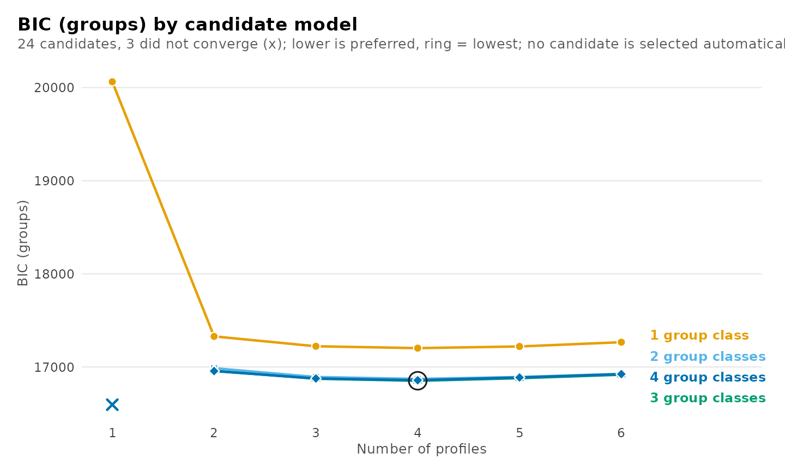

The tree plots how the profiles divide as more are added. Each profile
of a model is linked to the profiles of the next model that receive its
observations. Each number of group classes has its own tree, and
`n_group_classes` selects one; `plot_tree(models)` returns them all, one
plot each. The guide *Tree plot* compares solutions at one number of
profiles and plots the tree of group classes.

``` r

plot_tree(models, n_group_classes = 1)
```

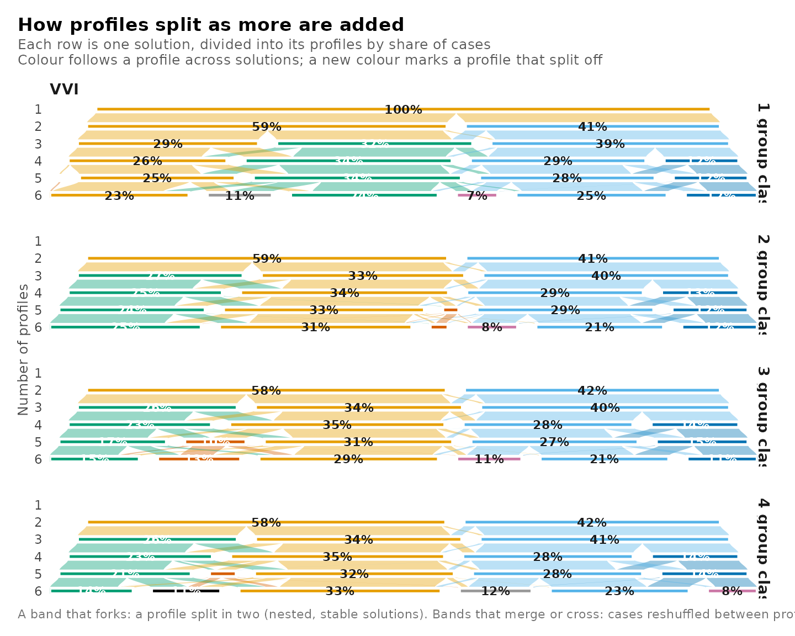

## Change with each added class

When a criterion decreases across the whole range, the size of each
decrease becomes the evidence. For every candidate, the table reports
the decrease in BIC from the candidate with one profile fewer and the
same number of group classes, and the decrease from the candidate with
one group class fewer and the same number of profiles. A positive value
means that the added class lowered the criterion. The argument `using`
selects another criterion.

``` r

get_results(models, "deltas")
#>            candidate n_profiles n_group_classes model  criterion value delta_profile
#> 1  profiles1_groups1          1               1   VVI bic_groups 20062            NA
#> 2  profiles2_groups1          2               1   VVI bic_groups 17328        2733.2
#> 3  profiles3_groups1          3               1   VVI bic_groups 17222         105.9
#> 4  profiles4_groups1          4               1   VVI bic_groups 17203          19.9
#> 5  profiles5_groups1          5               1   VVI bic_groups 17220         -17.9
#> 6  profiles6_groups1          6               1   VVI bic_groups 17266         -45.6
#> 7  profiles1_groups2          1               2   VVI bic_groups    NA            NA
#> 8  profiles2_groups2          2               2   VVI bic_groups 16987            NA
#> 9  profiles3_groups2          3               2   VVI bic_groups 16892          94.6
#> 10 profiles4_groups2          4               2   VVI bic_groups 16872          20.7
#> 11 profiles5_groups2          5               2   VVI bic_groups 16892         -20.6
#> 12 profiles6_groups2          6               2   VVI bic_groups 16926         -33.5
#> 13 profiles1_groups3          1               3   VVI bic_groups    NA            NA
#> 14 profiles2_groups3          2               3   VVI bic_groups 16959            NA
#> 15 profiles3_groups3          3               3   VVI bic_groups 16874          84.6
#> 16 profiles4_groups3          4               3   VVI bic_groups 16852          21.9
#> 17 profiles5_groups3          5               3   VVI bic_groups 16880         -27.5
#> 18 profiles6_groups3          6               3   VVI bic_groups 16917         -37.5
#> 19 profiles1_groups4          1               4   VVI bic_groups    NA            NA
#> 20 profiles2_groups4          2               4   VVI bic_groups 16956            NA
#> 21 profiles3_groups4          3               4   VVI bic_groups 16876          79.9
#> 22 profiles4_groups4          4               4   VVI bic_groups 16858          18.8
#> 23 profiles5_groups4          5               4   VVI bic_groups 16887         -29.7
#> 24 profiles6_groups4          6               4   VVI bic_groups 16924         -36.3
#>         from_profile delta_group_class  from_group_class
#> 1               <NA>                NA              <NA>
#> 2  profiles1_groups1                NA              <NA>
#> 3  profiles2_groups1                NA              <NA>
#> 4  profiles3_groups1                NA              <NA>
#> 5  profiles4_groups1                NA              <NA>
#> 6  profiles5_groups1                NA              <NA>
#> 7               <NA>                NA              <NA>
#> 8               <NA>            341.51 profiles2_groups1
#> 9  profiles2_groups2            330.20 profiles3_groups1
#> 10 profiles3_groups2            330.96 profiles4_groups1
#> 11 profiles4_groups2            328.23 profiles5_groups1
#> 12 profiles5_groups2            340.42 profiles6_groups1
#> 13              <NA>                NA              <NA>
#> 14              <NA>             28.18 profiles2_groups2
#> 15 profiles2_groups3             18.19 profiles3_groups2
#> 16 profiles3_groups3             19.43 profiles4_groups2
#> 17 profiles4_groups3             12.55 profiles5_groups2
#> 18 profiles5_groups3              8.51 profiles6_groups2
#> 19              <NA>                NA              <NA>
#> 20              <NA>              2.37 profiles2_groups3
#> 21 profiles2_groups4             -2.43 profiles3_groups3
#> 22 profiles3_groups4             -5.54 profiles4_groups3
#> 23 profiles4_groups4             -7.79 profiles5_groups3
#> 24 profiles5_groups4             -6.62 profiles6_groups3
```

With three group classes, adding a third profile lowers BIC by 85 and
adding a fourth lowers it by 22. Adding a fifth profile raises BIC by
27, which appears in the table as a negative decrease. The decreases are
plotted for both directions, along the number of profiles on the left
and along the number of group classes on the right.

``` r

plot_selection(models, what = "deltas")
```


The knee summary scales both axes of a curve to the unit interval and
finds the candidate with the largest perpendicular distance below the
straight line from the first point to the last. This chord-distance rule
is inspired by Kneedle, without its smoothing or sensitivity thresholds.
A nearly linear curve can have a very small maximum distance, so the
reported distance describes the strength of the bend as well as its
location. The knee is computed along the number of profiles for each
number of group classes, along the number of group classes for each
number of profiles, and across all candidates ordered by their number of
parameters.

``` r

get_results(models, "knees")
#>        direction            line  criterion              from                to n_points
#> 1       profiles   1 group class bic_groups profiles1_groups1 profiles6_groups1        6
#> 2       profiles 2 group classes bic_groups profiles2_groups2 profiles6_groups2        5
#> 3       profiles 3 group classes bic_groups profiles2_groups3 profiles6_groups3        5
#> 4       profiles 4 group classes bic_groups profiles2_groups4 profiles6_groups4        5
#> 5  group_classes       1 profile bic_groups profiles1_groups1 profiles1_groups1        1
#> 6  group_classes      2 profiles bic_groups profiles2_groups1 profiles2_groups4        4
#> 7  group_classes      3 profiles bic_groups profiles3_groups1 profiles3_groups4        4
#> 8  group_classes      4 profiles bic_groups profiles4_groups1 profiles4_groups4        4
#> 9  group_classes      5 profiles bic_groups profiles5_groups1 profiles5_groups4        4
#> 10 group_classes      6 profiles bic_groups profiles6_groups1 profiles6_groups4        4
#> 11    parameters  all candidates bic_groups profiles1_groups1 profiles6_groups4       21
#>       knee_candidate distance knee_without_largest stable                               note
#> 1  profiles2_groups1    0.544    profiles2_groups1   TRUE                                   
#> 2  profiles4_groups2    0.648    profiles3_groups2  FALSE moves when the largest is left out
#> 3  profiles4_groups3    0.750    profiles3_groups3  FALSE moves when the largest is left out
#> 4  profiles4_groups4    0.792    profiles3_groups4  FALSE moves when the largest is left out
#> 5               <NA>       NA                 <NA>     NA        fewer than three candidates
#> 6  profiles2_groups2    0.413    profiles2_groups2   TRUE                                   
#> 7  profiles3_groups2    0.438    profiles3_groups2   TRUE                                   
#> 8  profiles4_groups2    0.439    profiles4_groups2   TRUE                                   
#> 9  profiles5_groups2    0.456    profiles5_groups2   TRUE                                   
#> 10 profiles6_groups2    0.463    profiles6_groups2   TRUE                                   
#> 11 profiles2_groups2    0.561    profiles2_groups2   TRUE
```

With three group classes, the knee along the number of profiles is
profiles4_groups3. The straight line ends at the largest candidate, so
the knee depends on the range fitted. Without the largest candidate the
knee is profiles3_groups3, which the table records in `stable` and
`note`. Along the number of group classes with four profiles, the knee
is profiles4_groups2.

The criterion over all candidates at once, as the distance of each from
the lowest value:

``` r

plot_selection(models, what = "heatmap")
```


## Classification quality

Every observation has a posterior probability of membership in each
class. Relative entropy summarizes these probabilities over all
observations, from 0 when every observation is equally likely to belong
to every class, to 1 when every observation belongs to one class with
certainty. The average posterior probability (AvePP) of a class is the
mean posterior probability of that class among the observations assigned
to it. An AvePP of 0.7 or 0.8 and above is commonly taken to indicate
adequate separation. The table of candidates reports the lowest, highest
and mean AvePP at each level and the number of classes below a cutoff,
which is 0.8 by default and is set with `cutoff`.

``` r

plot_selection(models, what = "diagnostics")
```


The AvePP of every class of every candidate, with its size and the
relative entropy of its level:

``` r

get_results(models, "classification")
#>             candidate n_profiles n_group_classes model       level class n_modal proportion_modal
#> 1   profiles2_groups1          2               1   VVI individuals     1     833          0.58579
#> 2   profiles2_groups1          2               1   VVI individuals     2     589          0.41421
#> 3   profiles3_groups1          3               1   VVI individuals     1     452          0.31786
#> 4   profiles3_groups1          3               1   VVI individuals     2     555          0.39030
#> 5   profiles3_groups1          3               1   VVI individuals     3     415          0.29184
#> 6   profiles4_groups1          4               1   VVI individuals     1     481          0.33826
#> 7   profiles4_groups1          4               1   VVI individuals     2     157          0.11041
#> 8   profiles4_groups1          4               1   VVI individuals     3     419          0.29466
#> 9   profiles4_groups1          4               1   VVI individuals     4     365          0.25668
#> 10  profiles5_groups1          5               1   VVI individuals     1     355          0.24965
#> 11  profiles5_groups1          5               1   VVI individuals     2     419          0.29466
#> 12  profiles5_groups1          5               1   VVI individuals     3     486          0.34177
#> 13  profiles5_groups1          5               1   VVI individuals     4       5          0.00352
#> 14  profiles5_groups1          5               1   VVI individuals     5     157          0.11041
#> 15  profiles6_groups1          6               1   VVI individuals     1     372          0.26160
#> 16  profiles6_groups1          6               1   VVI individuals     2     157          0.11041
#> 17  profiles6_groups1          6               1   VVI individuals     3     378          0.26582
#> 18  profiles6_groups1          6               1   VVI individuals     4      62          0.04360
#> 19  profiles6_groups1          6               1   VVI individuals     5     337          0.23699
#> 20  profiles6_groups1          6               1   VVI individuals     6     116          0.08158
#> 21  profiles2_groups2          2               2   VVI individuals     1     836          0.58790
#> 22  profiles2_groups2          2               2   VVI individuals     2     586          0.41210
#> 23  profiles2_groups2          2               2   VVI      groups     1      71          0.66981
#> 24  profiles2_groups2          2               2   VVI      groups     2      35          0.33019
#> 25  profiles3_groups2          3               2   VVI individuals     1     472          0.33193
#> 26  profiles3_groups2          3               2   VVI individuals     2     570          0.40084
#> 27  profiles3_groups2          3               2   VVI individuals     3     380          0.26723
#> 28  profiles3_groups2          3               2   VVI      groups     1      71          0.66981
#> 29  profiles3_groups2          3               2   VVI      groups     2      35          0.33019
#> 30  profiles4_groups2          4               2   VVI individuals     1     490          0.34459
#> 31  profiles4_groups2          4               2   VVI individuals     2     166          0.11674
#> 32  profiles4_groups2          4               2   VVI individuals     3     418          0.29395
#> 33  profiles4_groups2          4               2   VVI individuals     4     348          0.24473
#> 34  profiles4_groups2          4               2   VVI      groups     1      71          0.66981
#> 35  profiles4_groups2          4               2   VVI      groups     2      35          0.33019
#> 36  profiles5_groups2          5               2   VVI individuals     1     483          0.33966
#> 37  profiles5_groups2          5               2   VVI individuals     2     423          0.29747
#> 38  profiles5_groups2          5               2   VVI individuals     3      31          0.02180
#> 39  profiles5_groups2          5               2   VVI individuals     4     327          0.22996
#> 40  profiles5_groups2          5               2   VVI individuals     5     158          0.11111
#> 41  profiles5_groups2          5               2   VVI      groups     1      72          0.67925
#> 42  profiles5_groups2          5               2   VVI      groups     2      34          0.32075
#> 43  profiles6_groups2          6               2   VVI individuals     1     465          0.32700
#> 44  profiles6_groups2          6               2   VVI individuals     2     171          0.12025
#> 45  profiles6_groups2          6               2   VVI individuals     3     317          0.22293
#> 46  profiles6_groups2          6               2   VVI individuals     4      90          0.06329
#> 47  profiles6_groups2          6               2   VVI individuals     5     343          0.24121
#> 48  profiles6_groups2          6               2   VVI individuals     6      36          0.02532
#> 49  profiles6_groups2          6               2   VVI      groups     1      69          0.65094
#> 50  profiles6_groups2          6               2   VVI      groups     2      37          0.34906
#> 51  profiles2_groups3          2               3   VVI individuals     1     832          0.58509
#> 52  profiles2_groups3          2               3   VVI individuals     2     590          0.41491
#> 53  profiles2_groups3          2               3   VVI      groups     1      25          0.23585
#> 54  profiles2_groups3          2               3   VVI      groups     2      31          0.29245
#> 55  profiles2_groups3          2               3   VVI      groups     3      50          0.47170
#> 56  profiles3_groups3          3               3   VVI individuals     1     367          0.25809
#> 57  profiles3_groups3          3               3   VVI individuals     2     576          0.40506
#> 58  profiles3_groups3          3               3   VVI individuals     3     479          0.33685
#> 59  profiles3_groups3          3               3   VVI      groups     1      25          0.23585
#> 60  profiles3_groups3          3               3   VVI      groups     2      30          0.28302
#> 61  profiles3_groups3          3               3   VVI      groups     3      51          0.48113
#> 62  profiles4_groups3          4               3   VVI individuals     1     508          0.35724
#> 63  profiles4_groups3          4               3   VVI individuals     2     402          0.28270
#> 64  profiles4_groups3          4               3   VVI individuals     3     192          0.13502
#> 65  profiles4_groups3          4               3   VVI individuals     4     320          0.22504
#> 66  profiles4_groups3          4               3   VVI      groups     1      28          0.26415
#> 67  profiles4_groups3          4               3   VVI      groups     2      48          0.45283
#> 68  profiles4_groups3          4               3   VVI      groups     3      30          0.28302
#> 69  profiles5_groups3          5               3   VVI individuals     1     123          0.08650
#> 70  profiles5_groups3          5               3   VVI individuals     2     201          0.14135
#> 71  profiles5_groups3          5               3   VVI individuals     3     244          0.17159
#> 72  profiles5_groups3          5               3   VVI individuals     4     457          0.32138
#> 73  profiles5_groups3          5               3   VVI individuals     5     397          0.27918
#> 74  profiles5_groups3          5               3   VVI      groups     1      27          0.25472
#> 75  profiles5_groups3          5               3   VVI      groups     2      48          0.45283
#> 76  profiles5_groups3          5               3   VVI      groups     3      31          0.29245
#> 77  profiles6_groups3          6               3   VVI individuals     1     206          0.14487
#> 78  profiles6_groups3          6               3   VVI individuals     2     446          0.31364
#> 79  profiles6_groups3          6               3   VVI individuals     3     322          0.22644
#> 80  profiles6_groups3          6               3   VVI individuals     4     128          0.09001
#> 81  profiles6_groups3          6               3   VVI individuals     5     168          0.11814
#> 82  profiles6_groups3          6               3   VVI individuals     6     152          0.10689
#> 83  profiles6_groups3          6               3   VVI      groups     1      47          0.44340
#> 84  profiles6_groups3          6               3   VVI      groups     2      32          0.30189
#> 85  profiles6_groups3          6               3   VVI      groups     3      27          0.25472
#> 86  profiles2_groups4          2               4   VVI individuals     1     832          0.58509
#> 87  profiles2_groups4          2               4   VVI individuals     2     590          0.41491
#> 88  profiles2_groups4          2               4   VVI      groups     1      25          0.23585
#> 89  profiles2_groups4          2               4   VVI      groups     2      12          0.11321
#> 90  profiles2_groups4          2               4   VVI      groups     3      22          0.20755
#> 91  profiles2_groups4          2               4   VVI      groups     4      47          0.44340
#> 92  profiles3_groups4          3               4   VVI individuals     1     477          0.33544
#> 93  profiles3_groups4          3               4   VVI individuals     2     576          0.40506
#> 94  profiles3_groups4          3               4   VVI individuals     3     369          0.25949
#> 95  profiles3_groups4          3               4   VVI      groups     1      46          0.43396
#> 96  profiles3_groups4          3               4   VVI      groups     2      15          0.14151
#> 97  profiles3_groups4          3               4   VVI      groups     3      20          0.18868
#> 98  profiles3_groups4          3               4   VVI      groups     4      25          0.23585
#> 99  profiles4_groups4          4               4   VVI individuals     1     191          0.13432
#> 100 profiles4_groups4          4               4   VVI individuals     2     321          0.22574
#> 101 profiles4_groups4          4               4   VVI individuals     3     510          0.35865
#> 102 profiles4_groups4          4               4   VVI individuals     4     400          0.28129
#> 103 profiles4_groups4          4               4   VVI      groups     1      46          0.43396
#> 104 profiles4_groups4          4               4   VVI      groups     2      24          0.22642
#> 105 profiles4_groups4          4               4   VVI      groups     3      11          0.10377
#> 106 profiles4_groups4          4               4   VVI      groups     4      25          0.23585
#> 107 profiles5_groups4          5               4   VVI individuals     1     189          0.13291
#> 108 profiles5_groups4          5               4   VVI individuals     2      38          0.02672
#> 109 profiles5_groups4          5               4   VVI individuals     3     302          0.21238
#> 110 profiles5_groups4          5               4   VVI individuals     4     491          0.34529
#> 111 profiles5_groups4          5               4   VVI individuals     5     402          0.28270
#> 112 profiles5_groups4          5               4   VVI      groups     1      23          0.21698
#> 113 profiles5_groups4          5               4   VVI      groups     2      25          0.23585
#> 114 profiles5_groups4          5               4   VVI      groups     3      11          0.10377
#> 115 profiles5_groups4          5               4   VVI      groups     4      47          0.44340
#> 116 profiles6_groups4          6               4   VVI individuals     1     491          0.34529
#> 117 profiles6_groups4          6               4   VVI individuals     2     107          0.07525
#> 118 profiles6_groups4          6               4   VVI individuals     3     341          0.23980
#> 119 profiles6_groups4          6               4   VVI individuals     4     149          0.10478
#> 120 profiles6_groups4          6               4   VVI individuals     5     174          0.12236
#> 121 profiles6_groups4          6               4   VVI individuals     6     160          0.11252
#> 122 profiles6_groups4          6               4   VVI      groups     1      26          0.24528
#> 123 profiles6_groups4          6               4   VVI      groups     2      14          0.13208
#> 124 profiles6_groups4          6               4   VVI      groups     3      23          0.21698
#> 125 profiles6_groups4          6               4   VVI      groups     4      43          0.40566
#>     estimated_n estimated_proportion average_posterior odds_correct_classification relative_entropy
#> 1        832.92              0.58574             0.982                       37.75            0.922
#> 2        589.08              0.41426             0.974                       53.24            0.922
#> 3        452.67              0.31834             0.832                       10.61            0.772
#> 4        551.11              0.38756             0.964                       42.39            0.772
#> 5        418.21              0.29410             0.863                       15.17            0.772
#> 6        478.06              0.33619             0.842                       10.51            0.735
#> 7        172.20              0.12110             0.803                       29.63            0.735
#> 8        405.28              0.28501             0.849                       14.14            0.735
#> 9        366.46              0.25771             0.846                       15.86            0.735
#> 10       359.22              0.25262             0.847                       16.42            0.773
#> 11       405.22              0.28496             0.849                       14.13            0.773
#> 12       480.38              0.33782             0.842                       10.42            0.773
#> 13         4.89              0.00344             0.962                     7368.14            0.773
#> 14       172.30              0.12116             0.804                       29.66            0.773
#> 15       340.87              0.23971             0.735                        8.78            0.669
#> 16       165.78              0.11658             0.784                       27.56            0.669
#> 17       348.85              0.24532             0.780                       10.89            0.669
#> 18        95.07              0.06686             0.636                       24.43            0.669
#> 19       321.57              0.22614             0.812                       14.74            0.669
#> 20       149.86              0.10538             0.627                       14.29            0.669
#> 21       834.10              0.58657             0.985                       46.08            0.938
#> 22       587.90              0.41343             0.982                       76.35            0.938
#> 23        71.52              0.67470             0.992                       59.89            0.940
#> 24        34.48              0.32530             0.969                       64.80            0.940
#> 25       469.56              0.33021             0.849                       11.40            0.790
#> 26       569.85              0.40074             0.979                       68.94            0.790
#> 27       382.59              0.26905             0.850                       15.45            0.790
#> 28        71.25              0.67213             0.992                       62.14            0.943
#> 29        34.75              0.32787             0.977                       87.77            0.943
#> 30       480.19              0.33769             0.845                       10.71            0.739
#> 31       178.19              0.12531             0.791                       26.49            0.739
#> 32       407.65              0.28667             0.858                       15.08            0.739
#> 33       355.96              0.25033             0.846                       16.41            0.739
#> 34        71.16              0.67132             0.990                       48.96            0.937
#> 35        34.84              0.32868             0.975                       80.76            0.937
#> 36       464.18              0.32643             0.846                       11.33            0.775
#> 37       408.11              0.28700             0.860                       15.27            0.775
#> 38        36.89              0.02594             0.838                      194.58            0.775
#> 39       337.67              0.23746             0.848                       17.88            0.775
#> 40       175.15              0.12317             0.803                       28.94            0.775
#> 41        71.40              0.67360             0.990                       48.07            0.965
#> 42        34.60              0.32640             0.996                      581.20            0.965
#> 43       444.31              0.31245             0.835                       11.14            0.732
#> 44       173.96              0.12233             0.781                       25.62            0.732
#> 45       294.72              0.20726             0.728                       10.24            0.732
#> 46       118.27              0.08317             0.699                       25.64            0.732
#> 47       349.82              0.24600             0.845                       16.71            0.732
#> 48        40.93              0.02878             0.789                      126.37            0.732
#> 49        69.10              0.65185             0.987                       39.18            0.946
#> 50        36.90              0.34815             0.972                       65.76            0.946
#> 51       830.91              0.58433             0.986                       49.28            0.940
#> 52       591.09              0.41567             0.982                       75.73            0.940
#> 53        26.66              0.25147             0.905                       28.33            0.816
#> 54        30.78              0.29035             0.962                       62.25            0.816
#> 55        48.57              0.45818             0.900                       10.69            0.816
#> 56       368.95              0.25946             0.845                       15.58            0.792
#> 57       574.96              0.40433             0.978                       65.03            0.792
#> 58       478.08              0.33621             0.853                       11.45            0.792
#> 59        27.65              0.26086             0.898                       24.87            0.797
#> 60        31.03              0.29271             0.977                      104.20            0.797
#> 61        47.32              0.44643             0.864                        7.90            0.797
#> 62       497.03              0.34953             0.854                       10.86            0.739
#> 63       391.99              0.27566             0.847                       14.60            0.739
#> 64       202.20              0.14220             0.801                       24.24            0.739
#> 65       330.78              0.23261             0.842                       17.57            0.739
#> 66        27.40              0.25844             0.874                       19.96            0.823
#> 67        48.01              0.45292             0.915                       13.01            0.823
#> 68        30.60              0.28864             0.981                      127.50            0.823
#> 69       141.26              0.09934             0.628                       15.34            0.714
#> 70       211.64              0.14884             0.804                       23.52            0.714
#> 71       248.08              0.17446             0.804                       19.44            0.714
#> 72       435.18              0.30603             0.817                       10.09            0.714
#> 73       385.84              0.27134             0.843                       14.42            0.714
#> 74        28.08              0.26491             0.917                       30.75            0.854
#> 75        46.73              0.44081             0.918                       14.29            0.854
#> 76        31.19              0.29428             0.987                      180.98            0.854
#> 77       206.70              0.14536             0.777                       20.53            0.674
#> 78       414.48              0.29148             0.795                        9.42            0.674
#> 79       297.05              0.20890             0.733                       10.42            0.674
#> 80       150.21              0.10563             0.711                       20.85            0.674
#> 81       191.71              0.13482             0.655                       12.18            0.674
#> 82       161.85              0.11382             0.788                       28.90            0.674
#> 83        46.26              0.43639             0.925                       15.84            0.853
#> 84        32.68              0.30828             0.984                      137.98            0.853
#> 85        27.07              0.25534             0.915                       31.49            0.853
#> 86       829.91              0.58362             0.986                       50.18            0.942
#> 87       592.09              0.41638             0.984                       85.01            0.942
#> 88        24.59              0.23201             0.868                       21.73            0.798
#> 89        11.33              0.10689             0.851                       47.77            0.798
#> 90        22.34              0.21071             0.877                       26.81            0.798
#> 91        47.74              0.45039             0.912                       12.62            0.798
#> 92       476.54              0.33512             0.853                       11.52            0.793
#> 93       576.30              0.40527             0.980                       70.36            0.793
#> 94       369.16              0.25960             0.843                       15.32            0.793
#> 95        47.04              0.44379             0.902                       11.51            0.772
#> 96        13.62              0.12851             0.841                       35.95            0.772
#> 97        20.96              0.19774             0.868                       26.74            0.772
#> 98        24.37              0.22995             0.843                       17.98            0.772
#> 99       201.57              0.14175             0.801                       24.37            0.740
#> 100      332.98              0.23416             0.843                       17.58            0.740
#> 101      494.01              0.34741             0.850                       10.64            0.740
#> 102      393.44              0.27668             0.853                       15.17            0.740
#> 103       46.89              0.44232             0.903                       11.76            0.803
#> 104       22.90              0.21605             0.867                       23.74            0.803
#> 105       10.91              0.10288             0.898                       76.55            0.803
#> 106       25.31              0.23874             0.873                       21.82            0.803
#> 107      201.07              0.14140             0.803                       24.79            0.751
#> 108       61.45              0.04322             0.786                       81.48            0.751
#> 109      305.33              0.21472             0.831                       17.96            0.751
#> 110      461.34              0.32443             0.826                        9.90            0.751
#> 111      392.80              0.27623             0.853                       15.15            0.751
#> 112       23.02              0.21714             0.926                       44.87            0.830
#> 113       25.69              0.24237             0.882                       23.26            0.830
#> 114       11.14              0.10505             0.899                       75.62            0.830
#> 115       46.16              0.43544             0.909                       12.98            0.830
#> 116      466.75              0.32823             0.830                        9.98            0.725
#> 117      114.80              0.08073             0.847                       63.10            0.725
#> 118      320.60              0.22546             0.806                       14.24            0.725
#> 119      167.55              0.11783             0.765                       24.39            0.725
#> 120      192.57              0.13542             0.797                       25.09            0.725
#> 121      159.73              0.11233             0.654                       14.97            0.725
#> 122       25.05              0.23630             0.898                       28.53            0.851
#> 123       13.24              0.12488             0.907                       68.41            0.851
#> 124       23.33              0.22010             0.919                       40.18            0.851
#> 125       44.38              0.41872             0.940                       21.71            0.851
```

For profiles4_groups3, the relative entropy is 0.74 for the profiles and
0.82 for the group classes. The lowest AvePP is 0.8 among the profiles
and 0.87 among the group classes.

## Checks of the estimation

A solution reached from several random starts is more credible than a
solution reached once, because a single start may have stopped at a
local maximum. An estimate on the boundary of the parameter space, such
as a variance at its lower bound, indicates a model too complex for the
data. A class that holds a very small share of the observations is also
hard to interpret. A candidate on the boundary whose smallest profile
holds about one observation is not a profile but a degenerate solution;
refitting with `boundary = "exclude"` keeps, for every candidate, the
best start without a variance at its lower bound. The following plots
report these checks for every candidate.

``` r

plot_selection(models, what = "trust")
```


``` r

plot_selection(models, what = "smallest")
```

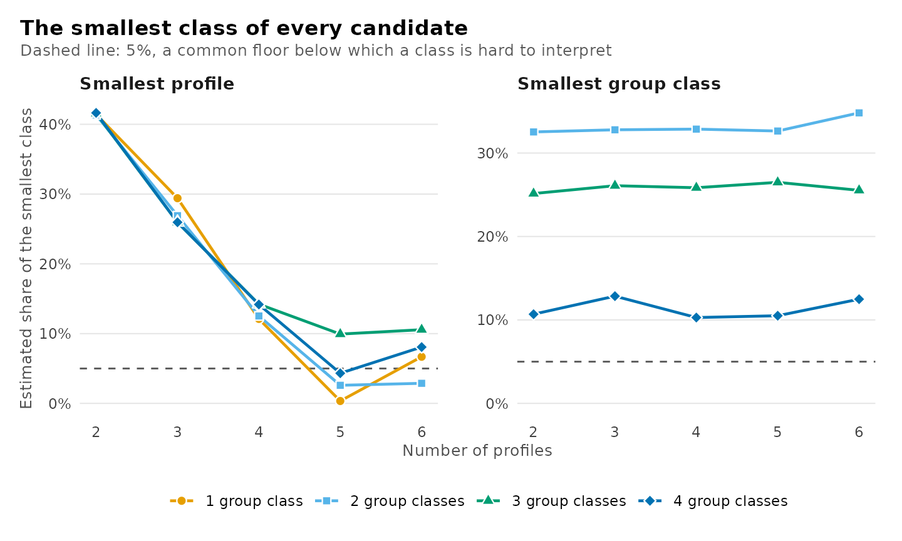

All of the plots for choosing the number of classes are produced
together with `plot_selection(models)`.

## Comparing candidates

Selected candidates are placed side by side with
[`compare_models()`](https://pak.dynasite.org/latents/reference/compare_models.md).
Candidates are named as in the table, given by their numbers of classes,
or selected by a number of profiles or group classes. The comparison
adds the difference in BIC from the lowest of the candidates compared
and the BIC weight. The weight is `exp(-delta_bic / 2)` normalized to
sum to one, the approximate posterior probability of each candidate when
all have equal prior probability.

The candidates preferred by BIC, ICL and AWE with students as the units:

``` r

compare_models(models, bic_groups_pick, icl_groups_pick, awe_groups_pick)
#> Model comparison
#> 
#> Model              Profiles  Group classes   k    LogLik       BIC   ΔBIC  Weight       ICL  Entropy  Min AvePP  < 0.8  Group entropy  Group min AvePP
#> -----------------  --------  -------------  --  --------  --------  -----  ------  --------  -------  ---------  -----  -------------  ---------------
#> profiles4_groups3         4              3  51  -8307.15  16852.14   0.00   1.000  18014.13     0.74       0.80      0           0.82             0.87
#> profiles4_groups2         4              2  47  -8326.19  16871.57  19.43   0.000  18021.23     0.74       0.79      1           0.94             0.98
#> profiles3_groups2         3              2  35  -8364.52  16892.26  40.12   0.000  17640.46     0.79       0.85      0           0.94             0.98
```

The same candidates given by their numbers of classes, with labels:

``` r

compare_models(models, bic = c(4, 3), icl = c(4, 2), awe = c(3, 2))
#> Model comparison
#> 
#> Model  Profiles  Group classes   k    LogLik       BIC   ΔBIC  Weight       ICL  Entropy  Min AvePP  < 0.8  Group entropy  Group min AvePP
#> -----  --------  -------------  --  --------  --------  -----  ------  --------  -------  ---------  -----  -------------  ---------------
#> bic           4              3  51  -8307.15  16852.14   0.00   1.000  18014.13     0.74       0.80      0           0.82             0.87
#> icl           4              2  47  -8326.19  16871.57  19.43   0.000  18021.23     0.74       0.79      1           0.94             0.98
#> awe           3              2  35  -8364.52  16892.26  40.12   0.000  17640.46     0.79       0.85      0           0.94             0.98
```

Every candidate with four profiles, which shows what the group classes
add:

``` r

comparison <- compare_models(models, n_profiles = 4)
comparison
#> Model comparison
#> 
#> Model              Profiles  Group classes   k    LogLik       BIC    ΔBIC  Weight       ICL  Entropy  Min AvePP  < 0.8  Group entropy  Group min AvePP
#> -----------------  --------  -------------  --  --------  --------  ------  ------  --------  -------  ---------  -----  -------------  ---------------
#> profiles4_groups1         4              1  43  -8501.00  17202.53  350.38   0.000  18358.86     0.74       0.80      0                                
#> profiles4_groups2         4              2  47  -8326.19  16871.57   19.43   0.000  18021.23     0.74       0.79      1           0.94             0.98
#> profiles4_groups3         4              3  51  -8307.15  16852.14    0.00   0.941  18014.13     0.74       0.80      0           0.82             0.87
#> profiles4_groups4         4              4  55  -8300.60  16857.69    5.54   0.059  18027.32     0.74       0.80      0           0.80             0.87
plot(comparison)
```


The comparison keeps the fitted models. The AvePP of every class of
every compared model is returned by
[`get_results()`](https://pak.dynasite.org/latents/reference/get_results.md),
and the model behind a row by
[`get_candidate()`](https://pak.dynasite.org/latents/reference/get_candidate.md).

``` r

get_results(comparison, "classification")
#>                model       level class n_modal proportion_modal estimated_n estimated_proportion
#> 1  profiles4_groups1 individuals     1     481            0.338       478.1                0.336
#> 2  profiles4_groups1 individuals     2     157            0.110       172.2                0.121
#> 3  profiles4_groups1 individuals     3     419            0.295       405.3                0.285
#> 4  profiles4_groups1 individuals     4     365            0.257       366.5                0.258
#> 5  profiles4_groups2 individuals     1     490            0.345       480.2                0.338
#> 6  profiles4_groups2 individuals     2     166            0.117       178.2                0.125
#> 7  profiles4_groups2 individuals     3     418            0.294       407.6                0.287
#> 8  profiles4_groups2 individuals     4     348            0.245       356.0                0.250
#> 9  profiles4_groups2      groups     1      71            0.670        71.2                0.671
#> 10 profiles4_groups2      groups     2      35            0.330        34.8                0.329
#> 11 profiles4_groups3 individuals     1     508            0.357       497.0                0.350
#> 12 profiles4_groups3 individuals     2     402            0.283       392.0                0.276
#> 13 profiles4_groups3 individuals     3     192            0.135       202.2                0.142
#> 14 profiles4_groups3 individuals     4     320            0.225       330.8                0.233
#> 15 profiles4_groups3      groups     1      28            0.264        27.4                0.258
#> 16 profiles4_groups3      groups     2      48            0.453        48.0                0.453
#> 17 profiles4_groups3      groups     3      30            0.283        30.6                0.289
#> 18 profiles4_groups4 individuals     1     191            0.134       201.6                0.142
#> 19 profiles4_groups4 individuals     2     321            0.226       333.0                0.234
#> 20 profiles4_groups4 individuals     3     510            0.359       494.0                0.347
#> 21 profiles4_groups4 individuals     4     400            0.281       393.4                0.277
#> 22 profiles4_groups4      groups     1      46            0.434        46.9                0.442
#> 23 profiles4_groups4      groups     2      24            0.226        22.9                0.216
#> 24 profiles4_groups4      groups     3      11            0.104        10.9                0.103
#> 25 profiles4_groups4      groups     4      25            0.236        25.3                0.239
#>    average_posterior odds_correct_classification relative_entropy
#> 1              0.842                        10.5            0.735
#> 2              0.803                        29.6            0.735
#> 3              0.849                        14.1            0.735
#> 4              0.846                        15.9            0.735
#> 5              0.845                        10.7            0.739
#> 6              0.791                        26.5            0.739
#> 7              0.858                        15.1            0.739
#> 8              0.846                        16.4            0.739
#> 9              0.990                        49.0            0.937
#> 10             0.975                        80.8            0.937
#> 11             0.854                        10.9            0.739
#> 12             0.847                        14.6            0.739
#> 13             0.801                        24.2            0.739
#> 14             0.842                        17.6            0.739
#> 15             0.874                        20.0            0.823
#> 16             0.915                        13.0            0.823
#> 17             0.981                       127.5            0.823
#> 18             0.801                        24.4            0.740
#> 19             0.843                        17.6            0.740
#> 20             0.850                        10.6            0.740
#> 21             0.853                        15.2            0.740
#> 22             0.903                        11.8            0.803
#> 23             0.867                        23.7            0.803
#> 24             0.898                        76.5            0.803
#> 25             0.873                        21.8            0.803
```

## Analysis of the chosen candidate

The example continues with profiles4_groups3, the candidate with the
lowest BIC with students as the units. It is taken from the fitted
candidates by name with
[`get_candidate()`](https://pak.dynasite.org/latents/reference/get_candidate.md).
The numbers of classes give the same model, as in
`get_candidate(models, 4, 3)`.

``` r

chosen <- get_candidate(models, "profiles4_groups3")
chosen
#> Two-level latent profile analysis: 4 profiles, 3 group classes
#> 1422 individuals in 106 groups; varying diagonal residual covariance (VVI)
#> Log likelihood: -8307.154320 | AIC: 16716.309 | BIC (groups): 16852.144
#> Converged: TRUE | iterations: 48 | best start: 3/3
#> Smallest standardized Gaussian eigenvalue: 0.195 (profiles, profile_4); Gaussian mass: 330.8; weight effective n: 434.9.
#> 
#>  profile browse lectures forum_read forum_post attendance count proportion
#>        1  0.412    0.232      0.490      0.383      0.309   497      0.350
#>        2 -0.564   -0.561     -0.695     -0.676     -0.656   392      0.276
#>        3 -1.113   -0.685     -1.200     -0.880     -1.417   202      0.142
#>        4  0.728    0.734      0.821      0.763      1.180   331      0.233
#> 
#> Variances and standard errors: get_results(x, "profiles"). 
#> Every other table: get_results(x, what = ), or get_results(x, "all").
```

`chosen` is the same kind of object that
[`multilpa()`](https://pak.dynasite.org/latents/reference/multilpa.md)
returns. Its summary reports the estimates with their standard errors.

``` r

summary(chosen)
#> Two-level latent profile analysis: 4 profiles, 3 group classes
#> Individuals: 1422; groups: 106; parameters: 51; converged: TRUE
#> Log likelihood: -8307.154320; AIC: 16716.309
#> BIC (groups): 16852.144; BIC (individuals): 16984.559
#> Best likelihood replicated in 3/3 starts (absolute tolerance 0.00831).
#> 
#> -- profiles --------------------------------------------------------
#>  profile  indicator    mean variance standard_deviation mean_standard_error variance_standard_error
#>        1     browse  0.4124   0.6154             0.7845             0.04315                 0.04351
#>        1   lectures  0.2325   0.7596             0.8715             0.05526                 0.05724
#>        1 forum_read  0.4903   0.4509             0.6715             0.04119                 0.03454
#>        1 forum_post  0.3834   0.7045             0.8394             0.05051                 0.05366
#>        1 attendance  0.3092   0.1976             0.4445             0.05098                 0.02208
#>        2     browse -0.5636   0.5199             0.7210             0.05555                 0.04358
#>        2   lectures -0.5614   0.5498             0.7415             0.04752                 0.04624
#>        2 forum_read -0.6949   0.3167             0.5627             0.04899                 0.02951
#>        2 forum_post -0.6760   0.4611             0.6790             0.04605                 0.04176
#>        2 attendance -0.6564   0.2567             0.5066             0.06568                 0.03088
#>    ... 10 more rows.  get_results(x, what = "profiles")
#> 
#> -- responses -------------------------------------------------------
#>    (no rows)
#> 
#> -- covariances -----------------------------------------------------
#>  profile  indicator indicator_2 covariance
#>        1     browse      browse     0.6154
#>        1   lectures      browse     0.0000
#>        1 forum_read      browse     0.0000
#>        1 forum_post      browse     0.0000
#>        1 attendance      browse     0.0000
#>        1     browse    lectures     0.0000
#>        1   lectures    lectures     0.7596
#>        1 forum_read    lectures     0.0000
#>        1 forum_post    lectures     0.0000
#>        1 attendance    lectures     0.0000
#>    ... 90 more rows.  get_results(x, what = "covariances")
#> 
#> -- gaussian_diagnostics --------------------------------------------
#>   context   profile gaussian_mass positive_rows weight_effective_n min_variance_ratio
#>  profiles profile_1         497.0          1422              619.0             0.2022
#>  profiles profile_2         392.0          1422              493.2             0.2626
#>  profiles profile_3         202.2          1422              290.4             0.2274
#>  profiles profile_4         330.8          1422              434.9             0.1950
#>  min_standardized_eigenvalue boundary
#>                       0.2022    FALSE
#>                       0.2626    FALSE
#>                       0.2274    FALSE
#>                       0.1950    FALSE
#> 
#> -- profile_probabilities -------------------------------------------
#>  group_class profile probability group_class_probability
#>            1       1     0.60651                  0.2584
#>            1       2     0.02188                  0.2584
#>            1       3     0.03272                  0.2584
#>            1       4     0.33890                  0.2584
#>            2       1     0.39272                  0.4529
#>            2       2     0.23522                  0.4529
#>            2       3     0.10354                  0.4529
#>            2       4     0.26852                  0.4529
#>            3       1     0.05318                  0.2886
#>            3       2     0.56484                  0.2886
#>    ... 2 more rows.  get_results(x, what = "profile_probabilities")
#> 
#> -- counts ----------------------------------------------------------
#>        level class effective_count effective_proportion
#>  individuals     1          497.03               0.3495
#>  individuals     2          391.99               0.2757
#>  individuals     3          202.20               0.1422
#>  individuals     4          330.78               0.2326
#>       groups     1           27.40               0.2584
#>       groups     2           48.01               0.4529
#>       groups     3           30.60               0.2886
#> 
#> -- posteriors ------------------------------------------------------
#>  row group profile posterior modal
#>    1     1       1 4.984e-01 FALSE
#>    2     1       1 6.732e-01  TRUE
#>    3     1       1 2.020e-06 FALSE
#>    4     1       1 1.720e-06 FALSE
#>    5     1       1 7.362e-07 FALSE
#>    6     1       1 5.209e-06 FALSE
#>    7     1       1 1.011e-05 FALSE
#>    8     1       1 8.729e-06 FALSE
#>    9     1       1 4.304e-07 FALSE
#>   10     1       1 2.373e-06 FALSE
#>    ... 5678 more rows.  get_results(x, what = "posteriors")
#> 
#> -- group_posteriors ------------------------------------------------
#>  group group_size log_likelihood group_class posterior modal
#>      1         13         -64.40           1 2.670e-12 FALSE
#>      2         13         -70.85           1 1.213e-14 FALSE
#>      3         14         -75.11           1 9.901e-01  TRUE
#>      4         13         -66.48           1 9.846e-01  TRUE
#>      5         14         -75.41           1 6.383e-13 FALSE
#>      6         12         -76.76           1 9.975e-04 FALSE
#>      7         15         -87.20           1 9.826e-01  TRUE
#>      8         14         -83.85           1 1.029e-08 FALSE
#>      9         14         -81.97           1 9.868e-01  TRUE
#>     10         15         -82.36           1 6.470e-14 FALSE
#>    ... 308 more rows.  get_results(x, what = "group_posteriors")
#> 
#> -- assignments -----------------------------------------------------
#>  student browse lectures forum_read forum_post attendance profile group_class uncertainty
#>        1   0.73    -0.08       0.30       0.67       0.72       4           3      0.5005
#>        1   0.68     0.53      -0.02      -0.55       0.70       1           3      0.3268
#>        1  -1.51    -0.51      -0.91      -0.80      -0.97       3           3      0.4740
#>        1   0.64    -1.02      -1.62      -1.20      -1.26       2           3      0.2989
#>        1  -0.94    -0.37      -0.71      -0.28      -1.52       3           3      0.3767
#>        1  -0.36    -0.46      -0.77      -0.43      -1.34       2           3      0.3609
#>        1   0.38    -1.85      -0.84      -1.09      -1.12       2           3      0.1305
#>        1  -1.44     0.66      -0.67      -1.67      -1.00       2           3      0.3803
#>        1  -0.76    -0.43      -1.04      -0.69      -1.37       3           3      0.3328
#>        1   0.26    -0.95      -0.51      -1.89      -1.45       2           3      0.2084
#>  posterior_profile_1 posterior_profile_2 posterior_profile_3 posterior_profile_4
#>            4.984e-01            0.002032           3.221e-09           4.995e-01
#>            6.732e-01            0.049166           5.577e-07           2.776e-01
#>            2.020e-06            0.473969           5.260e-01           1.136e-11
#>            1.720e-06            0.701122           2.989e-01           5.710e-12
#>            7.362e-07            0.376655           6.233e-01           1.129e-12
#>            5.209e-06            0.639084           3.609e-01           2.753e-11
#>            1.011e-05            0.869464           1.305e-01           6.738e-11
#>            8.729e-06            0.619696           3.803e-01           3.884e-11
#>            4.304e-07            0.332821           6.672e-01           9.040e-13
#>            2.373e-06            0.791623           2.084e-01           1.990e-12
#>    ... 1412 more rows.  get_results(x, what = "assignments")
#> 
#> -- classification --------------------------------------------------
#>        level class n_modal proportion_modal estimated_n estimated_proportion average_posterior
#>  individuals     1     508           0.3572      497.03               0.3495            0.8537
#>  individuals     2     402           0.2827      391.99               0.2757            0.8475
#>  individuals     3     192           0.1350      202.20               0.1422            0.8007
#>  individuals     4     320           0.2250      330.78               0.2326            0.8419
#>       groups     1      28           0.2642       27.40               0.2584            0.8743
#>       groups     2      48           0.4528       48.01               0.4529            0.9150
#>       groups     3      30           0.2830       30.60               0.2886            0.9810
#>  odds_correct_classification
#>                        10.86
#>                        14.60
#>                        24.24
#>                        17.57
#>                        19.96
#>                        13.01
#>                       127.50
#> 
#> -- average_posteriors ----------------------------------------------
#>        level assigned_class class n_assigned average_posterior
#>  individuals              1     1        508         8.537e-01
#>  individuals              1     2        508         2.566e-02
#>  individuals              1     3        508         2.592e-05
#>  individuals              1     4        508         1.206e-01
#>  individuals              2     1        402         3.174e-02
#>  individuals              2     2        402         8.475e-01
#>  individuals              2     3        402         1.205e-01
#>  individuals              2     4        402         2.550e-04
#>  individuals              3     1        192         6.639e-06
#>  individuals              3     2        192         1.993e-01
#>    ... 15 more rows.  get_results(x, what = "average_posteriors")
#> 
#> -- classification_errors -------------------------------------------
#>        level true_class assigned_class probability
#>  individuals          1              1   8.726e-01
#>  individuals          1              2   2.567e-02
#>  individuals          1              3   2.564e-06
#>  individuals          1              4   1.018e-01
#>  individuals          2              1   3.325e-02
#>  individuals          2              2   8.691e-01
#>  individuals          2              3   9.761e-02
#>  individuals          2              4   1.973e-05
#>  individuals          3              1   6.511e-05
#>  individuals          3              2   2.396e-01
#>    ... 15 more rows.  get_results(x, what = "classification_errors")
#> 
#> -- bch_weights -----------------------------------------------------
#>        level unit assigned_class class     weight
#>  individuals    1              4     1 -0.2679593
#>  individuals    1              4     2  0.0077387
#>  individuals    1              4     3 -0.0009927
#>  individuals    1              4     4  1.2612132
#>  individuals    2              1     1  1.1786556
#>  individuals    2              1     2 -0.0360361
#>  individuals    2              1     3  0.0046227
#>  individuals    2              1     4 -0.1472422
#>  individuals    3              3     1  0.0146287
#>  individuals    3              3     2 -0.3764143
#>    ... 5996 more rows.  get_results(x, what = "bch_weights")
#> 
#> -- entropy ---------------------------------------------------------
#>        level n_classes n_units entropy_sum relative_entropy
#>  individuals         4    1422      514.79           0.7389
#>       groups         3     106       20.64           0.8228
#> 
#> -- residuals -------------------------------------------------------
#>    profile indicator_1 indicator_2     kind observed expected residual effective_n statistic df
#>  profile_3    lectures  forum_post gaussian -0.11521        0 -0.11521       202.2    -1.633 NA
#>  profile_1      browse  forum_post gaussian -0.10181        0 -0.10181       497.0    -2.271 NA
#>  profile_2    lectures  attendance gaussian  0.10068        0  0.10068       392.0     1.992 NA
#>  profile_3      browse  forum_post gaussian  0.09747        0  0.09747       202.2     1.380 NA
#>  profile_1    lectures  attendance gaussian  0.09578        0  0.09578       497.0     2.135 NA
#>  profile_1      browse    lectures gaussian -0.09387        0 -0.09387       497.0    -2.093 NA
#>  profile_3      browse    lectures gaussian -0.09310        0 -0.09310       202.2    -1.318 NA
#>  profile_2      browse  forum_post gaussian -0.08845        0 -0.08845       392.0    -1.749 NA
#>  profile_4      browse  attendance gaussian  0.08648        0  0.08648       330.8     1.570 NA
#>  profile_3    lectures  attendance gaussian  0.08393        0  0.08393       202.2     1.187 NA
#>  p_value p_adjusted
#>  0.10240    0.10240
#>  0.02316    0.02316
#>  0.04632    0.04632
#>  0.16754    0.16754
#>  0.03272    0.03272
#>  0.03638    0.03638
#>  0.18758    0.18758
#>  0.08028    0.08028
#>  0.11651    0.11651
#>  0.23507    0.23507
#>    ... 30 more rows.  get_results(x, what = "residuals")
#> 
#> -- information_criteria --------------------------------------------
#>  log_likelihood n_parameters   aic   kic bic_groups bic_individual sabic_groups sabic_individual
#>           -8307           51 16716 16770      16852          16985        16691            16823
#>  caic_groups caic_individual awe_groups awe_individual icl_groups icl_individual clc_groups
#>        16903           17036      17284          18537      16893          18014      16656
#>  clc_individual
#>           17644
#> 
#> -- model -----------------------------------------------------------
#>  n_observations n_informative n_groups n_profiles n_group_classes centering scaling
#>            1422          1422      106          4               3      none    none
#>  covariance_structure n_parameters n_parameters_with_measurement log_likelihood   aic bic_groups
#>                   VVI           51                            51          -8307 16716      16852
#>  bic_individual converged iterations boundary small_classes best_start n_best_replicated weights
#>           16985      TRUE         48    FALSE         FALSE          3                 3    <NA>
#> 
#> -- stages ----------------------------------------------------------
#>  stage group_classes fixed log_likelihood parameters parameters_with_measurement converged
#>  joint             3  <NA>          -8307         51                          51      TRUE
#> 
#> -- starts ----------------------------------------------------------
#>  start log_likelihood converged iterations error boundary
#>      1          -8307      TRUE         72  <NA>    FALSE
#>      2          -8307      TRUE         93  <NA>    FALSE
#>      3          -8307      TRUE         48  <NA>    FALSE
#> 
#> -- data ------------------------------------------------------------
#>  student browse lectures forum_read forum_post attendance
#>        1   0.73    -0.08       0.30       0.67       0.72
#>        1   0.68     0.53      -0.02      -0.55       0.70
#>        1  -1.51    -0.51      -0.91      -0.80      -0.97
#>        1   0.64    -1.02      -1.62      -1.20      -1.26
#>        1  -0.94    -0.37      -0.71      -0.28      -1.52
#>        1  -0.36    -0.46      -0.77      -0.43      -1.34
#>        1   0.38    -1.85      -0.84      -1.09      -1.12
#>        1  -1.44     0.66      -0.67      -1.67      -1.00
#>        1  -0.76    -0.43      -1.04      -0.69      -1.37
#>        1   0.26    -0.95      -0.51      -1.89      -1.45
#>    ... 1412 more rows.  get_results(x, what = "data")
#> 
#> 20 tables above, truncated to fit. get_results(x, what = ) returns any
#> of them whole, and get_results(x, what = "all") returns every one.
```

The profiles are plotted as their means on the five indicators.

``` r

plot_profiles(chosen)
```


Each group class of students has its own distribution of the four
profiles.

``` r

plot_prevalence(chosen)
```


The classification diagnostics of the chosen model:

``` r

diagnostics(chosen)
```

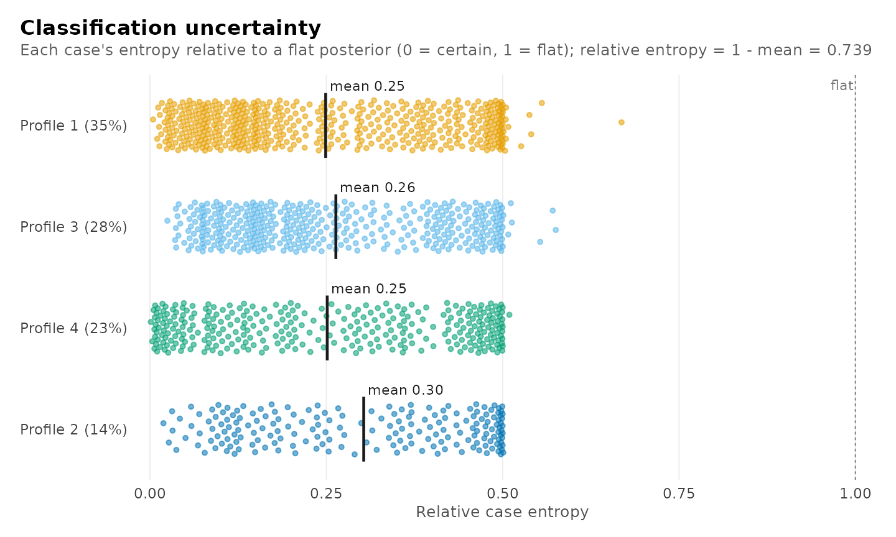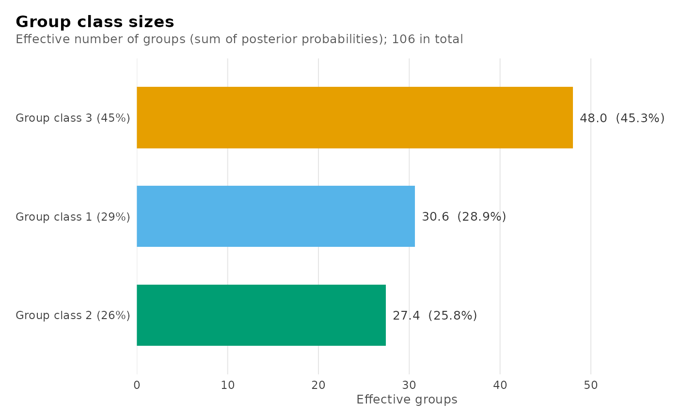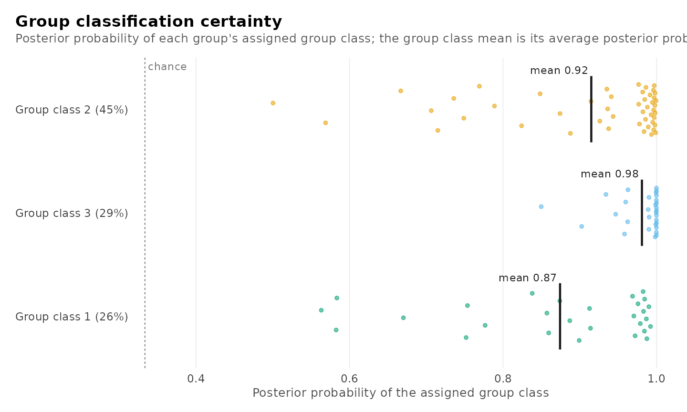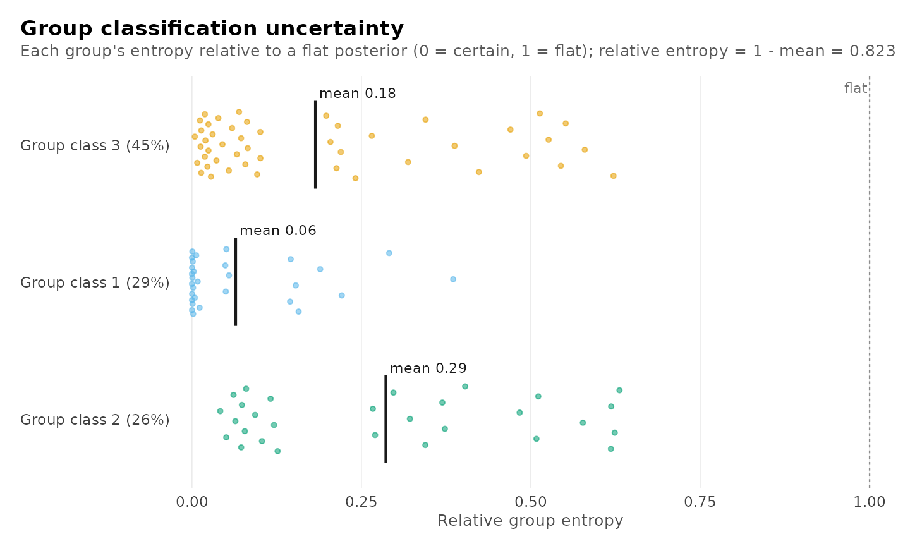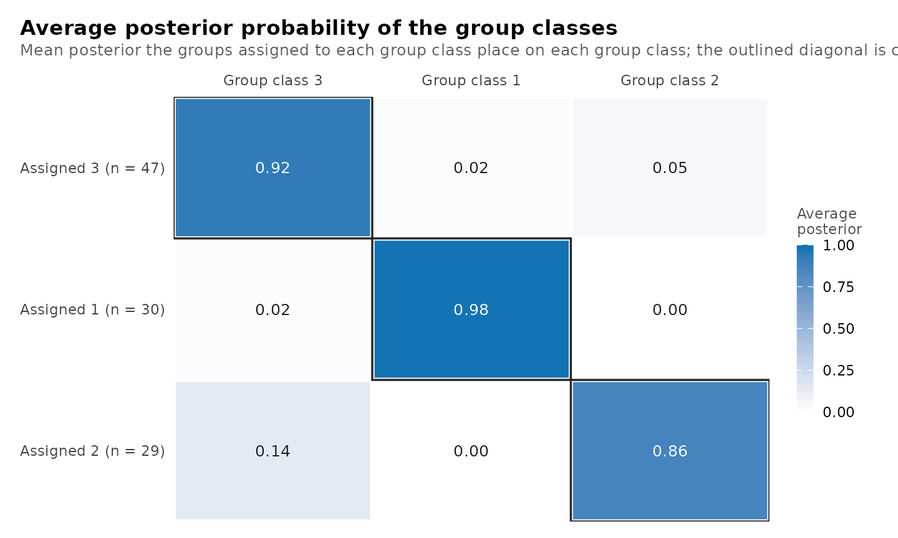

    #> Classification quality: 4 profiles, 3 group classes
    #> 
    #>   Relative entropy     individuals 0.739    groups 0.823
    #>   Smallest class       individuals 202.2 (14.2%)    groups 27.4 (25.8%)
    #>   Lowest avg posterior individuals 0.801    groups 0.874
    #>   Largest residual     -0.115  (lectures, forum_post; profile_3)
    #> 
    #> Tables: get_results(x, what = "entropy" | "classification" | 
    #>         "average_posteriors" | "residuals" | "all"). plot(x) draws them.

``` r

plot_diagnostics(chosen)
```

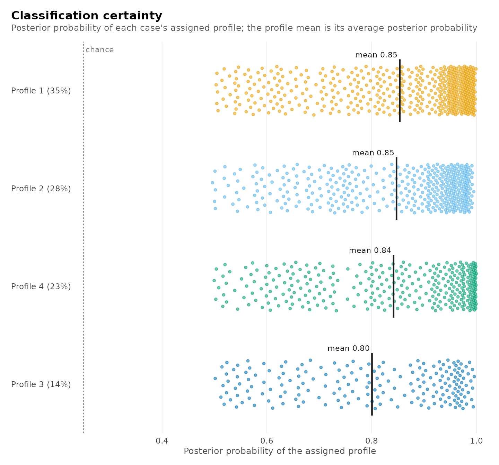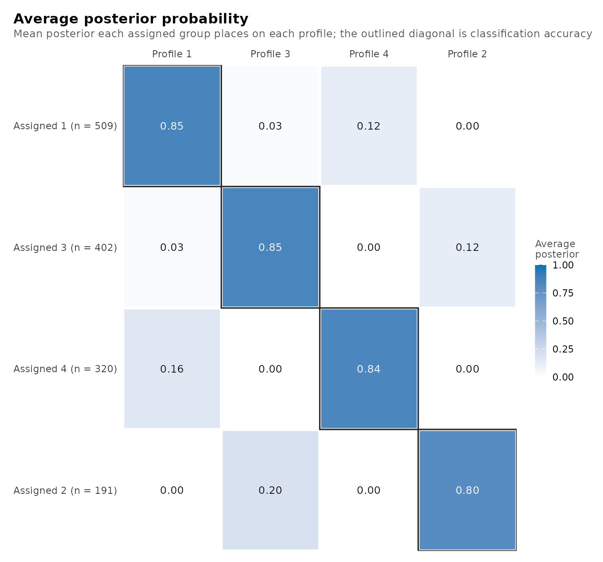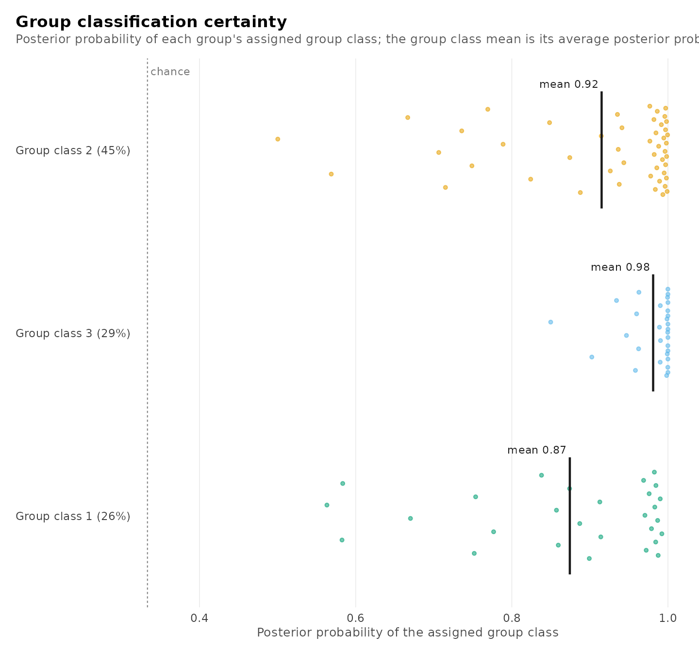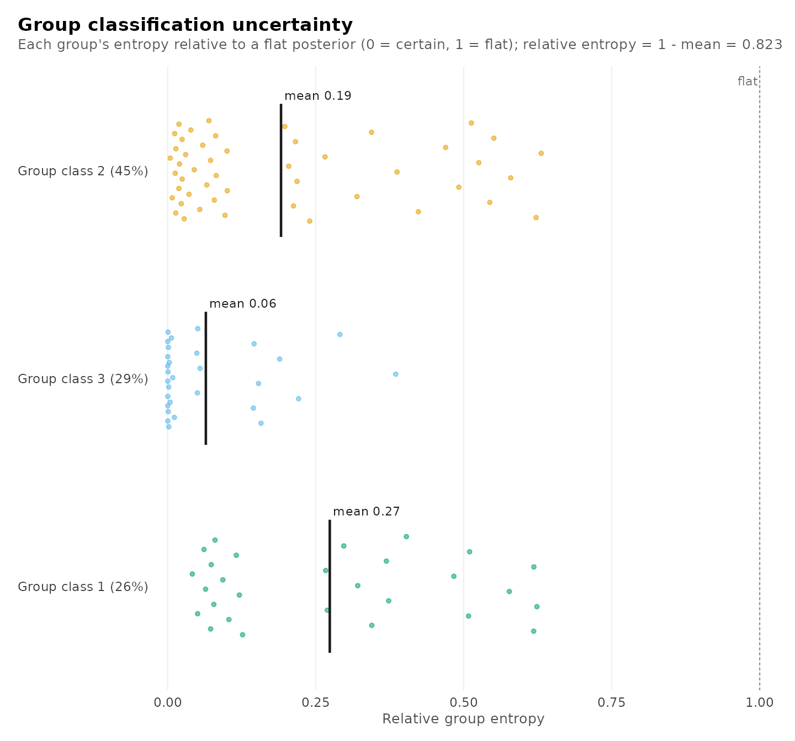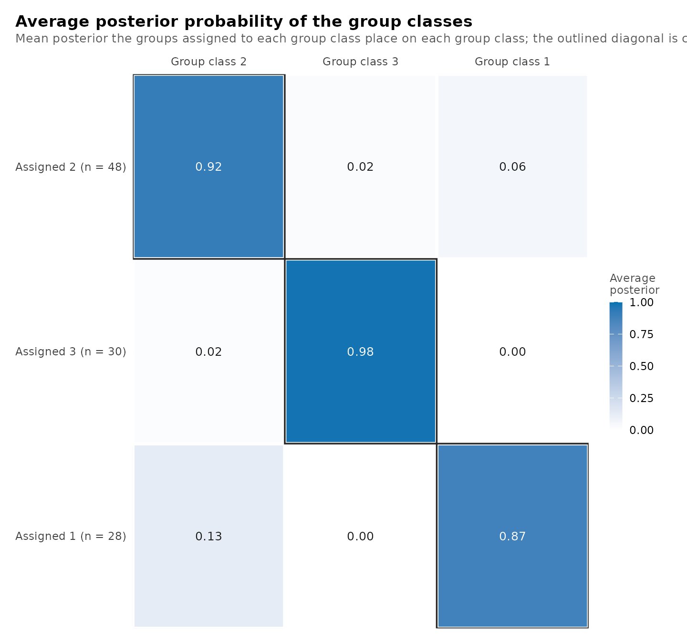

Each enrolment with its profile, its student’s group class and its
posterior probabilities:

``` r

head(get_results(chosen, "assignments", data = course_engagement))
#>   student course sequence browse lectures forum_read forum_post attendance previous_grade
#> 1       1     23        1   0.73    -0.08       0.30       0.67       0.72           0.54
#> 2       1     19        2   0.68     0.53      -0.02      -0.55       0.70          -0.71
#> 3       1      4        3  -1.51    -0.51      -0.91      -0.80      -0.97           1.98
#> 4       1     18        4   0.64    -1.02      -1.62      -1.20      -1.26          -1.42
#> 5       1     16        5  -0.94    -0.37      -0.71      -0.28      -1.52          -0.67
#> 6       1     29        6  -0.36    -0.46      -0.77      -0.43      -1.34          -0.40
#>   engagement student_type profile group_class uncertainty posterior_profile_1 posterior_profile_2
#> 1    engaged     wavering       4           3       0.500            4.98e-01             0.00203
#> 2    engaged     wavering       1           3       0.327            6.73e-01             0.04917
#> 3 disengaged     wavering       3           3       0.474            2.02e-06             0.47397
#> 4 disengaged     wavering       2           3       0.299            1.72e-06             0.70112
#> 5 disengaged     wavering       3           3       0.377            7.36e-07             0.37665
#> 6 disengaged     wavering       2           3       0.361            5.21e-06             0.63908
#>   posterior_profile_3 posterior_profile_4
#> 1            3.22e-09            5.00e-01
#> 2            5.58e-07            2.78e-01
#> 3            5.26e-01            1.14e-11
#> 4            2.99e-01            5.71e-12
#> 5            6.23e-01            1.13e-12
#> 6            3.61e-01            2.75e-11
```

The profiles can be related to an outcome. The mean of `previous_grade`
in each profile is estimated with
[`three_step()`](https://pak.dynasite.org/latents/reference/three_step.md),
which corrects for the uncertainty of the classification with the BCH
method.

``` r

three_step(chosen, data = course_engagement, outcome = "previous_grade")
#> Distal outcome by class (bch, 95% CI)
#> 
#> Class   Mean          95% CI     SE  Effective n
#> -----  -----  --------------  -----  -----------
#>     1   0.17  [ 0.07,  0.27]  0.050       338.59
#>     2  -0.30  [-0.41, -0.18]  0.058       255.57
#>     3  -0.36  [-0.53, -0.20]  0.084       111.57
#>     4   0.32  [ 0.18,  0.45]  0.069       210.39
```

## Functions

| Call | Result |
|:---|:---|
| enumerate_classes(data, vars, id, n_profiles, n_group_classes, model) | The fitted candidate models |
| as.data.frame(models) | One row per candidate with every column |
| get_results(models, “best”) | The candidate at the minimum of each criterion |
| get_results(models, “classification”) | Size, AvePP and entropy of every class of every candidate |
| get_results(models, “candidates”, cutoff = 0.9) | The table of candidates with another AvePP cutoff |
| get_results(models, “deltas”, using = ) | Decrease in a criterion from one profile fewer and one group class fewer |
| get_results(models, “knees”, using = ) | Maximum chord-distance knee of each line, its range and its stability |
| plot_enumeration(models), plot_enumeration(models, what = “bic_groups”), what = “all” | Information criteria across the candidates |
| plot_tree(models) | Division of profiles as more are added |
| plot_enumeration(models, what = “entropy”, “avepp” or “diagnostics”, cutoff = ) | Entropy and lowest AvePP across the candidates |
| plot_selection(models, what = “deltas”, “heatmap”, “smallest” or “trust”, using = ) | Decreases, distance from the lowest criterion, smallest class, estimation checks |
| plot_selection(models) | All of the plots for choosing the number of classes |
| get_candidate(models, “profiles4_groups3”), get_candidate(models, 4, 3) | One fitted candidate |
| compare_models(models, “name”, c(4, 2), …) | Named candidates side by side |
| compare_models(models, n_profiles = , n_group_classes = ) | All candidates with the given numbers of classes |
| compare_models(name = fit, name = fit) | Fitted models side by side, on the same data |
| get_candidate(comparison, “name”) | The model behind a row of a comparison |
| get_results(comparison, “classification”) | Every class of every compared model |
