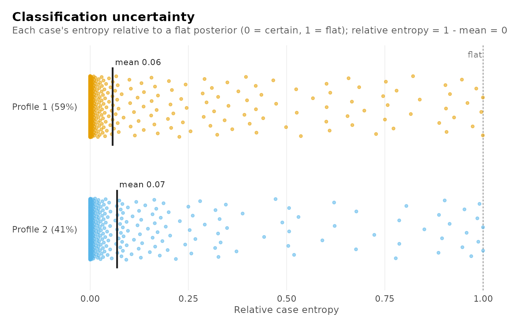
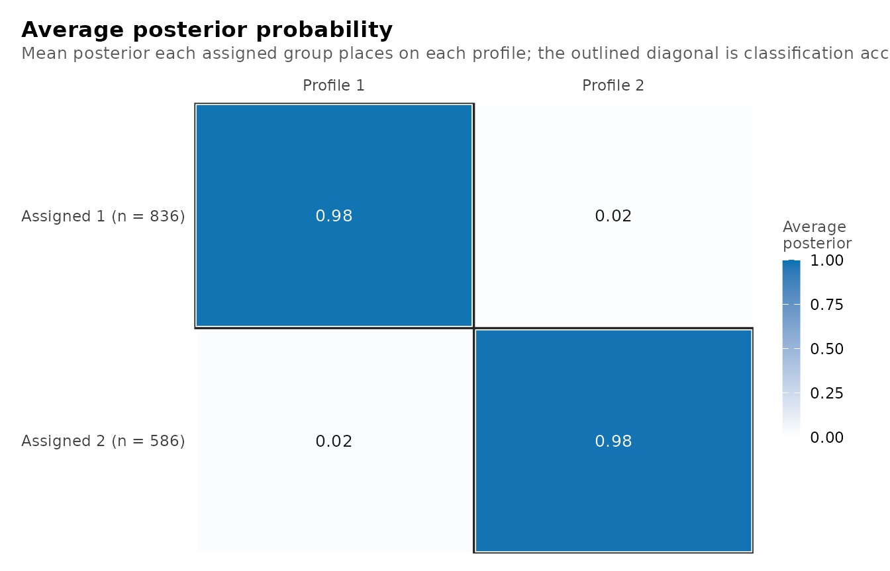
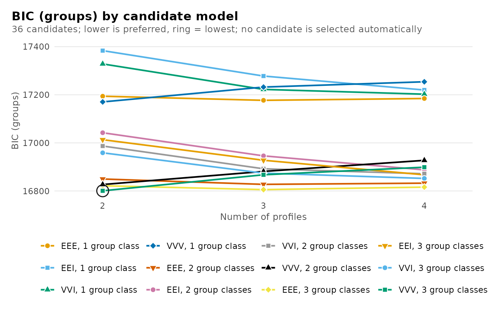

# Evaluating a multilevel latent profile model

A fitted mixture model is evaluated on four questions: whether the
estimation found a stable solution, how clearly observations and groups
are classified, whether the indicators are independent within profiles
as the model assumes, and whether a different number of profiles or
group classes fits better.

## Data

`course_engagement` has one row per course enrolment: 1,422 enrolments
from 106 students. `student` identifies the group, and five activity
measures (`browse`, `lectures`, `forum_read`, `forum_post`,
`attendance`) are the indicators, each standardized within course.

``` r

library(latents)
```

## The model to evaluate

To fit the model, we call
[`multilpa()`](https://pak.dynasite.org/latents/reference/multilpa.md)
with `vars` for the indicators, `id` for the group, `n_profiles` for the
number of profiles, `n_group_classes` for the number of group classes,
`n_starts` for the number of random EM starts, and `seed` for
reproducible starts.

``` r

fit <- multilpa(course_engagement,
                vars = c("browse", "lectures", "forum_read", "forum_post",
                         "attendance"),
                id = "student", n_profiles = 2, n_group_classes = 2,
                n_starts = 3, seed = 1)
```

## Estimation

To check convergence, we call
[`get_results()`](https://pak.dynasite.org/latents/reference/get_results.md)
with `"model"`. `converged` reports convergence of the best start,
`boundary` whether a variance reached its lower bound, and
`n_best_replicated` how many starts reached the best log likelihood. A
variance at its lower bound in a profile of about one observation is a
degenerate solution; fitting with `boundary = "exclude"` keeps the best
start without one. A profile with fewer effective members than its own
means and variances raises a `latents_thin_profiles` warning: its
variances are poorly determined, so inspect its covariance diagnostics
before interpreting it.

``` r

get_results(fit, "model")
#>   n_observations n_informative n_groups n_profiles n_group_classes centering scaling
#> 1           1422          1422      106          2               2      none    none
#>   covariance_structure n_parameters n_parameters_with_measurement log_likelihood   aic bic_groups
#> 1                  VVI           23                            23          -8440 16926      16987
#>   bic_individual converged iterations boundary small_classes best_start n_best_replicated weights
#> 1          17047      TRUE          9    FALSE         FALSE          1                 3    <NA>
```

To check the individual starts, we call
[`get_results()`](https://pak.dynasite.org/latents/reference/get_results.md)
with `"starts"`.

``` r

get_results(fit, "starts")
#>   start log_likelihood converged iterations error boundary
#> 1     1          -8440      TRUE          9  <NA>    FALSE
#> 2     2          -8440      TRUE         12  <NA>    FALSE
#> 3     3          -8440      TRUE          9  <NA>    FALSE
```

To check whether other random seeds reach the same solution, we call
[`sensitivity()`](https://pak.dynasite.org/latents/reference/sensitivity.md)
with `seeds` for the seeds to try. `optimum` numbers the distinct maxima
found, and `agreement` is the share of observations assigned as in the
original fit, after matching the arbitrary profile labels.

``` r

sensitivity(fit, seeds = 1:3)
#>   seed log_likelihood converged iterations optimum best agreement
#> 1    1          -8440      TRUE          9       1 TRUE         1
#> 2    2          -8440      TRUE          9       1 TRUE         1
#> 3    3          -8440      TRUE          9       1 TRUE         1
```

## Classification

To obtain relative entropy, we call
[`get_results()`](https://pak.dynasite.org/latents/reference/get_results.md)
with `"entropy"`. It is reported for observations and for groups: 1
means every case is assigned with certainty, 0 means no separation.

``` r

get_results(fit, "entropy")
#>         level n_classes n_units entropy_sum relative_entropy
#> 1 individuals         2    1422       60.94            0.938
#> 2      groups         2     106        4.43            0.940
```

To obtain classification quality by class, we call
[`get_results()`](https://pak.dynasite.org/latents/reference/get_results.md)
with `"classification"`. `n_modal` is the number of cases assigned to
the class, `average_posterior` the mean posterior probability of those
cases, and `odds_correct_classification` compares that certainty with
the class’s size.

``` r

get_results(fit, "classification")
#>         level class n_modal proportion_modal estimated_n estimated_proportion average_posterior
#> 1 individuals     1     836            0.588       834.1                0.587             0.985
#> 2 individuals     2     586            0.412       587.9                0.413             0.982
#> 3      groups     1      35            0.330        34.5                0.325             0.969
#> 4      groups     2      71            0.670        71.5                0.675             0.992
#>   odds_correct_classification
#> 1                        46.1
#> 2                        76.4
#> 3                        64.8
#> 4                        59.9
```

To see the uncertainty, we call
[`plot_diagnostics()`](https://pak.dynasite.org/latents/reference/latents-plots.md)
with `what = "entropy"` for the per-case uncertainty within each
profile, and with `what = "avepp"` for the average posterior of each
assigned class across all classes.

``` r

plot_diagnostics(fit, what = "entropy")
```



``` r

plot_diagnostics(fit, what = "avepp")
```



## Local independence

The default model assumes the indicators are independent within a
profile. To test this, we call
[`get_results()`](https://pak.dynasite.org/latents/reference/get_results.md)
with `"residuals"`. `residual` is the correlation between two indicators
that the profiles leave unexplained; `by = "overall"` pools the
profiles. The p-values are approximate.

``` r

get_results(fit, "residuals", by = "overall")
#>    profile indicator_1 indicator_2     kind observed expected residual effective_n statistic df
#> 1  overall  forum_read  attendance gaussian  0.21588        0  0.21588        1422    8.2620 NA
#> 2  overall    lectures  attendance gaussian  0.19234        0  0.19234        1422    7.3369 NA
#> 3  overall      browse  attendance gaussian  0.18077        0  0.18077        1422    6.8850 NA
#> 4  overall  forum_post  attendance gaussian  0.17239        0  0.17239        1422    6.5594 NA
#> 5  overall      browse  forum_read gaussian  0.06265        0  0.06265        1422    2.3632 NA
#> 6  overall      browse  forum_post gaussian -0.02511        0 -0.02511        1422   -0.9461 NA
#> 7  overall      browse    lectures gaussian -0.02126        0 -0.02126        1422   -0.8009 NA
#> 8  overall  forum_read  forum_post gaussian  0.01986        0  0.01986        1422    0.7483 NA
#> 9  overall    lectures  forum_post gaussian  0.01710        0  0.01710        1422    0.6440 NA
#> 10 overall    lectures  forum_read gaussian  0.00193        0  0.00193        1422    0.0725 NA
#>     p_value p_adjusted
#> 1  1.43e-16   1.43e-16
#> 2  2.19e-13   2.19e-13
#> 3  5.78e-12   5.78e-12
#> 4  5.40e-11   5.40e-11
#> 5  1.81e-02   1.81e-02
#> 6  3.44e-01   3.44e-01
#> 7  4.23e-01   4.23e-01
#> 8  4.54e-01   4.54e-01
#> 9  5.20e-01   5.20e-01
#> 10 9.42e-01   9.42e-01
```

To relax the assumption, we call
[`multilpa()`](https://pak.dynasite.org/latents/reference/multilpa.md)
with `covariance_model = "full"`, which estimates the covariances
between indicators within each profile. To compare the two models, we
call
[`get_results()`](https://pak.dynasite.org/latents/reference/get_results.md)
with `"information_criteria"` on each; lower values are better.

``` r

full <- multilpa(course_engagement,
                 vars = c("browse", "lectures", "forum_read", "forum_post",
                          "attendance"),
                 id = "student", n_profiles = 2, n_group_classes = 2,
                 covariance_model = "full", n_starts = 3, seed = 1)
get_results(fit, "information_criteria")
#>   log_likelihood n_parameters   aic   kic bic_groups bic_individual sabic_groups sabic_individual
#> 1          -8440           23 16926 16952      16987          17047        16914            16974
#>   caic_groups caic_individual awe_groups awe_individual icl_groups icl_individual clc_groups
#> 1       17010           17070      17292          17412      17116          17176      17009
#>   clc_individual
#> 1          17009
get_results(full, "information_criteria")
#>   log_likelihood n_parameters   aic   kic bic_groups bic_individual sabic_groups sabic_individual
#> 1          -8313           43 16712 16758      16827          16938        16691            16802
#>   caic_groups caic_individual awe_groups awe_individual icl_groups icl_individual clc_groups
#> 1       16870           16981      17346          17570      17017          17128      16816
#>   clc_individual
#> 1          16816
get_results(full, "residuals", by = "overall")
#>    profile indicator_1 indicator_2     kind observed expected residual effective_n statistic df
#> 1  overall  forum_post  attendance gaussian  0.18790  0.18790 1.06e-08        1422  4.13e-07 NA
#> 2  overall  forum_read  forum_post gaussian  0.02435  0.02435 9.66e-09        1422  3.64e-07 NA
#> 3  overall      browse  forum_post gaussian -0.01867 -0.01867 7.66e-09        1422  2.88e-07 NA
#> 4  overall  forum_read  attendance gaussian  0.24179  0.24179 6.82e-09        1422  2.73e-07 NA
#> 5  overall      browse  attendance gaussian  0.20383  0.20383 5.24e-09        1422  2.06e-07 NA
#> 6  overall    lectures  forum_post gaussian  0.02007  0.02007 4.81e-09        1422  1.81e-07 NA
#> 7  overall      browse  forum_read gaussian  0.07442  0.07442 4.11e-09        1422  1.56e-07 NA
#> 8  overall    lectures  attendance gaussian  0.20502  0.20502 3.02e-09        1422  1.19e-07 NA
#> 9  overall    lectures  forum_read gaussian  0.00885  0.00885 2.62e-09        1422  9.88e-08 NA
#> 10 overall      browse    lectures gaussian -0.01381 -0.01381 2.09e-09        1422  7.86e-08 NA
#>    p_value p_adjusted
#> 1        1          1
#> 2        1          1
#> 3        1          1
#> 4        1          1
#> 5        1          1
#> 6        1          1
#> 7        1          1
#> 8        1          1
#> 9        1          1
#> 10       1          1
```

## Number of profiles and group classes

To compare numbers of profiles and group classes, we call
[`enumerate_classes()`](https://pak.dynasite.org/latents/reference/enumerate_classes.md)
with `n_profiles` and `n_group_classes` for the counts to cross. It
crosses the counts with four covariance structures, equal or varying
variances with and without covariances, fits every combination, and does
not choose a model.

``` r

candidates <- enumerate_classes(course_engagement,
                                vars = c("browse", "lectures", "forum_read",
                                         "forum_post", "attendance"),
                                id = "student", n_profiles = 2:4,
                                n_group_classes = 1:3, n_starts = 3, seed = 1)
#> Warning: Profile 2: 18.6 Gaussian membership mass for 20 free means and variances. This is a
#> conservative diagnostic, not an identification test; inspect the Gaussian covariance diagnostics.
as.data.frame(candidates)
#>                candidate n_profiles n_group_classes model log_likelihood n_parameters   aic   kic
#> 1  profiles2_groups1_EEI          2               1   EEI          -8655           16 17341 17360
#> 2  profiles3_groups1_EEI          3               1   EEI          -8588           22 17219 17244
#> 3  profiles4_groups1_EEI          4               1   EEI          -8545           28 17145 17176
#> 4  profiles2_groups2_EEI          2               2   EEI          -8479           18 16994 17015
#> 5  profiles3_groups2_EEI          3               2   EEI          -8415           25 16879 16907
#> 6  profiles4_groups2_EEI          4               2   EEI          -8369           32 16802 16837
#> 7  profiles2_groups3_EEI          2               3   EEI          -8460           20 16960 16983
#> 8  profiles3_groups3_EEI          3               3   EEI          -8399           28 16853 16884
#> 9  profiles4_groups3_EEI          4               3   EEI          -8350           36 16771 16810
#> 10 profiles2_groups1_VVI          2               1   VVI          -8615           21 17272 17296
#> 11 profiles3_groups1_VVI          3               1   VVI          -8537           32 17137 17172
#> 12 profiles4_groups1_VVI          4               1   VVI          -8501           43 17088 17134
#> 13 profiles2_groups2_VVI          2               2   VVI          -8440           23 16926 16952
#> 14 profiles3_groups2_VVI          3               2   VVI          -8365           35 16799 16837
#> 15 profiles4_groups2_VVI          4               2   VVI          -8326           47 16746 16796
#> 16 profiles2_groups3_VVI          2               3   VVI          -8421           25 16892 16920
#> 17 profiles3_groups3_VVI          3               3   VVI          -8348           38 16773 16814
#> 18 profiles4_groups3_VVI          4               3   VVI          -8307           51 16716 16770
#> 19 profiles2_groups1_EEE          2               1   EEE          -8536           26 17125 17154
#> 20 profiles3_groups1_EEE          3               1   EEE          -8514           32 17092 17127
#> 21 profiles4_groups1_EEE          4               1   EEE          -8504           38 17083 17124
#> 22 profiles2_groups2_EEE          2               2   EEE          -8360           28 16775 16806
#> 23 profiles3_groups2_EEE          3               2   EEE          -8332           35 16734 16772
#> 24 profiles4_groups2_EEE          4               2   EEE          -8318           42 16721 16766
#> 25 profiles2_groups3_EEE          2               3   EEE          -8341           30 16742 16775
#> 26 profiles3_groups3_EEE          3               3   EEE          -8314           38 16704 16745
#> 27 profiles4_groups3_EEE          4               3   EEE          -8301           46 16693 16742
#> 28 profiles2_groups1_VVV          2               1   VVV          -8490           41 17061 17105
#> 29 profiles3_groups1_VVV          3               1   VVV          -8472           62 17067 17132
#> 30 profiles4_groups1_VVV          4               1   VVV          -8434           83 17033 17119
#> 31 profiles2_groups2_VVV          2               2   VVV          -8313           43 16712 16758
#> 32 profiles3_groups2_VVV          3               2   VVV          -8289           65 16708 16776
#> 33 profiles4_groups2_VVV          4               2   VVV          -8261           87 16696 16786
#> 34 profiles2_groups3_VVV          2               3   VVV          -8295           45 16681 16729
#> 35 profiles3_groups3_VVV          3               3   VVV          -8275           68 16686 16757
#> 36 profiles4_groups3_VVV          4               3   VVV          -8237           91 16656 16750
#>    bic_groups bic_individual sabic_groups sabic_individual caic_groups caic_individual awe_groups
#> 1       17384          17425        17333            17374       17400           17441      17672
#> 2       17278          17335        17209            17265       17300           17357      18281
#> 3       17220          17293        17131            17204       17248           17321      18528
#> 4       17042          17089        16985            17032       17060           17107      17320
#> 5       16946          17011        16867            16932       16971           17036      17952
#> 6       16888          16971        16787            16869       16920           17003      18248
#> 7       17013          17065        16950            17002       17033           17085      17330
#> 8       16928          17000        16839            16911       16956           17028      17992
#> 9       16867          16961        16753            16846       16903           16997      18271
#> 10      17328          17383        17262            17316       17349           17404      17644
#> 11      17222          17306        17121            17204       17254           17338      18179
#> 12      17203          17314        17067            17178       17246           17357      18577
#> 13      16987          17047        16914            16974       17010           17070      17292
#> 14      16892          16983        16782            16872       16927           17018      17824
#> 15      16872          16994        16723            16844       16919           17041      18265
#> 16      16959          17024        16880            16944       16984           17049      17306
#> 17      16874          16973        16754            16852       16912           17011      17856
#> 18      16852          16985        16691            16823       16903           17036      18303
#> 19      17194          17262        17112            17179       17220           17288      17658
#> 20      17177          17260        17076            17158       17209           17292      18406
#> 21      17185          17283        17065            17163       17223           17321      18820
#> 22      16850          16922        16761            16833       16878           16950      17267
#> 23      16827          16918        16717            16807       16862           16953      17994
#> 24      16832          16941        16700            16808       16874           16983      18368
#> 25      16822          16900        16727            16804       16852           16930      17274
#> 26      16806          16904        16686            16784       16844           16942      18010
#> 27      16816          16935        16671            16789       16862           16981      18371
#> 28      17170          17277        17041            17147       17211           17318      17732
#> 29      17232          17393        17036            17196       17294           17455      18344
#> 30      17254          17470        16992            17206       17337           17553      18315
#> 31      16827          16938        16691            16802       16870           16981      17346
#> 32      16881          17050        16676            16844       16946           17115      17593
#> 33      16927          17153        16652            16877       17014           17240      18365
#> 34      16801          16917        16658            16775       16846           16962      17360
#> 35      16867          17044        16652            16828       16935           17112      17958
#> 36      16899          17135        16611            16846       16990           17226      18195
#>    awe_individual icl_groups icl_individual clc_groups clc_individual profile_entropy group_entropy
#> 1           17755      17550          17591      17475          17475           0.916            NA
#> 2           18396      18113          18170      18010          18010           0.733            NA
#> 3           18673      18313          18386      18183          18183           0.723            NA
#> 4           17413      17182          17229      17098          17098           0.933         0.937
#> 5           18082      17760          17825      17644          17644           0.741         0.944
#> 6           18414      18003          18086      17853          17853           0.719         0.935
#> 7           17434      17177          17229      17084          17084           0.936         0.820
#> 8           18138      17778          17850      17647          17647           0.741         0.804
#> 9           18458      17995          18089      17827          17827           0.720         0.832
#> 10          17753      17483          17537      17385          17385           0.922            NA
#> 11          18345      17934          18017      17785          17785           0.772            NA
#> 12          18800      18247          18359      18047          18047           0.735            NA
#> 13          17412      17116          17176      17009          17009           0.938         0.940
#> 14          18005      17556          17646      17392          17392           0.790         0.943
#> 15          18509      17905          18027      17686          17686           0.739         0.937
#> 16          17436      17115          17180      16998          16998           0.940         0.816
#> 17          18053      17565          17663      17388          17388           0.792         0.797
#> 18          18568      17913          18045      17675          17675           0.739         0.823
#> 19          17793      17459          17526      17338          17338           0.866            NA
#> 20          18572      18161          18244      18011          18011           0.685            NA
#> 21          19017      18529          18628      18352          18352           0.659            NA
#> 22          17412      17052          17125      16922          16922           0.900         0.940
#> 23          18175      17726          17816      17562          17562           0.713         0.949
#> 24          18587      18047          18156      17851          17851           0.692         0.955
#> 25          17430      17044          17122      16904          16904           0.904         0.821
#> 26          18207      17718          17817      17541          17541           0.716         0.840
#> 27          18609      18018          18138      17804          17804           0.700         0.844
#> 28          17945      17418          17524      17226          17226           0.875            NA
#> 29          18666      17869          18030      17580          17580           0.796            NA
#> 30          18746      17679          17894      17292          17292           0.892            NA
#> 31          17570      17017          17128      16816          16816           0.906         0.942
#> 32          17931      17095          17264      16792          16792           0.933         0.943
#> 33          18817      17699          17925      17293          17293           0.805         0.946
#> 34          17593      17015          17132      16805          16805           0.909         0.816
#> 35          18312      17437          17614      17120          17120           0.828         0.824
#> 36          18667      17497          17734      17073          17073           0.855         0.837
#>    avepp_min avepp_max avepp_mean avepp_below group_avepp_min group_avepp_max group_avepp_mean
#> 1      0.976     0.977      0.977           0              NA              NA               NA
#> 2      0.794     0.961      0.860           1              NA              NA               NA
#> 3      0.817     0.843      0.830           0              NA              NA               NA
#> 4      0.982     0.982      0.982           0           0.967           0.991            0.979
#> 5      0.792     0.976      0.861           1           0.975           0.993            0.984
#> 6      0.818     0.838      0.827           0           0.974           0.989            0.982
#> 7      0.982     0.983      0.983           0           0.885           0.967            0.921
#> 8      0.797     0.976      0.860           1           0.883           0.971            0.915
#> 9      0.818     0.836      0.827           0           0.877           0.976            0.925
#> 10     0.974     0.982      0.978           0              NA              NA               NA
#> 11     0.832     0.964      0.886           0              NA              NA               NA
#> 12     0.803     0.849      0.835           0              NA              NA               NA
#> 13     0.982     0.985      0.983           0           0.969           0.992            0.980
#> 14     0.849     0.979      0.893           0           0.977           0.992            0.985
#> 15     0.791     0.859      0.835           1           0.975           0.990            0.983
#> 16     0.982     0.986      0.984           0           0.900           0.962            0.923
#> 17     0.843     0.978      0.892           0           0.864           0.977            0.913
#> 18     0.801     0.853      0.836           0           0.861           0.981            0.922
#> 19     0.961     0.967      0.964           0              NA              NA               NA
#> 20     0.755     0.954      0.832           2              NA              NA               NA
#> 21     0.660     0.947      0.756           3              NA              NA               NA
#> 22     0.972     0.975      0.974           0           0.968           0.992            0.980
#> 23     0.749     0.970      0.842           1           0.983           0.990            0.987
#> 24     0.670     0.971      0.771           3           0.988           0.992            0.990
#> 25     0.975     0.975      0.975           0           0.904           0.951            0.923
#> 26     0.750     0.969      0.842           1           0.856           0.960            0.921
#> 27     0.652     0.971      0.771           3           0.841           0.970            0.920
#> 28     0.959     0.971      0.965           0              NA              NA               NA
#> 29     0.665     0.956      0.833           1              NA              NA               NA
#> 30     0.630     0.958      0.837           1              NA              NA               NA
#> 31     0.973     0.978      0.976           0           0.971           0.993            0.982
#> 32     0.796     0.976      0.915           1           0.979           0.990            0.985
#> 33     0.798     0.974      0.856           1           0.962           0.995            0.979
#> 34     0.974     0.978      0.976           0           0.903           0.960            0.923
#> 35     0.650     0.973      0.841           1           0.878           0.955            0.920
#> 36     0.649     0.967      0.838           1           0.881           0.976            0.928
#>    group_avepp_below converged boundary min_standardized_eigenvalue min_gaussian_mass
#> 1                 NA      TRUE    FALSE                    0.381446             605.3
#> 2                 NA      TRUE    FALSE                    0.293250             430.8
#> 3                 NA      TRUE    FALSE                    0.202267             214.7
#> 4                  0      TRUE    FALSE                    0.387254             600.8
#> 5                  0      TRUE    FALSE                    0.308376             399.0
#> 6                  0      TRUE    FALSE                    0.216626             233.5
#> 7                  0      TRUE    FALSE                    0.387126             602.3
#> 8                  0      TRUE    FALSE                    0.310161             391.2
#> 9                  0      TRUE    FALSE                    0.216325             251.1
#> 10                NA      TRUE    FALSE                    0.375010             589.1
#> 11                NA      TRUE    FALSE                    0.193164             418.2
#> 12                NA      TRUE    FALSE                    0.189246             172.1
#> 13                 0      TRUE    FALSE                    0.371479             587.9
#> 14                 0      TRUE    FALSE                    0.199961             382.6
#> 15                 0      TRUE    FALSE                    0.200276             178.0
#> 16                 0      TRUE    FALSE                    0.374829             591.1
#> 17                 0      TRUE    FALSE                    0.200183             369.4
#> 18                 0      TRUE    FALSE                    0.195067             201.5
#> 19                NA      TRUE    FALSE                    0.278459             606.5
#> 20                NA      TRUE    FALSE                    0.278644             400.9
#> 21                NA      TRUE    FALSE                    0.278506             151.7
#> 22                 0      TRUE    FALSE                    0.278272             599.7
#> 23                 0      TRUE    FALSE                    0.276968             360.4
#> 24                 0      TRUE    FALSE                    0.276244             121.6
#> 25                 0      TRUE    FALSE                    0.278167             602.4
#> 26                 0      TRUE    FALSE                    0.276969             353.8
#> 27                 0      TRUE    FALSE                    0.275787             108.9
#> 28                NA      TRUE    FALSE                    0.269614             577.4
#> 29                NA      TRUE    FALSE                    0.120317             112.7
#> 30                NA      TRUE    FALSE                    0.000276              26.1
#> 31                 0      TRUE    FALSE                    0.271042             583.2
#> 32                 0      TRUE    FALSE                    0.011064              18.6
#> 33                 0      TRUE    FALSE                    0.001958              26.3
#> 34                 0      TRUE    FALSE                    0.272051             589.5
#> 35                 0      TRUE    FALSE                    0.120469             116.5
#> 36                 0      TRUE    FALSE                    0.002424              26.9
#>    n_best_replicated
#> 1                  3
#> 2                  3
#> 3                  3
#> 4                  3
#> 5                  3
#> 6                  3
#> 7                  3
#> 8                  3
#> 9                  3
#> 10                 3
#> 11                 3
#> 12                 3
#> 13                 3
#> 14                 3
#> 15                 3
#> 16                 3
#> 17                 3
#> 18                 3
#> 19                 3
#> 20                 3
#> 21                 1
#> 22                 3
#> 23                 3
#> 24                 1
#> 25                 3
#> 26                 3
#> 27                 1
#> 28                 3
#> 29                 2
#> 30                 1
#> 31                 3
#> 32                 1
#> 33                 1
#> 34                 3
#> 35                 2
#> 36                 1
#>                                                                                                                                                                                 warnings
#> 1                                                                                                                                                                                       
#> 2                                                                                                                                                                                       
#> 3                                                                                                                                                                                       
#> 4                                                                                                                                                                                       
#> 5                                                                                                                                                                                       
#> 6                                                                                                                                                                                       
#> 7                                                                                                                                                                                       
#> 8                                                                                                                                                                                       
#> 9                                                                                                                                                                                       
#> 10                                                                                                                                                                                      
#> 11                                                                                                                                                                                      
#> 12                                                                                                                                                                                      
#> 13                                                                                                                                                                                      
#> 14                                                                                                                                                                                      
#> 15                                                                                                                                                                                      
#> 16                                                                                                                                                                                      
#> 17                                                                                                                                                                                      
#> 18                                                                                                                                                                                      
#> 19                                                                                                                                                                                      
#> 20                                                                                                                                                                                      
#> 21                                                                                                                                                                                      
#> 22                                                                                                                                                                                      
#> 23                                                                                                                                                                                      
#> 24                                                                                                                                                                                      
#> 25                                                                                                                                                                                      
#> 26                                                                                                                                                                                      
#> 27                                                                                                                                                                                      
#> 28                                                                                                                                                                                      
#> 29                                                                                                                                                                                      
#> 30                                                                                                                                                                                      
#> 31                                                                                                                                                                                      
#> 32 Profile 2: 18.6 Gaussian membership mass for 20 free means and variances. This is a conservative diagnostic, not an identification test; inspect the Gaussian covariance diagnostics.
#> 33                                                                                                                                                                                      
#> 34                                                                                                                                                                                      
#> 35                                                                                                                                                                                      
#> 36                                                                                                                                                                                      
#>    error
#> 1   <NA>
#> 2   <NA>
#> 3   <NA>
#> 4   <NA>
#> 5   <NA>
#> 6   <NA>
#> 7   <NA>
#> 8   <NA>
#> 9   <NA>
#> 10  <NA>
#> 11  <NA>
#> 12  <NA>
#> 13  <NA>
#> 14  <NA>
#> 15  <NA>
#> 16  <NA>
#> 17  <NA>
#> 18  <NA>
#> 19  <NA>
#> 20  <NA>
#> 21  <NA>
#> 22  <NA>
#> 23  <NA>
#> 24  <NA>
#> 25  <NA>
#> 26  <NA>
#> 27  <NA>
#> 28  <NA>
#> 29  <NA>
#> 30  <NA>
#> 31  <NA>
#> 32  <NA>
#> 33  <NA>
#> 34  <NA>
#> 35  <NA>
#> 36  <NA>
```

To find which candidate minimizes each criterion, we call
[`get_results()`](https://pak.dynasite.org/latents/reference/get_results.md)
with `"best"`. Criteria that depend on a sample size are reported with
the number of groups and with the number of observations.

``` r

get_results(candidates, "best")
#>    criterion  convention             candidate n_profiles n_group_classes model value
#> 1        aic        <NA> profiles4_groups3_VVV          4               3   VVV 16656
#> 2        kic        <NA> profiles2_groups3_VVV          2               3   VVV 16729
#> 3        bic      groups profiles2_groups3_VVV          2               3   VVV 16801
#> 4        bic individuals profiles2_groups3_EEE          2               3   EEE 16900
#> 5      sabic      groups profiles4_groups3_VVV          4               3   VVV 16611
#> 6      sabic individuals profiles2_groups3_VVV          2               3   VVV 16775
#> 7       caic      groups profiles3_groups3_EEE          3               3   EEE 16844
#> 8       caic individuals profiles2_groups3_EEE          2               3   EEE 16930
#> 9        awe      groups profiles2_groups2_EEE          2               2   EEE 17267
#> 10       awe individuals profiles2_groups2_VVI          2               2   VVI 17412
#> 11       icl      groups profiles2_groups3_VVV          2               3   VVV 17015
#> 12       icl individuals profiles2_groups3_EEE          2               3   EEE 17122
#> 13       clc      groups profiles3_groups2_VVV          3               2   VVV 16792
#> 14       clc individuals profiles3_groups2_VVV          3               2   VVV 16792
```

To draw one criterion across the grid, we call
[`plot_enumeration()`](https://pak.dynasite.org/latents/reference/latents-plots.md)
with its name as `what`; `what = "all"` draws every criterion.

``` r

plot_enumeration(candidates, what = "bic_groups")
```



To take one candidate out of the grid as a fitted model, we call
[`get_candidate()`](https://pak.dynasite.org/latents/reference/get_candidate.md)
with its `n_profiles`, `n_group_classes` and `model`.

``` r

get_candidate(candidates, n_profiles = 3, n_group_classes = 2, model = "VVI")
#> Two-level latent profile analysis: 3 profiles, 2 group classes
#> 1422 individuals in 106 groups; varying diagonal residual covariance (VVI)
#> Log likelihood: -8364.520143 | AIC: 16799.040 | BIC (groups): 16892.261
#> Converged: TRUE | iterations: 30 | best log likelihood reached by 3 of 3 starts (3 converged)
#> Smallest standardized Gaussian eigenvalue: 0.2 (profiles, profile_1); Gaussian mass: 469.5; weight effective n: 597.6.
#> 
#> Class sizes   profile_1 33.0% (470)   profile_2 40.1% (570)   profile_3 26.9% (383)
#> Group classes group_class_1 32.8% (35)   group_class_2 67.2% (71)
#> 
#> Means
#>   indicator profile_1 profile_2 profile_3
#>      browse     0.376    -0.782     0.704
#>    lectures     0.166    -0.613     0.709
#>  forum_read     0.434    -0.898     0.806
#>  forum_post     0.321    -0.765     0.744
#>  attendance     0.239    -0.946     1.116
#> 
#> Variances and standard errors: get_results(x, "profiles").
#> Every other table: get_results(x, what = ), or get_results(x, "all").
```

## Parameter uncertainty

To obtain standard errors and 95% Wald intervals, we call
[`parameter_inference()`](https://pak.dynasite.org/latents/reference/parameter_inference.md)
on the fit. With `vcov_type = "robust"`, the standard errors are
clustered on groups.

``` r

parameter_inference(fit)
#>          level       outcome          term   parameter estimate standard_error statistic   p_value
#> 1  measurement     profile_1        browse        mean    0.540         0.0271      19.9  3.37e-88
#> 2  measurement     profile_1      lectures        mean    0.427         0.0325      13.2  1.56e-39
#> 3  measurement     profile_1    forum_read        mean    0.620         0.0247      25.1 1.25e-138
#> 4  measurement     profile_1    forum_post        mean    0.530         0.0295      18.0  3.71e-72
#> 5  measurement     profile_1    attendance        mean    0.649         0.0223      29.2 8.03e-187
#> 6  measurement     profile_2        browse        mean   -0.766         0.0312     -24.5 7.17e-133
#> 7  measurement     profile_2      lectures        mean   -0.606         0.0309     -19.6  1.32e-85
#> 8  measurement     profile_2    forum_read        mean   -0.879         0.0262     -33.5 1.33e-246
#> 9  measurement     profile_2    forum_post        mean   -0.753         0.0277     -27.2 8.23e-163
#> 10 measurement     profile_2    attendance        mean   -0.921         0.0264     -34.8 6.51e-266
#> 11 measurement     profile_1        browse    variance    0.590         0.0295        NA        NA
#> 12 measurement     profile_1      lectures    variance    0.845         0.0421        NA        NA
#> 13 measurement     profile_1    forum_read    variance    0.481         0.0244        NA        NA
#> 14 measurement     profile_1    forum_post    variance    0.689         0.0348        NA        NA
#> 15 measurement     profile_1    attendance    variance    0.384         0.0196        NA        NA
#> 16 measurement     profile_2        browse    variance    0.528         0.0322        NA        NA
#> 17 measurement     profile_2      lectures    variance    0.538         0.0321        NA        NA
#> 18 measurement     profile_2    forum_read    variance    0.363         0.0228        NA        NA
#> 19 measurement     profile_2    forum_post    variance    0.421         0.0261        NA        NA
#> 20 measurement     profile_2    attendance    variance    0.374         0.0228        NA        NA
#> 21     profile     profile_1 group_class_1 probability    0.170         0.0221        NA        NA
#> 22     profile     profile_2 group_class_1 probability    0.830         0.0221        NA        NA
#> 23     profile     profile_1 group_class_2 probability    0.786         0.0155        NA        NA
#> 24     profile     profile_2 group_class_2 probability    0.214         0.0155        NA        NA
#> 25       group group_class_1          <NA> probability    0.325         0.0476        NA        NA
#> 26       group group_class_2          <NA> probability    0.675         0.0476        NA        NA
#>    p_adjusted conf_low conf_high
#> 1    3.37e-88    0.486     0.593
#> 2    1.56e-39    0.364     0.491
#> 3   1.25e-138    0.571     0.668
#> 4    3.71e-72    0.473     0.588
#> 5   8.03e-187    0.605     0.693
#> 6   7.17e-133   -0.827    -0.704
#> 7    1.32e-85   -0.667    -0.546
#> 8   1.33e-246   -0.931    -0.828
#> 9   8.23e-163   -0.807    -0.698
#> 10  6.51e-266   -0.972    -0.869
#> 11         NA    0.535     0.651
#> 12         NA    0.766     0.931
#> 13         NA    0.436     0.532
#> 14         NA    0.624     0.761
#> 15         NA    0.348     0.424
#> 16         NA    0.469     0.596
#> 17         NA    0.479     0.605
#> 18         NA    0.321     0.411
#> 19         NA    0.373     0.476
#> 20         NA    0.332     0.421
#> 21         NA    0.131     0.218
#> 22         NA    0.782     0.869
#> 23         NA    0.754     0.815
#> 24         NA    0.185     0.246
#> 25         NA    0.240     0.425
#> 26         NA    0.575     0.760
parameter_inference(fit, vcov_type = "robust")
#>          level       outcome          term   parameter estimate standard_error statistic   p_value
#> 1  measurement     profile_1        browse        mean    0.540         0.0307      17.6  5.42e-69
#> 2  measurement     profile_1      lectures        mean    0.427         0.0312      13.7  1.17e-42
#> 3  measurement     profile_1    forum_read        mean    0.620         0.0249      24.9 4.97e-137
#> 4  measurement     profile_1    forum_post        mean    0.530         0.0294      18.1  5.50e-73
#> 5  measurement     profile_1    attendance        mean    0.649         0.0236      27.5 5.56e-166
#> 6  measurement     profile_2        browse        mean   -0.766         0.0308     -24.9 8.25e-137
#> 7  measurement     profile_2      lectures        mean   -0.606         0.0356     -17.0  6.13e-65
#> 8  measurement     profile_2    forum_read        mean   -0.879         0.0269     -32.7 6.55e-235
#> 9  measurement     profile_2    forum_post        mean   -0.753         0.0276     -27.3 3.35e-164
#> 10 measurement     profile_2    attendance        mean   -0.921         0.0275     -33.4 3.25e-245
#> 11 measurement     profile_1        browse    variance    0.590         0.0279        NA        NA
#> 12 measurement     profile_1      lectures    variance    0.845         0.0453        NA        NA
#> 13 measurement     profile_1    forum_read    variance    0.481         0.0217        NA        NA
#> 14 measurement     profile_1    forum_post    variance    0.689         0.0339        NA        NA
#> 15 measurement     profile_1    attendance    variance    0.384         0.0181        NA        NA
#> 16 measurement     profile_2        browse    variance    0.528         0.0289        NA        NA
#> 17 measurement     profile_2      lectures    variance    0.538         0.0307        NA        NA
#> 18 measurement     profile_2    forum_read    variance    0.363         0.0204        NA        NA
#> 19 measurement     profile_2    forum_post    variance    0.421         0.0279        NA        NA
#> 20 measurement     profile_2    attendance    variance    0.374         0.0227        NA        NA
#> 21     profile     profile_1 group_class_1 probability    0.170         0.0330        NA        NA
#> 22     profile     profile_2 group_class_1 probability    0.830         0.0330        NA        NA
#> 23     profile     profile_1 group_class_2 probability    0.786         0.0231        NA        NA
#> 24     profile     profile_2 group_class_2 probability    0.214         0.0231        NA        NA
#> 25       group group_class_1          <NA> probability    0.325         0.0489        NA        NA
#> 26       group group_class_2          <NA> probability    0.675         0.0489        NA        NA
#>    p_adjusted conf_low conf_high
#> 1    5.42e-69    0.479     0.600
#> 2    1.17e-42    0.366     0.489
#> 3   4.97e-137    0.571     0.669
#> 4    5.50e-73    0.473     0.588
#> 5   5.56e-166    0.603     0.695
#> 6   8.25e-137   -0.826    -0.705
#> 7    6.13e-65   -0.676    -0.537
#> 8   6.55e-235   -0.932    -0.827
#> 9   3.35e-164   -0.807    -0.699
#> 10  3.25e-245   -0.975    -0.867
#> 11         NA    0.538     0.647
#> 12         NA    0.760     0.938
#> 13         NA    0.441     0.526
#> 14         NA    0.625     0.759
#> 15         NA    0.350     0.421
#> 16         NA    0.475     0.588
#> 17         NA    0.481     0.602
#> 18         NA    0.325     0.405
#> 19         NA    0.370     0.479
#> 20         NA    0.332     0.421
#> 21         NA    0.115     0.245
#> 22         NA    0.755     0.885
#> 23         NA    0.737     0.828
#> 24         NA    0.172     0.263
#> 25         NA    0.237     0.427
#> 26         NA    0.573     0.763
```

## Reference

The calls below list other evaluation functions and views. Each comment
states what the call returns.

``` r

get_results(fit, "information_criteria", format = "long")  # one row per criterion
get_results(fit, "average_posteriors")          # mean posterior by assigned class
get_results(fit, "classification_errors")       # P(assigned class | true class)
get_results(fit, "residuals")                   # residuals within each profile
get_results(candidates, "candidates")           # the full enumeration grid
summary(candidates)                             # every grid table, truncated
bootstrap_lrt(fit, get_candidate(candidates, n_profiles = 3,
                                n_group_classes = 2, model = "VVI"),
              iter = 199, seed = 42)            # bootstrap test of one more class (slow)
enumerate_classes(course_engagement, vars = c("browse", "lectures"),
                  id = "student", n_profiles = 2:3,
                  model = c("VVI", "VVV"))      # crossing covariance models (slow)
confint(fit)                                    # confidence intervals
vcov(fit, vcov_type = "robust")                 # robust covariance matrix
plot_diagnostics(fit, what = "posteriors")                  # posterior of each assigned profile
plot_profiles(fit, what = "bars")                        # profile means with 95% intervals
diagnostics(fit)                                # all classification diagnostics
```

## Limits

- Information criteria compare the candidates fitted, not all possible
  models.
- Classification measures describe the fitted model; a misspecified
  model can still classify sharply.
- Wald intervals assume a converged fit with no variance at its bound,
  and are conditional on the chosen numbers of profiles and classes.
- Unmodelled dependence between indicators can make extra classes look
  better.
