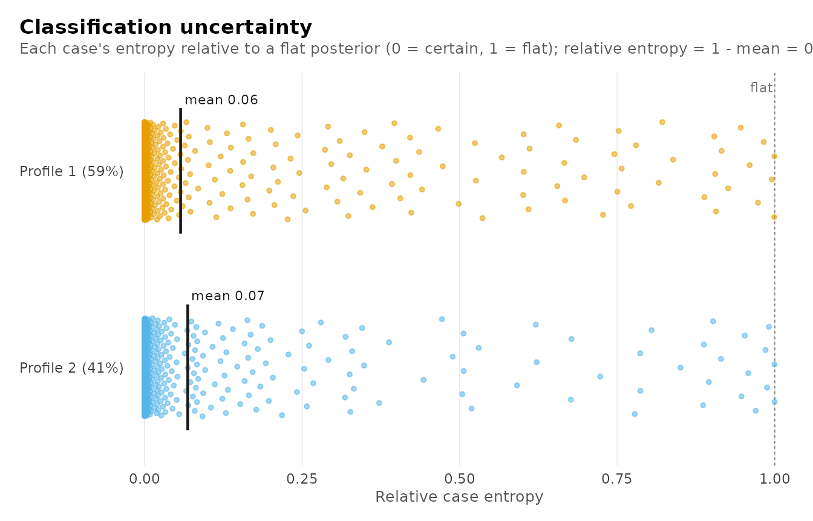
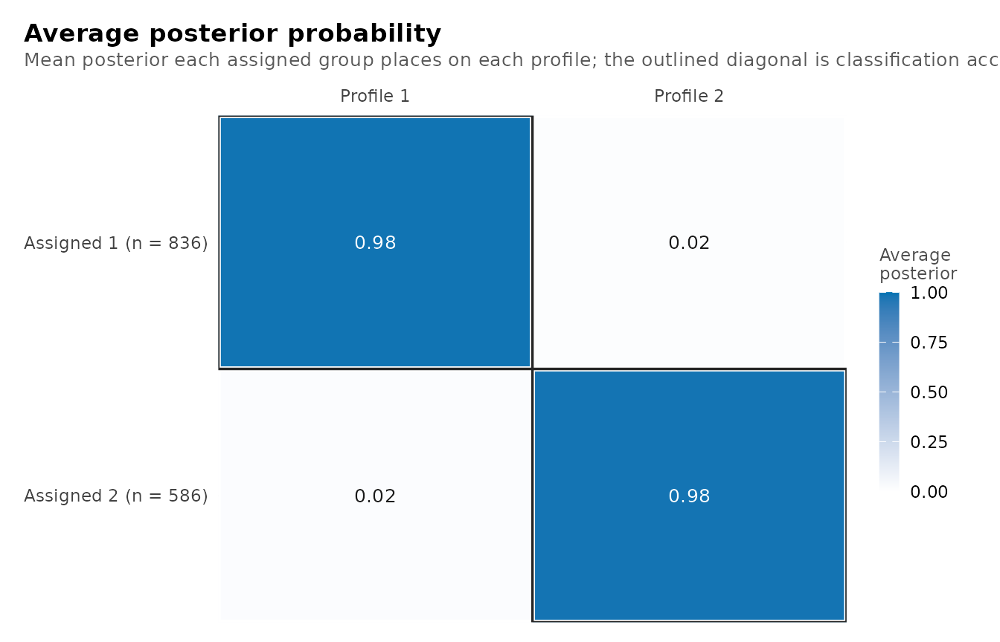
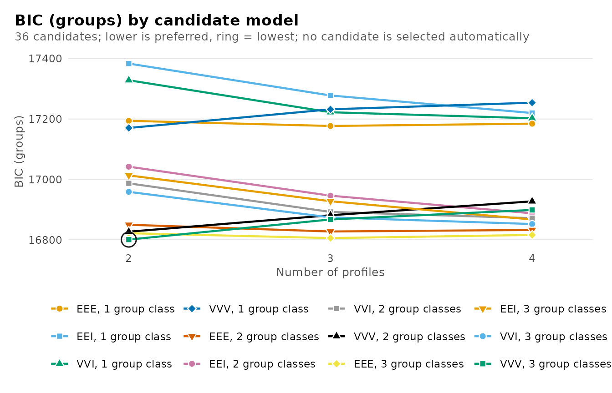

# Evaluating a multilevel latent profile model with the latents R package

A fitted mixture model is evaluated on four questions: whether the
estimation found a stable solution, how clearly observations and groups
are classified, whether the indicators are independent within profiles
as the model assumes, and whether a different number of profiles or
group classes fits better. These questions follow current guidance for
latent profile analysis (Spurk et al., 2020; Scrucca et al., 2024), and
they matter because the profiles of a person-centred model are
interpreted as substantive subgroups (Saqr et al., 2024). This guide
shows the functions that answer each of them for a two-level model.

## Data

`course_engagement` has one row per course enrolment: 1,422 enrolments
from 106 students. `student` identifies the group, and five activity
measures (`browse`, `lectures`, `forum_read`, `forum_post`,
`attendance`) are the indicators, each standardized within course.

``` r

library(latents)
```

## The model to evaluate

[`multilpa()`](https://pak.dynasite.org/latents/reference/multilpa.md)
fits the model, with `vars` for the indicators, `id` for the group,
`n_profiles` for the number of profiles, `n_group_classes` for the
number of group classes, `n_starts` for the number of random EM starts,
and `seed` for reproducible starts. The model evaluated first uses the
default diagonal covariance structure.

``` r

fit <- multilpa(course_engagement,
                vars = c("browse", "lectures", "forum_read", "forum_post",
                         "attendance"),
                id = "student", n_profiles = 2, n_group_classes = 2,
                n_starts = 3, seed = 1)
```

## Estimation

[`get_results()`](https://pak.dynasite.org/latents/reference/get_results.md)
with `"model"` reports the convergence of the fit. `converged` reports
convergence of the best start, `boundary` whether a variance reached its
lower bound, and `n_best_replicated` how many starts reached the best
log likelihood. A variance at its lower bound in a profile of about one
observation is a degenerate solution; fitting with
`boundary = "exclude"` keeps the best start without one. A profile with
fewer effective members than its own means and variances raises a
`latents_thin_profiles` warning: its variances are poorly determined, so
inspect its covariance diagnostics before interpreting it.

``` r

get_results(fit, "model")
#>   n_observations n_informative n_groups n_profiles n_group_classes centering scaling
#> 1           1422          1422      106          2               2      none    none
#>   covariance_structure n_parameters n_parameters_with_measurement log_likelihood   aic bic_groups
#> 1                  VVI           23                            23          -8440 16926      16987
#>   bic_individual converged iterations boundary small_classes best_start n_best_replicated weights
#> 1          17047      TRUE          9    FALSE         FALSE          1                 3    <NA>
```

[`get_results()`](https://pak.dynasite.org/latents/reference/get_results.md)
with `"starts"` reports every start.

``` r

get_results(fit, "starts")
#>   start log_likelihood converged iterations error boundary
#> 1     1          -8440      TRUE          9  <NA>    FALSE
#> 2     2          -8440      TRUE         12  <NA>    FALSE
#> 3     3          -8440      TRUE          9  <NA>    FALSE
```

[`sensitivity()`](https://pak.dynasite.org/latents/reference/sensitivity.md)
refits the model from the seeds given in `seeds` and reports whether
they reach the same solution. `optimum` numbers the distinct maxima
found, and `agreement` is the share of observations assigned as in the
original fit, after matching the arbitrary profile labels.

``` r

sensitivity(fit, seeds = 1:3)
#>   seed log_likelihood converged iterations optimum best agreement
#> 1    1          -8440      TRUE          9       1 TRUE         1
#> 2    2          -8440      TRUE          9       1 TRUE         1
#> 3    3          -8440      TRUE          9       1 TRUE         1
```

All three starts reach the log likelihood of -8440, and all three seeds
reach it with identical assignments, so the solution does not depend on
the starting values.

## Classification

[`get_results()`](https://pak.dynasite.org/latents/reference/get_results.md)
with `"entropy"` reports the relative entropy (Ramaswamy et al., 1993)
for observations and for groups: 1 means every case is assigned with
certainty, 0 means no separation.

``` r

get_results(fit, "entropy")
#>         level n_classes n_units entropy_sum relative_entropy
#> 1 individuals         2    1422       60.94            0.938
#> 2      groups         2     106        4.43            0.940
```

[`get_results()`](https://pak.dynasite.org/latents/reference/get_results.md)
with `"classification"` reports the classification quality of every
class. `n_modal` is the number of cases assigned to the class,
`average_posterior` the mean posterior probability of those cases, and
`odds_correct_classification` compares that certainty with the class’s
size (Nagin, 2005).

``` r

get_results(fit, "classification")
#>         level class n_modal proportion_modal estimated_n estimated_proportion average_posterior
#> 1 individuals     1     836            0.588       834.1                0.587             0.985
#> 2 individuals     2     586            0.412       587.9                0.413             0.982
#> 3      groups     1      35            0.330        34.5                0.325             0.969
#> 4      groups     2      71            0.670        71.5                0.675             0.992
#>   odds_correct_classification
#> 1                        46.1
#> 2                        76.4
#> 3                        64.8
#> 4                        59.9
```

Relative entropy is 0.938 for the enrolments and 0.940 for the students,
and the average posterior probabilities of the two profiles are 0.985
and 0.982: the classification is clear at both levels.

[`plot_diagnostics()`](https://pak.dynasite.org/latents/reference/plot_diagnostics.md)
draws the uncertainty: `what = "entropy"` the per-case uncertainty
within each profile, and `what = "avepp"` the average posterior of each
assigned class across all classes.

``` r

plot_diagnostics(fit, what = "entropy")
```



``` r

plot_diagnostics(fit, what = "avepp")
```



## Local independence

The default model assumes the indicators are independent within a
profile.
[`get_results()`](https://pak.dynasite.org/latents/reference/get_results.md)
with `"residuals"` tests this: `residual` is the correlation between two
indicators that the profiles leave unexplained, and `by = "overall"`
pools the profiles. The p-values are approximate and are adjusted for
multiple testing (Benjamini & Hochberg, 1995).

``` r

get_results(fit, "residuals", by = "overall")
#>    profile indicator_1 indicator_2     kind observed expected residual effective_n statistic df
#> 1  overall  forum_read  attendance gaussian  0.21588        0  0.21588        1422    8.2620 NA
#> 2  overall    lectures  attendance gaussian  0.19234        0  0.19234        1422    7.3369 NA
#> 3  overall      browse  attendance gaussian  0.18077        0  0.18077        1422    6.8850 NA
#> 4  overall  forum_post  attendance gaussian  0.17239        0  0.17239        1422    6.5594 NA
#> 5  overall      browse  forum_read gaussian  0.06265        0  0.06265        1422    2.3632 NA
#> 6  overall      browse  forum_post gaussian -0.02511        0 -0.02511        1422   -0.9461 NA
#> 7  overall      browse    lectures gaussian -0.02126        0 -0.02126        1422   -0.8009 NA
#> 8  overall  forum_read  forum_post gaussian  0.01986        0  0.01986        1422    0.7483 NA
#> 9  overall    lectures  forum_post gaussian  0.01710        0  0.01710        1422    0.6440 NA
#> 10 overall    lectures  forum_read gaussian  0.00193        0  0.00193        1422    0.0725 NA
#>     p_value p_adjusted
#> 1  1.43e-16   1.43e-15
#> 2  2.19e-13   1.09e-12
#> 3  5.78e-12   1.93e-11
#> 4  5.40e-11   1.35e-10
#> 5  1.81e-02   3.62e-02
#> 6  3.44e-01   5.68e-01
#> 7  4.23e-01   5.68e-01
#> 8  4.54e-01   5.68e-01
#> 9  5.20e-01   5.77e-01
#> 10 9.42e-01   9.42e-01
```

The four largest residuals all involve `attendance` (0.17 to 0.22,
adjusted p-values below 0.001), so the assumption does not hold for
these data; `attendance` is generated from the four click measures
([`?course_engagement`](https://pak.dynasite.org/latents/reference/course_engagement.md)).
`covariance_model = "full"` relaxes the assumption by estimating the
covariances between indicators within each profile, and
[`get_results()`](https://pak.dynasite.org/latents/reference/get_results.md)
with `"information_criteria"` compares the two models; lower values are
better.

``` r

full <- multilpa(course_engagement,
                 vars = c("browse", "lectures", "forum_read", "forum_post",
                          "attendance"),
                 id = "student", n_profiles = 2, n_group_classes = 2,
                 covariance_model = "full", n_starts = 3, seed = 1)
get_results(fit, "information_criteria")
#>   log_likelihood n_parameters   aic   kic bic_groups bic_individual sabic_groups sabic_individual
#> 1          -8440           23 16926 16952      16987          17047        16914            16974
#>   caic_groups caic_individual awe_groups awe_individual icl_groups icl_individual clc_groups
#> 1       17010           17070      17292          17412      17116          17176      17009
#>   clc_individual
#> 1          17009
get_results(full, "information_criteria")
#>   log_likelihood n_parameters   aic   kic bic_groups bic_individual sabic_groups sabic_individual
#> 1          -8313           43 16712 16758      16827          16938        16691            16802
#>   caic_groups caic_individual awe_groups awe_individual icl_groups icl_individual clc_groups
#> 1       16870           16981      17346          17570      17017          17128      16816
#>   clc_individual
#> 1          16816
get_results(full, "residuals", by = "overall")
#>    profile indicator_1 indicator_2     kind observed expected residual effective_n statistic df
#> 1  overall  forum_post  attendance gaussian  0.18790  0.18790 1.06e-08        1422  4.13e-07 NA
#> 2  overall  forum_read  forum_post gaussian  0.02435  0.02435 9.66e-09        1422  3.64e-07 NA
#> 3  overall      browse  forum_post gaussian -0.01867 -0.01867 7.66e-09        1422  2.88e-07 NA
#> 4  overall  forum_read  attendance gaussian  0.24179  0.24179 6.82e-09        1422  2.73e-07 NA
#> 5  overall      browse  attendance gaussian  0.20383  0.20383 5.24e-09        1422  2.06e-07 NA
#> 6  overall    lectures  forum_post gaussian  0.02007  0.02007 4.81e-09        1422  1.81e-07 NA
#> 7  overall      browse  forum_read gaussian  0.07442  0.07442 4.11e-09        1422  1.56e-07 NA
#> 8  overall    lectures  attendance gaussian  0.20502  0.20502 3.02e-09        1422  1.19e-07 NA
#> 9  overall    lectures  forum_read gaussian  0.00885  0.00885 2.62e-09        1422  9.88e-08 NA
#> 10 overall      browse    lectures gaussian -0.01381 -0.01381 2.09e-09        1422  7.86e-08 NA
#>    p_value p_adjusted
#> 1        1          1
#> 2        1          1
#> 3        1          1
#> 4        1          1
#> 5        1          1
#> 6        1          1
#> 7        1          1
#> 8        1          1
#> 9        1          1
#> 10       1          1
```

The full model lowers the BIC with students as units from 16,987 to
16,827. Its residuals are zero, because it estimates every
within-profile covariance; the residual check is informative only for a
model that restricts them. The full model is the one to evaluate
further.

## Number of profiles and group classes

[`enumerate_classes()`](https://pak.dynasite.org/latents/reference/enumerate_classes.md)
compares numbers of profiles and group classes, with `n_profiles` and
`n_group_classes` for the counts to cross. It crosses the counts with
four covariance structures, equal or varying variances with and without
covariances, fits every combination, and does not choose a model.

``` r

candidates <- enumerate_classes(course_engagement,
                                vars = c("browse", "lectures", "forum_read",
                                         "forum_post", "attendance"),
                                id = "student", n_profiles = 2:4,
                                n_group_classes = 1:3, n_starts = 3, seed = 1)
#> Warning: Profile 2: 18.6 Gaussian membership mass for 20 free means and variances. This is a
#> conservative diagnostic, not an identification test; inspect the Gaussian covariance diagnostics.
#> 7 of 36 candidates reached their best log likelihood from one start only (profiles4_groups1_EEE, profiles4_groups2_EEE, profiles4_groups3_EEE, profiles4_groups1_VVV, profiles3_groups2_VVV, profiles4_groups2_VVV, ...); refit those you consider with more starts.
subset(as.data.frame(candidates), model == "VVV")
#>                candidate n_profiles n_group_classes model log_likelihood n_parameters   aic   kic
#> 28 profiles2_groups1_VVV          2               1   VVV          -8490           41 17061 17105
#> 29 profiles3_groups1_VVV          3               1   VVV          -8472           62 17067 17132
#> 30 profiles4_groups1_VVV          4               1   VVV          -8434           83 17033 17119
#> 31 profiles2_groups2_VVV          2               2   VVV          -8313           43 16712 16758
#> 32 profiles3_groups2_VVV          3               2   VVV          -8289           65 16708 16776
#> 33 profiles4_groups2_VVV          4               2   VVV          -8261           87 16696 16786
#> 34 profiles2_groups3_VVV          2               3   VVV          -8295           45 16681 16729
#> 35 profiles3_groups3_VVV          3               3   VVV          -8275           68 16686 16757
#> 36 profiles4_groups3_VVV          4               3   VVV          -8237           91 16656 16750
#>    bic_groups bic_individual sabic_groups sabic_individual caic_groups caic_individual awe_groups
#> 28      17170          17277        17041            17147       17211           17318      17732
#> 29      17232          17393        17036            17196       17294           17455      18344
#> 30      17254          17470        16992            17206       17337           17553      18315
#> 31      16827          16938        16691            16802       16870           16981      17346
#> 32      16881          17050        16676            16844       16946           17115      17593
#> 33      16927          17153        16652            16877       17014           17240      18366
#> 34      16801          16917        16658            16775       16846           16962      17360
#> 35      16867          17044        16652            16828       16935           17112      17958
#> 36      16899          17135        16611            16846       16990           17226      18195
#>    awe_individual icl_groups icl_individual clc_groups clc_individual profile_entropy group_entropy
#> 28          17945      17418          17524      17226          17226           0.875            NA
#> 29          18666      17869          18030      17580          17580           0.796            NA
#> 30          18746      17679          17894      17292          17292           0.892            NA
#> 31          17570      17017          17128      16816          16816           0.906         0.942
#> 32          17931      17095          17264      16792          16792           0.933         0.943
#> 33          18818      17699          17925      17293          17293           0.805         0.946
#> 34          17593      17015          17132      16805          16805           0.909         0.816
#> 35          18312      17437          17614      17120          17120           0.828         0.824
#> 36          18667      17497          17734      17073          17073           0.855         0.837
#>    avepp_min avepp_max avepp_mean avepp_below group_avepp_min group_avepp_max group_avepp_mean
#> 28     0.959     0.971      0.965           0              NA              NA               NA
#> 29     0.665     0.956      0.833           1              NA              NA               NA
#> 30     0.630     0.958      0.837           1              NA              NA               NA
#> 31     0.973     0.978      0.976           0           0.971           0.993            0.982
#> 32     0.796     0.976      0.915           1           0.979           0.990            0.985
#> 33     0.802     0.974      0.856           0           0.962           0.995            0.979
#> 34     0.974     0.978      0.976           0           0.903           0.960            0.923
#> 35     0.650     0.973      0.841           1           0.878           0.955            0.920
#> 36     0.649     0.967      0.838           1           0.881           0.976            0.928
#>    group_avepp_below converged boundary min_standardized_eigenvalue min_gaussian_mass
#> 28                NA      TRUE    FALSE                    0.269614             577.4
#> 29                NA      TRUE    FALSE                    0.120317             112.7
#> 30                NA      TRUE    FALSE                    0.000276              26.1
#> 31                 0      TRUE    FALSE                    0.271042             583.2
#> 32                 0      TRUE    FALSE                    0.011064              18.6
#> 33                 0      TRUE    FALSE                    0.001958              26.3
#> 34                 0      TRUE    FALSE                    0.272051             589.5
#> 35                 0      TRUE    FALSE                    0.120469             116.5
#> 36                 0      TRUE    FALSE                    0.002424              26.9
#>    n_best_replicated
#> 28                 3
#> 29                 2
#> 30                 1
#> 31                 3
#> 32                 1
#> 33                 1
#> 34                 3
#> 35                 2
#> 36                 1
#>                                                                                                                                                                                 warnings
#> 28                                                                                                                                                                                      
#> 29                                                                                                                                                                                      
#> 30                                                                                                                                                                                      
#> 31                                                                                                                                                                                      
#> 32 Profile 2: 18.6 Gaussian membership mass for 20 free means and variances. This is a conservative diagnostic, not an identification test; inspect the Gaussian covariance diagnostics.
#> 33                                                                                                                                                                                      
#> 34                                                                                                                                                                                      
#> 35                                                                                                                                                                                      
#> 36                                                                                                                                                                                      
#>    error
#> 28  <NA>
#> 29  <NA>
#> 30  <NA>
#> 31  <NA>
#> 32  <NA>
#> 33  <NA>
#> 34  <NA>
#> 35  <NA>
#> 36  <NA>
```

[`get_results()`](https://pak.dynasite.org/latents/reference/get_results.md)
with `"best"` gives the candidate that minimizes each criterion.
Criteria that depend on a sample size are reported with the number of
groups and with the number of observations.

``` r

get_results(candidates, "best")
#>    criterion  convention             candidate n_profiles n_group_classes model value
#> 1        aic        <NA> profiles4_groups3_VVV          4               3   VVV 16656
#> 2        kic        <NA> profiles2_groups3_VVV          2               3   VVV 16729
#> 3        bic      groups profiles2_groups3_VVV          2               3   VVV 16801
#> 4        bic individuals profiles2_groups3_EEE          2               3   EEE 16900
#> 5      sabic      groups profiles4_groups3_VVV          4               3   VVV 16611
#> 6      sabic individuals profiles2_groups3_VVV          2               3   VVV 16775
#> 7       caic      groups profiles3_groups3_EEE          3               3   EEE 16844
#> 8       caic individuals profiles2_groups3_EEE          2               3   EEE 16930
#> 9        awe      groups profiles2_groups2_EEE          2               2   EEE 17267
#> 10       awe individuals profiles2_groups2_VVI          2               2   VVI 17412
#> 11       icl      groups profiles2_groups3_VVV          2               3   VVV 17015
#> 12       icl individuals profiles2_groups3_EEE          2               3   EEE 17122
#> 13       clc      groups profiles3_groups2_VVV          3               2   VVV 16792
#> 14       clc individuals profiles3_groups2_VVV          3               2   VVV 16792
```

The BIC (Schwarz, 1978) with students as units is lowest for two
profiles, three group classes and the `VVV` structure, and most criteria
select two profiles with a structure that estimates covariances. The
[Class
enumeration](https://pak.dynasite.org/latents/articles/enumeration.html)
article examines the choice between two and three group classes on these
data.

[`plot_enumeration()`](https://pak.dynasite.org/latents/reference/plot_enumeration.md)
draws one criterion across the grid, named in `what`; `what = "all"`
draws every criterion.

``` r

plot_enumeration(candidates, what = "bic_groups")
```



[`get_candidate()`](https://pak.dynasite.org/latents/reference/get_candidate.md)
takes one candidate out of the grid as a fitted model, given by its
`n_profiles`, `n_group_classes` and `model`.

``` r

get_candidate(candidates, n_profiles = 2, n_group_classes = 3, model = "VVV")
#> Two-level latent profile analysis: 2 profiles, 3 group classes
#> 1422 individuals in 106 groups; varying full residual covariance (VVV)
#> Log likelihood: -8295.382659 | AIC: 16680.765 | BIC (groups): 16800.620
#> Converged: TRUE | iterations: 18 | best log likelihood reached by 3 of 3 starts (3 converged)
#> Smallest standardized Gaussian eigenvalue: 0.2721 (profiles, profile_2); Gaussian mass: 589.5; weight effective n: 616.
#> 
#> Class sizes   profile_1 58.5% (833)   profile_2 41.5% (589)
#> Group classes group_class_1 29.0% (31)   group_class_2 24.9% (26)   group_class_3 46.0% (49)
#> 
#> Means
#>   indicator profile_1 profile_2
#>      browse     0.537    -0.758
#>    lectures     0.428    -0.605
#>  forum_read     0.618    -0.873
#>  forum_post     0.533    -0.753
#>  attendance     0.638    -0.901
#> 
#> Variances and standard errors: get_results(x, "profiles").
#> Every other table: get_results(x, what = ), or get_results(x, "all").
```

## Parameter uncertainty

[`parameter_inference()`](https://pak.dynasite.org/latents/reference/parameter_inference.md)
returns standard errors and 95% Wald intervals; with
`vcov_type = "robust"`, the standard errors are clustered on groups. The
first ten rows of each, for the full model:

``` r

head(parameter_inference(full), 10)
#>          level   outcome       term parameter estimate standard_error statistic   p_value
#> 1  measurement profile_1     browse      mean    0.531         0.0280      18.9  4.52e-80
#> 2  measurement profile_1   lectures      mean    0.422         0.0331      12.8  3.07e-37
#> 3  measurement profile_1 forum_read      mean    0.613         0.0259      23.6 1.38e-123
#> 4  measurement profile_1 forum_post      mean    0.527         0.0306      17.2  1.87e-66
#> 5  measurement profile_1 attendance      mean    0.632         0.0240      26.3 4.39e-152
#> 6  measurement profile_2     browse      mean   -0.764         0.0328     -23.3 6.90e-120
#> 7  measurement profile_2   lectures      mean   -0.607         0.0320     -19.0  3.96e-80
#> 8  measurement profile_2 forum_read      mean   -0.881         0.0276     -31.9 5.69e-223
#> 9  measurement profile_2 forum_post      mean   -0.758         0.0286     -26.5 5.45e-155
#> 10 measurement profile_2 attendance      mean   -0.908         0.0287     -31.7 5.51e-220
#>    p_adjusted conf_low conf_high
#> 1    4.52e-80    0.476     0.586
#> 2    3.07e-37    0.357     0.487
#> 3   1.38e-123    0.562     0.664
#> 4    1.87e-66    0.467     0.587
#> 5   4.39e-152    0.585     0.679
#> 6   6.90e-120   -0.829    -0.700
#> 7    3.96e-80   -0.670    -0.544
#> 8   5.69e-223   -0.935    -0.827
#> 9   5.45e-155   -0.814    -0.702
#> 10  5.51e-220   -0.964    -0.852
head(parameter_inference(full, vcov_type = "robust"), 10)
#>          level   outcome       term parameter estimate standard_error statistic   p_value
#> 1  measurement profile_1     browse      mean    0.531         0.0306      17.4  1.30e-67
#> 2  measurement profile_1   lectures      mean    0.422         0.0318      13.3  3.78e-40
#> 3  measurement profile_1 forum_read      mean    0.613         0.0265      23.2 1.39e-118
#> 4  measurement profile_1 forum_post      mean    0.527         0.0300      17.5  6.20e-69
#> 5  measurement profile_1 attendance      mean    0.632         0.0241      26.2 1.29e-151
#> 6  measurement profile_2     browse      mean   -0.764         0.0322     -23.7 1.54e-124
#> 7  measurement profile_2   lectures      mean   -0.607         0.0372     -16.3  6.51e-60
#> 8  measurement profile_2 forum_read      mean   -0.881         0.0277     -31.8 6.03e-222
#> 9  measurement profile_2 forum_post      mean   -0.758         0.0290     -26.1 3.33e-150
#> 10 measurement profile_2 attendance      mean   -0.908         0.0289     -31.4 5.28e-217
#>    p_adjusted conf_low conf_high
#> 1    1.30e-67    0.471     0.591
#> 2    3.78e-40    0.360     0.484
#> 3   1.39e-118    0.561     0.665
#> 4    6.20e-69    0.468     0.586
#> 5   1.29e-151    0.584     0.679
#> 6   1.54e-124   -0.827    -0.701
#> 7    6.51e-60   -0.680    -0.534
#> 8   6.03e-222   -0.935    -0.827
#> 9   3.33e-150   -0.814    -0.701
#> 10  5.28e-217   -0.965    -0.852
```

## Reference

The calls below list other evaluation functions and views. Each comment
states what the call returns.

``` r

get_results(fit, "information_criteria", format = "long")  # one row per criterion
get_results(fit, "average_posteriors")          # mean posterior by assigned class
get_results(fit, "classification_errors")       # P(assigned class | true class)
get_results(fit, "residuals")                   # residuals within each profile
get_results(candidates, "candidates")           # the full enumeration grid
summary(candidates)                             # every grid table, truncated
bootstrap_lrt(full, get_candidate(candidates, n_profiles = 2,
                                 n_group_classes = 3, model = "VVV"),
              iter = 199, seed = 42)            # bootstrap test of one more class (slow)
enumerate_classes(course_engagement, vars = c("browse", "lectures"),
                  id = "student", n_profiles = 2:3,
                  model = c("VVI", "VVV"))      # crossing covariance models (slow)
confint(fit)                                    # confidence intervals
vcov(fit, vcov_type = "robust")                 # robust covariance matrix
plot_diagnostics(fit, what = "posteriors")                  # posterior of each assigned profile
plot_profiles(fit, what = "bars")                        # profile means with 95% intervals
diagnostics(fit)                                # all classification diagnostics
```

## Limits

- Information criteria compare the candidates fitted, not all possible
  models.
- Classification measures describe the fitted model; a misspecified
  model can still classify sharply.
- Wald intervals assume a converged fit with no variance at its bound,
  and are conditional on the chosen numbers of profiles and classes.
- Unmodelled dependence between indicators can make extra classes look
  better.

## References

Benjamini, Y., & Hochberg, Y. (1995). Controlling the false discovery
rate: A practical and powerful approach to multiple testing. *Journal of
the Royal Statistical Society: Series B*, 57(1), 289–300.

Nagin, D. S. (2005). *Group-based modeling of development*. Harvard
University Press.

Ramaswamy, V., DeSarbo, W. S., Reibstein, D. J., & Robinson, W. T.
(1993). An empirical pooling approach for estimating marketing mix
elasticities with PIMS data. *Marketing Science*, 12, 103–124.

Saqr, M., Vogelsmeier, L. V. D. E., & López-Pernas, S. (2024). Capturing
where the learning process takes place: A person-specific and
person-centered primer. *Learning and Individual Differences*, 113,
102492. <https://doi.org/10.1016/j.lindif.2024.102492>

Schwarz, G. (1978). Estimating the dimension of a model. *The Annals of
Statistics*, 6, 461–464.

Scrucca, L., Saqr, M., López-Pernas, S., & Murphy, K. (2024). An
introduction and R tutorial to model-based clustering in education via
latent profile analysis. In M. Saqr & S. López-Pernas (Eds.), *Learning
analytics methods and tutorials: A practical guide using R*
(pp. 285–317). Springer. <https://doi.org/10.1007/978-3-031-54464-4_9>

Spurk, D., Hirschi, A., Wang, M., Valero, D., & Kauffeld, S. (2020).
Latent profile analysis: A review and “how to” guide of its application
within vocational behavior research. *Journal of Vocational Behavior*,
120, 103445. <https://doi.org/10.1016/j.jvb.2020.103445>
