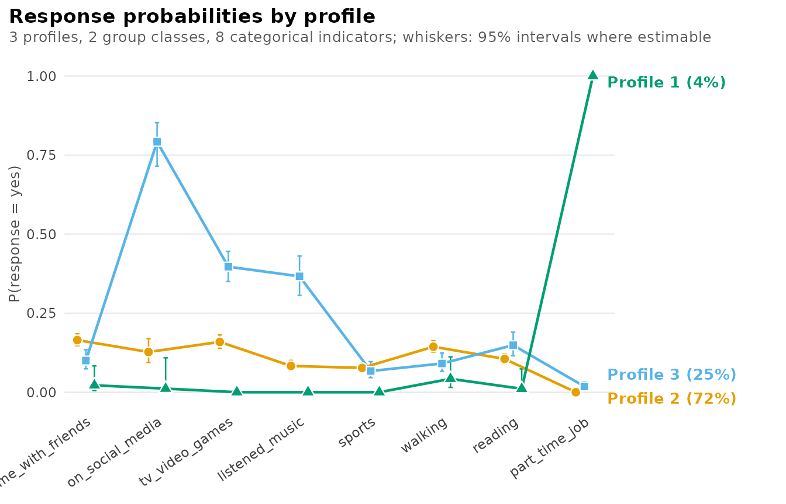
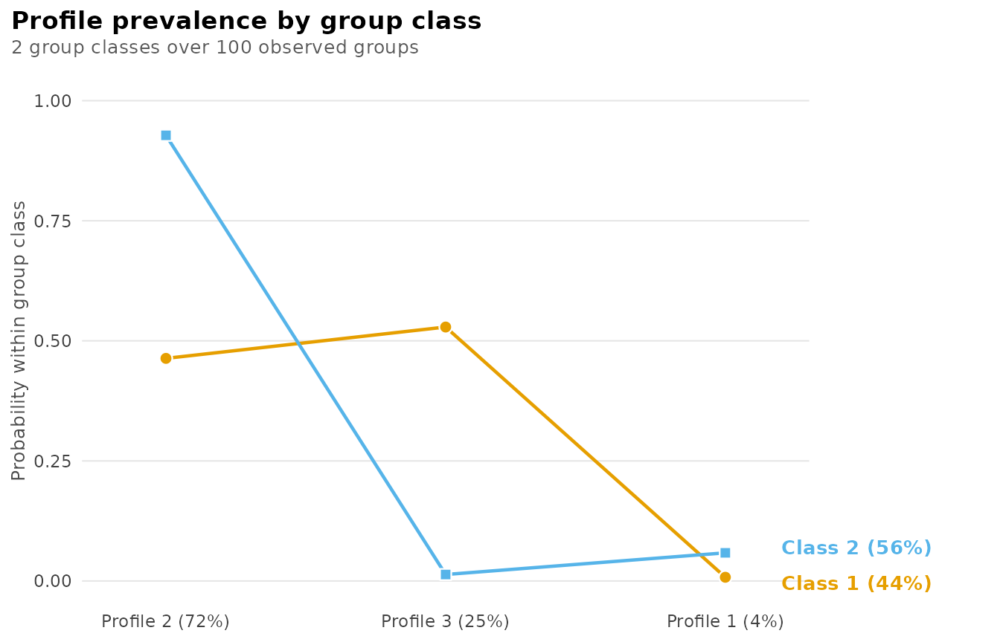

# Multilevel latent class analysis with the latents R package

Latent class analysis (LCA) is the categorical-data counterpart of
latent profile analysis, extending the person-centred approach to
situations in which the observed indicators are categorical rather than
continuous. Whereas latent profile analysis identifies subgroups based
on differences in the means of continuous indicators, LCA identifies
latent subgroups based on differences in the probabilities of endorsing
or selecting particular response categories across a set of categorical
items. Each latent class is therefore characterized by a specific
configuration of item-response probabilities, representing the
likelihood of observing each response category conditional on membership
in that class (Collins & Lanza, 2010). The resulting classes can be
interpreted as distinct response patterns that capture unobserved
heterogeneity in the population.

Two-level latent class analysis extends this framework to hierarchical
data structures in which individual observations are nested within
higher-level units, such as students within classrooms, employees within
organizations, or patients within healthcare institutions (Vermunt,
2003). In conventional LCA, individuals are assumed to originate from a
single population characterized by a common set of class proportions.
However, when observations are clustered, the distribution of
individual-level latent classes may differ across groups. Two-level LCA
accounts for this possibility by introducing a second latent
classification at the group level. The model consequently distinguishes
between individual-level classes, which describe differences in response
patterns, and group-level classes, which capture differences in the
composition of those individual-level classes across groups.

For observation $`i`$ belonging to group $`j`$, let $`C_{ij}`$ denote
the individual-level latent class and $`G_j`$ the latent group class.
The model estimates three sets of parameters that jointly describe the
individual and group classifications.

First, the item-response probabilities, defined as
$`\theta_{kqc}=P(Y_{ijq}=c\mid C_{ij}=k)`$, describe the probability of
observing response category $`c`$ on item $`q`$, conditional on an
individual’s membership in class $`k`$. These probabilities determine
the substantive characteristics of each individual-level class by
describing its characteristic response pattern. An important assumption
of the two-level specification is that these item-response probabilities
remain invariant across group classes. Thus, an individual belonging to
a particular latent class is assumed to exhibit the same conditional
response probabilities regardless of the group to which they belong.

Second, the individual-level class probabilities, expressed as
$`\pi_{k\mid m}=P(C_{ij}=k\mid G_j=m)`$, represent the probability that
an individual belongs to class $`k`$, conditional on the membership of
their group in group class $`m`$. These probabilities describe the
composition of each group class in terms of its constituent
individual-level classes. For example, different group classes may be
characterized by different proportions of individuals exhibiting
particular response patterns, even though the underlying item-response
probabilities defining those individual-level classes remain unchanged.
The probabilities sum to one across the individual-level classes within
each group class.

Third, the group-level class probabilities, defined as
$`\omega_m=P(G_j=m)`$, represent the proportion of groups belonging to
each latent group class. These parameters describe the distribution of
the higher-level latent classes across the population and determine the
relative prevalence of the different group types.

The distinction between the two levels of classification is important
for interpreting the model. Individual-level classes represent subgroups
of observations characterized by similar response patterns, whereas
group-level classes represent subgroups of higher-level units
characterized by different distributions of individual-level class
membership. Consequently, two groups may belong to different group
classes even when the same individual-level classes are present in both.
Their distinction lies in the relative proportions of individuals
belonging to each class rather than in differences in the response
probabilities defining those classes. This allows the model to identify
systematic differences in group composition without requiring the
individual-level measurement structure to vary across groups.

The two-level LCA specification relies on several conditional
independence assumptions. First, the observed categorical items are
assumed to be locally independent conditional on individual-level class
membership. This means that the association between items is assumed to
be explained by the underlying latent class, such that no additional
residual association remains between the indicators after conditioning
on class membership. Second, observations within the same group are
assumed to be independent conditional on their group’s latent class.
Their responses may therefore be associated at the population level
through their shared group classification, but are treated as
conditionally independent once that classification has been taken into
account. Finally, groups are assumed to be independent of one another.
Together, these assumptions establish the hierarchical structure through
which individual response patterns and between-group differences in
class composition are modelled simultaneously.

In the `latents` package, the function
[`multilca()`](https://pak.dynasite.org/latents/reference/multilca.md)
estimates the two-level latent class model using maximum likelihood
estimation and the expectation-maximization (EM) algorithm (Dempster et
al., 1977). The algorithm alternates between estimating the posterior
probabilities of latent class membership and updating the model
parameters until convergence is achieved. As in multilevel latent
profile analysis, the estimated individual-level classes are labelled
`profile_1`, `profile_2`, and so forth in the model output. These labels
are used for consistency across the package’s modelling functions and do
not imply that the classes are based on continuous indicators. The same
naming convention is used in
[`multilpa()`](https://pak.dynasite.org/latents/reference/multilpa.md),
facilitating a consistent interpretation of individual-level latent
classifications across categorical and continuous measurement models.

## Data

`student_esm` comes from an experience-sampling study of university
students (Neubauer & Schmiedek, 2024) and contains 2,582 prompts from
100 students (15 to 51 per student), answered when the student had not
studied since the previous prompt. Prompts are the observations and
students the groups. Eight yes/no items record leisure activities since
that prompt; four ratings from 1 to 7 record affect;
[`?student_esm`](https://pak.dynasite.org/latents/reference/student_esm.md)
describes the source and the selection of prompts.

``` r

library(latents)
activities <- c("time_with_friends", "on_social_media", "tv_video_games",
                "listened_music", "sports", "walking", "reading",
                "part_time_job")
summary(student_esm)
#>     student           day             beep      time_with_friends on_social_media tv_video_games
#>  Min.   :  1.0   Min.   : 0.00   Min.   :1.00   no :2211          no :1837        no :2033      
#>  1st Qu.: 27.0   1st Qu.: 3.00   1st Qu.:2.00   yes: 371          yes: 745        yes: 549      
#>  Median : 53.0   Median : 6.00   Median :3.00                                                   
#>  Mean   : 52.3   Mean   : 6.48   Mean   :3.06                                                   
#>  3rd Qu.: 79.0   3rd Qu.:10.00   3rd Qu.:4.00                                                   
#>  Max.   :100.0   Max.   :13.00   Max.   :5.00                                                   
#>  listened_music sports     walking    reading    part_time_job     happy         relaxed    
#>  no :2193       no :2397   no :2254   no :2291   no :2479      Min.   :1.00   Min.   :1.00  
#>  yes: 389       yes: 185   yes: 328   yes: 291   yes: 103      1st Qu.:4.00   1st Qu.:4.00  
#>                                                                Median :5.00   Median :5.00  
#>                                                                Mean   :4.88   Mean   :4.63  
#>                                                                3rd Qu.:6.00   3rd Qu.:6.00  
#>                                                                Max.   :7.00   Max.   :7.00  
#>     worried       exhausted   
#>  Min.   :1.00   Min.   :1.00  
#>  1st Qu.:1.00   1st Qu.:2.00  
#>  Median :2.00   Median :3.00  
#>  Mean   :2.29   Mean   :3.31  
#>  3rd Qu.:3.00   3rd Qu.:5.00  
#>  Max.   :7.00   Max.   :7.00
```

Social media is the most frequent activity (745 of the 2,582 prompts),
followed by TV or video games (549); a part-time job is the rarest
(103). Every activity is absent at most prompts, so classes are
distinguished by how far their “yes” probabilities exceed these base
rates.

## A first model

[`multilca()`](https://pak.dynasite.org/latents/reference/multilca.md)
treats every item in `vars` as categorical. `n_starts` sets the number
of random starts and `tol` the convergence tolerance; a strict tolerance
is required for accurate standard errors. A first model has two classes
and two group classes.

``` r

first <- multilca(student_esm, vars = activities, id = "student",
                  n_profiles = 2, n_group_classes = 2, n_starts = 20,
                  tol = 1e-10, seed = 1)
```

## Number of classes

[`enumerate_classes()`](https://pak.dynasite.org/latents/reference/enumerate_classes.md)
fits every combination of two to four classes and one to three group
classes, each from twenty random starts, and
`get_results(candidates, "best")` reports the candidate that each
criterion selects.

``` r

candidates <- enumerate_classes(student_esm, vars = activities,
                                categorical = activities, id = "student",
                                n_profiles = 2:4, n_group_classes = 1:3,
                                n_starts = 20, tol = 1e-10, seed = 1)
#> 2 of 9 candidates reached their best log likelihood from one start only (classes3_groups3, classes4_groups3); refit those you consider with more starts.
get_results(candidates, "best")
#>    criterion  convention        candidate n_profiles n_group_classes model value
#> 1        aic        <NA> classes4_groups3          4               3  <NA> 15126
#> 2        kic        <NA> classes4_groups3          4               3  <NA> 15172
#> 3        bic      groups classes4_groups3          4               3  <NA> 15238
#> 4        bic individuals classes4_groups3          4               3  <NA> 15377
#> 5      sabic      groups classes4_groups3          4               3  <NA> 15102
#> 6      sabic individuals classes4_groups3          4               3  <NA> 15241
#> 7       caic      groups classes4_groups3          4               3  <NA> 15281
#> 8       caic individuals classes4_groups3          4               3  <NA> 15420
#> 9        awe      groups classes3_groups2          3               2  <NA> 16767
#> 10       awe individuals classes3_groups2          3               2  <NA> 16956
#> 11       icl      groups classes3_groups2          3               2  <NA> 16546
#> 12       icl individuals classes3_groups2          3               2  <NA> 16641
#> 13       clc      groups classes3_groups2          3               2  <NA> 16413
#> 14       clc individuals classes3_groups2          3               2  <NA> 16413
```

The BIC (Schwarz, 1978) decreases up to the largest model in the grid,
four classes and three group classes; that model and the one with three
classes and three group classes reach their best log likelihood from a
single start, as the message reports, so their low BIC rests on
solutions that the starts do not replicate. The ICL (Biernacki et al.,
2000), AWE (Banfield & Raftery, 1993) and CLC, which penalize uncertain
classification, select three classes and two group classes, a model
whose best solution is reached by two of the twenty starts.
[`compare_models()`](https://pak.dynasite.org/latents/reference/compare_models.md)
sets the two-class model beside the three-class model.

``` r

lca <- multilca(student_esm, vars = activities, id = "student",
                n_profiles = 3, n_group_classes = 2, n_starts = 20,
                tol = 1e-10, seed = 1)
compare_models(two = first, three = lca)
#> Model comparison
#> 
#> Model  Classes  Group classes   k    LogLik       BIC   ΔBIC  Weight       ICL  Entropy  Min AvePP  < 0.8  Group entropy  Group min AvePP
#> -----  -------  -------------  --  --------  --------  -----  ------  --------  -------  ---------  -----  -------------  ---------------
#> two          2              2  19  -7739.84  15567.19  77.35   0.000  16762.74     0.67       0.86      0           0.88             0.96
#> three        3              2  29  -7678.14  15489.84   0.00   1.000  16640.78     0.80       0.86      0           0.88             0.95
```

The third class lowers the BIC by 77 and the ICL by 122, and raises
relative entropy from 0.67 to 0.80. The three-class model is retained.

## The chosen model

``` r

lca
#> Two-level latent class analysis: 3 classes, 2 group classes
#> 2582 individuals in 100 groups; 8 categorical indicators
#> Classes are labelled profile_1, profile_2, ... in every table.
#> Log likelihood: -7678.144915 | AIC: 15414.290 | BIC (groups): 15489.840
#> Converged: TRUE | iterations: 81 | best log likelihood reached by 2 of 20 starts (20 converged)
#> 
#> Class sizes   profile_1 3.5% (91)   profile_2 71.6% (1848)   profile_3 24.9% (643)
#> Group classes group_class_1 43.6% (44)   group_class_2 56.4% (56)
#> 
#> Response probabilities
#>          indicator category profile_1 profile_2 profile_3
#>  time_with_friends       no     0.978     0.835     0.900
#>  time_with_friends      yes     0.022     0.165     0.100
#>    on_social_media       no     0.989     0.873     0.208
#>    on_social_media      yes     0.011     0.127     0.792
#>     tv_video_games       no     1.000     0.841     0.603
#>     tv_video_games      yes     0.000     0.159     0.397
#>     listened_music       no     1.000     0.917     0.634
#>     listened_music      yes     0.000     0.083     0.366
#>             sports       no     1.000     0.923     0.933
#>             sports      yes     0.000     0.077     0.067
#>            walking       no     0.958     0.856     0.909
#>            walking      yes     0.042     0.144     0.091
#>            reading       no     0.989     0.895     0.851
#>            reading      yes     0.011     0.105     0.149
#>      part_time_job       no     0.000     1.000     0.982
#>      part_time_job      yes     1.000     0.000     0.018
#> 
#> Thresholds and standard errors: get_results(x, "responses").
#> Every other table: get_results(x, what = ), or get_results(x, "all").
```

The classes describe three kinds of leisure interval. Class 2 (71.6% of
the prompts) is low activity: no activity exceeds a probability of 0.17.
Class 3 (24.9%) is media use: social media (0.792), TV or video games
(0.397) and music (0.366). Class 1 (3.5%) consists of the prompts at
which the student worked in the part-time job (probability 1.000), with
almost no other activity. `get_results(lca, "responses")` returns the
same probabilities as a table, and the response plot compares them
across classes.

``` r

plot_responses(lca)
```



The activity items have “no”/“yes” labels, so the response plot is the
appropriate view. For items with distinct, finite numeric category
labels, such as ratings from 1 to 5,
[`plot_profiles()`](https://pak.dynasite.org/latents/reference/plot_profiles.md)
summarizes each item’s distribution in each class by its
probability-weighted mean, or by its median or mode
(`statistic = "median"` or `"mode"`). Means assume meaningful spacing
between the category scores. The median is the smallest score whose
cumulative probability reaches 0.5, and tied modes take the smallest
score. These summaries use the fitted probabilities, including in FIML
models, rather than averages of the cases assigned to each class, and
they are on the raw scale. They have no confidence intervals and
therefore do not require the parameter-inference calculation of the
response plot. In mixed models,
[`plot_profiles()`](https://pak.dynasite.org/latents/reference/plot_profiles.md)
shows only the continuous indicators.

### Group classes

``` r

get_results(lca, "profile_probabilities")
#>   group_class profile probability group_class_probability
#> 1           1       1     0.00778                   0.436
#> 2           1       2     0.46348                   0.436
#> 3           1       3     0.52874                   0.436
#> 4           2       1     0.05862                   0.564
#> 5           2       2     0.92787                   0.564
#> 6           2       3     0.01351                   0.564
```

The group classes are kinds of students. In group class 2 (56.4% of the
students), 92.8% of the prompts fall in the low-activity class, 5.9% in
the job class and 1.4% in the media class. In group class 1 (43.6%), the
prompts divide between media use (52.9%) and low activity (46.3%). The
two kinds of students therefore differ in media use rather than in
activity overall. The prevalence plot shows these probabilities.

``` r

plot_prevalence(lca)
```



## Replication of the maximum

The likelihood of latent class models often has several local maxima.
The `"starts"` table reports the maximum reached from each start.

``` r

get_results(lca, "starts")
#>    start log_likelihood converged iterations error boundary
#> 1      1          -7686      TRUE        315  <NA>    FALSE
#> 2      2          -7686      TRUE        254  <NA>    FALSE
#> 3      3          -7686      TRUE        325  <NA>    FALSE
#> 4      4          -7731      TRUE        323  <NA>    FALSE
#> 5      5          -7695      TRUE        108  <NA>    FALSE
#> 6      6          -7731      TRUE        503  <NA>    FALSE
#> 7      7          -7706      TRUE        158  <NA>    FALSE
#> 8      8          -7719      TRUE        109  <NA>    FALSE
#> 9      9          -7686      TRUE        147  <NA>    FALSE
#> 10    10          -7686      TRUE        262  <NA>    FALSE
#> 11    11          -7686      TRUE        203  <NA>    FALSE
#> 12    12          -7703      TRUE         80  <NA>    FALSE
#> 13    13          -7686      TRUE        147  <NA>    FALSE
#> 14    14          -7686      TRUE        116  <NA>    FALSE
#> 15    15          -7686      TRUE        299  <NA>    FALSE
#> 16    16          -7678      TRUE         81  <NA>    FALSE
#> 17    17          -7704      TRUE        163  <NA>    FALSE
#> 18    18          -7678      TRUE         75  <NA>    FALSE
#> 19    19          -7686      TRUE        122  <NA>    FALSE
#> 20    20          -7686      TRUE         98  <NA>    FALSE
```

The best log likelihood, -7678, is reached by 2 of the 20 starts; 11
starts stop at -7686 and the others lower. With few starts, the analysis
would report a different solution. The number of starts is therefore
part of the specification, and the replication of the best maximum
belongs in the report.

## Classification

``` r

get_results(lca, "counts")
#>         level class effective_count effective_proportion
#> 1 individuals     1            91.4               0.0354
#> 2 individuals     2          1848.0               0.7157
#> 3 individuals     3           642.6               0.2489
#> 4      groups     1            43.6               0.4357
#> 5      groups     2            56.4               0.5643
get_results(lca, "entropy")
#>         level n_classes n_units entropy_sum relative_entropy
#> 1 individuals         3    2582      556.82            0.804
#> 2      groups         2     100        8.48            0.878
get_results(lca, "average_posteriors")
#>          level assigned_class class n_assigned average_posterior
#> 1  individuals              1     1         92          9.91e-01
#> 2  individuals              1     2         92          1.42e-09
#> 3  individuals              1     3         92          8.69e-03
#> 4  individuals              2     1       1896          2.45e-10
#> 5  individuals              2     2       1896          9.30e-01
#> 6  individuals              2     3       1896          6.97e-02
#> 7  individuals              3     1        594          3.14e-04
#> 8  individuals              3     2        594          1.42e-01
#> 9  individuals              3     3        594          8.58e-01
#> 10      groups              1     1         42          9.71e-01
#> 11      groups              1     2         42          2.88e-02
#> 12      groups              2     1         58          4.80e-02
#> 13      groups              2     2         58          9.52e-01
```

The classes hold 91.4, 1,848.0 and 642.6 prompts and the group classes
43.6 and 56.4 students. Relative entropy (Ramaswamy et al., 1993) is
0.804 for the prompts and 0.878 for the students. The average posterior
of the assigned class is 0.991 for the job class, 0.930 for low activity
and 0.858 for media use, and 0.971 and 0.952 for the group classes: the
media class overlaps most with low activity, and analyses of assigned
classes should use the three-step methods below.

## Local independence

The `"residuals"` table compares the association of each pair of items
within each class with the association the model implies (none), with
Benjamini-Hochberg adjusted p-values (Benjamini & Hochberg, 1995).

``` r

head(get_results(lca, "residuals"), 6)
#>     profile       indicator_1 indicator_2        kind observed expected residual effective_n
#> 1 profile_1   on_social_media     walking categorical    0.424 1.60e-16    0.424        91.4
#> 2 profile_3            sports     walking categorical    0.166 3.80e-17    0.166       642.6
#> 3 profile_3 time_with_friends     walking categorical    0.143 1.45e-17    0.143       642.6
#> 4 profile_3    listened_music     walking categorical    0.133 7.66e-17    0.133       642.6
#> 5 profile_3    listened_music     reading categorical    0.110 8.70e-17    0.110       642.6
#> 6 profile_3    listened_music      sports categorical    0.108 1.42e-16    0.108       642.6
#>   statistic df  p_value p_adjusted
#> 1     16.43  1 5.04e-05    0.00141
#> 2     17.73  1 2.55e-05    0.00107
#> 3     13.21  1 2.79e-04    0.00585
#> 4     11.38  1 7.43e-04    0.01040
#> 5      7.75  1 5.38e-03    0.05022
#> 6      7.52  1 6.09e-03    0.05118
```

Walking remains associated with sports, time with friends and music
within the media class (residuals of 0.13 to 0.17, adjusted p-values
0.001 to 0.010), and with social media within the small job class.
`local_dependence` estimates the joint distribution of a pair of
categorical items within each class, as in Latent GOLD.

``` r

dependent <- multilca(student_esm, vars = activities, id = "student",
                      n_profiles = 3, n_group_classes = 2,
                      local_dependence = "sports:walking", n_starts = 20,
                      tol = 1e-10, seed = 1)
compare_models(independent = lca, dependent = dependent)
#> Model comparison
#> 
#> Model        Classes  Group classes   k    LogLik       BIC  ΔBIC  Weight       ICL  Entropy  Min AvePP  < 0.8  Group entropy  Group min AvePP
#> -----------  -------  -------------  --  --------  --------  ----  ------  --------  -------  ---------  -----  -------------  ---------------
#> independent        3              2  29  -7678.14  15489.84  5.63   0.056  16640.78     0.80       0.86      0           0.88             0.95
#> dependent          3              2  32  -7668.42  15484.21  0.00   0.944  16618.24     0.81       0.84      0           0.89             0.96
```

Freeing the pair lowers the BIC by 5.6. The gain is small, the solution
is reached by a single start, and the classes keep their meaning, so the
model with independent items is retained and the residual association
reported.

## Uncertainty of the estimates

Several response probabilities of the job class lie on the bound of zero
or one, where Wald inference is undefined. `boundary = "fix"` holds them
at the bound and reports every other parameter conditional on them, as
in Mplus; the `fixed_at_bound` attribute names the held parameters.

``` r

inference <- parameter_inference(lca, boundary = "fix")
attr(inference, "fixed_at_bound")
#>  [1] "measurement.response.profile_1.tv_video_games:no" 
#>  [2] "measurement.response.profile_1.tv_video_games:yes"
#>  [3] "measurement.response.profile_1.listened_music:no" 
#>  [4] "measurement.response.profile_1.listened_music:yes"
#>  [5] "measurement.response.profile_1.sports:no"         
#>  [6] "measurement.response.profile_1.sports:yes"        
#>  [7] "measurement.response.profile_1.part_time_job:no"  
#>  [8] "measurement.response.profile_2.part_time_job:no"  
#>  [9] "measurement.response.profile_1.part_time_job:yes" 
#> [10] "measurement.response.profile_2.part_time_job:yes"
tail(inference, 8)
#>      level       outcome          term   parameter estimate standard_error statistic p_value
#> 39 profile     profile_1 group_class_1 probability  0.00778        0.00276        NA      NA
#> 40 profile     profile_2 group_class_1 probability  0.46348        0.03355        NA      NA
#> 41 profile     profile_3 group_class_1 probability  0.52874        0.03360        NA      NA
#> 42 profile     profile_1 group_class_2 probability  0.05862        0.00718        NA      NA
#> 43 profile     profile_2 group_class_2 probability  0.92787        0.01670        NA      NA
#> 44 profile     profile_3 group_class_2 probability  0.01351        0.01463        NA      NA
#> 45   group group_class_1          <NA> probability  0.43573        0.06201        NA      NA
#> 46   group group_class_2          <NA> probability  0.56427        0.06201        NA      NA
#>    p_adjusted conf_low conf_high
#> 39         NA  0.00387    0.0156
#> 40         NA  0.39873    0.5295
#> 41         NA  0.46277    0.5937
#> 42         NA  0.04604    0.0744
#> 43         NA  0.88748    0.9545
#> 44         NA  0.00159    0.1054
#> 45         NA  0.32020    0.5587
#> 46         NA  0.44131    0.6798
```

Ten probabilities are held, both answers of five item–class pairs: TV or
video games, music, sports and the job in the job class, and the job in
the low-activity class. Group class 1 holds 0.436 of the students (95%
interval 0.320 to 0.559), and the probability of a media prompt in that
class is 0.529 (0.463 to 0.594).

## Relating the classes to affect

[`three_step()`](https://pak.dynasite.org/latents/reference/three_step.md)
compares the mean of a variable across classes with the BCH correction
for classification error (Bolck et al., 2004; Vermunt, 2010).

``` r

three_step(lca, data = student_esm, outcome = "happy", contrast = "pairs")
#> Distal outcome: class differences (bch, 95% CI)
#> 
#> Class  vs  Difference         95% CI     p  p (BH)
#> -----  --  ----------  -------------  ----  ------
#>     2   1        0.53  [ 0.13, 0.94]  .010    .029
#>     3   1        0.19  [-0.42, 0.79]  .541    .541
#>     3   2       -0.35  [-0.86, 0.17]  .189    .284
```

Students report higher happiness at low-activity prompts than at job
prompts (difference 0.53 on the 1 to 7 scale, 95% interval 0.13 to 0.94,
adjusted p = .029). Media prompts do not differ significantly from
either class.

## Mixed, ordinal and count indicators

[`multilpa()`](https://pak.dynasite.org/latents/reference/multilpa.md)
combines categorical indicators, listed in `categorical`, with
continuous ones. The model below adds three affect ratings as continuous
indicators. `worried` is omitted: half of its ratings are 1, and a
Gaussian component for that floor reaches the variance bound.

``` r

mixed <- multilpa(student_esm,
                  vars = c("happy", "relaxed", "exhausted", activities),
                  categorical = activities, id = "student", n_profiles = 3,
                  n_group_classes = 2, n_starts = 10, seed = 1)
#> Warning: A variance reached min_variance; this is a bound-active constrained fit.
mixed
#> Two-level latent profile analysis: 3 profiles, 2 group classes
#> 2582 individuals in 100 groups; varying diagonal residual covariance (VVI), 8 categorical indicators
#> Log likelihood: -18531.292688 | AIC: 37156.585 | BIC (groups): 37279.028
#> Converged: TRUE | iterations: 39 | best log likelihood reached by 6 of 10 starts (10 converged)
#> A variance is at its specified lower bound.
#> Smallest standardized Gaussian eigenvalue: 7.725e-07 (profiles, profile_2); Gaussian mass: 522.5; weight effective n: 524.7.
#> 
#> Class sizes   profile_1 45.2% (1167)   profile_2 20.2% (522)   profile_3 34.6% (892)
#> Group classes group_class_1 34.9% (35)   group_class_2 65.1% (65)
#> 
#> Means
#>  indicator profile_1 profile_2 profile_3
#>      happy      5.60      5.97      3.31
#>    relaxed      5.23      5.77      3.16
#>  exhausted      3.39      1.00      4.57
#> 
#> Variances and standard errors: get_results(x, "profiles").
#> Every other table: get_results(x, what = ), or get_results(x, "all").
```

The affect ratings dominate the classes: the means separate a low-affect
class (happy 3.31, exhausted 4.57) from two positive ones, and the
variance of `exhausted` in one class reaches its bound (`min_variance`),
as the warning reports. Indicators with more information define the
classes, so variables that are to be explained by the classes, as affect
is here, are better related to them with
[`three_step()`](https://pak.dynasite.org/latents/reference/three_step.md)
than added as indicators.

Ordinal ratings can be modelled as `ordinal`: an adjacent-category logit
with category intercepts shared across classes and a location per class,
instead of six free probabilities per item and class (identifying
constraints in
[`?multilpa`](https://pak.dynasite.org/latents/reference/multilpa.md)).

``` r

affect <- c("happy", "relaxed", "worried", "exhausted")
ordinal <- multilpa(student_esm, vars = c(affect, activities),
                    id = "student", ordinal = affect,
                    categorical = activities, n_profiles = 3,
                    n_group_classes = 2, n_starts = 10, seed = 1)
head(get_results(ordinal, "ordinal"), 7)
#>   profile indicator category probability location location_standard_error
#> 1       1     happy        1    0.197605     -3.4                   0.168
#> 2       1     happy        2    0.227278     -3.4                   0.168
#> 3       1     happy        3    0.312766     -3.4                   0.168
#> 4       1     happy        4    0.182318     -3.4                   0.168
#> 5       1     happy        5    0.072647     -3.4                   0.168
#> 6       1     happy        6    0.007099     -3.4                   0.168
#> 7       1     happy        7    0.000287     -3.4                   0.168
```

The `"ordinal"` table gives the fitted probability of each category and
the location of each class. Count indicators, such as numbers of
messages or absences, are listed in `count`: Poisson by default, with
one mean per class (`get_results(fit, "count_means")`), or negative
binomial (`count_model = "negative_binomial"`) for overdispersion, with
class-specific or common (`count_dispersion = "equal"`) dispersion.

## Options of multilca()

- **Item types.** Binary, ordinal and nominal items share one
  parameterization, unrestricted category probabilities in each class.
  Numeric, integer, logical, character and factor columns are accepted;
  factor levels keep their order, other types are sorted. Ordered items
  can instead be modelled as `ordinal` and counts as `count` (above).
- **Mixed measurement.** Continuous and categorical indicators in one
  model, through
  [`multilpa()`](https://pak.dynasite.org/latents/reference/multilpa.md)
  with `categorical`.
- **Missing answers.** `missing = "fiml"` uses the observed answers of
  each row.
- **Bounds.** `min_probability` keeps every response probability above a
  lower bound.
- **Standard errors.** Observed-information and robust
  (`vcov_type = "robust"`) standard errors through
  [`parameter_inference()`](https://pak.dynasite.org/latents/reference/parameter_inference.md).
- **Model comparison.**
  [`enumerate_classes()`](https://pak.dynasite.org/latents/reference/enumerate_classes.md)
  and
  [`bootstrap_lrt()`](https://pak.dynasite.org/latents/reference/bootstrap_lrt.md);
  in a FIML fit the bootstrap keeps each row’s pattern of missing
  answers.
- **Membership covariates.** `profile_covariates` and `group_covariates`
  work with categorical indicators, and
  [`parameter_inference()`](https://pak.dynasite.org/latents/reference/parameter_inference.md)
  reports their standard errors.
- **External variables.**
  [`three_step()`](https://pak.dynasite.org/latents/reference/three_step.md)
  and [`r3step()`](https://pak.dynasite.org/latents/reference/r3step.md)
  work on a categorical fit.
- **Transitions.**
  [`lta()`](https://pak.dynasite.org/latents/reference/lta.md) accepts
  categorical indicators.

## Other functions

``` r

get_results(lca, "classification")      # class sizes and average posteriors
get_results(lca, "responses")           # response probabilities with standard errors
r3step(lca, data = student_esm, covariates = "day")  # membership regressed on a predictor
enumerate_classes(student_esm, vars = activities, categorical = activities,
                  id = "student", n_profiles = 2:4,
                  n_group_classes = 1:3, n_starts = 20, tol = 1e-10,
                  seed = 1)              # compare numbers of classes (slow)
plot_profiles(mixed)                    # means of the continuous indicators
plot_responses(mixed)                   # probabilities of the categorical ones
multilca(student_esm, vars = activities, id = "student", n_profiles = 3,
         n_group_classes = 2, missing = "fiml")  # incomplete answers
```

## Assumptions

- Items are independent within a class, unless freed with
  `local_dependence`.
- Under unrestricted categorical measurement, each item has its own
  response distribution in every class; rare responses can produce
  estimates at the lower bound (`min_probability`).
- Prompts are independent given the student’s class; their order within
  a day or across days is not modelled.
- Categories are taken from the observed values; factor levels keep
  their order.

## Reporting

A report of a two-level LCA states the items and their coding, the
grouping variable, the candidates compared and the criteria used, the
number of starts and the replication of the best log likelihood, the
response probabilities and class probabilities with intervals,
parameters held at bounds, relative entropy and average posteriors at
both levels, residual associations, and the method used for external
variables.

## References

Banfield, J. D., & Raftery, A. E. (1993). Model-based Gaussian and
non-Gaussian clustering. *Biometrics*, 49, 803–821.

Benjamini, Y., & Hochberg, Y. (1995). Controlling the false discovery
rate: A practical and powerful approach to multiple testing. *Journal of
the Royal Statistical Society: Series B*, 57(1), 289–300.

Biernacki, C., Celeux, G., & Govaert, G. (2000). Assessing a mixture
model for clustering with the integrated completed likelihood. *IEEE
Transactions on Pattern Analysis and Machine Intelligence*, 22, 719–725.

Bolck, A., Croon, M., & Hagenaars, J. (2004). Estimating latent
structure models with categorical variables: One-step versus three-step
estimators. *Political Analysis*, 12(1), 3–27.

Collins, L. M., & Lanza, S. T. (2010). *Latent class and latent
transition analysis*. Wiley.

Dempster, A. P., Laird, N. M., & Rubin, D. B. (1977). Maximum likelihood
from incomplete data via the EM algorithm. *Journal of the Royal
Statistical Society: Series B*, 39(1), 1–38.

Neubauer, A. B., & Schmiedek, F. (2024). Approaching academic adjustment
on multiple time scales. *Zeitschrift für Erziehungswissenschaft*,
27(1), 147–168. <https://doi.org/10.1007/s11618-023-01182-8>

Ramaswamy, V., DeSarbo, W. S., Reibstein, D. J., & Robinson, W. T.
(1993). An empirical pooling approach for estimating marketing mix
elasticities with PIMS data. *Marketing Science*, 12, 103–124.

Schwarz, G. (1978). Estimating the dimension of a model. *The Annals of
Statistics*, 6, 461–464.

Vermunt, J. K. (2003). Multilevel latent class models. *Sociological
Methodology*, 33, 213–239.

Vermunt, J. K. (2010). Latent class modeling with covariates: Two
improved three-step approaches. *Political Analysis*, 18, 450–469.
