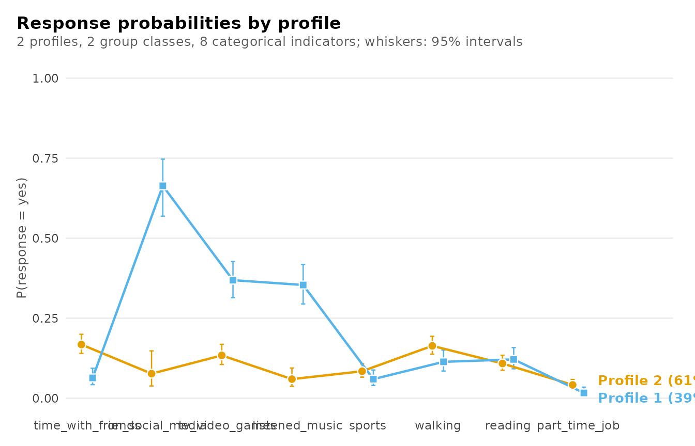
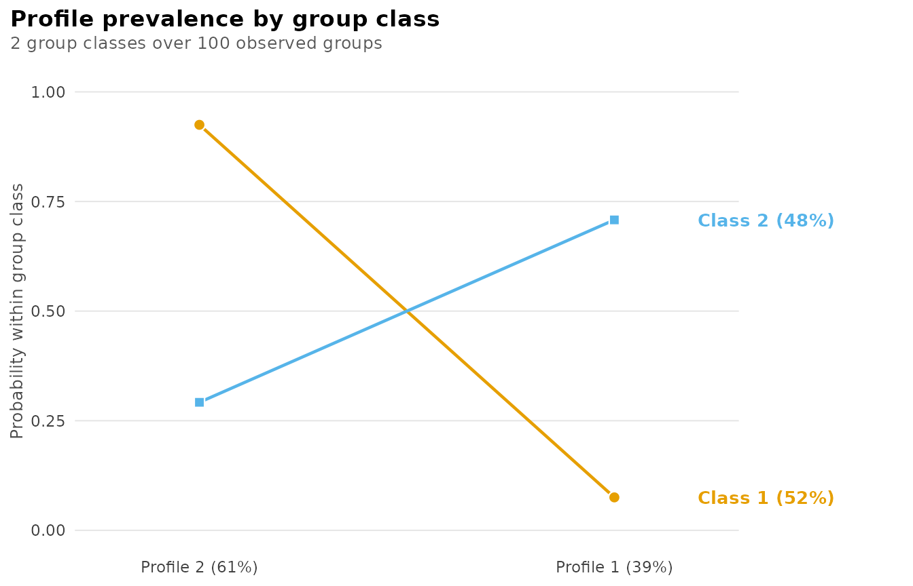

# Two-level latent class analysis

Two-level latent class analysis (LCA) represents heterogeneity in
categorical response patterns among observations nested within groups.
Observation-level classes, labelled profiles in the output, are defined
by item-response probabilities. Group classes differ in their
conditional probabilities of observation-level class membership. By
default,
[`multilca()`](https://pak.dynasite.org/latents/reference/multilca.md)
treats all selected indicators as categorical.
[`multilpa()`](https://pak.dynasite.org/latents/reference/multilpa.md)
supports mixed continuous and categorical indicators through the
`categorical` argument.

## What the package supports

- **Item types.** Binary, ordinal and nominal items share one
  parameterization: unrestricted category probabilities in each profile,
  subject to summing to one. Numeric, integer, logical, character and
  factor columns are accepted; factor levels keep their order, other
  types are sorted. Ordered items can instead be modelled as `ordinal`
  (an adjacent-category logit with shared category intercepts), and
  counts as `count` (Poisson); see below.
- **Mixed measurement.** Continuous and categorical indicators in one
  model.
- **Missing answers.** `missing = "fiml"` uses the observed answers of
  each row.
- **Standard errors.** Observed-information and robust
  (`vcov_type = "robust"`) standard errors through
  [`parameter_inference()`](https://pak.dynasite.org/latents/reference/parameter_inference.md).
- **Model comparison.**
  [`enumerate_classes()`](https://pak.dynasite.org/latents/reference/enumerate_classes.md)
  and
  [`bootstrap_lrt()`](https://pak.dynasite.org/latents/reference/bootstrap_lrt.md),
  which keeps each row’s pattern of missing answers in a FIML fit.
- **External variables.**
  [`three_step()`](https://pak.dynasite.org/latents/reference/three_step.md)
  and [`r3step()`](https://pak.dynasite.org/latents/reference/r3step.md)
  work on a categorical fit.
- **Membership covariates.** `profile_covariates` and `group_covariates`
  work with categorical indicators, and
  [`parameter_inference()`](https://pak.dynasite.org/latents/reference/parameter_inference.md)
  reports their standard errors.
- **Transitions.**
  [`lta()`](https://pak.dynasite.org/latents/reference/lta.md) accepts
  categorical indicators.
- **Bounds.** `min_probability` keeps every response probability above a
  lower bound.

## Data

`student_esm` holds experience-sampling data: 2,582 prompts from 100
university students, answered at times when the student had not been
studying. `student` identifies the group. Eight yes/no items record the
leisure activities done since the previous prompt, and four items rate
affect from 1 to 7. `day` is the study day, from 0 to 13.
[`?student_esm`](https://pak.dynasite.org/latents/reference/student_esm.md)
gives the source.

``` r

library(latents)
```

The example uses the first week of observations (`day <= 6`), retaining
all 100 students while limiting computation.

``` r

first_week <- subset(student_esm, day <= 6)
```

The eight activity items are used in several fits, so we store their
names once.

``` r

activities <- c("time_with_friends", "on_social_media", "tv_video_games",
                "listened_music", "sports", "walking", "reading",
                "part_time_job")
```

## Fitting the model

The model specifies two observation-level classes and two group classes.
The `tol` argument sets a stricter convergence tolerance for this
example; accurate numerical standard errors require a sufficiently
well-converged solution.

``` r

lca <- multilca(first_week, vars = activities, id = "student",
                n_profiles = 2, n_group_classes = 2, n_starts = 3,
                tol = 1e-10, seed = 1)
lca
#> Two-level latent class analysis: 2 classes, 2 group classes
#> 1422 individuals in 100 groups; 8 categorical indicators
#> Classes are labelled profile_1, profile_2, ... in every table.
#> Log likelihood: -4315.734843 | AIC: 8669.470 | BIC (groups): 8718.968
#> Converged: TRUE | iterations: 39 | best log likelihood reached by 2 of 3 starts (3 converged)
#> 
#> Class sizes   profile_1 38.6% (549)   profile_2 61.4% (873)
#> Group classes group_class_1 51.7% (52)   group_class_2 48.3% (48)
#> 
#> Response probabilities
#>          indicator category profile_1 profile_2
#>  time_with_friends       no     0.937     0.832
#>  time_with_friends      yes     0.063     0.168
#>    on_social_media       no     0.336     0.924
#>    on_social_media      yes     0.664     0.076
#>     tv_video_games       no     0.631     0.866
#>     tv_video_games      yes     0.369     0.134
#>     listened_music       no     0.646     0.941
#>     listened_music      yes     0.354     0.059
#>             sports       no     0.941     0.916
#>             sports      yes     0.059     0.084
#>            walking       no     0.887     0.837
#>            walking      yes     0.113     0.163
#>            reading       no     0.879     0.892
#>            reading      yes     0.121     0.108
#>      part_time_job       no     0.984     0.959
#>      part_time_job      yes     0.016     0.041
#> 
#> Thresholds and standard errors: get_results(x, "responses").
#> Every other table: get_results(x, what = ), or get_results(x, "all").
```

The `"responses"` table contains one row per profile, item and category.
The column `probability` is the estimated conditional probability of
that response within the profile.

``` r

get_results(lca, "responses")
#>    profile         indicator category probability threshold probability_standard_error
#> 1        1 time_with_friends       no      0.9368     2.696                    0.01281
#> 2        2 time_with_friends       no      0.8324     1.603                    0.01525
#> 3        1 time_with_friends      yes      0.0632        NA                    0.01281
#> 4        2 time_with_friends      yes      0.1676        NA                    0.01525
#> 5        1   on_social_media       no      0.3364    -0.679                    0.04592
#> 6        2   on_social_media       no      0.9235     2.491                    0.02663
#> 7        1   on_social_media      yes      0.6636        NA                    0.04592
#> 8        2   on_social_media      yes      0.0765        NA                    0.02663
#> 9        1    tv_video_games       no      0.6313     0.538                    0.02892
#> 10       2    tv_video_games       no      0.8664     1.870                    0.01605
#> 11       1    tv_video_games      yes      0.3687        NA                    0.02892
#> 12       2    tv_video_games      yes      0.1336        NA                    0.01605
#> 13       1    listened_music       no      0.6464     0.603                    0.03167
#> 14       2    listened_music       no      0.9406     2.762                    0.01420
#> 15       1    listened_music      yes      0.3536        NA                    0.03167
#> 16       2    listened_music      yes      0.0594        NA                    0.01420
#> 17       1            sports       no      0.9406     2.762                    0.01208
#> 18       2            sports       no      0.9159     2.388                    0.01053
#> 19       1            sports      yes      0.0594        NA                    0.01208
#> 20       2            sports      yes      0.0841        NA                    0.01053
#> 21       1           walking       no      0.8865     2.056                    0.01657
#> 22       2           walking       no      0.8365     1.633                    0.01423
#> 23       1           walking      yes      0.1135        NA                    0.01657
#> 24       2           walking      yes      0.1635        NA                    0.01423
#> 25       1           reading       no      0.8790     1.983                    0.01685
#> 26       2           reading       no      0.8917     2.108                    0.01190
#> 27       1           reading      yes      0.1210        NA                    0.01685
#> 28       2           reading      yes      0.1083        NA                    0.01190
#> 29       1     part_time_job       no      0.9838     4.103                    0.00625
#> 30       2     part_time_job       no      0.9587     3.144                    0.00730
#> 31       1     part_time_job      yes      0.0162        NA                    0.00625
#> 32       2     part_time_job      yes      0.0413        NA                    0.00730
```

The response plot compares the fitted item-response probabilities across
profiles.

``` r

plot_responses(lca)
```



For numeric categories, such as ratings from 1 to 5, a profile plot can
summarize each item’s fitted distribution on the original score scale:

``` r

plot_profiles(lca)                        # probability-weighted means
plot_profiles(lca, statistic = "median")  # fitted medians
plot_profiles(lca, statistic = "mode")    # most probable scores
```

Means assume meaningful spacing between category scores. The median is
the smallest score whose cumulative probability reaches 0.5; tied modes
use the smallest score. These summaries use fitted probabilities,
including in FIML models, rather than averages of cases assigned to each
class. They require numeric category labels and use the raw scale.
Confidence intervals are not computed, so these plots avoid the
parameter-inference calculation used by the response-probability plot.
In mixed models,
[`plot_profiles()`](https://pak.dynasite.org/latents/reference/latents-plots.md)
continues to show only continuous indicators.

The `"profile_probabilities"` table and the prevalence plot summarize
how the distribution of observation-level classes differs across group
classes.

``` r

get_results(lca, "profile_probabilities")
#>   group_class profile probability group_class_probability
#> 1           1       1      0.0751                   0.517
#> 2           1       2      0.9249                   0.517
#> 3           2       1      0.7080                   0.483
#> 4           2       2      0.2920                   0.483
```

``` r

plot_prevalence(lca)
```



The `"entropy"` table summarizes posterior classification separation at
both levels.

``` r

get_results(lca, "entropy")
#>         level n_classes n_units entropy_sum relative_entropy
#> 1 individuals         2    1422         411            0.583
#> 2      groups         2     100          13            0.813
```

## Mixed indicators

Mixed models specify all indicators in `vars` and the categorical subset
in `categorical`. This example treats three affect ratings as continuous
and the activity indicators as categorical. Treating ratings as
continuous is a measurement assumption that should be evaluated against
an ordinal specification. The `worried` item is omitted because its
concentration at the lowest category can produce a component with
variance near the lower bound under a Gaussian specification.

``` r

mixed <- multilpa(first_week,
                  vars = c("happy", "relaxed", "exhausted", activities),
                  categorical = activities, id = "student", n_profiles = 2,
                  n_group_classes = 2, n_starts = 3, seed = 1)
```

The default results table reports the continuous indicators’ means and
variances. The `"responses"` table reports categorical response
probabilities.

``` r

get_results(mixed)
#>   profile indicator mean variance standard_deviation mean_standard_error variance_standard_error
#> 1       1     happy 3.90    1.963              1.401              0.0653                  0.1076
#> 2       1   relaxed 3.66    1.946              1.395              0.0601                  0.1043
#> 3       1 exhausted 4.10    2.842              1.686              0.0696                  0.1503
#> 4       2     happy 5.98    0.659              0.812              0.0396                  0.0414
#> 5       2   relaxed 5.77    1.016              1.008              0.0536                  0.0742
#> 6       2 exhausted 2.32    1.976              1.406              0.0672                  0.1379
get_results(mixed, "responses")
#>    profile         indicator category probability threshold probability_standard_error
#> 1        1 time_with_friends       no      0.9309     2.601                    0.01003
#> 2        2 time_with_friends       no      0.8046     1.415                    0.01648
#> 3        1 time_with_friends      yes      0.0691        NA                    0.01003
#> 4        2 time_with_friends      yes      0.1954        NA                    0.01648
#> 5        1   on_social_media       no      0.6381     0.567                    0.01863
#> 6        2   on_social_media       no      0.7657     1.184                    0.01898
#> 7        1   on_social_media      yes      0.3619        NA                    0.01863
#> 8        2   on_social_media      yes      0.2343        NA                    0.01898
#> 9        1    tv_video_games       no      0.7370     1.030                    0.01685
#> 10       2    tv_video_games       no      0.8210     1.523                    0.01654
#> 11       1    tv_video_games      yes      0.2630        NA                    0.01685
#> 12       2    tv_video_games      yes      0.1790        NA                    0.01654
#> 13       1    listened_music       no      0.8394     1.654                    0.01419
#> 14       2    listened_music       no      0.8125     1.466                    0.01632
#> 15       1    listened_music      yes      0.1606        NA                    0.01419
#> 16       2    listened_music      yes      0.1875        NA                    0.01632
#> 17       1            sports       no      0.9385     2.726                    0.00928
#> 18       2            sports       no      0.9102     2.316                    0.01182
#> 19       1            sports      yes      0.0615        NA                    0.00928
#> 20       2            sports      yes      0.0898        NA                    0.01182
#> 21       1           walking       no      0.8821     2.012                    0.01244
#> 22       2           walking       no      0.8251     1.552                    0.01573
#> 23       1           walking      yes      0.1179        NA                    0.01244
#> 24       2           walking      yes      0.1749        NA                    0.01573
#> 25       1           reading       no      0.8670     1.874                    0.01317
#> 26       2           reading       no      0.9100     2.313                    0.01259
#> 27       1           reading      yes      0.1330        NA                    0.01317
#> 28       2           reading      yes      0.0900        NA                    0.01259
#> 29       1     part_time_job       no      0.9720     3.549                    0.00647
#> 30       2     part_time_job       no      0.9640     3.289                    0.00786
#> 31       1     part_time_job      yes      0.0280        NA                    0.00647
#> 32       2     part_time_job      yes      0.0360        NA                    0.00786
```

## Ordinal and count indicators

The affect ratings range from 1 to 7. An unrestricted categorical
specification requires six free probability parameters per item and
profile. The ordinal specification instead uses shared category
intercepts and profile locations under an adjacent-category logit model,
with identifying constraints described in
[`?multilpa`](https://pak.dynasite.org/latents/reference/multilpa.md).
The `ordinal` argument identifies the items to which this specification
applies.

``` r

affect <- c("happy", "relaxed", "worried", "exhausted")
ordinal <- multilpa(first_week, vars = c(affect, activities), id = "student",
                    ordinal = affect, categorical = activities, n_profiles = 2,
                    n_group_classes = 2, n_starts = 3, seed = 1)
ordinal
#> Two-level latent class analysis: 2 classes, 2 group classes
#> 1422 individuals in 100 groups; 8 categorical indicators
#> Also ordinal happy, relaxed, worried, exhausted (adjacent-category logit; get_results(x, "ordinal"))
#> Classes are labelled profile_1, profile_2, ... in every table.
#> Log likelihood: -13513.224894 | AIC: 27120.450 | BIC (groups): 27242.893
#> Converged: TRUE | iterations: 21 | best log likelihood reached by 3 of 3 starts (3 converged)
#> 
#> Class sizes   profile_1 43.3% (615)   profile_2 56.7% (807)
#> Group classes group_class_1 59.1% (59)   group_class_2 40.9% (41)
#> 
#> Response probabilities
#>          indicator category profile_1 profile_2
#>  time_with_friends       no     0.798     0.930
#>  time_with_friends      yes     0.202     0.070
#>    on_social_media       no     0.785     0.630
#>    on_social_media      yes     0.215     0.370
#>     tv_video_games       no     0.830     0.734
#>     tv_video_games      yes     0.170     0.266
#>     listened_music       no     0.810     0.840
#>     listened_music      yes     0.190     0.160
#>             sports       no     0.911     0.936
#>             sports      yes     0.089     0.064
#>            walking       no     0.815     0.887
#>            walking      yes     0.185     0.113
#>            reading       no     0.915     0.865
#>            reading      yes     0.085     0.135
#>      part_time_job       no     0.966     0.970
#>      part_time_job      yes     0.034     0.030
#> 
#> Thresholds and standard errors: get_results(x, "responses").
#> Every other table: get_results(x, what = ), or get_results(x, "all").
```

The `"ordinal"` table reports fitted category probabilities and profile
locations for the ordinal indicators.

``` r

head(get_results(ordinal, "ordinal"), 7)
#>   profile indicator category probability location location_standard_error
#> 1       1     happy        1    2.74e-05     1.86                   0.139
#> 2       1     happy        2    2.52e-04     1.86                   0.139
#> 3       1     happy        3    3.02e-03     1.86                   0.139
#> 4       1     happy        4    2.82e-02     1.86                   0.139
#> 5       1     happy        5    2.21e-01     1.86                   0.139
#> 6       1     happy        6    4.24e-01     1.86                   0.139
#> 7       1     happy        7    3.24e-01     1.86                   0.139
```

Count indicators, such as numbers of messages or absences, are specified
in `count`. The default Poisson model estimates one mean per profile,
available through `get_results(fit, "count_means")`. The
negative-binomial option, `count_model = "negative_binomial"`, permits
within-profile overdispersion through profile-specific dispersion
parameters, or a common parameter with `count_dispersion = "equal"`.
Both count specifications support membership covariates and latent
transition models.

## Reference

The calls below list other functions that work with categorical and
mixed models. Each comment states what the call returns.

``` r

get_results(lca, "classification")               # class sizes and average posteriors
get_results(lca, "residuals")                    # residual association within profiles
parameter_inference(lca)                         # standard errors and intervals
enumerate_classes(first_week, vars = activities, categorical = activities,
                  id = "student", n_profiles = 2:3,
                  n_group_classes = 1:2, seed = 1)  # compare numbers of classes (slow)
plot_profiles(mixed)                             # means of the continuous indicators
plot_responses(mixed)                            # answers to the categorical ones
multilca(first_week, vars = activities, id = "student", n_profiles = 2,
         n_group_classes = 2, missing = "fiml")  # incomplete answers, if any
```

## Assumptions

- Items are independent within a profile.
- Under unrestricted categorical measurement, each item has a separate
  response-probability distribution in every profile. Rare responses can
  produce estimates at the lower bound (`min_probability`).
- Categories are taken from the observed values; factor levels keep
  their order.
