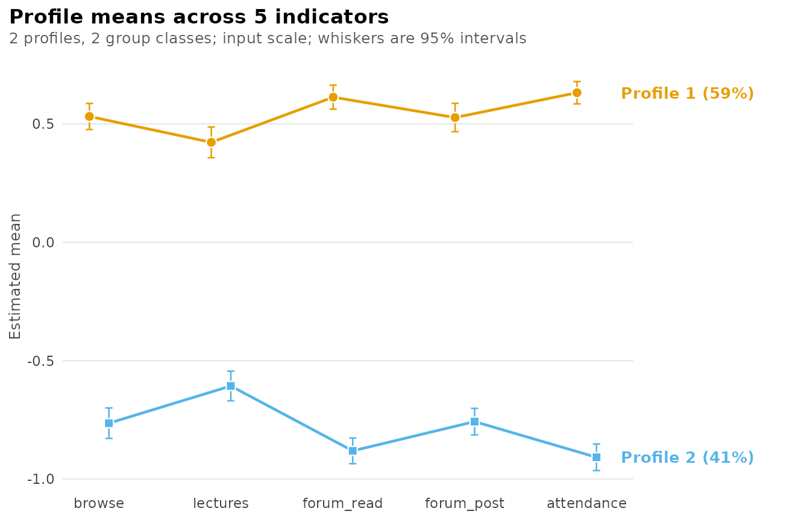
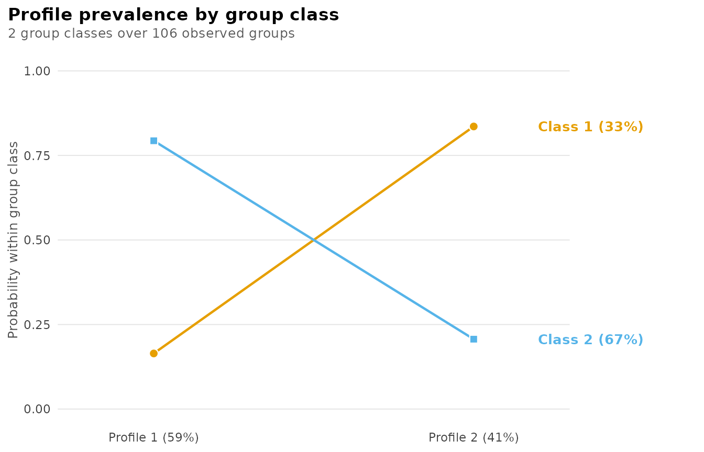

# Multilevel latent profile analysis with the latents R package

Latent profile analysis (LPA) is a person-centred statistical approach
used to identify unobserved subpopulations within a heterogeneous
population. It assumes that the observed data arise from a finite
mixture of latent profiles, each characterized by a distinct pattern of
means across a set of continuous indicators. Rather than assuming that
all observations originate from a single homogeneous population, LPA
allows individuals to differ in their underlying response patterns and
estimates the number and characteristics of the latent profiles, their
relative proportions, and the posterior probability of each observation
belonging to each profile. From a statistical perspective, LPA is a
finite Gaussian mixture model in which the observed distribution is
represented as a weighted combination of profile-specific multivariate
normal distributions (Scrucca et al., 2024).

Conventional LPA assumes that observations are independent of one
another. This assumption may be inappropriate when the data have a
hierarchical structure, in which observations are nested within
higher-level units. For example, courses completed by the same students
or employees belonging to the same departments may exhibit similarities
arising from their shared context. Such dependencies may also result in
differences in the distribution of latent profiles across groups.
Multilevel latent profile analysis extends the conventional model by
accounting for heterogeneity at both the individual and group levels
(Vermunt, 2003; Asparouhov & Muthén, 2008; Mäkikangas et al., 2018).

In multilevel LPA, individuals are classified into latent profiles based
on their patterns across the observed indicators, while groups are
classified into latent group classes according to the distribution of
individual-level profiles within them. Consequently, the model captures
not only differences between individuals but also systematic differences
in the composition of groups. For example, two groups may contain
individuals belonging to the same set of latent profiles but differ in
the relative proportions of individuals assigned to each profile. These
differences are represented through group-specific profile
probabilities.

Formally, let $`C_{ij}`$ denote the latent profile membership of
observation $`i`$ in group $`j`$, and let $`G_j`$ denote the latent
group class of group $`j`$. The composition of each group class is
described by the conditional profile probabilities:

``` math
\pi_{k\mid m}=P(C_{ij}=k\mid G_j=m),
\qquad
\sum_k\pi_{k\mid m}=1.
```

Here, $`\pi_{k\mid m}`$ represents the probability that an observation
belongs to individual-level profile $`k`$, conditional on its group
belonging to group class $`m`$. These probabilities therefore
characterize the distribution of individual-level profiles within each
group class. Groups assigned to different group classes may consequently
differ in their profile composition, even when the underlying
individual-level profiles are identical.

An important feature of this specification is that the profile-specific
means and variances are assumed to remain invariant across group
classes. In other words, the individual-level profiles retain the same
measurement characteristics regardless of the group class in which they
occur. Differences between group classes are therefore expressed through
the relative prevalence of individual-level profiles rather than through
changes in the profiles’ underlying definitions. This constraint
provides a common measurement structure for comparing group classes and
facilitates the interpretation of differences in their profile
compositions.

Houle et al. (2026) provide an overview of multilevel latent profile
analysis and its extensions, including alternative specifications that
allow additional sources of heterogeneity at the individual and group
levels. In the `latents` package, the function
[`multilpa()`](https://pak.dynasite.org/latents/reference/multilpa.md)
estimates the multilevel latent profile model using maximum likelihood
estimation and the expectation-maximization (EM) algorithm (Dempster et
al., 1977). The algorithm alternates between estimating posterior
probabilities of latent class membership and updating the model
parameters until convergence is reached.

The analysis below proceeds in the usual order: the extent of nesting, a
first model, a check of its assumptions, the numbers of profiles and
group classes, interpretation and evaluation of the chosen model, and
the relation of its classes to another variable.

## Data

`course_engagement` contains 1,422 course enrolments of 106 students.

- **Group:** `student`.
- **Indicators:** five activity measures (`browse`, `lectures`,
  `forum_read`, `forum_post`, `attendance`), standardized within course
  (0 is the course mean, 1 one standard deviation above it).
- **External variable:** `previous_grade`, the standardized grade of the
  preceding course.

Two further columns hold the generating structure, `engagement` for each
enrolment and `student_type` for each student; they serve only to check
recovery.

``` r

library(latents)
vars <- c("browse", "lectures", "forum_read", "forum_post", "attendance")
```

## Clustering within groups

[`descriptives()`](https://pak.dynasite.org/latents/reference/descriptives.md)
summarizes the indicators and their intraclass correlation (`icc`), the
share of variance between groups, estimated from the one-way analysis of
variance (Shrout & Fleiss, 1979).

``` r

descriptives(course_engagement, vars = vars, id = "student")
#>     variable    n n_missing      mean    sd   min  max n_distinct n_groups sd_within sd_between
#> 1     browse 1422         0 -2.81e-05 0.989 -3.14 2.49        398      106     0.890      0.502
#> 2   lectures 1422         0 -4.22e-05 0.989 -2.91 3.22        399      106     0.945      0.392
#> 3 forum_read 1422         0  7.03e-05 0.989 -2.73 2.81        400      106     0.872      0.524
#> 4 forum_post 1422         0 -2.11e-05 0.989 -2.61 3.10        397      106     0.912      0.458
#> 5 attendance 1422         0  7.74e-05 0.989 -2.45 2.41        401      106     0.873      0.525
#>      icc
#> 1 0.1923
#> 2 0.0878
#> 3 0.2240
#> 4 0.1503
#> 5 0.2215
```

Between 9% (`lectures`) and 22% (`forum_read`, `attendance`) of the
variance lies between students. Enrolments of one student are therefore
not independent, and the students are the independent units of the
analysis. Most of the variance remains within students, where the
profiles operate.

## A first model

`n_profiles` and `n_group_classes` set the numbers of profiles and group
classes; `n_starts` sets the number of EM starts, `seed` makes them
reproducible and `cores` runs them in parallel. The default covariance
structure is `"VVI"` (Celeux & Govaert, 1995): profile-specific
variances and no covariances within profiles, so the indicators are
independent given the profile.

``` r

fit <- multilpa(course_engagement, vars = vars, id = "student",
                n_profiles = 2, n_group_classes = 2, n_starts = 10, seed = 1)
fit
#> Two-level latent profile analysis: 2 profiles, 2 group classes
#> 1422 individuals in 106 groups; varying diagonal residual covariance (VVI)
#> Log likelihood: -8439.816424 | AIC: 16925.633 | BIC (groups): 16986.892
#> Converged: TRUE | iterations: 9 | best log likelihood reached by 10 of 10 starts (10 converged)
#> Smallest standardized Gaussian eigenvalue: 0.3715 (profiles, profile_2); Gaussian mass: 587.9; weight effective n: 606.
#> 
#> Class sizes   profile_1 58.7% (834)   profile_2 41.3% (588)
#> Group classes group_class_1 32.5% (34)   group_class_2 67.5% (72)
#> 
#> Means
#>   indicator profile_1 profile_2
#>      browse     0.540    -0.766
#>    lectures     0.427    -0.606
#>  forum_read     0.620    -0.879
#>  forum_post     0.530    -0.753
#>  attendance     0.649    -0.921
#> 
#> Variances and standard errors: get_results(x, "profiles").
#> Every other table: get_results(x, what = ), or get_results(x, "all").
```

Profile 1 (58.7% of the enrolments) lies 0.43 to 0.65 standard
deviations above the course mean on all indicators and profile 2 (41.3%)
0.61 to 0.92 below it: engaged and disengaged enrolments. The BIC uses
the 106 students as its sample size. All ten starts reached the same log
likelihood.

## Checking local independence

Under a diagonal structure, any association between indicators within a
profile can only be represented by additional profiles, which then
describe the association rather than types of observations. The
`"residuals"` table compares each within-profile association with the
value the model implies, with p-values adjusted by the
Benjamini-Hochberg procedure (Benjamini & Hochberg, 1995).

``` r

head(get_results(fit, "residuals"), 6)
#>     profile indicator_1 indicator_2     kind observed expected residual effective_n statistic df
#> 1 profile_1    lectures  attendance gaussian    0.234        0    0.234         834      6.87 NA
#> 2 profile_2  forum_read  attendance gaussian    0.229        0    0.229         588      5.63 NA
#> 3 profile_1  forum_read  attendance gaussian    0.209        0    0.209         834      6.11 NA
#> 4 profile_1  forum_post  attendance gaussian    0.203        0    0.203         834      5.94 NA
#> 5 profile_2      browse  attendance gaussian    0.192        0    0.192         588      4.71 NA
#> 6 profile_1      browse  attendance gaussian    0.173        0    0.173         834      5.04 NA
#>    p_value p_adjusted
#> 1 6.37e-12   1.27e-10
#> 2 1.80e-08   8.99e-08
#> 3 1.00e-09   1.00e-08
#> 4 2.87e-09   1.91e-08
#> 5 2.43e-06   8.10e-06
#> 6 4.62e-07   1.85e-06
```

The six largest residuals all involve `attendance`, in both profiles:
its within-profile correlations with the other measures are 0.17 to
0.23, with adjusted p-values below 0.00001. The data documentation
confirms the source: attendance is generated from the four click
measures
([`?course_engagement`](https://pak.dynasite.org/latents/reference/course_engagement.md)).
`covariance_model = "full"` estimates all within-profile covariances
(`"VVV"`); `local_dependence` frees selected pairs.

``` r

full <- multilpa(course_engagement, vars = vars, id = "student",
                 n_profiles = 2, n_group_classes = 2,
                 covariance_model = "full", n_starts = 10, seed = 1)
compare_models(diagonal = fit, full = full)
#> Model comparison
#> 
#> Model     Profiles  Group classes   k    LogLik       BIC    ΔBIC  Weight       ICL  Entropy  Min AvePP  < 0.8  Group entropy  Group min AvePP
#> --------  --------  -------------  --  --------  --------  ------  ------  --------  -------  ---------  -----  -------------  ---------------
#> diagonal         2              2  23  -8439.82  16986.89  160.14   0.000  17175.69     0.94       0.98      0           0.94             0.97
#> full             2              2  43  -8313.11  16826.75    0.00   1.000  17128.35     0.91       0.97      0           0.94             0.97
```

The full structure adds 20 parameters and lowers the BIC by 160 (BIC
weight 1.000). The profiles and group classes retain their sizes and
meaning; the numbers of classes are chosen under this structure.

## Choosing the numbers of profiles and group classes

[`enumerate_classes()`](https://pak.dynasite.org/latents/reference/enumerate_classes.md)
fits every combination of the requested numbers of profiles and group
classes and returns information criteria, classification statistics and
estimation checks. For the group classes, Lukočienė et al. (2010)
recommend the BIC (Schwarz, 1978) with the number of groups as sample
size (`bic_groups`). Group classes require at least two profiles, so
candidates with one profile and several group classes fail by design.

``` r

grid <- enumerate_classes(course_engagement, vars = vars, id = "student",
                          covariance_model = "full", n_profiles = 1:3,
                          n_group_classes = 1:4, n_starts = 5, seed = 1)
#> Warning: Profile 2: 18.6 Gaussian membership mass for 20 free means and variances. This is a
#> conservative diagnostic, not an identification test; inspect the Gaussian covariance diagnostics.
#> Warning: Profile 2: 17.2 Gaussian membership mass for 20 free means and variances. This is a
#> conservative diagnostic, not an identification test; inspect the Gaussian covariance diagnostics.
#> 2 of 9 candidates reached their best log likelihood from one start only (profiles3_groups2, profiles3_groups4); refit those you consider with more starts.
grid
#> Class enumeration: 12 candidate models (LPA)
#>          candidate n_profiles n_group_classes model log_likelihood n_parameters   aic bic_groups
#>  profiles1_groups1          1               1   VVV          -8710           20 17460      17514
#>  profiles2_groups1          2               1   VVV          -8490           41 17061      17170
#>  profiles3_groups1          3               1   VVV          -8472           62 17067      17232
#>  profiles1_groups2          1               2  <NA>             NA           NA    NA         NA
#>  profiles2_groups2          2               2   VVV          -8313           43 16712      16827
#>  profiles3_groups2          3               2   VVV          -8289           65 16708      16881
#>  profiles1_groups3          1               3  <NA>             NA           NA    NA         NA
#>  profiles2_groups3          2               3   VVV          -8295           45 16681      16801
#>  profiles3_groups3          3               3   VVV          -8275           68 16686      16867
#>  profiles1_groups4          1               4  <NA>             NA           NA    NA         NA
#>  profiles2_groups4          2               4   VVV          -8289           47 16672      16798
#>  profiles3_groups4          3               4   VVV          -8262           71 16666      16855
#>  bic_individual icl_individual profile_entropy group_entropy avepp_min avepp_max avepp_mean
#>           17565          17565              NA            NA        NA        NA         NA
#>           17277          17524           0.875            NA     0.959     0.971      0.965
#>           17393          18030           0.796            NA     0.665     0.956      0.833
#>              NA             NA              NA            NA        NA        NA         NA
#>           16938          17128           0.906         0.942     0.973     0.978      0.976
#>           17050          17264           0.933         0.943     0.796     0.976      0.915
#>              NA             NA              NA            NA        NA        NA         NA
#>           16917          17132           0.909         0.816     0.974     0.978      0.976
#>           17044          17614           0.828         0.824     0.650     0.973      0.841
#>              NA             NA              NA            NA        NA        NA         NA
#>           16920          17142           0.912         0.797     0.977     0.978      0.977
#>           17040          17276           0.940         0.801     0.830     0.979      0.928
#>  avepp_below group_avepp_min group_avepp_max group_avepp_mean group_avepp_below converged boundary
#>           NA              NA              NA               NA                NA      TRUE    FALSE
#>            0              NA              NA               NA                NA      TRUE    FALSE
#>            1              NA              NA               NA                NA      TRUE    FALSE
#>           NA              NA              NA               NA                NA     FALSE       NA
#>            0           0.971           0.993            0.982                 0      TRUE    FALSE
#>            1           0.979           0.990            0.985                 0      TRUE    FALSE
#>           NA              NA              NA               NA                NA     FALSE       NA
#>            0           0.903           0.960            0.923                 0      TRUE    FALSE
#>            1           0.878           0.955            0.920                 0      TRUE    FALSE
#>           NA              NA              NA               NA                NA     FALSE       NA
#>            0           0.830           0.925            0.874                 0      TRUE    FALSE
#>            0           0.851           0.910            0.879                 0      TRUE    FALSE
#>  n_best_replicated
#>                  5
#>                  5
#>                  4
#>                 NA
#>                  5
#>                  1
#>                 NA
#>                  5
#>                  4
#>                 NA
#>                  5
#>                  1
#> Every column, unrounded: as.data.frame(x).
#> 3 candidate(s) failed to fit; the `error` column of as.data.frame(x) gives the reason.
#> No candidate is selected automatically. Compare one convention consistently.
```

[`get_deltas()`](https://pak.dynasite.org/latents/reference/get_deltas.md)
gives the improvement of each criterion when a profile or a group class
is added.

``` r

subset(get_deltas(grid), criterion == "bic_groups")
#>            candidate n_profiles n_group_classes model  criterion value delta_profile
#> 1  profiles1_groups1          1               1   VVV bic_groups 17514            NA
#> 2  profiles2_groups1          2               1   VVV bic_groups 17170         343.1
#> 3  profiles3_groups1          3               1   VVV bic_groups 17232         -61.7
#> 4  profiles1_groups2          1               2  <NA> bic_groups    NA            NA
#> 5  profiles2_groups2          2               2   VVV bic_groups 16827            NA
#> 6  profiles3_groups2          3               2   VVV bic_groups 16881         -54.5
#> 7  profiles1_groups3          1               3  <NA> bic_groups    NA            NA
#> 8  profiles2_groups3          2               3   VVV bic_groups 16801            NA
#> 9  profiles3_groups3          3               3   VVV bic_groups 16867         -66.6
#> 10 profiles1_groups4          1               4  <NA> bic_groups    NA            NA
#> 11 profiles2_groups4          2               4   VVV bic_groups 16798            NA
#> 12 profiles3_groups4          3               4   VVV bic_groups 16855         -57.6
#>         from_profile delta_group_class  from_group_class
#> 1               <NA>                NA              <NA>
#> 2  profiles1_groups1                NA              <NA>
#> 3  profiles2_groups1                NA              <NA>
#> 4               <NA>                NA              <NA>
#> 5               <NA>            343.67 profiles2_groups1
#> 6  profiles2_groups2            350.88 profiles3_groups1
#> 7               <NA>                NA              <NA>
#> 8               <NA>             26.13 profiles2_groups2
#> 9  profiles2_groups3             13.99 profiles3_groups2
#> 10              <NA>                NA              <NA>
#> 11              <NA>              3.06 profiles2_groups3
#> 12 profiles2_groups4             12.06 profiles3_groups3
```

Two profiles are supported unambiguously: the second profile lowers the
BIC by 343, and a third raises it at every number of group classes, by
55 to 67. For the group classes, the second lowers the BIC by 344, the
third by 26 and the fourth by 3, while group-level separation declines
(relative entropy 0.942, 0.816 and 0.797; lowest group average posterior
0.971, 0.903 and 0.830). The AWE (Banfield & Raftery, 1993) and the ICL
computed on the enrolments (Biernacki et al., 2000), which penalize
uncertain classification, select two group classes (`get_best(grid)`).
The model with two profiles and two group classes is retained. The small
gains of further group classes have an identifiable source: engagement
changes along each student’s course sequence, a dependence that
multilevel LPA does not model and that additional group classes partly
absorb; [`lta()`](https://pak.dynasite.org/latents/reference/lta.md)
models the sequence directly (see the [latent transition
analysis](https://pak.dynasite.org/latents/articles/lta.html) article).

Two candidates with three profiles (two and four group classes) raise
warnings: one profile has too little membership for its 20 free means
and covariances, and both reached their best likelihood from a single
start. The AIC, whose penalty is the weakest, favours three profiles
with four group classes; the BIC rejects three profiles at every number
of group classes, so the warnings do not affect the choice by BIC.

## The chosen model

``` r

full
#> Two-level latent profile analysis: 2 profiles, 2 group classes
#> 1422 individuals in 106 groups; varying full residual covariance (VVV)
#> Log likelihood: -8313.111554 | AIC: 16712.223 | BIC (groups): 16826.751
#> Converged: TRUE | iterations: 12 | best log likelihood reached by 10 of 10 starts (10 converged)
#> Smallest standardized Gaussian eigenvalue: 0.271 (profiles, profile_2); Gaussian mass: 583.2; weight effective n: 610.5.
#> 
#> Class sizes   profile_1 59.0% (839)   profile_2 41.0% (583)
#> Group classes group_class_1 32.5% (34)   group_class_2 67.5% (72)
#> 
#> Means
#>   indicator profile_1 profile_2
#>      browse     0.531    -0.764
#>    lectures     0.422    -0.607
#>  forum_read     0.613    -0.881
#>  forum_post     0.527    -0.758
#>  attendance     0.632    -0.908
#> 
#> Variances and standard errors: get_results(x, "profiles").
#> Every other table: get_results(x, what = ), or get_results(x, "all").
```

Profile 1 (59.0%) lies 0.42 to 0.63 standard deviations above the course
mean and profile 2 (41.0%) 0.61 to 0.91 below it; attendance and forum
reading separate the profiles most, lecture viewing least.
[`get_results()`](https://pak.dynasite.org/latents/reference/get_results.md)
returns the means and variances, `get_results(full, "covariances")` the
covariances.

``` r

get_results(full)
#>    profile  indicator   mean variance standard_deviation mean_standard_error
#> 1        1     browse  0.531    0.601              0.775              0.0280
#> 2        1   lectures  0.422    0.846              0.920              0.0331
#> 3        1 forum_read  0.613    0.492              0.702              0.0259
#> 4        1 forum_post  0.527    0.694              0.833              0.0306
#> 5        1 attendance  0.632    0.409              0.639              0.0240
#> 6        2     browse -0.764    0.529              0.727              0.0328
#> 7        2   lectures -0.607    0.541              0.736              0.0320
#> 8        2 forum_read -0.881    0.359              0.599              0.0276
#> 9        2 forum_post -0.758    0.412              0.642              0.0286
#> 10       2 attendance -0.908    0.396              0.629              0.0287
#>    variance_standard_error
#> 1                   0.0308
#> 2                   0.0426
#> 3                   0.0258
#> 4                   0.0360
#> 5                   0.0221
#> 6                   0.0338
#> 7                   0.0331
#> 8                   0.0237
#> 9                   0.0267
#> 10                  0.0253
```

All variances are below 1, the variance of the standardized indicators:
enrolments within a profile are more homogeneous than the sample. The
profile plot shows the means, with the profile shares in the labels.

``` r

plot_profiles(full)
```



### Group classes

The `"profile_probabilities"` table gives $`\pi_{k \mid m}`$
(`probability`) and the proportion of groups in each class
(`group_class_probability`).

``` r

get_results(full, "profile_probabilities")
#>   group_class profile probability group_class_probability
#> 1           1       1       0.164                   0.325
#> 2           1       2       0.836                   0.325
#> 3           2       1       0.793                   0.675
#> 4           2       2       0.207                   0.675
```

Group class 2 (67.5% of the students) has 79.3% engaged enrolments and
group class 1 (32.5%) 16.4%: mostly engaged and mostly disengaged
students. Neither class is pure: a mostly engaged student is disengaged
in about one course in five, a mostly disengaged student engaged in
about one in six. Students are mixtures of profiles in class-specific
proportions. The prevalence plot shows these probabilities.

``` r

plot_prevalence(full)
```



## Class sizes and classification

`effective_count` sums the posterior probabilities and is therefore not
necessarily an integer.

``` r

get_results(full, "counts")
#>         level class effective_count effective_proportion
#> 1 individuals     1           838.8                0.590
#> 2 individuals     2           583.2                0.410
#> 3      groups     1            34.5                0.325
#> 4      groups     2            71.5                0.675
```

The profiles hold 838.8 and 583.2 enrolments, the group classes 34.5 and
71.5 students; no class is small enough to threaten estimation. Relative
entropy measures the separation of the classes on a scale from 0 (no
separation) to 1 (certain assignment) (Ramaswamy et al., 1993); it is
not a measure of fit.

``` r

get_results(full, "entropy")
#>         level n_classes n_units entropy_sum relative_entropy
#> 1 individuals         2    1422       92.36            0.906
#> 2      groups         2     106        4.25            0.942
```

Relative entropy is 0.906 for the enrolments and 0.942 for the students.
The average posterior probability of the assigned class gives the same
information by class.

``` r

get_results(full, "average_posteriors")
#>         level assigned_class class n_assigned average_posterior
#> 1 individuals              1     1        842           0.97775
#> 2 individuals              1     2        842           0.02225
#> 3 individuals              2     1        580           0.02674
#> 4 individuals              2     2        580           0.97326
#> 5      groups              1     1         35           0.97087
#> 6      groups              1     2         35           0.02913
#> 7      groups              2     1         71           0.00698
#> 8      groups              2     2         71           0.99302
```

The average posteriors are 0.978 and 0.973 for the profiles and 0.971
and 0.993 for the group classes. Assignments are therefore accurate at
both levels, although analyses of assigned classes still ignore the
remaining uncertainty; the three-step methods below account for it. The
`"assignments"` table adds the most probable `profile` and
`group_class`, the `uncertainty` of the profile assignment and the
posterior probabilities to the data.

``` r

get_results(full, "assignments", data = course_engagement) |> head()
#>   student course sequence browse lectures forum_read forum_post attendance previous_grade
#> 1       1     23        1   0.73    -0.08       0.30       0.67       0.72           0.54
#> 2       1     19        2   0.68     0.53      -0.02      -0.55       0.70          -0.71
#> 3       1      4        3  -1.51    -0.51      -0.91      -0.80      -0.97           1.98
#> 4       1     18        4   0.64    -1.02      -1.62      -1.20      -1.26          -1.42
#> 5       1     16        5  -0.94    -0.37      -0.71      -0.28      -1.52          -0.67
#> 6       1     29        6  -0.36    -0.46      -0.77      -0.43      -1.34          -0.40
#>   engagement student_type profile group_class uncertainty posterior_profile_1 posterior_profile_2
#> 1    engaged     wavering       1           1    0.010237            0.989763              0.0102
#> 2    engaged     wavering       1           1    0.147719            0.852281              0.1477
#> 3 disengaged     wavering       2           1    0.000061            0.000061              0.9999
#> 4 disengaged     wavering       2           1    0.000193            0.000193              0.9998
#> 5 disengaged     wavering       2           1    0.000224            0.000224              0.9998
#> 6 disengaged     wavering       2           1    0.000563            0.000563              0.9994
```

The first student’s first two enrolments are assigned to the engaged
profile, the second with an uncertainty of 0.148, and the next four to
the disengaged profile with uncertainties below 0.001; the student
belongs to the mostly disengaged group class.

## Recovery of the known structure

The `truth` argument cross-tabulates the assignments with the generating
labels; class numbers are arbitrary, so correspondence is read from the
table.

``` r

get_results(full, "assignments", data = course_engagement,
            truth = c("engagement", "student_type"))
#>    assignment class        truth      value   n proportion
#> 1     profile     1   engagement disengaged  18     0.0308
#> 2     profile     2   engagement disengaged 567     0.9692
#> 3     profile     1   engagement    engaged 824     0.9845
#> 4     profile     2   engagement    engaged  13     0.0155
#> 5 group_class     1 student_type  committed   1     0.0161
#> 6 group_class     2 student_type  committed  61     0.9839
#> 7 group_class     1 student_type   wavering  34     0.7727
#> 8 group_class     2 student_type   wavering  10     0.2273
```

Profile 1 contains 824 of the 837 engaged enrolments and profile 2 567
of the 585 disengaged ones (98% and 97%). Group class 2 contains 61 of
the 62 committed students but also 10 of the 44 wavering ones. The model
classifies the students with high certainty (relative entropy 0.942),
yet recovers the wavering students less well: group classes differ only
in their proportions of profiles, so a wavering student whose enrolments
happen to be mostly engaged resembles a committed one.

## Uncertainty of the estimates

[`parameter_inference()`](https://pak.dynasite.org/latents/reference/parameter_inference.md)
returns each estimate with its standard error and 95% Wald interval,
from the observed information by default; `vcov_type = "robust"` gives
sandwich standard errors with the students as clusters. The first ten
rows are the profile means.

``` r

inference <- parameter_inference(full)
head(inference, 10)
#>          level   outcome       term parameter estimate standard_error statistic   p_value
#> 1  measurement profile_1     browse      mean    0.531         0.0280      18.9  4.52e-80
#> 2  measurement profile_1   lectures      mean    0.422         0.0331      12.8  3.07e-37
#> 3  measurement profile_1 forum_read      mean    0.613         0.0259      23.6 1.38e-123
#> 4  measurement profile_1 forum_post      mean    0.527         0.0306      17.2  1.87e-66
#> 5  measurement profile_1 attendance      mean    0.632         0.0240      26.3 4.39e-152
#> 6  measurement profile_2     browse      mean   -0.764         0.0328     -23.3 6.90e-120
#> 7  measurement profile_2   lectures      mean   -0.607         0.0320     -19.0  3.96e-80
#> 8  measurement profile_2 forum_read      mean   -0.881         0.0276     -31.9 5.69e-223
#> 9  measurement profile_2 forum_post      mean   -0.758         0.0286     -26.5 5.45e-155
#> 10 measurement profile_2 attendance      mean   -0.908         0.0287     -31.7 5.51e-220
#>    p_adjusted conf_low conf_high
#> 1    4.52e-80    0.476     0.586
#> 2    3.07e-37    0.357     0.487
#> 3   1.38e-123    0.562     0.664
#> 4    1.87e-66    0.467     0.587
#> 5   4.39e-152    0.585     0.679
#> 6   6.90e-120   -0.829    -0.700
#> 7    3.96e-80   -0.670    -0.544
#> 8   5.69e-223   -0.935    -0.827
#> 9   5.45e-155   -0.814    -0.702
#> 10  5.51e-220   -0.964    -0.852
```

The standard errors of the means are 0.024 to 0.033, and the intervals
of the two profiles are far apart. The last six rows contain the
group-level probabilities.

``` r

tail(inference, 6)
#>      level       outcome          term   parameter estimate standard_error statistic p_value
#> 41 profile     profile_1 group_class_1 probability    0.164         0.0224        NA      NA
#> 42 profile     profile_2 group_class_1 probability    0.836         0.0224        NA      NA
#> 43 profile     profile_1 group_class_2 probability    0.793         0.0161        NA      NA
#> 44 profile     profile_2 group_class_2 probability    0.207         0.0161        NA      NA
#> 45   group group_class_1          <NA> probability    0.325         0.0475        NA      NA
#> 46   group group_class_2          <NA> probability    0.675         0.0475        NA      NA
#>    p_adjusted conf_low conf_high
#> 41         NA    0.125     0.213
#> 42         NA    0.787     0.875
#> 43         NA    0.760     0.823
#> 44         NA    0.177     0.240
#> 45         NA    0.240     0.424
#> 46         NA    0.576     0.760
```

The group level is estimated less precisely. The share of mostly
disengaged students is 0.325 (95% interval 0.240 to 0.424); the
probability of an engaged enrolment is 0.164 (0.125 to 0.213) in that
class and 0.793 (0.760 to 0.823) in the other.

## Stability across seeds

[`sensitivity()`](https://pak.dynasite.org/latents/reference/sensitivity.md)
refits the model from several seeds and compares the maxima and
classifications.

``` r

sensitivity(full, seeds = 1:5)
#>   seed log_likelihood converged iterations optimum best agreement
#> 1    1          -8313      TRUE         12       1 TRUE         1
#> 2    2          -8313      TRUE         12       1 TRUE         1
#> 3    3          -8313      TRUE         12       1 TRUE         1
#> 4    4          -8313      TRUE         12       1 TRUE         1
#> 5    5          -8313      TRUE         12       1 TRUE         1
```

All five refits reach the log likelihood of -8313 with identical
classifications (`agreement` of 1).

## Relating the classes to other variables

Entering an external variable in the model can change the classes it is
meant to explain. Three-step methods hold the classes fixed and correct
for classification error (Bolck et al., 2004; Vermunt, 2010).
[`r3step()`](https://pak.dynasite.org/latents/reference/r3step.md)
regresses profile membership on predictors, with the last profile, here
the disengaged one, as reference.

``` r

r3step(full, data = course_engagement, covariates = "previous_grade")
#>         level   outcome           term estimate standard_error statistic  p_value p_adjusted
#> 1 individuals profile_1    (Intercept)    0.394         0.1362      2.89 3.80e-03         NA
#> 2 individuals profile_1 previous_grade    0.615         0.0612     10.05 9.55e-24   9.55e-24
#>   conf_low conf_high
#> 1    0.127     0.661
#> 2    0.495     0.735
```

A previous grade one standard deviation higher increases the log odds of
an engaged enrolment by 0.615 (95% interval 0.495 to 0.735), an odds
ratio of about 1.85.
[`three_step()`](https://pak.dynasite.org/latents/reference/three_step.md)
compares the mean of a variable across profiles.

``` r

three_step(full, data = course_engagement, outcome = "previous_grade",
           contrast = "pairs")
#> Distal outcome: class differences (bch, 95% CI)
#> 
#> Class  vs  Difference          95% CI      p  p (BH)
#> -----  --  ----------  --------------  -----  ------
#>     2   1       -0.57  [-0.67, -0.47]  <.001   <.001
```

Previous grades are 0.57 standard deviations lower before disengaged
than before engaged enrolments (95% interval 0.47 to 0.67). Both results
are associations; temporal order alone does not establish an effect of
grades on engagement. One-step alternatives enter predictors in the
model (`profile_covariates` for observations, `group_covariates` for
groups);
[`fit_staged()`](https://pak.dynasite.org/latents/reference/fit_staged.md)
holds the profiles fixed while the group classes are estimated. The
[covariates](https://pak.dynasite.org/latents/articles/covariates.html)
and [case
study](https://pak.dynasite.org/latents/articles/case-engagement-covariates.html)
articles compare these approaches.

## Sampling weights

`weights` names a column of sampling weights, constant within the
independent unit (here `student`). Estimation maximizes a weighted
pseudo-log-likelihood, with weights normalized to sum to the number of
students, and reports Kish’s (1965) effective sample size. The example
doubles the weight of the simulated wavering students, as for a design
that sampled them at half the rate, and uses the diagonal structure of
the first model.

``` r

weighted_data <- transform(course_engagement,
                           survey_weight = ifelse(student_type == "wavering", 2, 1))
weighted_fit <- multilpa(weighted_data, vars = vars, id = "student",
                         n_profiles = 2, n_group_classes = 2,
                         weights = "survey_weight", n_starts = 10, seed = 1)
weighted_fit
#> Two-level latent profile analysis: 2 profiles, 2 group classes
#> 1422 individuals in 106 groups; varying diagonal residual covariance (VVI)
#> Sampling weights `survey_weight` (pseudo maximum likelihood): Kish effective n 94.5 of 106 units
#> Log likelihood: -8341.125778 | AIC: 16728.252 | BIC (groups): 16789.511
#> Converged: TRUE | iterations: 9 | best log likelihood reached by 10 of 10 starts (10 converged)
#> Smallest standardized Gaussian eigenvalue: 0.3759 (profiles, profile_2); Gaussian mass: 714.8; weight effective n: 563.8.
#> 
#> Class sizes   profile_1 49.5% (701)   profile_2 50.5% (715)
#> Group classes group_class_1 45.2% (48)   group_class_2 54.8% (58)
#> 
#> Means
#>   indicator profile_1 profile_2
#>      browse     0.525    -0.770
#>    lectures     0.446    -0.608
#>  forum_read     0.605    -0.877
#>  forum_post     0.515    -0.742
#>  attendance     0.655    -0.921
#> 
#> Variances and standard errors: get_results(x, "profiles").
#> Every other table: get_results(x, what = ), or get_results(x, "all").
```

Weighting changes the prevalence of the classes, not their definition:
the mostly disengaged group class grows from 32.5% to 45.2% of the
students and the engaged profile shrinks from 58.7% to 49.5% of the
enrolments, while the profile means barely change (browsing in the
engaged profile 0.525 against 0.540). The effective sample size is 94.5
of 106 students.

For weighted fits,
[`parameter_inference()`](https://pak.dynasite.org/latents/reference/parameter_inference.md)
uses sandwich standard errors by default; `vcov_type = "observed"` is
not available, because inverse-information standard errors do not
represent the sampling variance under unequal weights.

``` r

head(parameter_inference(weighted_fit), 4)
#>         level   outcome       term parameter estimate standard_error statistic   p_value p_adjusted
#> 1 measurement profile_1     browse      mean    0.525         0.0324      16.2  6.16e-59   6.16e-59
#> 2 measurement profile_1   lectures      mean    0.446         0.0367      12.2  4.54e-34   4.54e-34
#> 3 measurement profile_1 forum_read      mean    0.605         0.0264      22.9 8.01e-116  8.01e-116
#> 4 measurement profile_1 forum_post      mean    0.515         0.0319      16.2  9.48e-59   9.48e-59
#>   conf_low conf_high
#> 1    0.462     0.589
#> 2    0.374     0.518
#> 3    0.553     0.657
#> 4    0.453     0.578
```

`weights` is also available in
[`lta()`](https://pak.dynasite.org/latents/reference/lta.md),
[`mixture_regression()`](https://pak.dynasite.org/latents/reference/mixture_regression.md)
and the other model families of
[`multilpa()`](https://pak.dynasite.org/latents/reference/multilpa.md).
The parametric bootstrap likelihood ratio test does not accept weighted
fits, because its simulations do not reproduce a sampling design.

## Other options of multilpa()

- **Covariance structures.** `model` takes the fourteen mclust codes
  (`"EII"` to `"VVV"`); `volume`, `shape` and `orientation` set the
  components separately; `local_dependence` frees selected pairs.
- **Missing values.** `missing = "fiml"` uses all observed indicators of
  incomplete rows.
- **Indicator types.** `categorical`, `ordinal` and `count` combine
  categorical, ordinal and count indicators with continuous ones (see
  the [latent class
  analysis](https://pak.dynasite.org/latents/articles/lca.html)
  vignette).
- **Model families.** `family` fits group-class models from raw ratings
  (`"additive"`, `"dispersion"`, `"additive_dispersion"`,
  `"restricted_cross_level"`, `"full_cross_level"`; see the [group-class
  and
  cross-level](https://pak.dynasite.org/latents/articles/additive.html)
  article).
- **Order of observations.** `time` orders each group’s observations for
  the sequence tables and
  [`plot_sequences()`](https://pak.dynasite.org/latents/reference/plot_sequences.md);
  [`lta()`](https://pak.dynasite.org/latents/reference/lta.md) models
  transitions between profiles.
- **Centring.** `centering = "person"` subtracts each group’s mean, so
  that profiles describe deviations from a group’s usual level and group
  classes describe patterns of change; `"grand"` subtracts the sample
  mean.

## Other tables, plots and functions

The calls below list the other tables, functions and views available for
a fitted model. Each comment states what the call returns.

``` r

# Tables: get_results(full, what)
get_results(full, "all")                          # every table, as a named list
get_results(full, "covariances")                  # within-profile residual covariances
get_results(full, "posteriors")                   # one row per observation and profile
get_results(full, "posteriors", format = "wide")  # one row per observation
get_results(full, "group_posteriors")             # one row per group and group class
get_results(full, "classification")               # class sizes and average posteriors
get_results(full, "average_posteriors")           # mean posterior by assigned class
get_results(full, "classification_errors")        # P(assigned class | true class)
get_results(full, "bch_weights")                  # weights for three-step analysis
get_results(full, "residuals")                    # residual correlations within profiles
get_results(full, "information_criteria")         # AIC, BIC and the other criteria
get_results(full, "model")                        # one row describing the fit
get_results(full, "data")                         # the variables used in the fit
as.data.frame(full)                               # the profile table

# Summaries and diagnostics
descriptives(full)                    # indicator summaries with the ICC
descriptives(full, by = "profile")    # the same, by assigned profile
diagnostics(full)                     # every classification diagnostic
report(full)                          # summary, diagnostics and plots together

# Inference and likelihood
parameter_inference(full)             # standard errors and Wald intervals
confint(full)                         # confidence intervals
vcov(full)                            # covariance matrix of the estimates
logLik(full)                          # log likelihood
AIC(full)                             # Akaike information criterion
BIC(full)                             # BIC with the number of groups
nobs(full)                            # number of groups

# Plots: the plot_ functions, each with what = and "all"
plot_views()                                   # every view and what it shows
plot_profiles(full, what = "bars")              # profile means with 95% intervals
plot_profiles(full, what = "heatmap")           # means in standard deviations
plot_profiles(full, what = "all")               # every profile view
plot_diagnostics(full, what = "sizes")          # effective size of each profile
plot_diagnostics(full, what = "entropy")        # per-case classification uncertainty
plot_diagnostics(full, what = "posteriors")     # posterior of each assigned profile
plot_diagnostics(full, what = "avepp")          # average posteriors, assigned by posterior class
plot(full, what = "all")                        # every view this fit supports

# Other functions
sensitivity(full, seeds = 1:10)       # refits under several seeds
```

The [class
enumeration](https://pak.dynasite.org/latents/articles/enumeration.html)
article covers
[`enumerate_classes()`](https://pak.dynasite.org/latents/reference/enumerate_classes.md)
and
[`get_candidate()`](https://pak.dynasite.org/latents/reference/get_candidate.md);
the [latent transition
analysis](https://pak.dynasite.org/latents/articles/lta.html) article
covers [`lta()`](https://pak.dynasite.org/latents/reference/lta.md),
[`get_tna()`](https://pak.dynasite.org/latents/reference/get_tna.md) and
[`get_group_tna()`](https://pak.dynasite.org/latents/reference/get_group_tna.md).
The evaluation article on the [package
website](https://pak.dynasite.org/latents/articles/) covers
[`bootstrap_lrt()`](https://pak.dynasite.org/latents/reference/bootstrap_lrt.md),
and the covariates article covers
[`three_step()`](https://pak.dynasite.org/latents/reference/three_step.md),
[`r3step()`](https://pak.dynasite.org/latents/reference/r3step.md) and
[`fit_staged()`](https://pak.dynasite.org/latents/reference/fit_staged.md).

## All tables

[`summary()`](https://rdrr.io/r/base/summary.html) collects the result
tables; `rows` limits the rows printed per table.

``` r

print(summary(full), rows = 3)
#> Two-level latent profile analysis: 2 profiles, 2 group classes
#> Individuals: 1422; groups: 106; parameters: 43; converged: TRUE
#> Log likelihood: -8313.111554; AIC: 16712.223
#> BIC (groups): 16826.751; BIC (individuals): 16938.395
#> Best likelihood replicated in 10/10 starts (absolute tolerance 0.00711).
#> 
#> -- profiles --------------------------------------------------------
#>  profile  indicator   mean variance standard_deviation mean_standard_error variance_standard_error
#>        1     browse 0.5313   0.6012             0.7754             0.02804                 0.03084
#>        1   lectures 0.4221   0.8459             0.9197             0.03310                 0.04256
#>        1 forum_read 0.6128   0.4921             0.7015             0.02592                 0.02578
#>    ... 7 more rows.  get_results(x, what = "profiles")
#> 
#> -- responses -------------------------------------------------------
#>    (no rows)
#> 
#> -- covariances -----------------------------------------------------
#>  profile  indicator indicator_2 covariance
#>        1     browse      browse   0.601215
#>        1   lectures      browse   0.001435
#>        1 forum_read      browse   0.026721
#>    ... 47 more rows.  get_results(x, what = "covariances")
#> 
#> -- gaussian_diagnostics --------------------------------------------
#>   context   profile gaussian_mass positive_rows weight_effective_n min_variance_ratio
#>  profiles profile_1         838.8          1422              865.7             0.4184
#>  profiles profile_2         583.2          1422              610.5             0.3675
#>  min_standardized_eigenvalue boundary
#>                       0.2767    FALSE
#>                       0.2710    FALSE
#> 
#> -- profile_probabilities -------------------------------------------
#>  group_class profile probability group_class_probability
#>            1       1      0.1644                  0.3252
#>            1       2      0.8356                  0.3252
#>            2       1      0.7934                  0.6748
#>    ... 1 more rows.  get_results(x, what = "profile_probabilities")
#> 
#> -- counts ----------------------------------------------------------
#>        level class effective_count effective_proportion
#>  individuals     1          838.78               0.5899
#>  individuals     2          583.22               0.4101
#>       groups     1           34.48               0.3252
#>    ... 1 more rows.  get_results(x, what = "counts")
#> 
#> -- posteriors ------------------------------------------------------
#>  row group profile posterior modal
#>    1     1       1 9.898e-01  TRUE
#>    2     1       1 8.523e-01  TRUE
#>    3     1       1 6.103e-05 FALSE
#>    ... 2841 more rows.  get_results(x, what = "posteriors")
#> 
#> -- group_posteriors ------------------------------------------------
#>  group group_size log_likelihood group_class posterior modal
#>      1         13         -61.99           1 1.000e+00  TRUE
#>      2         13         -70.35           1 1.000e+00  TRUE
#>      3         14         -77.34           1 1.699e-09 FALSE
#>    ... 209 more rows.  get_results(x, what = "group_posteriors")
#> 
#> -- assignments -----------------------------------------------------
#>  student browse lectures forum_read forum_post attendance profile group_class uncertainty
#>        1   0.73    -0.08       0.30       0.67       0.72       1           1   1.024e-02
#>        1   0.68     0.53      -0.02      -0.55       0.70       1           1   1.477e-01
#>        1  -1.51    -0.51      -0.91      -0.80      -0.97       2           1   6.103e-05
#>  posterior_profile_1 posterior_profile_2
#>            9.898e-01             0.01024
#>            8.523e-01             0.14772
#>            6.103e-05             0.99994
#>    ... 1419 more rows.  get_results(x, what = "assignments")
#> 
#> -- classification --------------------------------------------------
#>        level class n_modal proportion_modal estimated_n estimated_proportion average_posterior
#>  individuals     1     842           0.5921      838.78               0.5899            0.9778
#>  individuals     2     580           0.4079      583.22               0.4101            0.9733
#>       groups     1      35           0.3302       34.48               0.3252            0.9709
#>  odds_correct_classification
#>                        30.56
#>                        52.34
#>                        69.15
#>    ... 1 more rows.  get_results(x, what = "classification")
#> 
#> -- average_posteriors ----------------------------------------------
#>        level assigned_class class n_assigned average_posterior
#>  individuals              1     1        842           0.97775
#>  individuals              1     2        842           0.02225
#>  individuals              2     1        580           0.02674
#>    ... 5 more rows.  get_results(x, what = "average_posteriors")
#> 
#> -- classification_errors -------------------------------------------
#>        level true_class assigned_class probability
#>  individuals          1              1     0.98151
#>  individuals          1              2     0.01849
#>  individuals          2              1     0.03212
#>    ... 5 more rows.  get_results(x, what = "classification_errors")
#> 
#> -- bch_weights -----------------------------------------------------
#>        level unit assigned_class class   weight
#>  individuals    1              1     1  1.01948
#>  individuals    1              1     2 -0.01948
#>  individuals    2              1     1  1.01948
#>    ... 3053 more rows.  get_results(x, what = "bch_weights")
#> 
#> -- entropy ---------------------------------------------------------
#>        level n_classes n_units entropy_sum relative_entropy
#>  individuals         2    1422       92.36           0.9063
#>       groups         2     106        4.25           0.9422
#> 
#> -- replication -----------------------------------------------------
#>  n_starts n_screened n_converged n_failed n_best_replicated share tolerance best_start
#>        10          0          10        0                10     1   0.00711          1
#>  log_likelihood
#>           -8313
#> 
#> -- residuals -------------------------------------------------------
#>    profile indicator_1 indicator_2     kind observed expected  residual effective_n statistic df
#>  profile_2  forum_post  attendance gaussian 0.124466 0.124466 2.296e-08       583.2 5.617e-07 NA
#>  profile_2      browse  forum_post gaussian 0.006572 0.006572 1.549e-08       583.2 3.732e-07 NA
#>  profile_2      browse  attendance gaussian 0.218610 0.218610 1.254e-08       583.2 3.173e-07 NA
#>  p_value p_adjusted
#>        1          1
#>        1          1
#>        1          1
#>    ... 17 more rows.  get_results(x, what = "residuals")
#> 
#> -- information_criteria --------------------------------------------
#>  log_likelihood n_parameters   aic   kic bic_groups bic_individual sabic_groups sabic_individual
#>           -8313           43 16712 16758      16827          16938        16691            16802
#>  caic_groups caic_individual awe_groups awe_individual icl_groups icl_individual clc_groups
#>        16870           16981      17346          17570      17017          17128      16816
#>  clc_individual
#>           16816
#> 
#> -- model -----------------------------------------------------------
#>  n_observations n_informative n_groups n_profiles n_group_classes centering scaling
#>            1422          1422      106          2               2      none    none
#>  covariance_structure n_parameters n_parameters_with_measurement log_likelihood   aic bic_groups
#>                   VVV           43                            43          -8313 16712      16827
#>  bic_individual converged iterations boundary small_classes best_start n_best_replicated weights
#>           16938      TRUE         12    FALSE         FALSE          1                10    <NA>
#> 
#> -- stages ----------------------------------------------------------
#>  stage group_classes fixed log_likelihood parameters parameters_with_measurement converged
#>  joint             2  <NA>          -8313         43                          43      TRUE
#> 
#> -- starts ----------------------------------------------------------
#>  start log_likelihood converged iterations error boundary
#>      1          -8313      TRUE         12  <NA>    FALSE
#>      2          -8313      TRUE         15  <NA>    FALSE
#>      3          -8313      TRUE         12  <NA>    FALSE
#>    ... 7 more rows.  get_results(x, what = "starts")
#> 
#> -- data ------------------------------------------------------------
#>  student browse lectures forum_read forum_post attendance
#>        1   0.73    -0.08       0.30       0.67       0.72
#>        1   0.68     0.53      -0.02      -0.55       0.70
#>        1  -1.51    -0.51      -0.91      -0.80      -0.97
#>    ... 1419 more rows.  get_results(x, what = "data")
#> 
#> 21 tables above, truncated to fit. get_results(x, what = ) returns any
#> of them whole, and get_results(x, what = "all") returns every one.
```

## Assumptions

- Profiles have the same means and covariances in every group class.
- Observations are independent given the class of their group, and
  groups are independent. Observations ordered in time, such as a
  student’s course sequence, can violate the first condition;
  [`lta()`](https://pak.dynasite.org/latents/reference/lta.md) models
  the order.
- Under the default diagonal structure, indicators are independent
  within a profile; `covariance_model = "full"`, `model` and
  `local_dependence` relax this, and the `"residuals"` table checks it.
- The numbers of profiles and group classes are chosen from the criteria
  (see the [class
  enumeration](https://pak.dynasite.org/latents/articles/enumeration.html)
  and [model
  selection](https://pak.dynasite.org/latents/articles/model-selection.html)
  articles).

## Reporting

A report of a multilevel LPA states:

- the indicators, their scaling, the grouping variable and the
  intraclass correlations;
- the covariance structure and the evidence for it;
- the candidates compared, the criteria used and the reasons for the
  chosen numbers of profiles and group classes;
- the number of starts, the replication of the best log likelihood and
  the seeds;
- the profile means with standard errors or intervals, the profile
  probabilities of each group class and the class sizes at both levels;
- relative entropy and average posterior probabilities at both levels;
- for external variables, the method (three-step, BCH or one-step) and
  its estimates with intervals.

## References

Asparouhov, T., & Muthén, B. (2008). Multilevel mixture models. In G. R.
Hancock & K. M. Samuelsen (Eds.), *Advances in latent variable mixture
models* (pp. 27–51). Information Age.

Banfield, J. D., & Raftery, A. E. (1993). Model-based Gaussian and
non-Gaussian clustering. *Biometrics*, 49, 803–821.

Benjamini, Y., & Hochberg, Y. (1995). Controlling the false discovery
rate: A practical and powerful approach to multiple testing. *Journal of
the Royal Statistical Society: Series B*, 57(1), 289–300.

Biernacki, C., Celeux, G., & Govaert, G. (2000). Assessing a mixture
model for clustering with the integrated completed likelihood. *IEEE
Transactions on Pattern Analysis and Machine Intelligence*, 22, 719–725.

Bolck, A., Croon, M., & Hagenaars, J. (2004). Estimating latent
structure models with categorical variables: One-step versus three-step
estimators. *Political Analysis*, 12(1), 3–27.

Celeux, G., & Govaert, G. (1995). Gaussian parsimonious clustering
models. *Pattern Recognition*, 28(5), 781–793.

Dempster, A. P., Laird, N. M., & Rubin, D. B. (1977). Maximum likelihood
from incomplete data via the EM algorithm. *Journal of the Royal
Statistical Society: Series B*, 39(1), 1–38.

Houle, S. A., Morin, A. J. S., & Harvey, J.-F. (2026). Multilevel latent
profile analyses: A comprehensive guide. *Organizational Research
Methods*. <https://doi.org/10.1177/10944281261469432>

Kish, L. (1965). *Survey sampling*. Wiley.

Lukočienė, O., Varriale, R., & Vermunt, J. K. (2010). The simultaneous
decision(s) about the number of lower- and higher-level classes in
multilevel latent class analysis. *Sociological Methodology*, 40,
247–283.

Mäkikangas, A., Tolvanen, A., Aunola, K., Feldt, T., Mauno, S., &
Kinnunen, U. (2018). Multilevel latent profile analysis with covariates:
Identifying job characteristics profiles in hierarchical data as an
example. *Organizational Research Methods*, 21(4), 931–954.
<https://doi.org/10.1177/1094428118760690>

Ramaswamy, V., DeSarbo, W. S., Reibstein, D. J., & Robinson, W. T.
(1993). An empirical pooling approach for estimating marketing mix
elasticities with PIMS data. *Marketing Science*, 12, 103–124.

Schwarz, G. (1978). Estimating the dimension of a model. *The Annals of
Statistics*, 6, 461–464.

Scrucca, L., Saqr, M., López-Pernas, S., & Murphy, K. (2024). An
introduction and R tutorial to model-based clustering in education via
latent profile analysis. In M. Saqr & S. López-Pernas (Eds.), *Learning
analytics methods and tutorials: A practical guide using R*
(pp. 285–317). Springer. <https://doi.org/10.1007/978-3-031-54464-4_9>

Shrout, P. E., & Fleiss, J. L. (1979). Intraclass correlations: Uses in
assessing rater reliability. *Psychological Bulletin*, 86(2), 420–428.

Vermunt, J. K. (2003). Multilevel latent class models. *Sociological
Methodology*, 33, 213–239.

Vermunt, J. K. (2010). Latent class modeling with covariates: Two
improved three-step approaches. *Political Analysis*, 18, 450–469.
