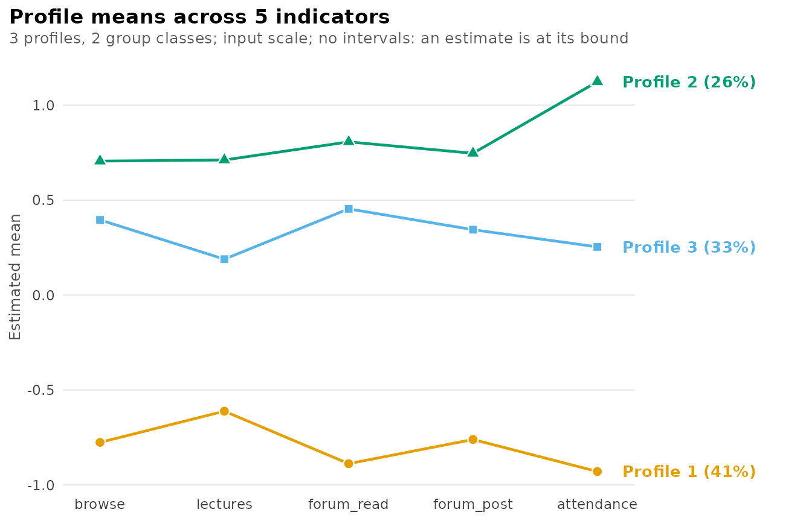
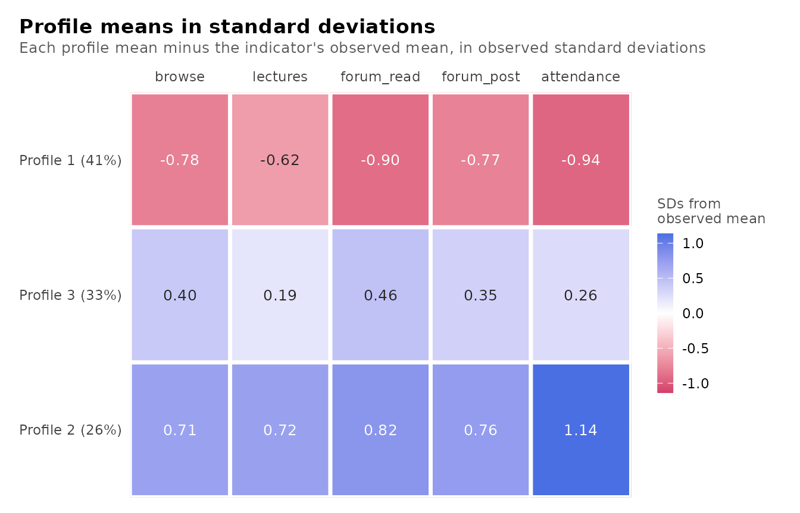
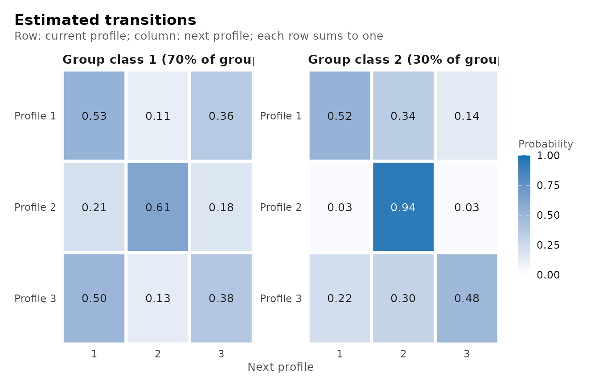
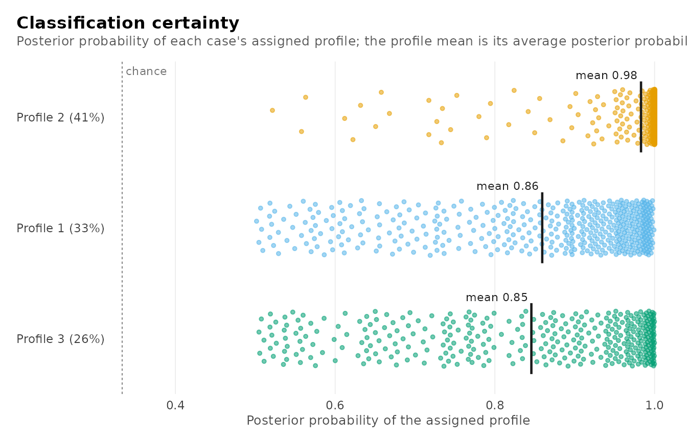
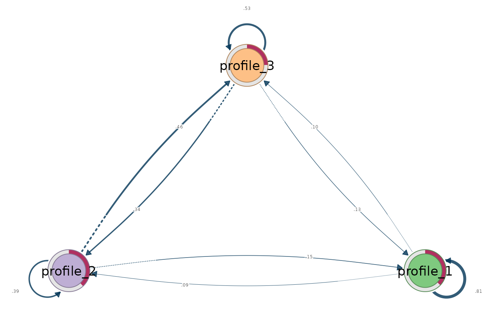
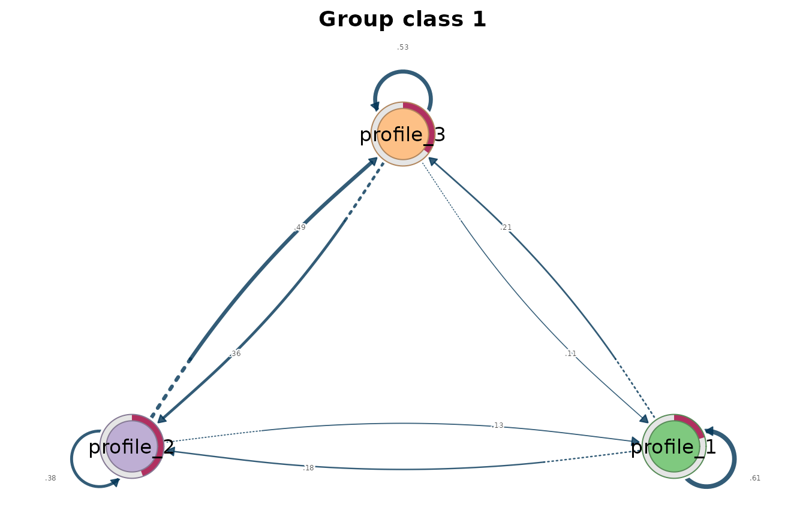
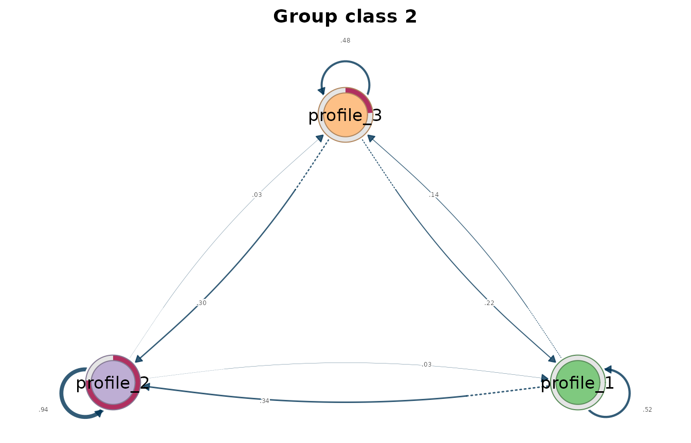

# Latent transition analysis

Latent transition analysis (LTA) estimates latent states at successive
occasions and the probabilities of transitions between them. In the
default model, profiles have a common measurement definition across
occasions. With latent group classes, initial-state probabilities and
transition matrices differ by class, representing heterogeneity in
longitudinal patterns.

## Data

`course_engagement` is simulated and has one row per course enrolment:
1,422 enrolments from 106 students.
[`lta()`](https://pak.dynasite.org/latents/reference/lta.md) needs three
kinds of variables.

- **Group:** `student` identifies whose occasions belong together.
- **Occasion order:** `sequence` is the position of each course in the
  student’s history. Students can have different numbers of occasions.
- **Indicators:** five activity measures (`browse`, `lectures`,
  `forum_read`, `forum_post`, `attendance`), each standardized within
  course, so 0 is the course average.

``` r

library(latents)
```

## Fit

The [`lta()`](https://pak.dynasite.org/latents/reference/lta.md)
function requires indicators (`vars`), a group identifier (`id`), and
occasion order (`time`). The arguments `n_profiles` and
`n_group_classes` specify the latent structure; `n_starts` and `seed`
control repeated estimation from reproducible starting values.

``` r

moves <- lta(course_engagement,
             vars = c("browse", "lectures", "forum_read", "forum_post",
                      "attendance"),
             id = "student", time = "sequence",
             n_profiles = 3, n_group_classes = 2, n_starts = 3, seed = 1)
moves
#> Latent transition model: 3 profiles, 2 group classes
#> 1422 observations in 106 groups, up to 15 occasions (unbalanced, observed grid)
#> Log likelihood: -8242.966906; 47 parameters; BIC (groups): 16705.1155
#> Converged: TRUE after 36 iterations; best of 3 starts
#> Smallest standardized Gaussian eigenvalue: 0.2092 (profiles, profile_1); Gaussian mass: 470.7; weight effective n: 589.7.
#> 
#> Class sizes   profile_1 33.1% (471)   profile_2 40.7% (579)   profile_3 26.2% (372)
#> Group classes group_class_1 30.0% (32)   group_class_2 70.0% (74)
#> 
#> Means
#>   indicator profile_1 profile_2 profile_3
#>      browse     0.396    -0.776     0.706
#>    lectures     0.189    -0.612     0.712
#>  forum_read     0.454    -0.888     0.807
#>  forum_post     0.345    -0.761     0.747
#>  attendance     0.254    -0.929     1.124
#> 
#> Variances and standard errors: get_results(x, "profiles").
#> Every other table: get_results(x, what = ), or get_results(x, "all").
```

The `"starts"` table reports the log likelihood reached by each start.
Replication of the selected likelihood supports numerical stability but
does not establish that the global maximum has been found.

``` r

get_results(moves, "starts")
#>   start log_likelihood converged iterations error
#> 1     1          -8243      TRUE         36  <NA>
#> 2     2          -8243      TRUE         48  <NA>
#> 3     3          -8243      TRUE         64  <NA>
```

## Profiles

The profile plot displays estimated indicator means and the estimated
share of occasions in each profile. For a transition model,
[`plot()`](https://rdrr.io/r/graphics/plot.default.html) without an
explicit view instead displays transition matrices.

``` r

plot_profiles(moves)
```



The profile heatmap expresses each mean in standard deviations from the
indicator’s overall mean, facilitating comparison across indicators.

``` r

plot_profiles(moves, what = "heatmap")
```



## Starting probabilities

The `"initial"` table reports initial profile probabilities
(`probability`), profile prevalence across occasions (`prevalence`), and
estimated group-class proportions (`group_class_probability`).

``` r

get_results(moves, "initial")
#>   group_class profile probability prevalence group_class_probability
#> 1           1       1    1.00e-10     0.0841                     0.3
#> 2           1       2    7.62e-01     0.8193                     0.3
#> 3           1       3    2.38e-01     0.0965                     0.3
#> 4           2       1    3.53e-01     0.4372                     0.7
#> 5           2       2    2.04e-01     0.2297                     0.7
#> 6           2       3    4.44e-01     0.3330                     0.7
```

## Transitions

The `"transitions"` table reports the probability of moving from state
`from` to state `to` at the next occasion. Probabilities sum to one
within each origin state and group class. The column `stable` identifies
transitions that retain the same state; `expected_count` reports the
posterior expected transition count. A row with `estimated = FALSE`
lacks information for estimating that transition distribution.

``` r

get_results(moves, "transitions")
#>    group_class from to probability expected_count stable estimated group_class_probability
#> 1            1    1  1      0.5202          17.54   TRUE      TRUE                     0.3
#> 2            1    1  2      0.3394          11.44  FALSE      TRUE                     0.3
#> 3            1    1  3      0.1405           4.74  FALSE      TRUE                     0.3
#> 4            1    2  1      0.0302           9.75  FALSE      TRUE                     0.3
#> 5            1    2  2      0.9386         303.22   TRUE      TRUE                     0.3
#> 6            1    2  3      0.0313          10.10  FALSE      TRUE                     0.3
#> 7            1    3  1      0.2221           8.71  FALSE      TRUE                     0.3
#> 8            1    3  2      0.2961          11.61  FALSE      TRUE                     0.3
#> 9            1    3  3      0.4818          18.90   TRUE      TRUE                     0.3
#> 10           2    1  1      0.5256         214.24   TRUE      TRUE                     0.7
#> 11           2    1  2      0.1141          46.50  FALSE      TRUE                     0.7
#> 12           2    1  3      0.3603         146.88  FALSE      TRUE                     0.7
#> 13           2    2  1      0.2099          43.69  FALSE      TRUE                     0.7
#> 14           2    2  2      0.6146         127.95   TRUE      TRUE                     0.7
#> 15           2    2  3      0.1756          36.55  FALSE      TRUE                     0.7
#> 16           2    3  1      0.4951         150.59  FALSE      TRUE                     0.7
#> 17           2    3  2      0.1277          38.85  FALSE      TRUE                     0.7
#> 18           2    3  3      0.3772         114.74   TRUE      TRUE                     0.7
```

The transition plot displays one matrix per group class, with current
profiles in rows and next-occasion profiles in columns.

``` r

plot_transitions(moves)
```



## Sequences

The sequence plot displays one row per group, coloured by the most
probable profile at each occasion. These modal assignments summarize the
fitted sequences but omit classification uncertainty.

``` r

plot_sequences(moves)
```


## Classification

The `"entropy"` table reports relative entropy for occasions and groups.
With more than one class, a value of 1 indicates certain posterior
membership; 0 indicates equal posterior probabilities across classes for
every case. Entropy summarizes classification separation under the
fitted model.

``` r

get_results(moves, "entropy")
#>         level n_classes n_units entropy_sum relative_entropy
#> 1 individuals         3    1422       309.4            0.802
#> 2      groups         2     106        16.3            0.778
```

Diagnostic plots display per-case uncertainty within each profile
(`what = "entropy"`) and posterior probabilities of assigned profiles
(`what = "posteriors"`).

``` r

plot_diagnostics(moves, what = "entropy")
```


``` r

plot_diagnostics(moves, what = "posteriors")
```



## Transition networks

The estimated transitions can be represented as networks.
[`get_tna()`](https://pak.dynasite.org/latents/reference/get_tna.md)
returns a network pooled across group classes;
[`get_group_tna()`](https://pak.dynasite.org/latents/reference/get_group_tna.md)
returns one network per class. Both functions produce
[tna](https://cran.r-project.org/package=tna) objects that can be
displayed with [`plot()`](https://rdrr.io/r/graphics/plot.default.html).

``` r

plot(get_tna(moves))
```



``` r

plot(get_group_tna(moves))
```



## Beyond homogeneous transitions

Several extensions permit alternative specifications of temporal
dependence and measurement:

- `transition_covariates` lets covariates shift the transition
  probabilities: the log odds of moving to each other profile rather
  than staying. A covariate may change over occasions.
- `initial_covariates` lets covariates shift the starting profile.
- `transitions = "occasion"` estimates a separate transition matrix for
  each move.
- `measurement = "occasion"` lets the profiles’ means and variances
  differ by occasion.
- `order = 2` makes the next profile depend on the two previous ones.
- `mover_stayer = TRUE` adds a class of groups that never change
  profile.

`enumerate_classes(..., time = "sequence")` compares numbers of profiles
and group classes, and
[`bootstrap_lrt()`](https://pak.dynasite.org/latents/reference/bootstrap_lrt.md)
tests a model against a nested one.

The following example examines whether `previous_grade`, which varies
across courses, is associated with transition probabilities:

``` r

activity <- c("browse", "lectures", "forum_read", "forum_post", "attendance")
homogeneous <- lta(course_engagement, activity, "student", n_profiles = 2,
                   time = "sequence", seed = 1)
grade <- lta(course_engagement, activity, "student", n_profiles = 2,
             time = "sequence", transition_covariates = "previous_grade",
             seed = 1)
get_results(grade, "transition_coefficients")
#>     group_class      from        to           term estimate standard_error statistic  p_value
#> 1 group_class_1 profile_1 profile_2    (Intercept)  -1.8398          0.118   -15.566 1.25e-54
#> 2 group_class_1 profile_1 profile_2 previous_grade   0.0338          0.121     0.280 7.79e-01
#> 3 group_class_1 profile_2 profile_1    (Intercept)  -1.4632          0.130   -11.256 2.17e-29
#> 4 group_class_1 profile_2 profile_1 previous_grade   0.0438          0.130     0.337 7.36e-01
#>   conf_low conf_high odds_ratio estimated
#> 1   -2.071    -1.608      0.159      TRUE
#> 2   -0.203     0.270      1.034      TRUE
#> 3   -1.718    -1.208      0.231      TRUE
#> 4   -0.211     0.298      1.045      TRUE
```

The estimated odds ratios are close to one, and the confidence intervals
for the log-odds coefficients include zero. These results provide
limited evidence of an association between previous grade and
transitions in this example; they do not establish the absence of an
association. A second-order model, in which the next profile depends on
the two previous states, can also be compared with the first-order
specification using BIC:

``` r

second <- lta(course_engagement, activity, "student", n_profiles = 2,
              time = "sequence", order = 2, seed = 1)
BIC(homogeneous, grade, second)
#>             df   BIC
#> homogeneous 23 16778
#> grade       25 16787
#> second      27 16786
```

For these data, BIC is lower for the homogeneous first-order model than
for either extension. Extended models provide transition and
initial-state logit coefficients, with Wald standard errors when
supported by the fitted model, and occasion-specific probability
summaries.

## Assumptions

- By default the next profile depends only on the current profile and
  the group class, and transition probabilities are the same at every
  occasion; the arguments above relax each of these.
- Profiles have the same definition at every occasion unless
  `measurement = "occasion"`.
- Indicators are independent within a profile (the default diagonal
  covariance; `covariance_model = "full"` or a non-diagonal `model`
  relaxes it).
