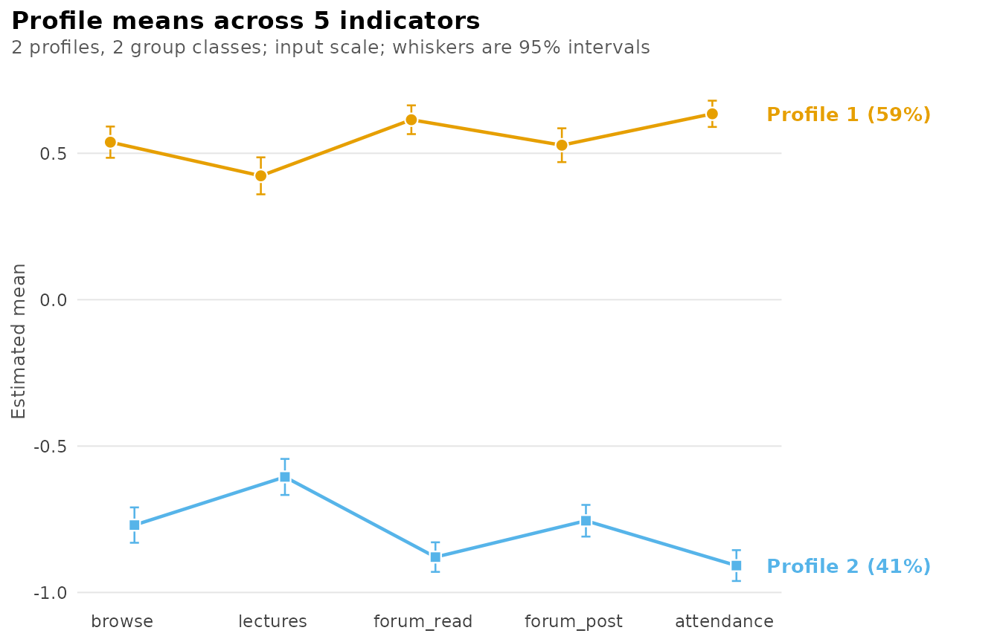
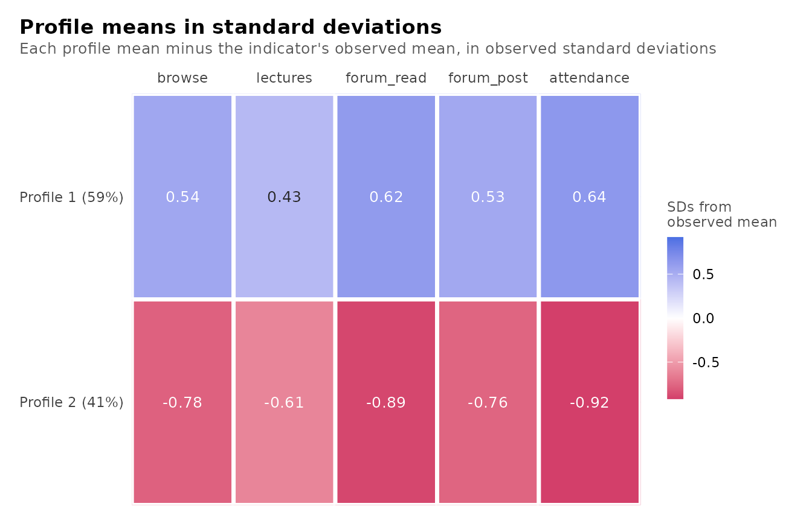
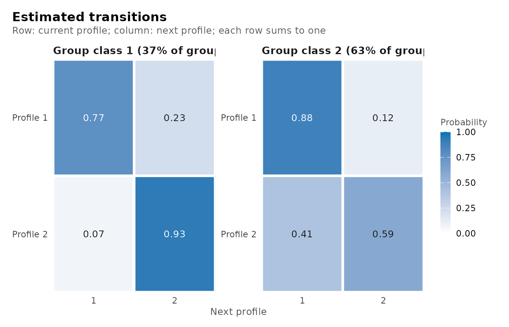
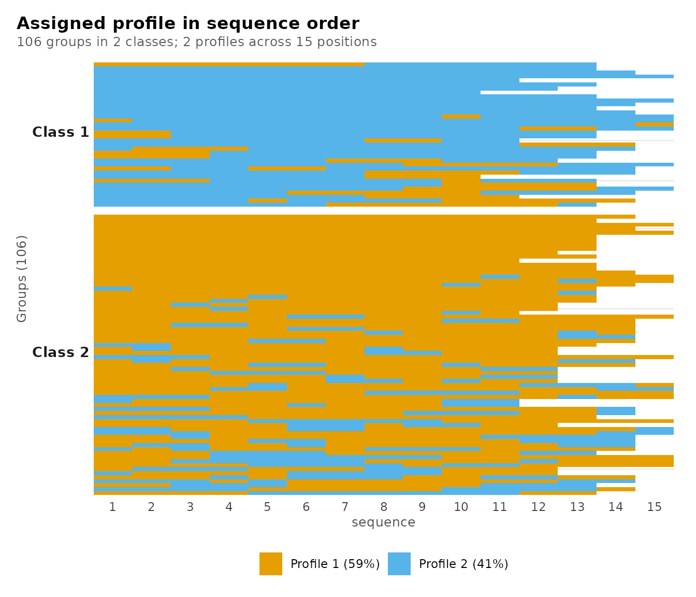
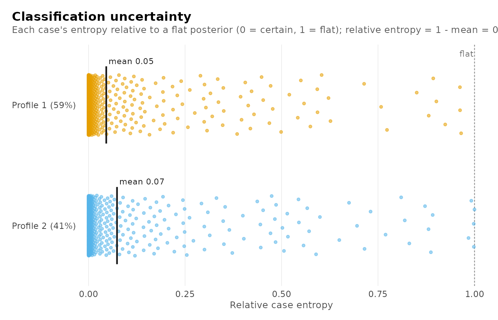
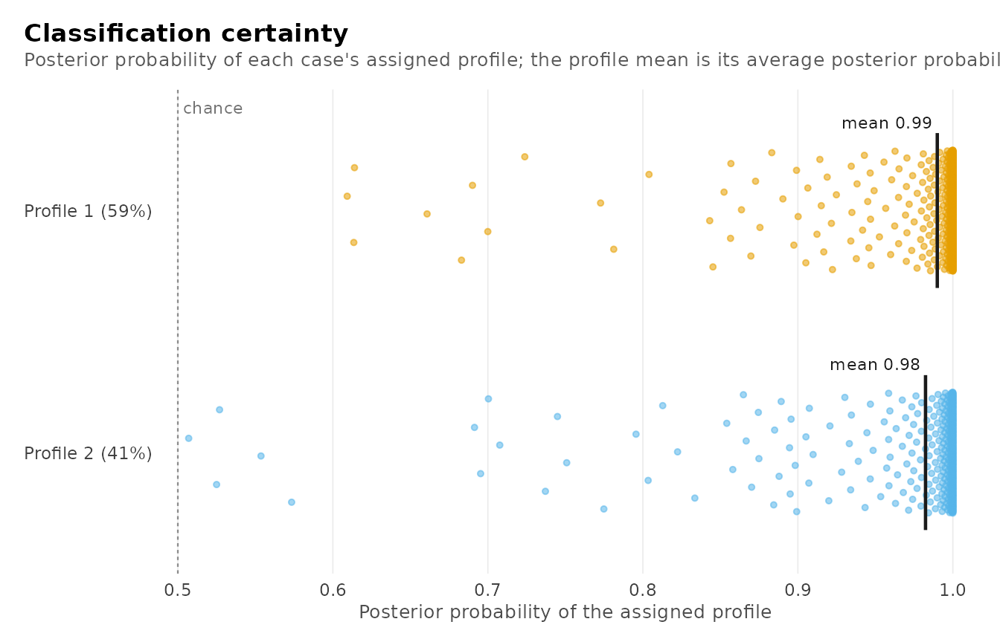
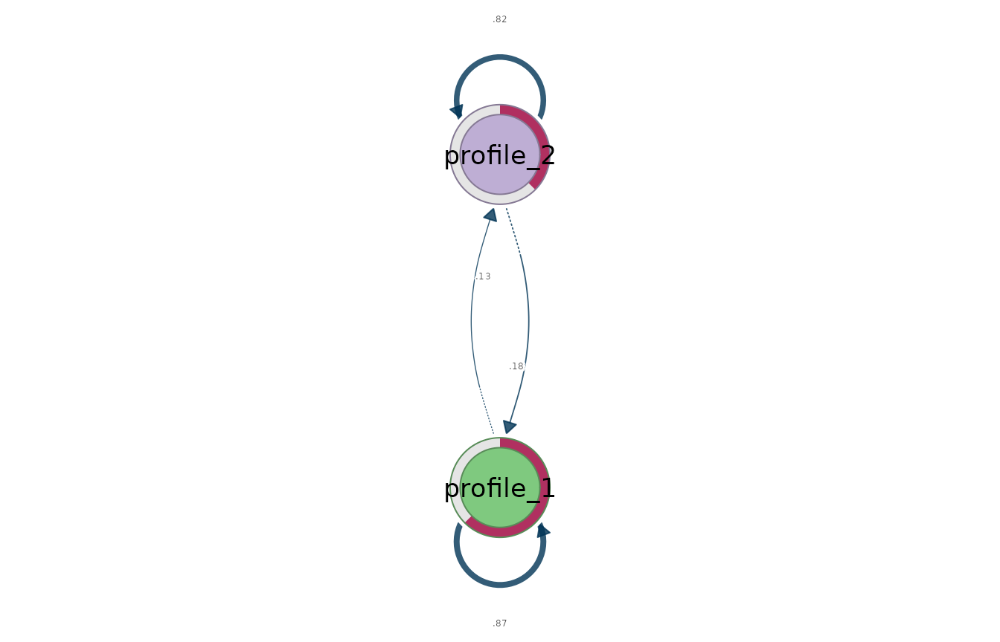
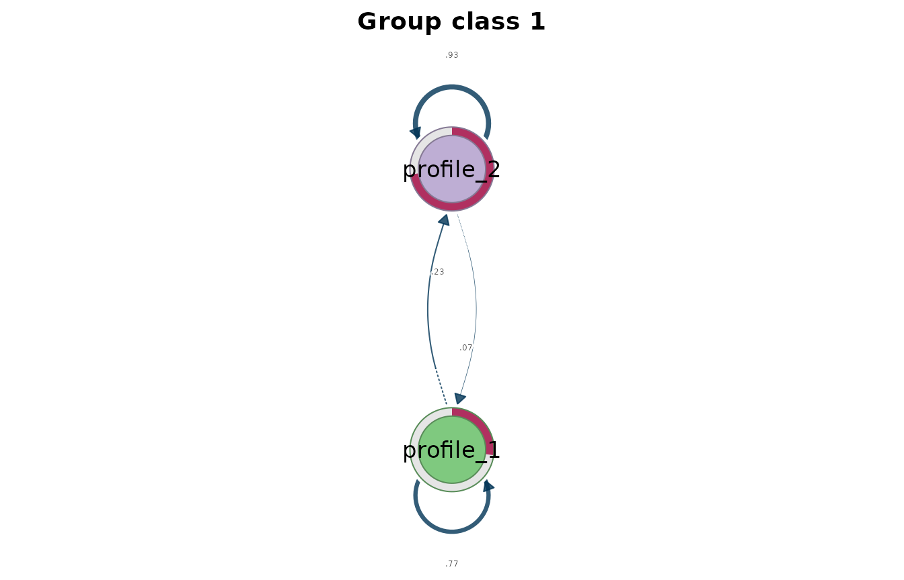
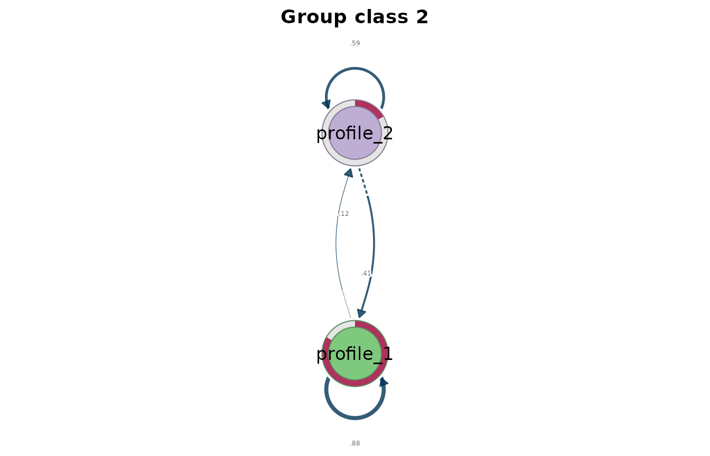

# Latent transition analysis

Latent transition analysis (LTA) models change in latent states over
repeated occasions (Collins & Lanza, 2010). At every occasion, each unit
belongs to one of a small number of unobserved states, defined, as in
latent class or profile analysis, by their distributions on the observed
indicators. Change is the movement of units between these states from
one occasion to the next. LTA estimates the states, how units are
distributed over them at the start, and how likely each move is.

## What latent transition analysis is

**States are latent.** The indicators measure the state of a unit at an
occasion with error. Classifying each occasion separately, for instance
with one latent profile analysis per occasion, and cross-tabulating the
assignments treats every misclassification as a change of state and
overstates instability. LTA estimates the states and the transitions in
one model, so the transition probabilities are corrected for
classification error under the model’s assumptions (Collins & Lanza,
2010).

**The model has three parts.** With $`S_{jt}`$ the state of unit $`j`$
at occasion $`t`$ and $`Y_{jt}`$ its indicators,

- the measurement model $`P(Y_{jt} \mid S_{jt} = k)`$ defines each
  state: means and variances for continuous indicators, response
  probabilities for categorical ones;
- the initial probabilities $`\delta_k = P(S_{j1} = k)`$ give the
  distribution of the states at the first occasion;
- the transition probabilities
  $`\tau_{kl} = P(S_{jt} = l \mid S_{j,t-1} = k)`$ give the probability
  of moving from state $`k`$ to state $`l`$; each row of the transition
  matrix sums to one, the diagonal holds the probabilities of staying,
  and the off-diagonal cells the direction of change.

**Default assumptions make the transitions interpretable.** The
measurement model is the same at every occasion (measurement
invariance), so a state means the same thing throughout and a transition
is a change of state rather than a change of the states’ definitions.
The next state depends only on the current one (the first-order Markov
property), and the transition probabilities are the same at every move
(homogeneity). Each of these can be relaxed, as the last section shows.

**LTA is a hidden Markov model.** The states form a Markov chain that is
not observed directly; only the indicators are. In the terminology of
hidden Markov models (Rabiner, 1989), the measurement model gives the
emission distributions.
[`lta()`](https://pak.dynasite.org/latents/reference/lta.md) estimates
the model by maximum likelihood with the EM algorithm, computing the
posterior probabilities of the states with the forward-backward
recursions.

**Group classes add heterogeneity in change.** A single transition
matrix assumes that all units change in the same way. With latent group
classes, each class has its own initial and transition probabilities
over the same states, a mixed Markov model (van de Pol & Langeheine,
1990). The classes are types of dynamics: for example, units that leave
an unfavourable state quickly and units that remain in it. The
mover-stayer model (Goodman, 1961) is the special case with one class of
units that never change state.

**The output describes change:** the prevalence of each state over time,
the stability of each state (the diagonal of the transition matrix), the
most likely moves out of each state, the differences in dynamics between
group classes and, with covariates, the predictors of the initial state
and of each transition.

## Data

`course_engagement` is simulated and has one row per course enrolment:
1,422 enrolments from 106 students. The simulation is calibrated to the
engagement data of students followed through a full study programme
(Saqr & López-Pernas, 2021; Saqr et al., 2023): its scales, spread,
correlations and the persistence of engagement across courses follow
those data, while no value of the source is retained.
[`lta()`](https://pak.dynasite.org/latents/reference/lta.md) needs three
kinds of variables.

- **Group:** `student` identifies whose occasions belong together.
- **Occasion order:** `sequence` is the position of each course in the
  student’s history. Students can have different numbers of occasions
  (10 to 15 here).
- **Indicators:** five activity measures (`browse`, `lectures`,
  `forum_read`, `forum_post`, `attendance`), each standardized within
  course, so 0 is the course average.

The data were generated from two engagement profiles and two kinds of
students, committed and wavering, whose stationary probabilities of an
engaged enrolment are about 0.8 and 0.25; engagement changes along each
student’s sequence
([`?course_engagement`](https://pak.dynasite.org/latents/reference/course_engagement.md)).
`attendance` is generated from the four click measures, so the
indicators are correlated within profiles.

``` r

library(latents)
vars <- c("browse", "lectures", "forum_read", "forum_post", "attendance")
```

## Numbers of profiles and group classes

[`enumerate_classes()`](https://pak.dynasite.org/latents/reference/enumerate_classes.md)
with `time` compares transition models. Because attendance depends on
the other indicators, the candidates estimate full within-profile
covariances (`covariance_model = "full"`); with a diagonal structure, an
additional profile absorbs that dependence (see the [multilevel latent
profile analysis](https://pak.dynasite.org/latents/articles/lpa.html)
vignette).

``` r

grid <- enumerate_classes(course_engagement, vars = vars, id = "student",
                          time = "sequence", covariance_model = "full",
                          n_profiles = 2:3, n_group_classes = 1:3,
                          n_starts = 5, seed = 1)
#> 3 of 6 candidates reached their best log likelihood from one start only (profiles3_groups1, profiles3_groups2, profiles3_groups3); refit those you consider with more starts.
grid
#> Transition-model enumeration: 6 candidates (LTA)
#>          candidate n_profiles n_group_classes model log_likelihood n_parameters   bic   aic entropy
#>  profiles2_groups1          2               1  <NA>          -8206           43 16613 16499  0.9434
#>  profiles3_groups1          3               1  <NA>          -8172           68 16662 16481  0.9462
#>  profiles2_groups2          2               2  <NA>          -8188           47 16596 16471  0.9427
#>  profiles3_groups2          3               2  <NA>          -8159           77 16677 16472  0.8487
#>  profiles2_groups3          2               3  <NA>          -8187           51 16612 16476  0.9429
#>  profiles3_groups3          3               3  <NA>          -8151           86 16702 16473  0.9039
#>  converged boundary
#>       TRUE    FALSE
#>       TRUE     TRUE
#>       TRUE    FALSE
#>       TRUE     TRUE
#>       TRUE     TRUE
#>       TRUE     TRUE
#> Pick one by its name: get_candidate(x, "<candidate>").
get_best(grid)
#>           candidate n_profiles n_group_classes model log_likelihood n_parameters   aic   bic
#> 3 profiles2_groups2          2               2  <NA>          -8188           47 16471 16596
#>   bic_individual entropy converged boundary n_best_replicated warnings error
#> 3          16718   0.943      TRUE    FALSE                 5           <NA>
```

The BIC (Schwarz, 1978) selects two profiles and two group classes. That
candidate has no estimate on a boundary and reaches its best log
likelihood from every start; all candidates with three profiles have
boundary estimates and reach their best solutions from a single start. A
multilevel latent profile analysis of the same data favours additional
group classes, which absorb the serial dependence that it does not
model; LTA models that dependence and selects the generating structure.

## Fit

The [`lta()`](https://pak.dynasite.org/latents/reference/lta.md)
function requires indicators (`vars`), a group identifier (`id`), and
occasion order (`time`). The arguments `n_profiles` and
`n_group_classes` specify the latent structure; `n_starts` and `seed`
control repeated estimation from reproducible starting values.

``` r

moves <- lta(course_engagement, vars = vars, id = "student",
             time = "sequence", covariance_model = "full",
             n_profiles = 2, n_group_classes = 2, n_starts = 10, seed = 1)
moves
#> Latent transition model: 2 profiles, 2 group classes
#> 1422 observations in 106 groups, up to 15 occasions (unbalanced, observed grid)
#> Log likelihood: -8188.367007; 47 parameters; BIC (groups): 16595.9157
#> Converged: TRUE after 18 iterations; best of 10 starts
#> Smallest standardized Gaussian eigenvalue: 0.27 (profiles, profile_2); Gaussian mass: 585; weight effective n: 600.5.
#> 
#> Class sizes   profile_1 58.9% (837)   profile_2 41.1% (585)
#> Group classes group_class_1 37.0% (39)   group_class_2 63.0% (67)
#> 
#> Means
#>   indicator profile_1 profile_2
#>      browse     0.538    -0.770
#>    lectures     0.423    -0.605
#>  forum_read     0.615    -0.879
#>  forum_post     0.528    -0.755
#>  attendance     0.635    -0.908
#> 
#> Variances and standard errors: get_results(x, "profiles").
#> Every other table: get_results(x, what = ), or get_results(x, "all").
```

Profile 1 (58.9% of the enrolments) lies 0.42 to 0.64 standard
deviations above the course mean on all indicators and profile 2 (41.1%)
0.61 to 0.91 below it: engaged and disengaged enrolments.

The `"starts"` table reports the log likelihood reached by each start.
Replication of the selected likelihood supports numerical stability but
does not establish that the global maximum has been found.

``` r

get_results(moves, "starts")
#>    start log_likelihood converged iterations error
#> 1      1          -8188      TRUE         18  <NA>
#> 2      2          -8188      TRUE         21  <NA>
#> 3      3          -8188      TRUE         21  <NA>
#> 4      4          -8188      TRUE         24  <NA>
#> 5      5          -8188      TRUE         21  <NA>
#> 6      6          -8188      TRUE         24  <NA>
#> 7      7          -8188      TRUE         24  <NA>
#> 8      8          -8188      TRUE         21  <NA>
#> 9      9          -8188      TRUE         18  <NA>
#> 10    10          -8188      TRUE         21  <NA>
```

All ten starts reach the log likelihood of -8188.

## Profiles

The profile plot displays estimated indicator means and the estimated
share of occasions in each profile. For a transition model,
[`plot()`](https://rdrr.io/r/graphics/plot.default.html) without an
explicit view instead displays transition matrices.

``` r

plot_profiles(moves)
```



The profile heatmap expresses each mean in standard deviations from the
indicator’s overall mean, facilitating comparison across indicators.

``` r

plot_profiles(moves, what = "heatmap")
```



## Starting probabilities

The `"initial"` table reports initial profile probabilities
(`probability`), profile prevalence across occasions (`prevalence`), and
estimated group-class proportions (`group_class_probability`).

``` r

get_results(moves, "initial")
#>   group_class profile probability prevalence group_class_probability
#> 1           1       1       0.271      0.246                    0.37
#> 2           1       2       0.729      0.754                    0.37
#> 3           2       1       0.833      0.789                    0.63
#> 4           2       2       0.167      0.211                    0.63
```

Group class 2 (63% of the students) starts engaged with probability
0.833 and is engaged at 78.9% of its occasions; group class 1 (37%)
starts engaged with probability 0.271 and is engaged at 24.6% of its
occasions. These prevalences match the stationary probabilities of the
committed and wavering students in the simulation, about 0.8 and 0.25.

## Transitions

The `"transitions"` table reports the probability of moving from state
`from` to state `to` at the next occasion. Probabilities sum to one
within each origin state and group class. The column `stable` identifies
transitions that retain the same state; `expected_count` reports the
posterior expected transition count. A row with `estimated = FALSE`
lacks information for estimating that transition distribution.

``` r

get_results(moves, "transitions")
#>   group_class from to probability expected_count origin_expected_count supported stable estimated
#> 1           1    1  1      0.7742           93.6                   121      TRUE   TRUE      TRUE
#> 2           1    1  2      0.2258           27.3                   121      TRUE  FALSE      TRUE
#> 3           1    2  1      0.0679           24.7                   364      TRUE  FALSE      TRUE
#> 4           1    2  2      0.9321          339.6                   364      TRUE   TRUE      TRUE
#> 5           2    1  1      0.8842          582.0                   658      TRUE   TRUE      TRUE
#> 6           2    1  2      0.1158           76.2                   658      TRUE  FALSE      TRUE
#> 7           2    2  1      0.4076           70.3                   173      TRUE  FALSE      TRUE
#> 8           2    2  2      0.5924          102.2                   173      TRUE   TRUE      TRUE
#>   group_class_probability
#> 1                    0.37
#> 2                    0.37
#> 3                    0.37
#> 4                    0.37
#> 5                    0.63
#> 6                    0.63
#> 7                    0.63
#> 8                    0.63
```

The group classes differ mainly in recovery from disengagement. A
committed student (group class 2) who is disengaged in one course is
engaged in the next with probability 0.408; a wavering student (group
class 1) with probability 0.068, remaining disengaged with probability
0.932. Engagement is stable in both classes (0.884 and 0.774). Every
transition rests on enough expected moves to be estimated (`supported`
and `estimated` are `TRUE`).

The transition plot displays one matrix per group class, with current
profiles in rows and next-occasion profiles in columns.

``` r

plot_transitions(moves)
```



## Sequences

The sequence plot displays one row per group, coloured by the most
probable profile at each occasion, as the sequence index plots of
sequence analysis do (Saqr et al., 2024). These modal assignments
summarize the fitted sequences but omit classification uncertainty.

``` r

plot_sequences(moves)
```



## Classification

The `"entropy"` table reports relative entropy for occasions and groups
(Ramaswamy et al., 1993). With more than one class, a value of 1
indicates certain posterior membership; 0 indicates equal posterior
probabilities across classes for every case. Entropy summarizes
classification separation under the fitted model.

``` r

get_results(moves, "entropy")
#>         level n_classes n_units entropy_sum relative_entropy
#> 1 individuals         2    1422        56.5            0.943
#> 2      groups         2     106        25.4            0.654
```

Occasions are classified clearly (0.943), students much less so (0.654).
Under the transition model a student’s class rests on the dynamics of a
sequence of 10 to 15 states, and a wavering student who happens to stay
engaged for several courses resembles a committed one. The
cross-tabulation with the generating labels shows the consequence.

``` r

get_results(moves, "assignments", data = course_engagement,
            truth = c("engagement", "student_type"))
#>    assignment class        truth      value   n proportion
#> 1     profile     1   engagement disengaged  10     0.0171
#> 2     profile     2   engagement disengaged 575     0.9829
#> 3     profile     1   engagement    engaged 825     0.9857
#> 4     profile     2   engagement    engaged  12     0.0143
#> 5 group_class     1 student_type  committed   1     0.0161
#> 6 group_class     2 student_type  committed  61     0.9839
#> 7 group_class     1 student_type   wavering  35     0.7955
#> 8 group_class     2 student_type   wavering   9     0.2045
```

The profiles recover 825 of the 837 engaged and 575 of the 585
disengaged enrolments (98.6% and 98.3%). Group class 2 contains 61 of
the 62 committed students and 9 of the 44 wavering ones. Diagnostic
plots display per-case uncertainty within each profile
(`what = "entropy"`) and posterior probabilities of assigned profiles
(`what = "posteriors"`).

``` r

plot_diagnostics(moves, what = "entropy")
```



``` r

plot_diagnostics(moves, what = "posteriors")
```



## Transition networks

The estimated transitions can be represented as networks.
[`get_tna()`](https://pak.dynasite.org/latents/reference/get_tna.md)
returns a network pooled across group classes;
[`get_group_tna()`](https://pak.dynasite.org/latents/reference/get_group_tna.md)
returns one network per class. Both functions produce
[tna](https://cran.r-project.org/package=tna) objects (Tikka et al.,
2025) that can be displayed with
[`plot()`](https://rdrr.io/r/graphics/plot.default.html) and analysed
further with tna or with
[Nestimate](https://cran.r-project.org/package=Nestimate) (Saqr et al.,
2026), which accepts `tna` and `group_tna` objects.

``` r

plot(get_tna(moves))
```



``` r

plot(get_group_tna(moves))
```



## Beyond homogeneous transitions

Several extensions permit alternative specifications of temporal
dependence and measurement:

- `transition_covariates` lets covariates shift the transition
  probabilities: the log odds of moving to each other profile rather
  than staying. A covariate may change over occasions.
- `initial_covariates` lets covariates shift the starting profile.
- `transitions = "occasion"` estimates a separate transition matrix for
  each move.
- `measurement = "occasion"` lets the profiles’ means and variances
  differ by occasion.
- `order = 2` makes the next profile depend on the two previous ones.
- `mover_stayer = TRUE` adds a class of groups that never change profile
  (Goodman, 1961).

`enumerate_classes(..., time = "sequence")` compares numbers of profiles
and group classes, and
[`bootstrap_lrt()`](https://pak.dynasite.org/latents/reference/bootstrap_lrt.md)
tests a model against a nested one.

The following example examines whether `previous_grade`, which varies
across courses, is associated with transition probabilities:

``` r

grade <- lta(course_engagement, vars = vars, id = "student",
             time = "sequence", covariance_model = "full", n_profiles = 2,
             n_group_classes = 2, transition_covariates = "previous_grade",
             n_starts = 10, seed = 1)
get_results(grade, "transition_coefficients")
#>     group_class      from        to           term estimate standard_error statistic  p_value
#> 1 group_class_1 profile_1 profile_2    (Intercept)   -1.050          0.425    -2.471 1.35e-02
#> 2 group_class_1 profile_1 profile_2 previous_grade   -0.348          0.398    -0.876 3.81e-01
#> 3 group_class_1 profile_2 profile_1    (Intercept)   -2.756          0.453    -6.085 1.17e-09
#> 4 group_class_1 profile_2 profile_1 previous_grade   -0.211          0.340    -0.619 5.36e-01
#> 5 group_class_2 profile_1 profile_2    (Intercept)   -2.119          0.162   -13.047 6.64e-39
#> 6 group_class_2 profile_1 profile_2 previous_grade    0.206          0.162     1.276 2.02e-01
#> 7 group_class_2 profile_2 profile_1    (Intercept)   -0.297          0.282    -1.051 2.93e-01
#> 8 group_class_2 profile_2 profile_1 previous_grade    0.266          0.211     1.262 2.07e-01
#>   conf_low conf_high odds_ratio estimated
#> 1   -1.883    -0.217     0.3499      TRUE
#> 2   -1.128     0.432     0.7058      TRUE
#> 3   -3.643    -1.868     0.0636      TRUE
#> 4   -0.878     0.457     0.8100      TRUE
#> 5   -2.437    -1.801     0.1202      TRUE
#> 6   -0.111     0.523     1.2292      TRUE
#> 7   -0.849     0.256     0.7434      TRUE
#> 8   -0.147     0.680     1.3049      TRUE
```

The odds ratios of `previous_grade` are between 0.71 and 1.30, and every
95% interval of its log-odds coefficients includes zero. These results
provide limited evidence of an association between previous grade and
transitions in this example; they do not establish the absence of an
association. A second-order model, in which the next profile depends on
the two previous states, and a mover-stayer model can also be compared
with the first-order specification using BIC:

``` r

second <- lta(course_engagement, vars = vars, id = "student",
              time = "sequence", covariance_model = "full", n_profiles = 2,
              n_group_classes = 2, order = 2, n_starts = 10, seed = 1)
stayer <- lta(course_engagement, vars = vars, id = "student",
              time = "sequence", covariance_model = "full", n_profiles = 2,
              mover_stayer = TRUE, n_starts = 10, seed = 1)
BIC(moves, grade, second, stayer)
#>        df   BIC
#> moves  47 16596
#> grade  51 16611
#> second 55 16628
#> stayer 45 16606
```

For these data, BIC is lower for the first-order model with two group
classes than for any extension: the grade covariate (BIC higher by 15),
the second-order dependence (by 32) and the mover-stayer model with one
class of movers (by 10). Extended models provide transition and
initial-state logit coefficients, with Wald standard errors when
supported by the fitted model, and occasion-specific probability
summaries.

## Assumptions

- By default the next profile depends only on the current profile and
  the group class, and transition probabilities are the same at every
  occasion; the arguments above relax each of these.
- Profiles have the same definition at every occasion unless
  `measurement = "occasion"`.
- Indicators are independent within a profile under the default diagonal
  covariance; `covariance_model = "full"` or a non-diagonal `model`
  relaxes it, as here.

## References

Collins, L. M., & Lanza, S. T. (2010). *Latent class and latent
transition analysis*. Wiley.

Goodman, L. A. (1961). Statistical methods for the mover-stayer model.
*Journal of the American Statistical Association*, 56, 841–868.

Rabiner, L. R. (1989). A tutorial on hidden Markov models and selected
applications in speech recognition. *Proceedings of the IEEE*, 77(2),
257–286.

Ramaswamy, V., DeSarbo, W. S., Reibstein, D. J., & Robinson, W. T.
(1993). An empirical pooling approach for estimating marketing mix
elasticities with PIMS data. *Marketing Science*, 12, 103–124.

Saqr, M., & López-Pernas, S. (2021). The longitudinal trajectories of
online engagement over a full program. *Computers & Education*, 175,
104325. <https://doi.org/10.1016/j.compedu.2021.104325>

Saqr, M., López-Pernas, S., Helske, S., Durand, M., Murphy, K., Studer,
M., & Ritschard, G. (2024). Sequence analysis in education: Principles,
technique, and tutorial with R. In M. Saqr & S. López-Pernas (Eds.),
*Learning analytics methods and tutorials: A practical guide using R*
(pp. 321–354). Springer. <https://doi.org/10.1007/978-3-031-54464-4_10>

Saqr, M., López-Pernas, S., Helske, S., & Hrastinski, S. (2023). The
longitudinal association between engagement and achievement varies by
time, students’ profiles, and achievement state: A full program study.
*Computers & Education*, 199, 104787.
<https://doi.org/10.1016/j.compedu.2023.104787>

Saqr, M., López-Pernas, S., & Misiejuk, K. (2026). Nestimate: An R
package for dynamic, probabilistic, and high order network analysis.
*Applied Psychological Measurement*.
<https://doi.org/10.1177/01466216261472019>

Schwarz, G. (1978). Estimating the dimension of a model. *The Annals of
Statistics*, 6, 461–464.

Tikka, S., López-Pernas, S., & Saqr, M. (2025). tna: An R package for
transition network analysis. *Applied Psychological Measurement, 49*(6),
326–328. <https://doi.org/10.1177/01466216251348840>

van de Pol, F., & Langeheine, R. (1990). Mixed Markov latent class
models. *Sociological Methodology*, 20, 213–247.
