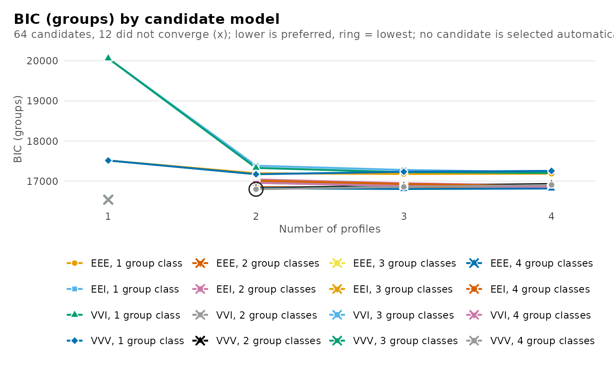
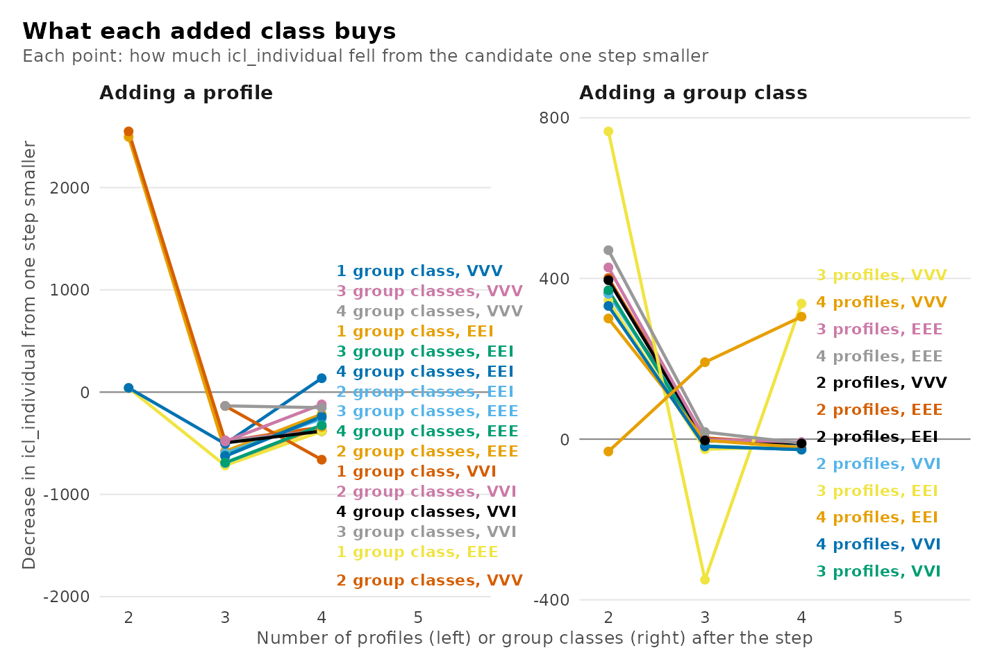
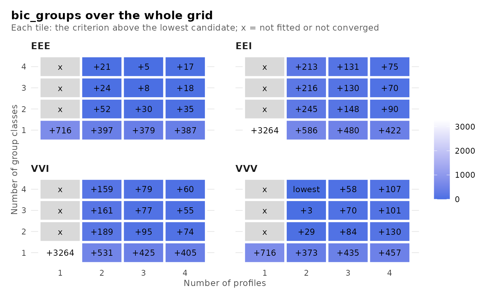
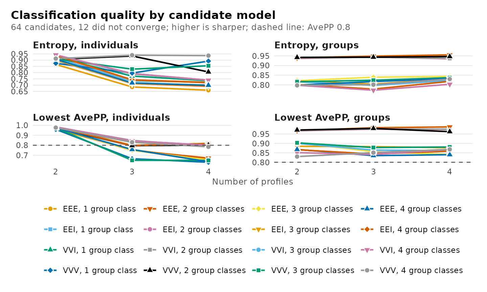
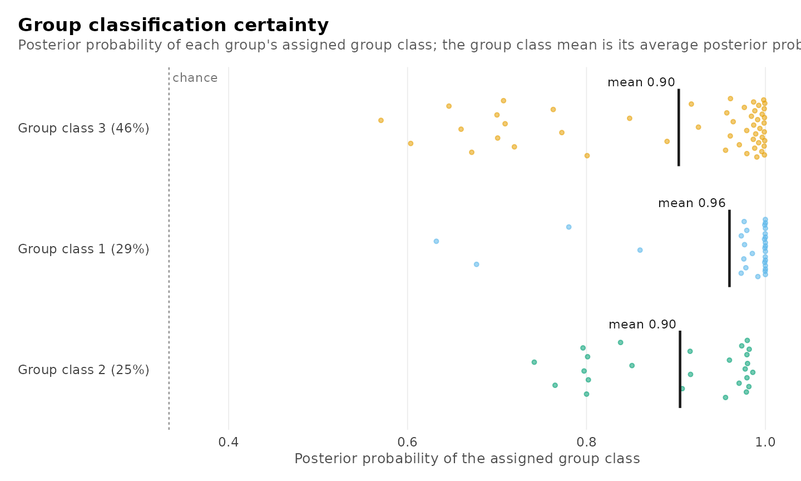
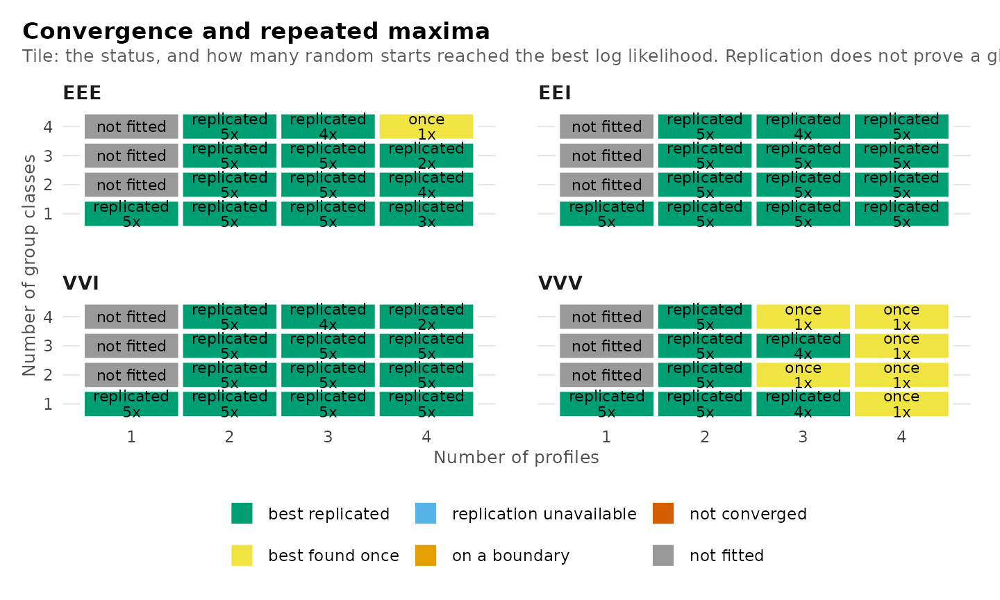
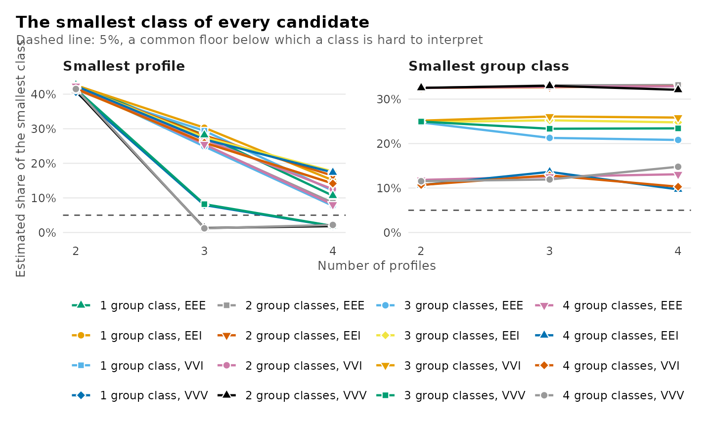
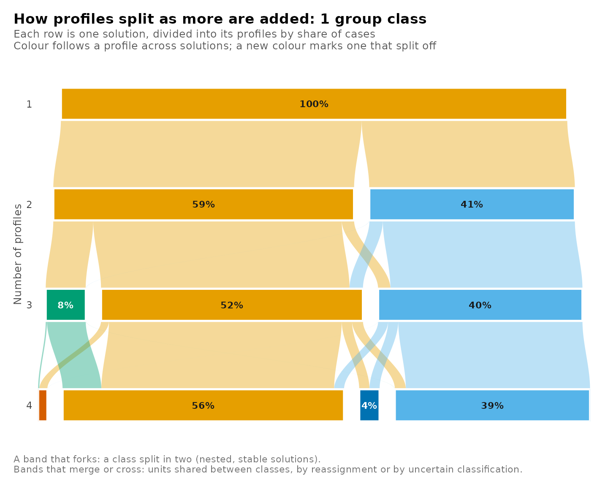
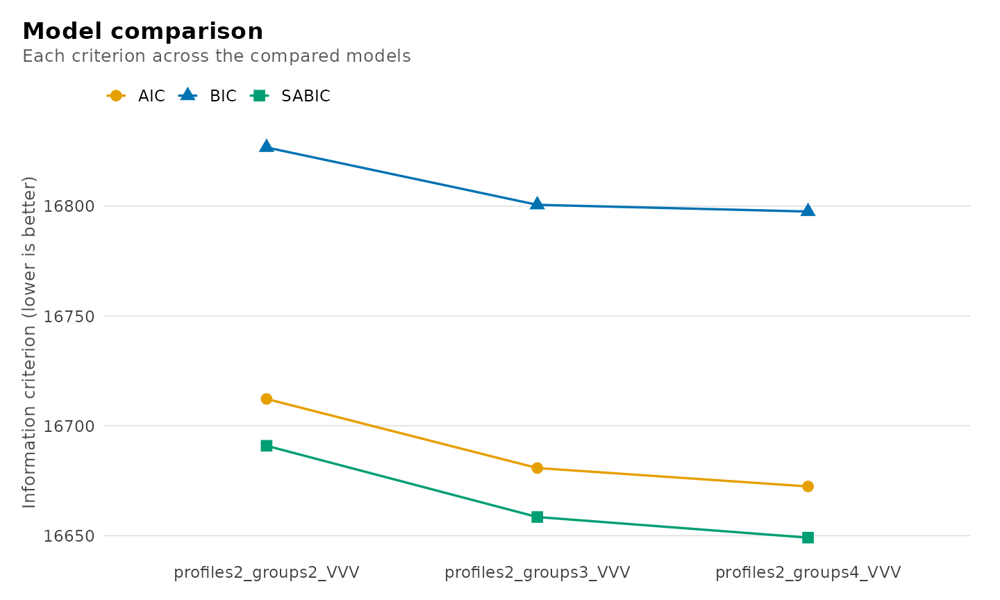

# Selecting the number of classes in mixture models with the latents R package

In finite mixture modelling, the number of latent classes is not known a
priori and is not a parameter of the model; it must be determined by
comparing models fitted with different numbers of classes. No single
statistic identifies the correct number: information criteria,
likelihood-based tests and indices of classification quality each have
known limitations, and they frequently disagree (Nylund et al., 2007).
Class enumeration is therefore an inferential judgement that integrates
several sources of evidence and is reported transparently. This guide
describes each source of evidence that latents computes for a set of
candidate models: its definition, its interpretation, and the conditions
under which it is unreliable. It then outlines how these sources are
combined into a defensible and reproducible decision. A complete applied
example is given in [Class
enumeration](https://pak.dynasite.org/latents/articles/enumeration.md).

Latent profile and latent class analysis are person-centred methods.
Rather than describing the average relationship among variables across
the whole sample, they identify subgroups of individuals who share a
pattern of responses, and thereby capture heterogeneity that
variable-centred methods average away (Saqr et al., 2024). Model-based
clustering with finite Gaussian mixtures provides the statistical
framework for latent profile analysis, and Scrucca et al. (2024)
introduce its estimation, its covariance structures and the selection of
the number of profiles in R. Because the subgroups are defined by the
model rather than observed, their number has to be decided from the
data, which is the subject of this guide.

The evidence considered here addresses five distinct questions,
summarized below together with the functions that report it.

| Question | Evidence | Functions |
|----|----|----|
| Which candidate balances fit and size best? | Information criteria and their minima | [`as.data.frame()`](https://rdrr.io/r/base/as.data.frame.html), `get_results(x, "best")`, `plot_enumeration(x)` |
| Where do added classes stop paying off? | Changes between neighbouring candidates and the knee of each curve | `get_results(x, "deltas")`, `get_results(x, "knees")`, `plot_selection(x, what = "deltas")`, `plot_selection(x, what = "heatmap")` |
| Are the classes distinct? | Entropy, average posterior probability, odds of correct classification | `get_results(x, "classification")`, `plot_selection(x, what = "diagnostics")` |
| Can the estimate be trusted? | Convergence, boundary estimates, replication of the best likelihood, the smallest class | `plot_selection(x, what = "trust")`, `plot_selection(x, what = "smallest")` |
| Is one more class supported? | The bootstrap likelihood ratio test of neighbouring candidates | [`bootstrap_lrt()`](https://pak.dynasite.org/latents/reference/bootstrap_lrt.md) |

`plot_selection(x)` displays the evidence of the second, third and
fourth rows jointly, and
[`compare_models()`](https://pak.dynasite.org/latents/reference/compare_models.md)
tabulates selected candidates side by side.

``` r

library(latents)
```

## The candidates

The examples use `course_engagement`, in which course enrolments are
nested within students and each enrolment is described by five
standardized indicators of activity. A model is fitted for every
combination of one to four profiles, one to four group classes and the
four basic covariance structures (`EEI`, `VVI`, `EEE` and `VVV`), the
grid analysed in [Class
enumeration](https://pak.dynasite.org/latents/articles/enumeration.md).
Five random starts per candidate are used to limit computation; applied
analyses should use at least ten, because replication of the maximum
likelihood across starts is itself part of the evidence. The examples
below illustrate each source of evidence on this grid; the [Class
enumeration](https://pak.dynasite.org/latents/articles/enumeration.md)
article interprets the same results and reaches a decision.

``` r

activity <- c("browse", "lectures", "forum_read", "forum_post", "attendance")
models <- enumerate_classes(course_engagement, activity, "student",
                            n_profiles = 1:4, n_group_classes = 1:4,
                            n_starts = 5, seed = 1)
#> 7 of 52 candidates reached their best log likelihood from one start only (profiles4_groups4_EEE, profiles4_groups1_VVV, profiles3_groups2_VVV, profiles4_groups2_VVV, profiles4_groups3_VVV, profiles3_groups4_VVV, ...); refit those you consider with more starts.
```

The grid comprises 64 candidates, of which 52 were estimated. A model
with one profile and several group classes is not identified, because
group classes defined over a single profile cannot differ; such
candidates are listed but not estimated. Each candidate is labelled by
its numbers of classes and its structure (e.g., `profiles2_groups3_VVV`
for two profiles, three group classes and a full covariance per
profile), and the functions below accept this label.

## Before fitting: starts, scaling and missing values

Three analytic decisions precede estimation. Each is passed through the
`...` argument of
[`enumerate_classes()`](https://pak.dynasite.org/latents/reference/enumerate_classes.md),
[`enumerate_lpa()`](https://pak.dynasite.org/latents/reference/enumerate_lpa.md)
and
[`enumerate_lca()`](https://pak.dynasite.org/latents/reference/enumerate_lca.md),
so that it applies identically to every candidate, and each should be
reported alongside the selected number of classes.

### Random starts

The likelihood of a finite mixture model is typically multimodal, and
the EM algorithm converges to a local maximum determined by its starting
values. `n_starts` sets the number of random starts per candidate;
increasing it reduces the probability that a candidate is reported at a
local rather than the global maximum. A solution at a local maximum
usually separates its classes less well, so re-estimation with more
starts frequently increases entropy and AvePP. When more starts are
required, the entire grid is re-estimated with the same number;
re-estimating only the candidates of interest would confer on them an
advantage in likelihood and separation that the remaining candidates
were not given.

``` r

models <- enumerate_classes(course_engagement, activity, "student",
                            n_profiles = 1:4, n_group_classes = 1:4,
                            n_starts = 20, seed = 1)
```

Additional starts also make a degenerate solution more likely to be
found when a candidate has more profiles than the data support: one
profile collapses on a single observation, with every variance at its
lower bound (`min_variance`). The Gaussian likelihood of such a profile
increases without limit as its variances shrink, so its value, and every
criterion computed from it, is determined by `min_variance` rather than
by the data, and BIC can favour one profile too many as a result. In a
simulation with 500 starts per candidate, this occurred in two of 29
datasets; with ten or twenty starts it was rare. Such candidates carry
`boundary = TRUE` in the table of candidates. `boundary = "exclude"`
sets aside every start with a variance at its lower bound and retains
the best of the remaining starts; the default, `"allow"`, retains the
highest likelihood, as Mplus does. The option is advisable when many
starts are used, and it has no effect on categorical indicators, which
have no variances. A spurious profile need not reach the bound: a few
nearly coincident observations can give it variances close to zero. A
candidate with a profile that has fewer effective members than its own
means and variances is therefore reported by a `latents_thin_profiles`
warning naming the affected profile and its effective membership.

``` r

models <- enumerate_classes(course_engagement, activity, "student",
                            n_profiles = 1:4, n_group_classes = 1:4,
                            n_starts = 200, boundary = "exclude", seed = 1)
```

### Centring and scaling

`centering` subtracts a mean and `scaling` divides by a standard
deviation, each computed at one of two levels: over all observations
(`"grand"`) or within each group (`"person"`). Combined, they yield the
conventional z-scores. Grand-mean standardization
(`centering = "grand", scaling = "grand"`) expresses each indicator in
sample standard deviations; within-person standardization
(`centering = "person", scaling = "person"`) expresses each observation
as a deviation from its own group’s mean in units of that group’s
standard deviation, so that the profiles describe within-person
fluctuation rather than between-person level.

Under the covariance structures `EEI`, `VEI`, `EVI`, `VVI`, `EEE`,
`VEE`, `EVV` and `VVV`, whose constraints are preserved when each
indicator is rescaled, grand-mean scaling is a reparameterization of the
unconstrained likelihood. Corresponding optima have the same class
membership, entropy and AvePP when bounds and priors transform
consistently. The package’s absolute variance floor is expressed in the
fitted units, so an active floor can change classification after
rescaling; numerical search can also reach different local optima. The
spherical structures `EII` and `VII` constrain all indicators to a
common variance, so that an unscaled indicator with a large range would
dominate the classification; under these structures the indicators
should be standardized beforehand.

``` r

srl_indicators <- c("cognitive_strategies", "intrinsic_value",
                    "self_efficacy", "self_regulation", "test_anxiety")
spherical <- enumerate_lpa(srl, srl_indicators, n_profiles = 2:4,
                           model = "EII", centering = "grand",
                           scaling = "grand", n_starts = 5, seed = 1)
get_results(spherical, "best")
#>    criterion  convention candidate n_profiles n_group_classes model value
#> 1        aic        <NA> profiles4          4               1   EII  3377
#> 2        kic        <NA> profiles4          4               1   EII  3404
#> 3        bic      groups profiles4          4               1   EII  3466
#> 4        bic individuals profiles4          4               1   EII  3466
#> 5      sabic      groups profiles4          4               1   EII  3390
#> 6      sabic individuals profiles4          4               1   EII  3390
#> 7       caic      groups profiles4          4               1   EII  3490
#> 8       caic individuals profiles4          4               1   EII  3490
#> 9        awe      groups profiles4          4               1   EII  3784
#> 10       awe individuals profiles4          4               1   EII  3784
#> 11       icl      groups profiles4          4               1   EII  3575
#> 12       icl individuals profiles4          4               1   EII  3575
#> 13       clc      groups profiles4          4               1   EII  3438
#> 14       clc individuals profiles4          4               1   EII  3438
```

Because scaling shifts the log likelihood by a constant, information
criteria are comparable only among candidates estimated under the same
centring and scaling, as is the case within a single grid.

### Missing values

With `missing = "fiml"`, the likelihood of each observation is evaluated
over its observed indicators, without imputation; under the
missing-at-random assumption and a correctly specified, identifiable
model, this supports consistent estimation; it does not guarantee
finite-sample unbiasedness. An observation with all indicators missing
contributes nothing to the likelihood, and its posterior probability
equals the prior implied by its group; it is therefore not classified.
Following Mplus, such observations are excluded from the sample size of
the individual-level information criteria, from entropy and AvePP, from
the classification tables and from the effective class counts;
`n_informative` records the number retained, and the printed fit reports
the number excluded. Groups in which no observation has an observed
indicator are excluded from the group-level sample size and statistics
on the same grounds (`n_informative_groups`), whereas a group with at
least one observed row is retained. Partially observed rows remain in
every statistic: they are classified, with correspondingly greater
uncertainty, from the indicators available. Setting `drop_empty = FALSE`
includes empty rows in classification summaries and empty groups in
group-based criteria. Profile/class models keep informative rows for
individual-based criteria; transition models count all positive-weight
rows under this setting. These choices leave the estimated likelihood
unchanged but can change reported diagnostics and criteria.

``` r

set.seed(3)
empty <- sample(nrow(course_engagement), 150)
partial <- setdiff(sample(nrow(course_engagement), 150), empty)
incomplete <- transform(course_engagement,
                        browse = replace(browse, empty, NA),
                        lectures = replace(lectures, empty, NA),
                        forum_read = replace(forum_read, empty, NA),
                        forum_post = replace(forum_post, empty, NA),
                        attendance = replace(attendance, c(empty, partial), NA))
incomplete_fit <- multilpa(incomplete, activity, "student", n_profiles = 3,
                           n_group_classes = 2, model = "VVI",
                           missing = "fiml", n_starts = 3, seed = 1)
get_results(incomplete_fit, "entropy")
#>         level n_classes n_units entropy_sum relative_entropy
#> 1 individuals         3    1272      321.58            0.770
#> 2      groups         2     106        5.42            0.926
```

Individual-level entropy is computed over 1272 observations: the 1,422
enrolments less the 150 with no observed indicator. Deleting those rows
from the data yields identical estimates, likelihood and classification
statistics. Deleting partially observed rows, by contrast, alters the
sample and, where missingness depends on observed values, biases the
estimated profiles.

## Information criteria

### Definitions

Each criterion adds a penalty to the deviance, `-2L`, where `L` is the
maximized log likelihood. Let `q` denote the number of free parameters,
`n` the sample size, and `EN = -sum(p log p)` the classification
entropy, summed over all units and classes of the posterior
probabilities `p`:

| Criterion | Formula | Penalty depends on | Reference |
|----|----|----|----|
| `aic` | `-2L + 2q` | parameters only | Akaike (1974) |
| `kic` | `-2L + 3(q + 1)` | parameters only | Cavanaugh (1999), in the form tidyLPA computes; his general `-2L + 3q` differs by a constant 3 |
| `bic` | `-2L + q log(n)` | sample size | Schwarz (1978) |
| `sabic` | `-2L + q log((n + 2) / 24)` | sample size | Sclove (1987) |
| `caic` | `-2L + q (log(n) + 1)` | sample size | Bozdogan (1987) |
| `icl` | `-2L + q log(n) + 2 EN` | sample size and classification | Biernacki, Celeux and Govaert (2000) |
| `awe` | `-2(L - EN) + 2q (1.5 + log(n))` | sample size and classification | Banfield and Raftery (1993) |
| `clc` | `-2L + 2 EN` | classification only | Biernacki and Govaert (1997) |

Smaller values indicate a better trade-off between fit and complexity.
The penalty per parameter is 2 for AIC, 3 for KIC, `log((n + 2) / 24)`
for SABIC, `log(n)` for BIC and `log(n) + 1` for CAIC. SABIC has a
smaller per-parameter penalty than AIC until `n` exceeds
`24 * exp(2) - 2` (approximately 175.34); compare the actual penalties
at the relevant sample size. Heavier penalties favour fewer classes. ICL
and AWE additionally penalize classification uncertainty, since
overlapping classes increase `EN`; they consequently favour fewer and
better-separated classes than BIC. CLC carries no per-parameter penalty,
only the entropy term, and may favour many classes when these are well
separated and few when they are not. CLC is defined here, as are ICL and
AWE, on the entropy sum; some software reports a variant based on
relative entropy, which is bounded by one and therefore imposes almost
no penalty, and the two are not comparable.

### Two conventions for the sample size

In a two-level model the sample size may be defined as the number of
groups (here, 106 students) or the number of observations (here, 1,422
enrolments). latents reports every sample-size-dependent criterion under
both conventions: columns ending in `_groups` use the number of groups
and columns ending in `_individual` the number of observations. Neither
constitutes a uniquely correct multilevel BIC; each is a stated
convention, and an analysis adopts one and applies it to every
candidate. AIC and KIC do not depend on the sample size.

The entropy `EN` of ICL, AWE and CLC is the same under both conventions:
the soft entropy of the complete-data classification, which in a
two-level model is the group class of every student together with the
profile of every enrolment. It is the entropy of the group-class
posteriors plus, within each group class, the entropy of the profile
posteriors (the complete-data entropy of Biernacki et al., 2000, applied
to both levels). With one group class it is the entropy of the profile
posteriors. The two conventions therefore differ only in `n`, and in a
single-level model, where the two sample sizes coincide, every criterion
is identical under both. A transition model from
[`lta()`](https://pak.dynasite.org/latents/reference/lta.md) is the
exception: its profiles form a Markov chain within a person, and its
criteria charge one level’s entropy per convention.

### The table of every candidate

[`as.data.frame()`](https://rdrr.io/r/base/as.data.frame.html) returns
one row per candidate, containing every criterion under both conventions
together with the log likelihood, the number of parameters, summaries of
classification quality and diagnostics of estimation.

The 16 candidates with the `VVV` structure:

``` r

subset(as.data.frame(models), model == "VVV")
#>                candidate n_profiles n_group_classes model log_likelihood n_parameters   aic   kic
#> 49 profiles1_groups1_VVV          1               1   VVV          -8710           20 17460 17483
#> 50 profiles2_groups1_VVV          2               1   VVV          -8490           41 17061 17105
#> 51 profiles3_groups1_VVV          3               1   VVV          -8472           62 17067 17132
#> 52 profiles4_groups1_VVV          4               1   VVV          -8434           83 17033 17119
#> 53 profiles1_groups2_VVV          1               2   VVV             NA           NA    NA    NA
#> 54 profiles2_groups2_VVV          2               2   VVV          -8313           43 16712 16758
#> 55 profiles3_groups2_VVV          3               2   VVV          -8289           65 16708 16776
#> 56 profiles4_groups2_VVV          4               2   VVV          -8261           87 16696 16786
#> 57 profiles1_groups3_VVV          1               3   VVV             NA           NA    NA    NA
#> 58 profiles2_groups3_VVV          2               3   VVV          -8295           45 16681 16729
#> 59 profiles3_groups3_VVV          3               3   VVV          -8275           68 16686 16757
#> 60 profiles4_groups3_VVV          4               3   VVV          -8237           91 16656 16750
#> 61 profiles1_groups4_VVV          1               4   VVV             NA           NA    NA    NA
#> 62 profiles2_groups4_VVV          2               4   VVV          -8289           47 16672 16722
#> 63 profiles3_groups4_VVV          3               4   VVV          -8262           71 16666 16740
#> 64 profiles4_groups4_VVV          4               4   VVV          -8231           95 16652 16750
#>    bic_groups bic_individual sabic_groups sabic_individual caic_groups caic_individual awe_groups
#> 49      17514          17565        17450            17502       17534           17585      17667
#> 50      17170          17277        17041            17147       17211           17318      17732
#> 51      17232          17393        17036            17196       17294           17455      18344
#> 52      17254          17470        16992            17206       17337           17553      18315
#> 53         NA             NA           NA               NA          NA              NA         NA
#> 54      16827          16938        16691            16802       16870           16981      17346
#> 55      16881          17050        16676            16844       16946           17115      17593
#> 56      16927          17153        16652            16877       17014           17240      18366
#> 57         NA             NA           NA               NA          NA              NA         NA
#> 58      16801          16917        16658            16775       16846           16962      17360
#> 59      16867          17044        16652            16828       16935           17112      17958
#> 60      16899          17135        16611            16846       16990           17226      18195
#> 61         NA             NA           NA               NA          NA              NA         NA
#> 62      16798          16920        16649            16770       16845           16967      17380
#> 63      16855          17040        16631            16814       16926           17111      17636
#> 64      16905          17151        16604            16849       17000           17246      17910
#>    awe_individual icl_groups icl_individual clc_groups clc_individual profile_entropy group_entropy
#> 49          17771      17514          17565      17420          17420              NA            NA
#> 50          17945      17418          17524      17226          17226           0.875            NA
#> 51          18666      17869          18030      17580          17580           0.796            NA
#> 52          18746      17679          17894      17292          17292           0.892            NA
#> 53             NA         NA             NA         NA             NA              NA            NA
#> 54          17570      17017          17128      16816          16816           0.906         0.942
#> 55          17931      17095          17264      16792          16792           0.933         0.943
#> 56          18818      17699          17925      17293          17293           0.805         0.946
#> 57             NA         NA             NA         NA             NA              NA            NA
#> 58          17593      17015          17132      16805          16805           0.909         0.816
#> 59          18312      17437          17614      17120          17120           0.828         0.824
#> 60          18667      17497          17734      17073          17073           0.855         0.837
#> 61             NA         NA             NA         NA             NA              NA            NA
#> 62          17624      17020          17142      16801          16801           0.912         0.797
#> 63          18005      17092          17276      16761          16761           0.940         0.801
#> 64          18403      17182          17429      16739          16739           0.936         0.830
#>    avepp_min avepp_max avepp_mean avepp_below group_avepp_min group_avepp_max group_avepp_mean
#> 49        NA        NA         NA          NA              NA              NA               NA
#> 50     0.959     0.971      0.965           0              NA              NA               NA
#> 51     0.665     0.956      0.833           1              NA              NA               NA
#> 52     0.630     0.958      0.837           1              NA              NA               NA
#> 53        NA        NA         NA          NA              NA              NA               NA
#> 54     0.973     0.978      0.976           0           0.971           0.993            0.982
#> 55     0.796     0.976      0.915           1           0.979           0.990            0.985
#> 56     0.802     0.974      0.856           0           0.962           0.995            0.979
#> 57        NA        NA         NA          NA              NA              NA               NA
#> 58     0.974     0.978      0.976           0           0.903           0.960            0.923
#> 59     0.650     0.973      0.841           1           0.878           0.955            0.920
#> 60     0.649     0.967      0.838           1           0.881           0.976            0.928
#> 61        NA        NA         NA          NA              NA              NA               NA
#> 62     0.977     0.978      0.977           0           0.830           0.925            0.874
#> 63     0.830     0.979      0.928           0           0.851           0.910            0.879
#> 64     0.785     0.976      0.887           1           0.868           0.961            0.921
#>    group_avepp_below converged boundary min_standardized_eigenvalue min_gaussian_mass
#> 49                NA      TRUE    FALSE                    0.279287            1422.0
#> 50                NA      TRUE    FALSE                    0.269614             577.4
#> 51                NA      TRUE    FALSE                    0.120317             112.7
#> 52                NA      TRUE    FALSE                    0.000276              26.1
#> 53                NA     FALSE       NA                          NA                NA
#> 54                 0      TRUE    FALSE                    0.271042             583.2
#> 55                 0      TRUE    FALSE                    0.011064              18.6
#> 56                 0      TRUE    FALSE                    0.001958              26.3
#> 57                NA     FALSE       NA                          NA                NA
#> 58                 0      TRUE    FALSE                    0.272051             589.5
#> 59                 0      TRUE    FALSE                    0.120469             116.5
#> 60                 0      TRUE    FALSE                    0.002424              26.9
#> 61                NA     FALSE       NA                          NA                NA
#> 62                 0      TRUE    FALSE                    0.271143             590.0
#> 63                 0      TRUE    FALSE                    0.003469              17.2
#> 64                 0      TRUE    FALSE                    0.013442              31.2
#>    n_best_replicated
#> 49                 5
#> 50                 5
#> 51                 4
#> 52                 1
#> 53                NA
#> 54                 5
#> 55                 1
#> 56                 1
#> 57                NA
#> 58                 5
#> 59                 4
#> 60                 1
#> 61                NA
#> 62                 5
#> 63                 1
#> 64                 1
#>                                                                                                                                                                                 warnings
#> 49                                                                                                                                                                                      
#> 50                                                                                                                                                                                      
#> 51                                                                                                                                                                                      
#> 52                                                                                                                                                                                      
#> 53                                                                                                                                                                                      
#> 54                                                                                                                                                                                      
#> 55 Profile 2: 18.6 Gaussian membership mass for 20 free means and variances. This is a conservative diagnostic, not an identification test; inspect the Gaussian covariance diagnostics.
#> 56                                                                                                                                                                                      
#> 57                                                                                                                                                                                      
#> 58                                                                                                                                                                                      
#> 59                                                                                                                                                                                      
#> 60                                                                                                                                                                                      
#> 61                                                                                                                                                                                      
#> 62                                                                                                                                                                                      
#> 63 Profile 2: 17.2 Gaussian membership mass for 20 free means and variances. This is a conservative diagnostic, not an identification test; inspect the Gaussian covariance diagnostics.
#> 64                                                                                                                                                                                      
#>                                                                                     error
#> 49                                                                                   <NA>
#> 50                                                                                   <NA>
#> 51                                                                                   <NA>
#> 52                                                                                   <NA>
#> 53 Multiple group classes are not identifiable with one profile or only singleton groups.
#> 54                                                                                   <NA>
#> 55                                                                                   <NA>
#> 56                                                                                   <NA>
#> 57 Multiple group classes are not identifiable with one profile or only singleton groups.
#> 58                                                                                   <NA>
#> 59                                                                                   <NA>
#> 60                                                                                   <NA>
#> 61 Multiple group classes are not identifiable with one profile or only singleton groups.
#> 62                                                                                   <NA>
#> 63                                                                                   <NA>
#> 64                                                                                   <NA>
```

### The minimum of each criterion

`get_results(x, "best")` reduces this table to one row per criterion and
convention, giving the candidate at which the criterion attains its
minimum, its numbers of classes and the minimum value. It identifies the
candidate favoured by each criterion and makes no further inference.

``` r

get_results(models, "best")
#>    criterion  convention             candidate n_profiles n_group_classes model value
#> 1        aic        <NA> profiles4_groups4_VVV          4               4   VVV 16652
#> 2        kic        <NA> profiles2_groups4_VVV          2               4   VVV 16722
#> 3        bic      groups profiles2_groups4_VVV          2               4   VVV 16798
#> 4        bic individuals profiles2_groups3_EEE          2               3   EEE 16900
#> 5      sabic      groups profiles4_groups4_VVV          4               4   VVV 16604
#> 6      sabic individuals profiles2_groups4_VVV          2               4   VVV 16770
#> 7       caic      groups profiles3_groups3_EEE          3               3   EEE 16844
#> 8       caic individuals profiles2_groups3_EEE          2               3   EEE 16930
#> 9        awe      groups profiles2_groups2_EEE          2               2   EEE 17267
#> 10       awe individuals profiles2_groups2_VVI          2               2   VVI 17412
#> 11       icl      groups profiles2_groups3_VVV          2               3   VVV 17015
#> 12       icl individuals profiles2_groups3_EEE          2               3   EEE 17122
#> 13       clc      groups profiles4_groups4_VVV          4               4   VVV 16739
#> 14       clc individuals profiles4_groups4_VVV          4               4   VVV 16739
```

In this example the criteria favour 7 different candidates: BIC with
students as units favours profiles2_groups4_VVV, BIC with enrolments as
units profiles2_groups3_EEE, ICL with students as units
profiles2_groups3_VVV, and AIC profiles4_groups4_VVV. Such disagreement
is typical rather than anomalous. The criteria were derived for
different purposes, and their penalties largely account for the pattern:
AIC favours the largest candidate in this grid, as does the CLC, which
has no parameter penalty, whereas the ICL and AWE favour smaller ones.
AIC does not always have the lightest penalty: SABIC’s per-parameter
penalty is smaller at the group sample size used here, as the formula
above shows.

A minimum at the boundary of the grid, that is, at the largest number of
profiles or group classes estimated, indicates that the criterion was
still decreasing and that the range examined was too narrow. The range
is then extended until the minimum lies in its interior. Where the
criterion continues to decrease at every size the data can support, as
is common in large samples, the magnitude of successive decreases
becomes the relevant evidence (see below).

### Plotting the criteria

[`plot_enumeration()`](https://pak.dynasite.org/latents/reference/plot_enumeration.md)
displays the criteria against the number of profiles, with one line per
number of group classes and the minimum of each criterion marked. `what`
selects criteria by column name, and `what = "all"` displays all of
them.

``` r

plot_enumeration(models, what = "bic_groups")
```



## Where added classes stop paying off

### Deltas

When a criterion decreases across the entire range, its minimum is
uninformative, but the magnitude of each decrease is not.
`get_results(x, "deltas")` reports, for every candidate, the decrease in
a criterion relative to the neighbouring candidate with one profile
fewer (`delta_profile`, from `from_profile`) and with one group class
fewer (`delta_group_class`, from `from_group_class`). A positive value
indicates that the additional class reduced the criterion, and a
negative value that it increased it; candidates without such a neighbour
in the grid have `NA`. BIC with groups as units is used unless `using`
specifies another criterion.

The rows of the `VVV` candidates:

``` r

subset(get_results(models, "deltas"), model == "VVV")
#>                candidate n_profiles n_group_classes model  criterion value delta_profile
#> 49 profiles1_groups1_VVV          1               1   VVV bic_groups 17514            NA
#> 50 profiles2_groups1_VVV          2               1   VVV bic_groups 17170         343.1
#> 51 profiles3_groups1_VVV          3               1   VVV bic_groups 17232         -61.7
#> 52 profiles4_groups1_VVV          4               1   VVV bic_groups 17254         -22.0
#> 53 profiles1_groups2_VVV          1               2   VVV bic_groups    NA            NA
#> 54 profiles2_groups2_VVV          2               2   VVV bic_groups 16827            NA
#> 55 profiles3_groups2_VVV          3               2   VVV bic_groups 16881         -54.5
#> 56 profiles4_groups2_VVV          4               2   VVV bic_groups 16927         -46.0
#> 57 profiles1_groups3_VVV          1               3   VVV bic_groups    NA            NA
#> 58 profiles2_groups3_VVV          2               3   VVV bic_groups 16801            NA
#> 59 profiles3_groups3_VVV          3               3   VVV bic_groups 16867         -66.6
#> 60 profiles4_groups3_VVV          4               3   VVV bic_groups 16899         -31.5
#> 61 profiles1_groups4_VVV          1               4   VVV bic_groups    NA            NA
#> 62 profiles2_groups4_VVV          2               4   VVV bic_groups 16798            NA
#> 63 profiles3_groups4_VVV          3               4   VVV bic_groups 16855         -57.6
#> 64 profiles4_groups4_VVV          4               4   VVV bic_groups 16905         -49.3
#>             from_profile delta_group_class      from_group_class
#> 49                  <NA>                NA                  <NA>
#> 50 profiles1_groups1_VVV                NA                  <NA>
#> 51 profiles2_groups1_VVV                NA                  <NA>
#> 52 profiles3_groups1_VVV                NA                  <NA>
#> 53                  <NA>                NA                  <NA>
#> 54                  <NA>            343.67 profiles2_groups1_VVV
#> 55 profiles2_groups2_VVV            350.88 profiles3_groups1_VVV
#> 56 profiles3_groups2_VVV            326.86 profiles4_groups1_VVV
#> 57                  <NA>                NA                  <NA>
#> 58                  <NA>             26.13 profiles2_groups2_VVV
#> 59 profiles2_groups3_VVV             13.99 profiles3_groups2_VVV
#> 60 profiles3_groups3_VVV             28.46 profiles4_groups2_VVV
#> 61                  <NA>                NA                  <NA>
#> 62                  <NA>              3.06 profiles2_groups3_VVV
#> 63 profiles2_groups4_VVV             12.06 profiles3_groups3_VVV
#> 64 profiles3_groups4_VVV             -5.74 profiles4_groups3_VVV
```

In the `VVV` candidates, the second profile and the second group class
produce large decreases, whereas further profiles increase the criterion
and further group classes reduce it only slightly; the [Class
enumeration](https://pak.dynasite.org/latents/articles/enumeration.md)
article interprets these values. Diminishing decreases indicate the
point beyond which additional classes capture detail rather than
structure, and the first negative value marks where they cease to
improve the criterion. The deltas are displayed for both directions:
along the number of profiles (left) and along the number of group
classes (right).

The display is available for any criterion, here the ICL with enrolments
as units:

``` r

plot_selection(models, what = "deltas", using = "icl_individual")
```



### Knees

The knee, or elbow, of a decreasing curve is the point at which it
changes from steep to flat. `get_results(x, "knees")` locates it with a
simplified, geometric version of the Kneedle algorithm (Satopää et al.,
2011):

1.  both axes, the number of classes and the criterion, are rescaled to
    the unit interval;
2.  a chord is drawn from the first candidate to the last;
3.  the knee is the candidate with the greatest perpendicular distance
    below the chord, and `distance` is that distance in rescaled units.

The smoothing and sensitivity thresholds of the original algorithm are
omitted, so a nearly linear curve may still yield a knee with a very
small `distance`; the distance therefore quantifies the strength of the
bend as well as its location. A curve whose final value is not below its
initial value has no knee, since a bend in an increasing criterion does
not indicate diminishing returns.

Knees are computed along three families of curves: over the number of
profiles at each number of group classes (`direction = "profiles"`),
over the number of group classes at each number of profiles
(`"group_classes"`), and over all candidates ordered by number of
parameters (`"parameters"`). The columns `from` and `to` identify the
endpoints of each curve and `n_points` its length.

The lines of the `VVV` candidates:

``` r

subset(get_results(models, "knees"), endsWith(line, "VVV"))
#>        direction                 line  criterion                  from                    to
#> 13      profiles   1 group class, VVV bic_groups profiles1_groups1_VVV profiles4_groups1_VVV
#> 14      profiles 2 group classes, VVV bic_groups profiles2_groups2_VVV profiles4_groups2_VVV
#> 15      profiles 3 group classes, VVV bic_groups profiles2_groups3_VVV profiles4_groups3_VVV
#> 16      profiles 4 group classes, VVV bic_groups profiles2_groups4_VVV profiles4_groups4_VVV
#> 29 group_classes       1 profile, VVV bic_groups profiles1_groups1_VVV profiles1_groups1_VVV
#> 30 group_classes      2 profiles, VVV bic_groups profiles2_groups1_VVV profiles2_groups4_VVV
#> 31 group_classes      3 profiles, VVV bic_groups profiles3_groups1_VVV profiles3_groups4_VVV
#> 32 group_classes      4 profiles, VVV bic_groups profiles4_groups1_VVV profiles4_groups4_VVV
#> 36    parameters  all candidates, VVV bic_groups profiles1_groups1_VVV profiles4_groups4_VVV
#>    n_points        knee_candidate distance  knee_without_largest stable
#> 13        4 profiles2_groups1_VVV    0.597 profiles2_groups1_VVV   TRUE
#> 14        3                  <NA>       NA                  <NA>     NA
#> 15        3                  <NA>       NA                  <NA>     NA
#> 16        3                  <NA>       NA                  <NA>     NA
#> 29        1                  <NA>       NA                  <NA>     NA
#> 30        4 profiles2_groups2_VVV    0.416 profiles2_groups2_VVV   TRUE
#> 31        4 profiles3_groups2_VVV    0.423 profiles3_groups2_VVV   TRUE
#> 32        4 profiles4_groups2_VVV    0.422 profiles4_groups2_VVV   TRUE
#> 36       13 profiles2_groups3_VVV    0.542 profiles2_groups3_VVV   TRUE
#>                                           note
#> 13                                            
#> 14 the criterion does not fall along this line
#> 15 the criterion does not fall along this line
#> 16 the criterion does not fall along this line
#> 29                 fewer than three candidates
#> 30                                            
#> 31                                            
#> 32                                            
#> 36
```

Because the chord terminates at the largest candidate estimated, the
location of the knee depends on the extent of the grid: adding a
candidate moves the chord and may move the knee. This dependence is
assessed directly. `knee_without_largest` is the knee of the same curve
with its final candidate removed, and `stable` is `TRUE` when the two
coincide; a knee that shifts when the range is shortened by one
candidate constitutes weak evidence. `note` explains every row for which
no complete result is available:

| `note` | Meaning |
|----|----|
| empty | a knee was found and is stable |
| `fewer than three candidates` | a line needs three points for a knee |
| `three candidates: stability not assessed` | `stable` needs four points |
| `the criterion does not fall along this line` | no diminishing return to find |
| `the curve does not bend below the line` | the curve is straight or bends upward |
| `no knee when the largest is left out` | the shortened line has no knee |
| `moves when the largest is left out` | the knee depends on the range fitted |

In this grid the knee along the number of group classes lies at two
group classes for every number of profiles from two to four and every
structure, and it is stable; along the number of profiles, the `VVV`
lines with two or more group classes have no knee, because the criterion
does not fall beyond two profiles. The deltas and the knees are
interpreted jointly.

### The criterion over the whole grid

The heatmap displays all candidates simultaneously, shaded by the
difference between each candidate’s criterion and the minimum in the
grid. It uses the same criterion as the deltas and accepts the same
`using` argument.

``` r

plot_selection(models, what = "heatmap")
```



## Are the classes distinct?

A candidate may fit the data well yet separate its classes poorly,
leaving many units with uncertain class membership. Three statistics
derived from the posterior probabilities of membership quantify
separation.

- **Relative entropy**, `1 - EN / (n log K)` for `K` classes, ranges
  from 0, when every unit is equally likely to belong to every class, to
  1, when every unit is classified with certainty. It summarizes an
  entire level in a single value and is undefined (`NA`) for a level
  with one class.
- **Average posterior probability (AvePP)** of a class is the mean
  posterior probability of that class among the units modally assigned
  to it. Values of 0.7 or above are conventionally taken to indicate
  adequate separation (Nagin, 2005). Being class-specific, it reveals a
  single poorly separated class that entropy would average away.
- **Odds of correct classification (OCC)** of a class is
  `(p / (1 - p)) / (r / (1 - r))`, where `p` is its AvePP and `r` its
  estimated proportion. It compares model-based classification with
  assignment by class proportion alone: values near 1 indicate no
  improvement, and values of 5 or more are conventionally taken to
  indicate adequate separation (Nagin, 2005).

The table of candidates summarizes each level by its relative entropy
and the minimum, maximum and mean AvePP, and counts the classes below a
cutoff (0.8 by default, set with `cutoff`).
`get_results(x, "classification")` reports, for every class of every
candidate, its size by modal assignment and by estimate, its AvePP, its
OCC and the relative entropy of its level.

For the `VVV` candidates with two profiles:

``` r

subset(get_results(models, "classification"), n_profiles == 2 & model == "VVV")
#>                 candidate n_profiles n_group_classes model       level class n_modal
#> 190 profiles2_groups1_VVV          2               1   VVV individuals     1     846
#> 191 profiles2_groups1_VVV          2               1   VVV individuals     2     576
#> 199 profiles2_groups2_VVV          2               2   VVV individuals     1     842
#> 200 profiles2_groups2_VVV          2               2   VVV individuals     2     580
#> 201 profiles2_groups2_VVV          2               2   VVV      groups     1      35
#> 202 profiles2_groups2_VVV          2               2   VVV      groups     2      71
#> 214 profiles2_groups3_VVV          2               3   VVV individuals     1     836
#> 215 profiles2_groups3_VVV          2               3   VVV individuals     2     586
#> 216 profiles2_groups3_VVV          2               3   VVV      groups     1      31
#> 217 profiles2_groups3_VVV          2               3   VVV      groups     2      25
#> 218 profiles2_groups3_VVV          2               3   VVV      groups     3      50
#> 232 profiles2_groups4_VVV          2               4   VVV individuals     1     839
#> 233 profiles2_groups4_VVV          2               4   VVV individuals     2     583
#> 234 profiles2_groups4_VVV          2               4   VVV      groups     1      14
#> 235 profiles2_groups4_VVV          2               4   VVV      groups     2      25
#> 236 profiles2_groups4_VVV          2               4   VVV      groups     3      21
#> 237 profiles2_groups4_VVV          2               4   VVV      groups     4      46
#>     proportion_modal estimated_n estimated_proportion average_posterior odds_correct_classification
#> 190            0.595       844.6                0.594             0.971                        22.7
#> 191            0.405       577.4                0.406             0.959                        34.6
#> 199            0.592       838.8                0.590             0.978                        30.6
#> 200            0.408       583.2                0.410             0.973                        52.3
#> 201            0.330        34.5                0.325             0.971                        69.2
#> 202            0.670        71.5                0.675             0.993                        68.6
#> 214            0.588       832.5                0.585             0.978                        31.2
#> 215            0.412       589.5                0.415             0.974                        53.6
#> 216            0.292        30.8                0.290             0.960                        58.4
#> 217            0.236        26.4                0.249             0.905                        28.5
#> 218            0.472        48.8                0.460             0.903                        10.9
#> 232            0.590       832.0                0.585             0.977                        29.6
#> 233            0.410       590.0                0.415             0.978                        63.7
#> 234            0.132        12.2                0.115             0.830                        37.5
#> 235            0.236        24.1                0.228             0.862                        21.2
#> 236            0.198        21.7                0.204             0.878                        27.9
#> 237            0.434        48.0                0.453             0.925                        15.0
#>     relative_entropy
#> 190            0.875
#> 191            0.875
#> 199            0.906
#> 200            0.906
#> 201            0.942
#> 202            0.942
#> 214            0.909
#> 215            0.909
#> 216            0.816
#> 217            0.816
#> 218            0.816
#> 232            0.912
#> 233            0.912
#> 234            0.797
#> 235            0.797
#> 236            0.797
#> 237            0.797
```

`plot_selection(x, what = "diagnostics")` displays relative entropy and
the minimum AvePP across candidates, with the cutoff indicated;
`what = "entropy"` and `what = "avepp"` display either one. For a single
fitted candidate,
[`plot_diagnostics()`](https://pak.dynasite.org/latents/reference/plot_diagnostics.md)
displays the posterior probability of each unit’s assigned class, each
unit’s relative entropy, the class sizes and the matrix of average
posterior probabilities, for the profiles and, when there are two or
more group classes, for the group classes (`what = "group_posteriors"`,
etc.).

``` r

plot_selection(models, what = "diagnostics")
```



Entropy and AvePP may diverge, and the divergence is informative. AvePP
depends only on the posterior probability of each unit’s assigned class,
whereas entropy depends on the full vector of posterior probabilities. A
unit with posterior probabilities of 0.70, 0.10, 0.10 and 0.10 and one
with 0.70, 0.30, 0 and 0 in the same four-class model contribute equally
to AvePP. The former has lower relative entropy because its uncertainty
is spread across more alternatives. Mostly certain assignments with a
small tail of uncertain units can still give both high AvePP and high
relative entropy. Moderate uncertainty spread across many units can
instead give a relatively high AvePP alongside lower relative entropy.
Inspect the posterior distribution as well as either summary.

The two levels of a two-level model are classified on the basis of
different amounts of information. A group’s class is inferred from all
of its observations jointly, whereas an observation’s profile is
inferred from its own responses and the group’s inferred class, which
also uses the other observations in that group. Certainty at either
level depends on the fitted separation and available information. For a
single candidate,
[`plot_diagnostics()`](https://pak.dynasite.org/latents/reference/plot_diagnostics.md)
displays both levels:

``` r

plot_diagnostics(get_candidate(models, "profiles2_groups3_VVV"),
                 what = "group_posteriors")
```



When all candidates separate their profiles poorly, such that no number
of classes yields adequate entropy or minimum AvePP, the indicators do
not discriminate well among individual observations. The number of
classes is then determined from the information criteria and substantive
interpretation, and the limited separation is reported as a limitation.
In this situation modal class assignments are an unreliable substitute
for the latent classes in subsequent analyses, and bias-corrected
three-step estimators
([`r3step()`](https://pak.dynasite.org/latents/reference/r3step.md),
[`three_step()`](https://pak.dynasite.org/latents/reference/three_step.md))
should be used instead.

Classification quality is not in itself a criterion for the number of
classes: models with fewer classes are generally better separated, so
selection on entropy alone favours too few classes. It serves to
discriminate between candidates that the information criteria do not
distinguish, and it determines how the selected classes may be used, for
example whether modal assignments can represent them in subsequent
analyses.

## Can the estimate be trusted?

### Estimation checks

Because the likelihood is multimodal, a solution replicated from several
random starts is more credible than one obtained from a single start. An
estimate on the boundary of the parameter space, such as a variance at
its lower bound or a class with negligible membership, can indicate a
model too complex for the data. `plot_selection(x, what = "trust")`
represents each candidate by a tile labelled with the number of starts
that reached its maximum likelihood and shaded by the first problem
detected:

| Status | Meaning |
|----|----|
| best replicated | converged within the interior of the parameter space, with the maximum likelihood reached by more than one start |
| best found once | as above, but the maximum likelihood was reached by a single start |
| on a boundary | an estimate lies on the boundary of the parameter space |
| not converged | the EM algorithm terminated before meeting its convergence criterion |
| not fitted (`x`) | not identified, or estimation failed (the error is retained in the table) |

``` r

plot_selection(models, what = "trust")
```



A candidate whose maximum was found only once should be re-estimated
with more starts before it is selected, together with the remainder of
the grid (see *Random starts*). If re-estimation increases its
likelihood, the earlier solution was a local maximum and is superseded;
entropy and AvePP often increase as well. A higher AvePP is never a
ground for preferring one solution of a given candidate over another:
the maximum likelihood solution is the estimate. The columns
`converged`, `boundary`, `n_best_replicated`, `warnings` and `error` of
the table of candidates report the same diagnostics. A candidate on a
boundary whose smallest class holds about one observation is a
degenerate solution rather than a class; re-estimating the grid with
`boundary = "exclude"` replaces it with the best solution in the
interior of the parameter space (see *Random starts*).

### The smallest class

A class comprising a very small proportion of units is difficult to
interpret and is estimated from little data.
`plot_selection(x, what = "smallest")` displays the estimated proportion
of the smallest class of every candidate, with a reference line at 5%, a
conventional threshold rather than a rule.

``` r

plot_selection(models, what = "smallest")
```



## All of the plots together

`plot_selection(x)` returns the deltas, the heatmap, the smallest class,
the estimation diagnostics and the classification diagnostics as a list
of plots displayed in sequence. `using` sets the criterion for the first
two and `cutoff` the AvePP threshold for the last.

## How the profiles divide

The clustering tree shows how the profiles of each model are partitioned
in the model with one additional profile: each profile is linked to the
profiles of the larger model that receive its observations (Zappia &
Oshlack, 2018). A profile that divides cleanly into two suggests a
substantive distinction, whereas a profile formed from several profiles
of the smaller model suggests a reallocation of observations rather than
a refinement. Each number of group classes and structure has its own
tree, selected with `n_group_classes` and `model`; the guide *Tree plot*
compares solutions at one number of profiles.

``` r

plot_tree(models, n_group_classes = 1, model = "VVV")
```



## Comparing chosen candidates

Once the evidence has reduced the choice to a few candidates,
[`compare_models()`](https://pak.dynasite.org/latents/reference/compare_models.md)
tabulates them side by side, specified by label or by numbers of
classes. The table adds each candidate’s difference in BIC from the
smallest value among those compared (`delta_bic`) and its BIC weight,
`exp(-delta_bic / 2)` normalized over the compared candidates, which
approximates the posterior probability of each model under equal prior
probabilities, assuming one of them is correct (Wagenmakers and Farrell,
2004). The weights are conditional on the set of candidates compared.

``` r

comparison <- compare_models(models, "profiles2_groups2_VVV",
                             "profiles2_groups3_VVV", "profiles2_groups4_VVV")
comparison
#> Model comparison
#> 
#> Model                  Profiles  Group classes   k    LogLik       BIC   ΔBIC  Weight       ICL  Entropy  Min AvePP  < 0.8  Group entropy  Group min AvePP
#> ---------------------  --------  -------------  --  --------  --------  -----  ------  --------  -------  ---------  -----  -------------  ---------------
#> profiles2_groups2_VVV         2              2  43  -8313.11  16826.75  29.19   0.000  17128.35     0.91       0.97      0           0.94             0.97
#> profiles2_groups3_VVV         2              3  45  -8295.38  16800.62   3.06   0.178  17131.51     0.91       0.97      0           0.82             0.90
#> profiles2_groups4_VVV         2              4  47  -8289.19  16797.56   0.00   0.822  17142.10     0.91       0.98      0           0.80             0.83
plot(comparison)
```



The fitted model corresponding to a row is extracted with
[`get_candidate()`](https://pak.dynasite.org/latents/reference/get_candidate.md),
by label, or by numbers of classes together with `model` when the grid
contains several structures, as in
`get_candidate(models, 2, 2, model = "VVV")`.

## Testing one more class

The conventional likelihood ratio test is invalid for comparing mixtures
with `k` and `k + 1` classes, because the null model lies on the
boundary of the parameter space of the alternative, where the test
statistic does not follow its usual asymptotic distribution.
[`bootstrap_lrt()`](https://pak.dynasite.org/latents/reference/bootstrap_lrt.md)
approximates the null distribution by parametric bootstrap (McLachlan,
1987; Nylund et al., 2007): data sets are simulated from the fitted null
model, both models are re-estimated on each, and the observed statistic
is referred to the simulated distribution. Of `B` requested data sets,
let `V` satisfy the estimation checks and `b` of those have a statistic
at least as large as the observed one. The p-value is
`(b + 1) / (V + 1)`, bounded below by `1 / (V + 1)`. Invalid replicates
are reported; the p-value is withheld when fewer than half the requested
replicates are valid. The example requests 19 replicates: if all are
valid, the smallest attainable p-value is 0.05. Applied analyses should
use 99 or more and inspect the valid count. The [Class
enumeration](https://pak.dynasite.org/latents/articles/enumeration.md)
article applies the test to two and three group classes with two
profiles.

The Vuong-Lo-Mendell-Rubin test refers the same statistic to an
asymptotic approximation of its distribution (Vuong, 1989; Lo et al.,
2001): a weighted sum of chi-square variables with one degree of
freedom, whose weights are the eigenvalues of a matrix formed from the
scores and second derivatives of both models. The test requires no
simulation. Its adjusted version (aLMR) divides the statistic by
`1 + 1 / (d log n)`, with `d` the number of added parameters and `n` the
number of independent units, and refers it to the same distribution.
[`get_results()`](https://pak.dynasite.org/latents/reference/get_results.md)
with `"lmr"` reports both for every pair of converged candidates that
differ by one profile or one group class. A pair whose information
matrix is singular is kept with its reason in `note`. The tests of the
`VVV` candidates with two profiles:

``` r

subset(get_results(models, "lmr"), model == "VVV" & n_profiles == 2)
#>        direction        null_candidate alternative_candidate n_profiles n_group_classes model
#> 55      profiles profiles1_groups1_VVV profiles2_groups1_VVV          2               1   VVV
#> 57 group_classes profiles2_groups1_VVV profiles2_groups2_VVV          2               2   VVV
#> 62 group_classes profiles2_groups2_VVV profiles2_groups3_VVV          2               3   VVV
#> 67 group_classes profiles2_groups3_VVV profiles2_groups4_VVV          2               4   VVV
#>    n_units parameters_added    lr   vlmr_p adjusted_lr   almr_p reference_mean reference_sd note
#> 55     106               21 441.1 0.00e+00       436.6 0.00e+00         21.146         7.31 <NA>
#> 57     106                2 353.0 0.00e+00       318.8 0.00e+00         -0.363         7.87 <NA>
#> 62     106                2  35.5 1.25e-06        32.0 4.27e-06          0.985         3.46 <NA>
#> 67     106                2  12.4 5.45e-04        11.2 1.07e-03          0.274         2.57 <NA>
```

Each additional group class is supported by the test (every p-value
below 0.01), as it is by the BIC (the bootstrap test, run for two
against three group classes, agrees), although the improvement from the
third and fourth group classes is small.

The regularity conditions of Vuong’s theorem do not hold for mixture
models (Jeffries, 2003), and the test’s p-values are not uniformly
distributed when the smaller model is true (Vermunt, 2024). It is one
piece of evidence beside the criteria, the classification and the
bootstrap.

## Putting the evidence together

No algorithm converts this evidence into a number of classes, and
latents applies none. A defensible decision is reached by examining the
evidence in a fixed sequence and reporting each step:

0.  **Analytic decisions**: report the number of random starts, whether
    starts at a variance bound were excluded (`boundary`), any centring
    or scaling, the treatment of missing values, and the number of
    observations with no observed indicator.
1.  **Sample-size convention**: specify the convention before examining
    any criterion and apply it consistently.
2.  **Criterion minima**: examine the minima under that convention,
    noting where the criteria agree and the direction in which they
    disagree. A minimum at the boundary of the grid requires an extended
    grid.
3.  **Deltas and knees**: where the criteria decrease throughout,
    examine the magnitude of successive decreases and report the knee
    with its `distance` and stability.
4.  **Classification quality**: for the remaining candidates, report
    relative entropy and the minimum AvePP and OCC at each level.
5.  **Estimation diagnostics**: verify replication of the maximum
    likelihood, the absence of boundary estimates and the size of the
    smallest class; re-estimate candidates whose maximum was found only
    once.
6.  **Likelihood ratio test**: when the evidence is equivocal, test the
    leading candidate against its neighbour with the bootstrap
    likelihood ratio test.
7.  **Substantive interpretation**: among candidates that the statistics
    do not distinguish, select the one whose classes are distinct and
    substantively meaningful for the research question, and state the
    rationale.

The tables underlying each step are returned by the functions above, so
that the reported decision can be reproduced from the reported evidence.

## Functions

| Call | Result |
|:---|:---|
| enumerate_classes(…, n_starts = , centering = , scaling = , missing = “fiml”) | The same starts, centring, scaling and missing-data handling for every candidate |
| enumerate_classes(…, boundary = “exclude”) | Starts with a variance at its lower bound set aside for every candidate |
| as.data.frame(models) | One row per candidate: every criterion, classification summaries and checks |
| get_results(models, “best”) | The candidate at the minimum of each criterion and convention |
| plot_enumeration(models), plot_enumeration(models, what = “bic_groups”), what = “all” | Criteria across the candidates, lowest ringed |
| get_results(models, “deltas”, using = ) | Decrease in a criterion from one profile fewer and one group class fewer |
| plot_selection(models, what = “deltas”, using = ) | The decreases along profiles and along group classes |
| get_results(models, “knees”, using = ) | Chord-distance knee of each line, with its stability |
| plot_selection(models, what = “heatmap”, using = ) | Distance of every candidate from the lowest criterion |
| get_results(models, “classification”) | Size, AvePP, OCC and entropy of every class of every candidate |
| get_results(models, “candidates”, cutoff = ) | The table of candidates with another AvePP cutoff |
| plot_enumeration(models, what = “diagnostics”, “entropy” or “avepp”, cutoff = ) | Relative entropy and lowest AvePP across the candidates |
| get_results(fit, “entropy”) | Relative entropy of one fit at each level, over the classified units |
| plot_diagnostics(fit), what = “group_posteriors” and the like | Certainty, uncertainty, sizes and AvePP of one fit, profiles and group classes |
| plot_selection(models, what = “trust”) | Convergence, boundary and replication of every candidate |
| plot_selection(models, what = “smallest”) | Share of the smallest class of every candidate |
| plot_selection(models) | Deltas, heatmap, smallest class, trust and diagnostics together |
| plot_tree(models) | How the profiles divide as more are added |
| compare_models(models, “name”, …) | Chosen candidates side by side, with BIC weights |
| get_candidate(models, “name”) | One fitted candidate |
| bootstrap_lrt(smaller, larger, data, iter) | Bootstrap likelihood ratio test of k against k + 1 classes |
| get_results(models, “lmr”) | VLMR and adjusted LMR tests of every pair of neighbouring candidates |

## References

Akaike, H. (1974). A new look at the statistical model identification.
*IEEE Transactions on Automatic Control*, 19, 716–723.

Banfield, J. D., & Raftery, A. E. (1993). Model-based Gaussian and
non-Gaussian clustering. *Biometrics*, 49, 803–821.

Biernacki, C., & Govaert, G. (1997). Using the classification likelihood
to choose the number of clusters. *Computing Science and Statistics*,
29, 451–457.

Biernacki, C., Celeux, G., & Govaert, G. (2000). Assessing a mixture
model for clustering with the integrated completed likelihood. *IEEE
Transactions on Pattern Analysis and Machine Intelligence*, 22, 719–725.

Bozdogan, H. (1987). Model selection and Akaike’s information criterion
(AIC): The general theory and its analytical extensions.
*Psychometrika*, 52, 345–370.

Cavanaugh, J. E. (1999). A large-sample model selection criterion based
on Kullback’s symmetric divergence. *Statistics and Probability
Letters*, 42, 333–343.

Jeffries, N. O. (2003). A note on ‘Testing the number of components in a
normal mixture’. *Biometrika*, 90, 991–994.

Lo, Y., Mendell, N. R., & Rubin, D. B. (2001). Testing the number of
components in a normal mixture. *Biometrika*, 88, 767–778.

McLachlan, G. J. (1987). On bootstrapping the likelihood ratio test
statistic for the number of components in a normal mixture. *Applied
Statistics*, 36, 318–324.

Nagin, D. S. (2005). *Group-based modeling of development*. Harvard
University Press.

Nylund, K. L., Asparouhov, T., & Muthén, B. O. (2007). Deciding on the
number of classes in latent class analysis and growth mixture modeling:
A Monte Carlo simulation study. *Structural Equation Modeling*, 14,
535–569.

Saqr, M., Vogelsmeier, L. V. D. E., & López-Pernas, S. (2024). Capturing
where the learning process takes place: A person-specific and
person-centered primer. *Learning and Individual Differences*, 113,
102492. <https://doi.org/10.1016/j.lindif.2024.102492>

Satopää, V., Albrecht, J., Irwin, D., & Raghavan, B. (2011). Finding a
“kneedle” in a haystack: detecting knee points in system behavior. *31st
International Conference on Distributed Computing Systems Workshops*,
166–171.

Schwarz, G. (1978). Estimating the dimension of a model. *The Annals of
Statistics*, 6, 461–464.

Sclove, S. L. (1987). Application of model-selection criteria to some
problems in multivariate analysis. *Psychometrika*, 52, 333–343.

Scrucca, L., Saqr, M., López-Pernas, S., & Murphy, K. (2024). An
introduction and R tutorial to model-based clustering in education via
latent profile analysis. In M. Saqr & S. López-Pernas (Eds.), *Learning
analytics methods and tutorials: A practical guide using R*
(pp. 285–317). Springer. <https://doi.org/10.1007/978-3-031-54464-4_9>

Vermunt, J. K. (2024). The Vuong-Lo-Mendell-Rubin test for latent class
and latent profile analysis: A note on the different implementations in
Mplus and LatentGOLD. *Methodology*, 20(1), 72–83.
<https://doi.org/10.5964/meth.12467>

Vuong, Q. H. (1989). Likelihood ratio tests for model selection and
non-nested hypotheses. *Econometrica*, 57, 307–333.

Wagenmakers, E.-J., & Farrell, S. (2004). AIC model selection using
Akaike weights. *Psychonomic Bulletin & Review*, 11, 192–196.

Zappia, L., & Oshlack, A. (2018). Clustering trees: a visualization for
evaluating clusterings at multiple resolutions. *GigaScience*, 7(7),
giy083.
