# Model selection: the evidence for the number of classes

In finite mixture modelling, the number of latent classes is not known a
priori and is not a parameter of the model; it must be determined by
comparing models fitted with different numbers of classes. No single
statistic identifies the correct number: information criteria,
likelihood-based tests and indices of classification quality each have
known limitations, and they frequently disagree (Nylund, Asparouhov and
Muthén, 2007). Class enumeration is therefore an inferential judgement
that integrates several sources of evidence and is reported
transparently. This guide describes each source of evidence that latents
computes for a set of candidate models: its definition, its
interpretation, and the conditions under which it is unreliable. It then
outlines how these sources are combined into a defensible and
reproducible decision. A complete applied example is given in [Class
enumeration in mixture
models](https://pak.dynasite.org/latents/articles/class-enumeration.md).

The evidence considered here addresses five distinct questions,
summarized below together with the functions that report it.

| Question | Evidence | Functions |
|----|----|----|
| Which candidate balances fit and size best? | Information criteria and their minima | [`as.data.frame()`](https://rdrr.io/r/base/as.data.frame.html), `get_results(x, "best")`, `plot_enumeration(x)` |
| Where do added classes stop paying off? | Changes between neighbouring candidates and the knee of each curve | `get_results(x, "deltas")`, `get_results(x, "knees")`, `plot_selection(x, what = "deltas")`, `plot_selection(x, what = "heatmap")` |
| Are the classes distinct? | Entropy, average posterior probability, odds of correct classification | `get_results(x, "classification")`, `plot_selection(x, what = "diagnostics")` |
| Can the estimate be trusted? | Convergence, boundary estimates, replication of the best likelihood, the smallest class | `plot_selection(x, what = "trust")`, `plot_selection(x, what = "smallest")` |
| Is one more class supported? | The bootstrap likelihood ratio test of neighbouring candidates | [`bootstrap_lrt()`](https://pak.dynasite.org/latents/reference/bootstrap_lrt.md) |

`plot_selection(x)` displays the evidence of the second, third and
fourth rows jointly, and
[`compare_models()`](https://pak.dynasite.org/latents/reference/compare_models.md)
tabulates selected candidates side by side.

``` r

library(latents)
```

## The candidates

The examples use `course_engagement`, in which course enrolments are
nested within students and each enrolment is described by five
standardized indicators of activity. A model is fitted for every
combination of one to six profiles and one to four group classes, with
class-specific variances and no covariances (`"VVI"`). Three random
starts per candidate are used to limit computation; applied analyses
should use at least ten, because replication of the maximum likelihood
across starts is itself part of the evidence.

``` r

activity <- c("browse", "lectures", "forum_read", "forum_post", "attendance")
models <- enumerate_classes(course_engagement, activity, "student",
                            n_profiles = 1:6, n_group_classes = 1:4,
                            model = "VVI", n_starts = 3, seed = 1)
#> Warning: Profile 4: 4.9 Gaussian membership mass for 10 free means and variances. This is a
#> conservative diagnostic, not an identification test; inspect the Gaussian covariance diagnostics.
models
#> Class enumeration: 24 candidate models (LPA)
#>          candidate n_profiles n_group_classes model log_likelihood n_parameters   aic bic_groups
#>  profiles1_groups1          1               1   VVI         -10007           10 20035      20062
#>  profiles2_groups1          2               1   VVI          -8615           21 17272      17328
#>  profiles3_groups1          3               1   VVI          -8537           32 17137      17222
#>  profiles4_groups1          4               1   VVI          -8501           43 17088      17203
#>  profiles5_groups1          5               1   VVI          -8484           54 17077      17220
#>  profiles6_groups1          6               1   VVI          -8481           65 17093      17266
#>  profiles1_groups2          1               2   VVI             NA           NA    NA         NA
#>  profiles2_groups2          2               2   VVI          -8440           23 16926      16987
#>  profiles3_groups2          3               2   VVI          -8365           35 16799      16892
#>  profiles4_groups2          4               2   VVI          -8326           47 16746      16872
#>  profiles5_groups2          5               2   VVI          -8309           59 16735      16892
#>  profiles6_groups2          6               2   VVI          -8297           71 16737      16926
#>  profiles1_groups3          1               3   VVI             NA           NA    NA         NA
#>  profiles2_groups3          2               3   VVI          -8421           25 16892      16959
#>  profiles3_groups3          3               3   VVI          -8348           38 16773      16874
#>  profiles4_groups3          4               3   VVI          -8307           51 16716      16852
#>  profiles5_groups3          5               3   VVI          -8291           64 16709      16880
#>  profiles6_groups3          6               3   VVI          -8279           77 16712      16917
#>  profiles1_groups4          1               4   VVI             NA           NA    NA         NA
#>  profiles2_groups4          2               4   VVI          -8415           27 16884      16956
#>  profiles3_groups4          3               4   VVI          -8343           41 16767      16876
#>  profiles4_groups4          4               4   VVI          -8301           55 16711      16858
#>  profiles5_groups4          5               4   VVI          -8283           69 16704      16887
#>  profiles6_groups4          6               4   VVI          -8268           83 16703      16924
#>  bic_individual icl_individual profile_entropy group_entropy avepp_min avepp_max avepp_mean
#>           20088          20088              NA            NA        NA        NA         NA
#>           17383          17537           0.922            NA     0.974     0.982      0.978
#>           17306          18017           0.772            NA     0.832     0.964      0.886
#>           17314          18359           0.735            NA     0.803     0.849      0.835
#>           17361          18401           0.773            NA     0.804     0.962      0.861
#>           17435          19124           0.669            NA     0.627     0.812      0.729
#>              NA             NA              NA            NA        NA        NA         NA
#>           17047          17168           0.938         0.940     0.982     0.985      0.983
#>           16983          17640           0.790         0.943     0.849     0.979      0.893
#>           16994          18021           0.739         0.937     0.791     0.858      0.835
#>           17045          18076           0.775         0.965     0.803     0.860      0.839
#>           17110          18476           0.732         0.946     0.699     0.845      0.780
#>              NA             NA              NA            NA        NA        NA         NA
#>           17024          17142           0.940         0.816     0.982     0.986      0.984
#>           16973          17622           0.792         0.797     0.845     0.978      0.892
#>           16985          18014           0.739         0.823     0.801     0.854      0.836
#>           17046          18353           0.714         0.854     0.628     0.843      0.779
#>           17117          18780           0.674         0.853     0.655     0.795      0.743
#>              NA             NA              NA            NA        NA        NA         NA
#>           17026          17140           0.942         0.798     0.984     0.986      0.985
#>           16983          17630           0.793         0.772     0.843     0.980      0.892
#>           17000          18027           0.740         0.803     0.801     0.853      0.837
#>           17067          18207           0.751         0.830     0.786     0.853      0.820
#>           17139          18540           0.725         0.851     0.654     0.847      0.783
#>  avepp_below group_avepp_min group_avepp_max group_avepp_mean group_avepp_below converged boundary
#>           NA              NA              NA               NA                NA      TRUE    FALSE
#>            0              NA              NA               NA                NA      TRUE    FALSE
#>            0              NA              NA               NA                NA      TRUE    FALSE
#>            0              NA              NA               NA                NA      TRUE    FALSE
#>            0              NA              NA               NA                NA      TRUE    FALSE
#>            5              NA              NA               NA                NA      TRUE    FALSE
#>           NA              NA              NA               NA                NA     FALSE       NA
#>            0           0.969           0.992            0.980                 0      TRUE    FALSE
#>            0           0.977           0.992            0.985                 0      TRUE    FALSE
#>            1           0.975           0.990            0.983                 0      TRUE    FALSE
#>            0           0.990           0.996            0.993                 0      TRUE    FALSE
#>            4           0.972           0.987            0.979                 0      TRUE    FALSE
#>           NA              NA              NA               NA                NA     FALSE       NA
#>            0           0.900           0.962            0.923                 0      TRUE    FALSE
#>            0           0.864           0.977            0.913                 0      TRUE    FALSE
#>            0           0.874           0.981            0.923                 0      TRUE    FALSE
#>            1           0.917           0.987            0.941                 0      TRUE    FALSE
#>            6           0.915           0.984            0.941                 0      TRUE    FALSE
#>           NA              NA              NA               NA                NA     FALSE       NA
#>            0           0.851           0.912            0.877                 0      TRUE    FALSE
#>            0           0.841           0.902            0.864                 0      TRUE    FALSE
#>            0           0.867           0.903            0.885                 0      TRUE    FALSE
#>            1           0.882           0.926            0.904                 0      TRUE    FALSE
#>            3           0.898           0.940            0.916                 0      TRUE    FALSE
#>  n_best_replicated
#>                  3
#>                  3
#>                  3
#>                  3
#>                  1
#>                  1
#>                 NA
#>                  3
#>                  3
#>                  3
#>                  2
#>                  1
#>                 NA
#>                  3
#>                  3
#>                  3
#>                  2
#>                  2
#>                 NA
#>                  3
#>                  3
#>                  2
#>                  1
#>                  1
#> 3 candidate(s) failed to fit; the `error` column of as.data.frame(x) gives the reason.
#> No candidate is selected automatically. Compare one convention consistently.
```

The grid comprises 24 candidates, of which 21 were estimated. A model
with one profile and several group classes is not identified, because
group classes defined over a single profile cannot differ; such
candidates are listed but not estimated. Each candidate is labelled by
its numbers of classes (e.g., `profiles4_groups3` for four profiles and
three group classes), and the functions below accept this label.

## Before fitting: starts, scaling and missing values

Three analytic decisions precede estimation. Each is passed through the
`...` argument of
[`enumerate_classes()`](https://pak.dynasite.org/latents/reference/enumerate_classes.md),
[`enumerate_lpa()`](https://pak.dynasite.org/latents/reference/enumerate_lpa.md)
and
[`enumerate_lca()`](https://pak.dynasite.org/latents/reference/enumerate_lca.md),
so that it applies identically to every candidate, and each should be
reported alongside the selected number of classes.

### Random starts

The likelihood of a finite mixture model is typically multimodal, and
the EM algorithm converges to a local maximum determined by its starting
values. `n_starts` sets the number of random starts per candidate;
increasing it reduces the probability that a candidate is reported at a
local rather than the global maximum. A solution at a local maximum
usually separates its classes less well, so re-estimation with more
starts frequently increases entropy and AvePP. When more starts are
required, the entire grid is re-estimated with the same number;
re-estimating only the candidates of interest would confer on them an
advantage in likelihood and separation that the remaining candidates
were not given.

``` r

models <- enumerate_classes(course_engagement, activity, "student",
                            n_profiles = 1:6, n_group_classes = 1:4,
                            model = "VVI", n_starts = 20, seed = 1)
```

Additional starts also make a degenerate solution more likely to be
found when a candidate has more profiles than the data support: one
profile collapses on a single observation, with every variance at its
lower bound (`min_variance`). The Gaussian likelihood of such a profile
increases without limit as its variances shrink, so its value, and every
criterion computed from it, is determined by `min_variance` rather than
by the data, and BIC can favour one profile too many as a result. In a
simulation with 500 starts per candidate, this occurred in two of 29
datasets; with ten or twenty starts it was rare. Such candidates carry
`boundary = TRUE` in the table of candidates. `boundary = "exclude"`
sets aside every start with a variance at its lower bound and retains
the best of the remaining starts; the default, `"allow"`, retains the
highest likelihood, as Mplus does. The option is advisable when many
starts are used, and it has no effect on categorical indicators, which
have no variances. A spurious profile need not reach the bound: a few
nearly coincident observations can give it variances close to zero. A
candidate with a profile that has fewer effective members than its own
means and variances is therefore reported by a `latents_thin_profiles`
warning, which the grid above raises once.

``` r

models <- enumerate_classes(course_engagement, activity, "student",
                            n_profiles = 1:6, n_group_classes = 1:4,
                            model = "VVI", n_starts = 200,
                            boundary = "exclude", seed = 1)
```

### Centring and scaling

`centering` subtracts a mean and `scaling` divides by a standard
deviation, each computed at one of two levels: over all observations
(`"grand"`) or within each group (`"person"`). Combined, they yield the
conventional z-scores. Grand-mean standardization
(`centering = "grand", scaling = "grand"`) expresses each indicator in
sample standard deviations; within-person standardization
(`centering = "person", scaling = "person"`) expresses each observation
as a deviation from its own group’s mean in units of that group’s
standard deviation, so that the profiles describe within-person
fluctuation rather than between-person level.

Under covariance structures that estimate a separate variance for each
indicator (`EEI`, `VVI`, `EEE`, `VVV`, `EVI`, `VEI`), grand-mean scaling
is a reparameterization: it alters the units of the estimates but leaves
class membership, entropy and AvePP unchanged. The spherical structures
`EII` and `VII` constrain all indicators to a common variance, so that
an unscaled indicator with a large range would dominate the
classification; under these structures the indicators should be
standardized beforehand.

``` r

srl_indicators <- c("cognitive_strategies", "intrinsic_value",
                    "self_efficacy", "self_regulation", "test_anxiety")
spherical <- enumerate_lpa(srl, srl_indicators, n_profiles = 2:4,
                           model = "EII", centering = "grand",
                           scaling = "grand", n_starts = 5, seed = 1)
get_results(spherical, "best")
#>    criterion  convention candidate n_profiles n_group_classes model value
#> 1        aic        <NA> profiles4          4               1   EII  3372
#> 2        kic        <NA> profiles4          4               1   EII  3399
#> 3        bic      groups profiles4          4               1   EII  3461
#> 4        bic individuals profiles4          4               1   EII  3461
#> 5      sabic      groups profiles4          4               1   EII  3385
#> 6      sabic individuals profiles4          4               1   EII  3385
#> 7       caic      groups profiles4          4               1   EII  3485
#> 8       caic individuals profiles4          4               1   EII  3485
#> 9        awe      groups profiles4          4               1   EII  3670
#> 10       awe individuals profiles4          4               1   EII  3779
#> 11       icl      groups profiles4          4               1   EII  3461
#> 12       icl individuals profiles4          4               1   EII  3570
#> 13       clc      groups profiles4          4               1   EII  3324
#> 14       clc individuals profiles4          4               1   EII  3433
```

Because scaling shifts the log likelihood by a constant, information
criteria are comparable only among candidates estimated under the same
centring and scaling, as is the case within a single grid.

### Missing values

With `missing = "fiml"`, the likelihood of each observation is evaluated
over its observed indicators, without imputation; under the
missing-at-random assumption this yields unbiased estimates. An
observation with all indicators missing contributes nothing to the
likelihood, and its posterior probability equals the prior implied by
its group; it is therefore not classified. Following Mplus, such
observations are excluded from the sample size of the individual-level
information criteria, from entropy and AvePP, from the classification
tables and from the effective class counts; `n_informative` records the
number retained, and the printed fit reports the number excluded. Groups
in which no observation has an observed indicator are excluded from the
group-level sample size and statistics on the same grounds
(`n_informative_groups`), whereas a group with at least one observed row
is retained. Partially observed rows remain in every statistic: they are
classified, with correspondingly greater uncertainty, from the
indicators available. Setting `drop_empty = FALSE` restores the counting
rules of latents 0.9.37 and earlier, so that previously reported results
can be reproduced.

``` r

set.seed(3)
incomplete <- course_engagement
empty <- sample(nrow(incomplete), 150)
incomplete[empty, activity] <- NA
partial <- setdiff(sample(nrow(incomplete), 150), empty)
incomplete[partial, "attendance"] <- NA
incomplete_fit <- multilpa(incomplete, activity, "student", n_profiles = 3,
                           n_group_classes = 2, model = "VVI",
                           missing = "fiml", n_starts = 3, seed = 1)
get_results(incomplete_fit, "entropy")
#>         level n_classes n_units entropy_sum relative_entropy
#> 1 individuals         3    1272      321.52            0.770
#> 2      groups         2     106        5.42            0.926
```

Individual-level entropy is computed over 1272 observations: the 1,422
enrolments less the 150 with no observed indicator. Deleting those rows
from the data yields identical estimates, likelihood and classification
statistics. Deleting partially observed rows, by contrast, alters the
sample and, where missingness depends on observed values, biases the
estimated profiles.

## Information criteria

### Definitions

Each criterion adds a penalty to the deviance, `-2L`, where `L` is the
maximized log likelihood. Let `q` denote the number of free parameters,
`n` the sample size, and `EN = -sum(p log p)` the classification
entropy, summed over all units and classes of the posterior
probabilities `p`:

| Criterion | Formula | Penalty depends on | Reference |
|----|----|----|----|
| `aic` | `-2L + 2q` | parameters only | Akaike (1974) |
| `kic` | `-2L + 3(q + 1)` | parameters only | Cavanaugh (1999) |
| `bic` | `-2L + q log(n)` | sample size | Schwarz (1978) |
| `sabic` | `-2L + q log((n + 2) / 24)` | sample size | Sclove (1987) |
| `caic` | `-2L + q (log(n) + 1)` | sample size | Bozdogan (1987) |
| `icl` | `-2L + q log(n) + 2 EN` | sample size and classification | Biernacki, Celeux and Govaert (2000) |
| `awe` | `-2(L - EN) + 2q (1.5 + log(n))` | sample size and classification | Banfield and Raftery (1993) |
| `clc` | `-2L + 2 EN` | classification only | Biernacki and Govaert (1997) |

Smaller values indicate a better trade-off between fit and complexity.
The penalty per parameter is 2 for AIC, 3 for KIC, `log((n + 2) / 24)`
for SABIC, `log(n)` for BIC and `log(n) + 1` for CAIC; for samples
beyond a few dozen units, AIC is therefore the most lenient and CAIC the
most conservative, and heavier penalties favour fewer classes. ICL and
AWE additionally penalize classification uncertainty, since overlapping
classes increase `EN`; they consequently favour fewer and
better-separated classes than BIC. CLC carries no per-parameter penalty,
only the entropy term, and may favour many classes when these are well
separated and few when they are not. CLC is defined here, as are ICL and
AWE, on the entropy sum; some software reports a variant based on
relative entropy, which is bounded by one and therefore imposes almost
no penalty, and the two are not comparable.

### Two conventions for the sample size

In a two-level model the sample size may be defined as the number of
groups (here, 106 students) or the number of observations (here, 1,422
enrolments). latents reports every sample-size-dependent criterion under
both conventions: columns ending in `_groups` use the number of groups
and the posterior probabilities of the group classes for `EN`, and
columns ending in `_individual` use the number of observations and the
posterior probabilities of the profiles. Neither constitutes a uniquely
correct multilevel BIC; each is a stated convention, and an analysis
adopts one and applies it to every candidate. AIC and KIC do not depend
on the sample size.

In a single-level model the two sample sizes coincide, and BIC, SABIC
and CAIC are identical under both conventions. The entropy-based
criteria are not: their `_groups` columns use the classification of the
group classes, of which a single-level model has only one, so they carry
no classification penalty and ICL reduces to BIC. For single-level
models, the `_individual` columns of ICL, AWE and CLC should therefore
be used.

### The table of every candidate

[`as.data.frame()`](https://rdrr.io/r/base/as.data.frame.html) returns
one row per candidate, containing every criterion under both conventions
together with the log likelihood, the number of parameters, summaries of
classification quality and diagnostics of estimation.

``` r

as.data.frame(models)
#>            candidate n_profiles n_group_classes model log_likelihood n_parameters   aic   kic
#> 1  profiles1_groups1          1               1   VVI         -10007           10 20035 20048
#> 2  profiles2_groups1          2               1   VVI          -8615           21 17272 17296
#> 3  profiles3_groups1          3               1   VVI          -8537           32 17137 17172
#> 4  profiles4_groups1          4               1   VVI          -8501           43 17088 17134
#> 5  profiles5_groups1          5               1   VVI          -8484           54 17077 17134
#> 6  profiles6_groups1          6               1   VVI          -8481           65 17093 17161
#> 7  profiles1_groups2          1               2   VVI             NA           NA    NA    NA
#> 8  profiles2_groups2          2               2   VVI          -8440           23 16926 16952
#> 9  profiles3_groups2          3               2   VVI          -8365           35 16799 16837
#> 10 profiles4_groups2          4               2   VVI          -8326           47 16746 16796
#> 11 profiles5_groups2          5               2   VVI          -8309           59 16735 16797
#> 12 profiles6_groups2          6               2   VVI          -8297           71 16737 16811
#> 13 profiles1_groups3          1               3   VVI             NA           NA    NA    NA
#> 14 profiles2_groups3          2               3   VVI          -8421           25 16892 16920
#> 15 profiles3_groups3          3               3   VVI          -8348           38 16773 16814
#> 16 profiles4_groups3          4               3   VVI          -8307           51 16716 16770
#> 17 profiles5_groups3          5               3   VVI          -8291           64 16709 16776
#> 18 profiles6_groups3          6               3   VVI          -8279           77 16712 16792
#> 19 profiles1_groups4          1               4   VVI             NA           NA    NA    NA
#> 20 profiles2_groups4          2               4   VVI          -8415           27 16884 16914
#> 21 profiles3_groups4          3               4   VVI          -8343           41 16767 16811
#> 22 profiles4_groups4          4               4   VVI          -8301           55 16711 16769
#> 23 profiles5_groups4          5               4   VVI          -8283           69 16704 16776
#> 24 profiles6_groups4          6               4   VVI          -8268           83 16703 16789
#>    bic_groups bic_individual sabic_groups sabic_individual caic_groups caic_individual awe_groups
#> 1       20062          20088        20030            20056       20072           20098      20138
#> 2       17328          17383        17262            17316       17349           17404      17489
#> 3       17222          17306        17121            17204       17254           17338      17468
#> 4       17203          17314        17067            17178       17246           17357      17532
#> 5       17220          17361        17050            17189       17274           17415      17634
#> 6       17266          17435        17061            17228       17331           17500      17764
#> 7          NA             NA           NA               NA          NA              NA         NA
#> 8       16987          17047        16914            16974       17010           17070      17172
#> 9       16892          16983        16782            16872       16927           17018      17169
#> 10      16872          16994        16723            16844       16919           17041      17241
#> 11      16892          17045        16706            16858       16951           17104      17350
#> 12      16926          17110        16701            16884       16997           17181      17478
#> 13         NA             NA           NA               NA          NA              NA         NA
#> 14      16959          17024        16880            16944       16984           17049      17193
#> 15      16874          16973        16754            16852       16912           17011      17212
#> 16      16852          16985        16691            16823       16903           17036      17284
#> 17      16880          17046        16677            16842       16944           17110      17404
#> 18      16917          17117        16674            16872       16994           17194      17541
#> 19         NA             NA           NA               NA          NA              NA         NA
#> 20      16956          17026        16871            16941       16983           17053      17223
#> 21      16876          16983        16747            16853       16917           17024      17258
#> 22      16858          17000        16684            16826       16913           17055      17337
#> 23      16887          17067        16669            16847       16956           17136      17466
#> 24      16924          17139        16661            16876       17007           17222      17604
#>    awe_individual icl_groups icl_individual clc_groups clc_individual profile_entropy group_entropy
#> 1           20190      20062          20088      20015          20015              NA            NA
#> 2           17753      17328          17537      17230          17385           0.922            NA
#> 3           18345      17222          18017      17073          17785           0.772            NA
#> 4           18800      17203          18359      17002          18047           0.735            NA
#> 5           18955      17220          18401      16969          18009           0.773            NA
#> 6           19791      17266          19124      16963          18652           0.669            NA
#> 7              NA         NA             NA         NA             NA              NA            NA
#> 8           17404      16996          17168      16889          17002           0.938         0.940
#> 9           18000      16901          17640      16737          17386           0.790         0.943
#> 10          18503      16881          18021      16662          17680           0.739         0.937
#> 11          18682      16897          18076      16622          17648           0.775         0.965
#> 12          19205      16934          18476      16602          17961           0.732         0.946
#> 13             NA         NA             NA         NA             NA              NA            NA
#> 14          17398      17001          17142      16885          16960           0.940         0.816
#> 15          18012      16921          17622      16744          17346           0.792         0.797
#> 16          18537      16893          18014      16656          17644           0.739         0.823
#> 17          19010      16914          18353      16615          17888           0.714         0.854
#> 18          19570      16951          18780      16592          18221           0.674         0.853
#> 19             NA         NA             NA         NA             NA              NA            NA
#> 20          17417      17016          17140      16890          16944           0.942         0.798
#> 21          18051      16943          17630      16752          17332           0.793         0.772
#> 22          18592      16916          18027      16659          17628           0.740         0.803
#> 23          18915      16937          18207      16616          17706           0.751         0.830
#> 24          19392      16967          18540      16580          17938           0.725         0.851
#>    avepp_min avepp_max avepp_mean avepp_below group_avepp_min group_avepp_max group_avepp_mean
#> 1         NA        NA         NA          NA              NA              NA               NA
#> 2      0.974     0.982      0.978           0              NA              NA               NA
#> 3      0.832     0.964      0.886           0              NA              NA               NA
#> 4      0.803     0.849      0.835           0              NA              NA               NA
#> 5      0.804     0.962      0.861           0              NA              NA               NA
#> 6      0.627     0.812      0.729           5              NA              NA               NA
#> 7         NA        NA         NA          NA              NA              NA               NA
#> 8      0.982     0.985      0.983           0           0.969           0.992            0.980
#> 9      0.849     0.979      0.893           0           0.977           0.992            0.985
#> 10     0.791     0.858      0.835           1           0.975           0.990            0.983
#> 11     0.803     0.860      0.839           0           0.990           0.996            0.993
#> 12     0.699     0.845      0.780           4           0.972           0.987            0.979
#> 13        NA        NA         NA          NA              NA              NA               NA
#> 14     0.982     0.986      0.984           0           0.900           0.962            0.923
#> 15     0.845     0.978      0.892           0           0.864           0.977            0.913
#> 16     0.801     0.854      0.836           0           0.874           0.981            0.923
#> 17     0.628     0.843      0.779           1           0.917           0.987            0.941
#> 18     0.655     0.795      0.743           6           0.915           0.984            0.941
#> 19        NA        NA         NA          NA              NA              NA               NA
#> 20     0.984     0.986      0.985           0           0.851           0.912            0.877
#> 21     0.843     0.980      0.892           0           0.841           0.902            0.864
#> 22     0.801     0.853      0.837           0           0.867           0.903            0.885
#> 23     0.786     0.853      0.820           1           0.882           0.926            0.904
#> 24     0.654     0.847      0.783           3           0.898           0.940            0.916
#>    group_avepp_below converged boundary min_standardized_eigenvalue min_gaussian_mass
#> 1                 NA      TRUE    FALSE                      1.0000           1422.00
#> 2                 NA      TRUE    FALSE                      0.3750            589.08
#> 3                 NA      TRUE    FALSE                      0.1932            418.21
#> 4                 NA      TRUE    FALSE                      0.1893            172.20
#> 5                 NA      TRUE    FALSE                      0.0036              4.89
#> 6                 NA      TRUE    FALSE                      0.1556             95.07
#> 7                 NA     FALSE       NA                          NA                NA
#> 8                  0      TRUE    FALSE                      0.3715            587.90
#> 9                  0      TRUE    FALSE                      0.2000            382.59
#> 10                 0      TRUE    FALSE                      0.2003            178.19
#> 11                 0      TRUE    FALSE                      0.0636             36.89
#> 12                 0      TRUE    FALSE                      0.0849             40.93
#> 13                NA     FALSE       NA                          NA                NA
#> 14                 0      TRUE    FALSE                      0.3748            591.09
#> 15                 0      TRUE    FALSE                      0.2003            368.95
#> 16                 0      TRUE    FALSE                      0.1950            202.20
#> 17                 0      TRUE    FALSE                      0.1681            141.26
#> 18                 0      TRUE    FALSE                      0.1745            150.21
#> 19                NA     FALSE       NA                          NA                NA
#> 20                 0      TRUE    FALSE                      0.3747            592.09
#> 21                 0      TRUE    FALSE                      0.2007            369.16
#> 22                 0      TRUE    FALSE                      0.1967            201.57
#> 23                 0      TRUE    FALSE                      0.0994             61.45
#> 24                 0      TRUE    FALSE                      0.1224            114.80
#>    n_best_replicated
#> 1                  3
#> 2                  3
#> 3                  3
#> 4                  3
#> 5                  1
#> 6                  1
#> 7                 NA
#> 8                  3
#> 9                  3
#> 10                 3
#> 11                 2
#> 12                 1
#> 13                NA
#> 14                 3
#> 15                 3
#> 16                 3
#> 17                 2
#> 18                 2
#> 19                NA
#> 20                 3
#> 21                 3
#> 22                 2
#> 23                 1
#> 24                 1
#>                                                                                                                                                                                warnings
#> 1                                                                                                                                                                                      
#> 2                                                                                                                                                                                      
#> 3                                                                                                                                                                                      
#> 4                                                                                                                                                                                      
#> 5  Profile 4: 4.9 Gaussian membership mass for 10 free means and variances. This is a conservative diagnostic, not an identification test; inspect the Gaussian covariance diagnostics.
#> 6                                                                                                                                                                                      
#> 7                                                                                                                                                                                      
#> 8                                                                                                                                                                                      
#> 9                                                                                                                                                                                      
#> 10                                                                                                                                                                                     
#> 11                                                                                                                                                                                     
#> 12                                                                                                                                                                                     
#> 13                                                                                                                                                                                     
#> 14                                                                                                                                                                                     
#> 15                                                                                                                                                                                     
#> 16                                                                                                                                                                                     
#> 17                                                                                                                                                                                     
#> 18                                                                                                                                                                                     
#> 19                                                                                                                                                                                     
#> 20                                                                                                                                                                                     
#> 21                                                                                                                                                                                     
#> 22                                                                                                                                                                                     
#> 23                                                                                                                                                                                     
#> 24                                                                                                                                                                                     
#>                                                                                     error
#> 1                                                                                    <NA>
#> 2                                                                                    <NA>
#> 3                                                                                    <NA>
#> 4                                                                                    <NA>
#> 5                                                                                    <NA>
#> 6                                                                                    <NA>
#> 7  Multiple group classes are not identifiable with one profile or only singleton groups.
#> 8                                                                                    <NA>
#> 9                                                                                    <NA>
#> 10                                                                                   <NA>
#> 11                                                                                   <NA>
#> 12                                                                                   <NA>
#> 13 Multiple group classes are not identifiable with one profile or only singleton groups.
#> 14                                                                                   <NA>
#> 15                                                                                   <NA>
#> 16                                                                                   <NA>
#> 17                                                                                   <NA>
#> 18                                                                                   <NA>
#> 19 Multiple group classes are not identifiable with one profile or only singleton groups.
#> 20                                                                                   <NA>
#> 21                                                                                   <NA>
#> 22                                                                                   <NA>
#> 23                                                                                   <NA>
#> 24                                                                                   <NA>
```

### The minimum of each criterion

`get_results(x, "best")` reduces this table to one row per criterion and
convention, giving the candidate at which the criterion attains its
minimum, its numbers of classes and the minimum value. It identifies the
candidate favoured by each criterion and makes no further inference.

``` r

get_results(models, "best")
#>    criterion  convention         candidate n_profiles n_group_classes model value
#> 1        aic        <NA> profiles6_groups4          6               4   VVI 16703
#> 2        kic        <NA> profiles4_groups4          4               4   VVI 16769
#> 3        bic      groups profiles4_groups3          4               3   VVI 16852
#> 4        bic individuals profiles3_groups3          3               3   VVI 16973
#> 5      sabic      groups profiles6_groups4          6               4   VVI 16661
#> 6      sabic individuals profiles4_groups3          4               3   VVI 16823
#> 7       caic      groups profiles4_groups3          4               3   VVI 16903
#> 8       caic individuals profiles3_groups3          3               3   VVI 17011
#> 9        awe      groups profiles3_groups2          3               2   VVI 17169
#> 10       awe individuals profiles2_groups3          2               3   VVI 17398
#> 11       icl      groups profiles4_groups2          4               2   VVI 16881
#> 12       icl individuals profiles2_groups4          2               4   VVI 17140
#> 13       clc      groups profiles6_groups4          6               4   VVI 16580
#> 14       clc individuals profiles2_groups4          2               4   VVI 16944
```

In this example the criteria favour 8 different candidates: BIC with
students as units favours profiles4_groups3, BIC with enrolments as
units profiles3_groups3, ICL with students as units profiles4_groups2,
and AIC profiles6_groups4. Such disagreement is typical rather than
anomalous. The criteria were derived for different purposes, and their
penalties largely account for the pattern: AIC, with the lightest
penalty, favours the largest candidate, whereas the entropy-based
criteria favour smaller ones.

A minimum at the boundary of the grid, that is, at the largest number of
profiles or group classes estimated, indicates that the criterion was
still decreasing and that the range examined was too narrow. The range
is then extended until the minimum lies in its interior. Where the
criterion continues to decrease at every size the data can support, as
is common in large samples, the magnitude of successive decreases
becomes the relevant evidence (see below).

### Plotting the criteria

[`plot_enumeration()`](https://pak.dynasite.org/latents/reference/latents-plots.md)
displays the criteria against the number of profiles, with one line per
number of group classes and the minimum of each criterion marked. `what`
selects criteria by column name, and `what = "all"` displays all of
them.

``` r

plot_enumeration(models)
```

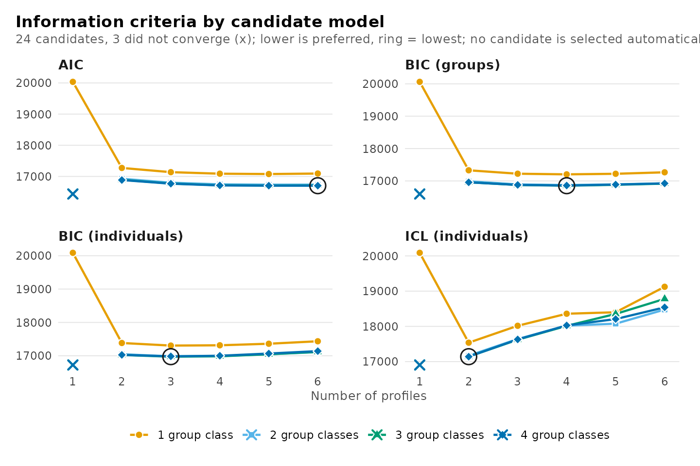

``` r

plot_enumeration(models, what = "bic_groups")
```

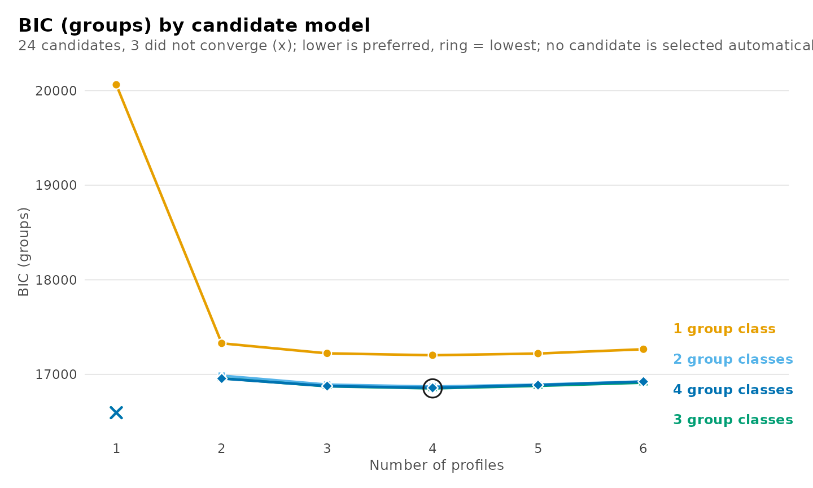

## Where added classes stop paying off

### Deltas

When a criterion decreases across the entire range, its minimum is
uninformative, but the magnitude of each decrease is not.
`get_results(x, "deltas")` reports, for every candidate, the decrease in
a criterion relative to the neighbouring candidate with one profile
fewer (`delta_profile`, from `from_profile`) and with one group class
fewer (`delta_group_class`, from `from_group_class`). A positive value
indicates that the additional class reduced the criterion, and a
negative value that it increased it; candidates without such a neighbour
in the grid have `NA`. BIC with groups as units is used unless `using`
specifies another criterion.

``` r

get_results(models, "deltas")
#>            candidate n_profiles n_group_classes model  criterion value delta_profile
#> 1  profiles1_groups1          1               1   VVI bic_groups 20062            NA
#> 2  profiles2_groups1          2               1   VVI bic_groups 17328        2733.2
#> 3  profiles3_groups1          3               1   VVI bic_groups 17222         105.9
#> 4  profiles4_groups1          4               1   VVI bic_groups 17203          19.9
#> 5  profiles5_groups1          5               1   VVI bic_groups 17220         -17.9
#> 6  profiles6_groups1          6               1   VVI bic_groups 17266         -45.6
#> 7  profiles1_groups2          1               2   VVI bic_groups    NA            NA
#> 8  profiles2_groups2          2               2   VVI bic_groups 16987            NA
#> 9  profiles3_groups2          3               2   VVI bic_groups 16892          94.6
#> 10 profiles4_groups2          4               2   VVI bic_groups 16872          20.7
#> 11 profiles5_groups2          5               2   VVI bic_groups 16892         -20.6
#> 12 profiles6_groups2          6               2   VVI bic_groups 16926         -33.5
#> 13 profiles1_groups3          1               3   VVI bic_groups    NA            NA
#> 14 profiles2_groups3          2               3   VVI bic_groups 16959            NA
#> 15 profiles3_groups3          3               3   VVI bic_groups 16874          84.6
#> 16 profiles4_groups3          4               3   VVI bic_groups 16852          21.9
#> 17 profiles5_groups3          5               3   VVI bic_groups 16880         -27.5
#> 18 profiles6_groups3          6               3   VVI bic_groups 16917         -37.5
#> 19 profiles1_groups4          1               4   VVI bic_groups    NA            NA
#> 20 profiles2_groups4          2               4   VVI bic_groups 16956            NA
#> 21 profiles3_groups4          3               4   VVI bic_groups 16876          79.9
#> 22 profiles4_groups4          4               4   VVI bic_groups 16858          18.8
#> 23 profiles5_groups4          5               4   VVI bic_groups 16887         -29.7
#> 24 profiles6_groups4          6               4   VVI bic_groups 16924         -36.3
#>         from_profile delta_group_class  from_group_class
#> 1               <NA>                NA              <NA>
#> 2  profiles1_groups1                NA              <NA>
#> 3  profiles2_groups1                NA              <NA>
#> 4  profiles3_groups1                NA              <NA>
#> 5  profiles4_groups1                NA              <NA>
#> 6  profiles5_groups1                NA              <NA>
#> 7               <NA>                NA              <NA>
#> 8               <NA>            341.51 profiles2_groups1
#> 9  profiles2_groups2            330.20 profiles3_groups1
#> 10 profiles3_groups2            330.96 profiles4_groups1
#> 11 profiles4_groups2            328.23 profiles5_groups1
#> 12 profiles5_groups2            340.42 profiles6_groups1
#> 13              <NA>                NA              <NA>
#> 14              <NA>             28.18 profiles2_groups2
#> 15 profiles2_groups3             18.19 profiles3_groups2
#> 16 profiles3_groups3             19.43 profiles4_groups2
#> 17 profiles4_groups3             12.55 profiles5_groups2
#> 18 profiles5_groups3              8.51 profiles6_groups2
#> 19              <NA>                NA              <NA>
#> 20              <NA>              2.37 profiles2_groups3
#> 21 profiles2_groups4             -2.43 profiles3_groups3
#> 22 profiles3_groups4             -5.54 profiles4_groups3
#> 23 profiles4_groups4             -7.79 profiles5_groups3
#> 24 profiles5_groups4             -6.62 profiles6_groups3
```

With three group classes, the third profile reduces BIC by 85 and the
fourth by 22, whereas the fifth increases it by 27 (shown as a negative
decrease). The candidate with two profiles has no profile-wise delta
because its neighbour, with one profile and three group classes, is not
identified. Diminishing decreases indicate the point beyond which
additional profiles capture detail rather than structure, and the first
negative value marks where they cease to improve the criterion. The
deltas are displayed for both directions: along the number of profiles
(left) and along the number of group classes (right).

``` r

plot_selection(models, what = "deltas")
```

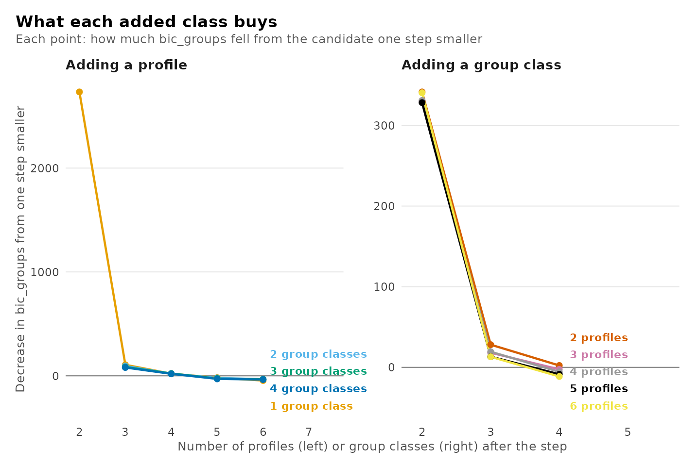

The same display is available for any criterion:

``` r

plot_selection(models, what = "deltas", using = "icl_individual")
```

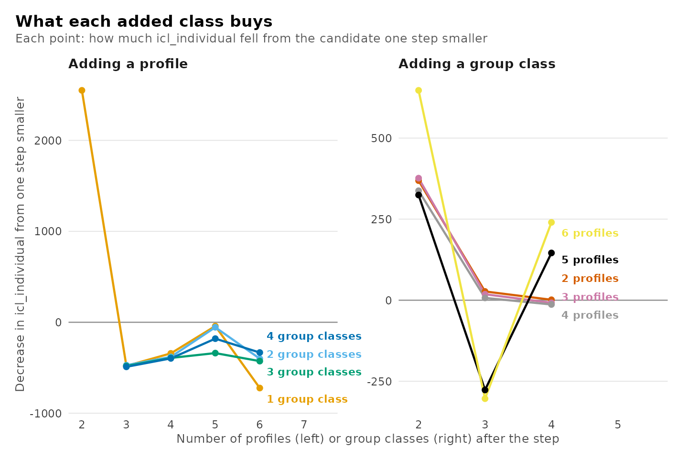

### Knees

The knee, or elbow, of a decreasing curve is the point at which it
changes from steep to flat. `get_results(x, "knees")` locates it with a
simplified, geometric version of the Kneedle algorithm (Satopää,
Albrecht, Irwin and Raghavan, 2011):

1.  both axes, the number of classes and the criterion, are rescaled to
    the unit interval;
2.  a chord is drawn from the first candidate to the last;
3.  the knee is the candidate with the greatest perpendicular distance
    below the chord, and `distance` is that distance in rescaled units.

The smoothing and sensitivity thresholds of the original algorithm are
omitted, so a nearly linear curve may still yield a knee with a very
small `distance`; the distance therefore quantifies the strength of the
bend as well as its location. A curve whose final value is not below its
initial value has no knee, since a bend in an increasing criterion does
not indicate diminishing returns.

Knees are computed along three families of curves: over the number of
profiles at each number of group classes (`direction = "profiles"`),
over the number of group classes at each number of profiles
(`"group_classes"`), and over all candidates ordered by number of
parameters (`"parameters"`). The columns `from` and `to` identify the
endpoints of each curve and `n_points` its length.

``` r

get_results(models, "knees")
#>        direction            line  criterion              from                to n_points
#> 1       profiles   1 group class bic_groups profiles1_groups1 profiles6_groups1        6
#> 2       profiles 2 group classes bic_groups profiles2_groups2 profiles6_groups2        5
#> 3       profiles 3 group classes bic_groups profiles2_groups3 profiles6_groups3        5
#> 4       profiles 4 group classes bic_groups profiles2_groups4 profiles6_groups4        5
#> 5  group_classes       1 profile bic_groups profiles1_groups1 profiles1_groups1        1
#> 6  group_classes      2 profiles bic_groups profiles2_groups1 profiles2_groups4        4
#> 7  group_classes      3 profiles bic_groups profiles3_groups1 profiles3_groups4        4
#> 8  group_classes      4 profiles bic_groups profiles4_groups1 profiles4_groups4        4
#> 9  group_classes      5 profiles bic_groups profiles5_groups1 profiles5_groups4        4
#> 10 group_classes      6 profiles bic_groups profiles6_groups1 profiles6_groups4        4
#> 11    parameters  all candidates bic_groups profiles1_groups1 profiles6_groups4       21
#>       knee_candidate distance knee_without_largest stable                               note
#> 1  profiles2_groups1    0.544    profiles2_groups1   TRUE                                   
#> 2  profiles4_groups2    0.648    profiles3_groups2  FALSE moves when the largest is left out
#> 3  profiles4_groups3    0.750    profiles3_groups3  FALSE moves when the largest is left out
#> 4  profiles4_groups4    0.792    profiles3_groups4  FALSE moves when the largest is left out
#> 5               <NA>       NA                 <NA>     NA        fewer than three candidates
#> 6  profiles2_groups2    0.413    profiles2_groups2   TRUE                                   
#> 7  profiles3_groups2    0.438    profiles3_groups2   TRUE                                   
#> 8  profiles4_groups2    0.439    profiles4_groups2   TRUE                                   
#> 9  profiles5_groups2    0.456    profiles5_groups2   TRUE                                   
#> 10 profiles6_groups2    0.463    profiles6_groups2   TRUE                                   
#> 11 profiles2_groups2    0.561    profiles2_groups2   TRUE
```

Because the chord terminates at the largest candidate estimated, the
location of the knee depends on the extent of the grid: adding a
candidate moves the chord and may move the knee. This dependence is
assessed directly. `knee_without_largest` is the knee of the same curve
with its final candidate removed, and `stable` is `TRUE` when the two
coincide; a knee that shifts when the range is shortened by one
candidate constitutes weak evidence. `note` explains every row for which
no complete result is available:

| `note` | Meaning |
|----|----|
| empty | a knee was found and is stable |
| `fewer than three candidates` | a line needs three points for a knee |
| `three candidates: stability not assessed` | `stable` needs four points |
| `the criterion does not fall along this line` | no diminishing return to find |
| `the curve does not bend below the line` | the curve is straight or bends upward |
| `no knee when the largest is left out` | the shortened line has no knee |
| `moves when the largest is left out` | the knee depends on the range fitted |

With three group classes, the knee along the number of profiles is
profiles4_groups3, at a distance of 0.75. Without the largest candidate
it is profiles3_groups3, so `stable` is FALSE: the bend lies between
three and four profiles, and which of the two is identified depends on
the extent of the grid. The deltas locate the same region with less
ambiguity, which is why the two are interpreted jointly.

### The criterion over the whole grid

The heatmap displays all candidates simultaneously, shaded by the
difference between each candidate’s criterion and the minimum in the
grid. It uses the same criterion as the deltas and accepts the same
`using` argument.

``` r

plot_selection(models, what = "heatmap")
```


## Are the classes distinct?

A candidate may fit the data well yet separate its classes poorly,
leaving many units with uncertain class membership. Three statistics
derived from the posterior probabilities of membership quantify
separation.

- **Relative entropy**, `1 - EN / (n log K)` for `K` classes, ranges
  from 0, when every unit is equally likely to belong to every class, to
  1, when every unit is classified with certainty. It summarizes an
  entire level in a single value and is undefined (`NA`) for a level
  with one class.
- **Average posterior probability (AvePP)** of a class is the mean
  posterior probability of that class among the units modally assigned
  to it. Values of 0.7 to 0.8 or above are conventionally taken to
  indicate adequate separation (Nagin, 2005). Being class-specific, it
  reveals a single poorly separated class that entropy would average
  away.
- **Odds of correct classification (OCC)** of a class is
  `(p / (1 - p)) / (r / (1 - r))`, where `p` is its AvePP and `r` its
  estimated proportion. It compares model-based classification with
  assignment by class proportion alone: values near 1 indicate no
  improvement, and values of 5 or more are conventionally taken to
  indicate adequate separation (Nagin, 2005).

The table of candidates summarizes each level by its relative entropy
and the minimum, maximum and mean AvePP, and counts the classes below a
cutoff (0.8 by default, set with `cutoff`).
`get_results(x, "classification")` reports, for every class of every
candidate, its size by modal assignment and by estimate, its AvePP, its
OCC and the relative entropy of its level.

``` r

get_results(models, "classification")
#>             candidate n_profiles n_group_classes model       level class n_modal proportion_modal
#> 1   profiles2_groups1          2               1   VVI individuals     1     833          0.58579
#> 2   profiles2_groups1          2               1   VVI individuals     2     589          0.41421
#> 3   profiles3_groups1          3               1   VVI individuals     1     452          0.31786
#> 4   profiles3_groups1          3               1   VVI individuals     2     555          0.39030
#> 5   profiles3_groups1          3               1   VVI individuals     3     415          0.29184
#> 6   profiles4_groups1          4               1   VVI individuals     1     481          0.33826
#> 7   profiles4_groups1          4               1   VVI individuals     2     157          0.11041
#> 8   profiles4_groups1          4               1   VVI individuals     3     419          0.29466
#> 9   profiles4_groups1          4               1   VVI individuals     4     365          0.25668
#> 10  profiles5_groups1          5               1   VVI individuals     1     355          0.24965
#> 11  profiles5_groups1          5               1   VVI individuals     2     419          0.29466
#> 12  profiles5_groups1          5               1   VVI individuals     3     486          0.34177
#> 13  profiles5_groups1          5               1   VVI individuals     4       5          0.00352
#> 14  profiles5_groups1          5               1   VVI individuals     5     157          0.11041
#> 15  profiles6_groups1          6               1   VVI individuals     1     372          0.26160
#> 16  profiles6_groups1          6               1   VVI individuals     2     157          0.11041
#> 17  profiles6_groups1          6               1   VVI individuals     3     378          0.26582
#> 18  profiles6_groups1          6               1   VVI individuals     4      62          0.04360
#> 19  profiles6_groups1          6               1   VVI individuals     5     337          0.23699
#> 20  profiles6_groups1          6               1   VVI individuals     6     116          0.08158
#> 21  profiles2_groups2          2               2   VVI individuals     1     836          0.58790
#> 22  profiles2_groups2          2               2   VVI individuals     2     586          0.41210
#> 23  profiles2_groups2          2               2   VVI      groups     1      71          0.66981
#> 24  profiles2_groups2          2               2   VVI      groups     2      35          0.33019
#> 25  profiles3_groups2          3               2   VVI individuals     1     472          0.33193
#> 26  profiles3_groups2          3               2   VVI individuals     2     570          0.40084
#> 27  profiles3_groups2          3               2   VVI individuals     3     380          0.26723
#> 28  profiles3_groups2          3               2   VVI      groups     1      71          0.66981
#> 29  profiles3_groups2          3               2   VVI      groups     2      35          0.33019
#> 30  profiles4_groups2          4               2   VVI individuals     1     490          0.34459
#> 31  profiles4_groups2          4               2   VVI individuals     2     166          0.11674
#> 32  profiles4_groups2          4               2   VVI individuals     3     418          0.29395
#> 33  profiles4_groups2          4               2   VVI individuals     4     348          0.24473
#> 34  profiles4_groups2          4               2   VVI      groups     1      71          0.66981
#> 35  profiles4_groups2          4               2   VVI      groups     2      35          0.33019
#> 36  profiles5_groups2          5               2   VVI individuals     1     483          0.33966
#> 37  profiles5_groups2          5               2   VVI individuals     2     423          0.29747
#> 38  profiles5_groups2          5               2   VVI individuals     3      31          0.02180
#> 39  profiles5_groups2          5               2   VVI individuals     4     327          0.22996
#> 40  profiles5_groups2          5               2   VVI individuals     5     158          0.11111
#> 41  profiles5_groups2          5               2   VVI      groups     1      72          0.67925
#> 42  profiles5_groups2          5               2   VVI      groups     2      34          0.32075
#> 43  profiles6_groups2          6               2   VVI individuals     1     465          0.32700
#> 44  profiles6_groups2          6               2   VVI individuals     2     171          0.12025
#> 45  profiles6_groups2          6               2   VVI individuals     3     317          0.22293
#> 46  profiles6_groups2          6               2   VVI individuals     4      90          0.06329
#> 47  profiles6_groups2          6               2   VVI individuals     5     343          0.24121
#> 48  profiles6_groups2          6               2   VVI individuals     6      36          0.02532
#> 49  profiles6_groups2          6               2   VVI      groups     1      69          0.65094
#> 50  profiles6_groups2          6               2   VVI      groups     2      37          0.34906
#> 51  profiles2_groups3          2               3   VVI individuals     1     832          0.58509
#> 52  profiles2_groups3          2               3   VVI individuals     2     590          0.41491
#> 53  profiles2_groups3          2               3   VVI      groups     1      25          0.23585
#> 54  profiles2_groups3          2               3   VVI      groups     2      31          0.29245
#> 55  profiles2_groups3          2               3   VVI      groups     3      50          0.47170
#> 56  profiles3_groups3          3               3   VVI individuals     1     367          0.25809
#> 57  profiles3_groups3          3               3   VVI individuals     2     576          0.40506
#> 58  profiles3_groups3          3               3   VVI individuals     3     479          0.33685
#> 59  profiles3_groups3          3               3   VVI      groups     1      25          0.23585
#> 60  profiles3_groups3          3               3   VVI      groups     2      30          0.28302
#> 61  profiles3_groups3          3               3   VVI      groups     3      51          0.48113
#> 62  profiles4_groups3          4               3   VVI individuals     1     508          0.35724
#> 63  profiles4_groups3          4               3   VVI individuals     2     402          0.28270
#> 64  profiles4_groups3          4               3   VVI individuals     3     192          0.13502
#> 65  profiles4_groups3          4               3   VVI individuals     4     320          0.22504
#> 66  profiles4_groups3          4               3   VVI      groups     1      28          0.26415
#> 67  profiles4_groups3          4               3   VVI      groups     2      48          0.45283
#> 68  profiles4_groups3          4               3   VVI      groups     3      30          0.28302
#> 69  profiles5_groups3          5               3   VVI individuals     1     123          0.08650
#> 70  profiles5_groups3          5               3   VVI individuals     2     201          0.14135
#> 71  profiles5_groups3          5               3   VVI individuals     3     244          0.17159
#> 72  profiles5_groups3          5               3   VVI individuals     4     457          0.32138
#> 73  profiles5_groups3          5               3   VVI individuals     5     397          0.27918
#> 74  profiles5_groups3          5               3   VVI      groups     1      27          0.25472
#> 75  profiles5_groups3          5               3   VVI      groups     2      48          0.45283
#> 76  profiles5_groups3          5               3   VVI      groups     3      31          0.29245
#> 77  profiles6_groups3          6               3   VVI individuals     1     206          0.14487
#> 78  profiles6_groups3          6               3   VVI individuals     2     446          0.31364
#> 79  profiles6_groups3          6               3   VVI individuals     3     322          0.22644
#> 80  profiles6_groups3          6               3   VVI individuals     4     128          0.09001
#> 81  profiles6_groups3          6               3   VVI individuals     5     168          0.11814
#> 82  profiles6_groups3          6               3   VVI individuals     6     152          0.10689
#> 83  profiles6_groups3          6               3   VVI      groups     1      47          0.44340
#> 84  profiles6_groups3          6               3   VVI      groups     2      32          0.30189
#> 85  profiles6_groups3          6               3   VVI      groups     3      27          0.25472
#> 86  profiles2_groups4          2               4   VVI individuals     1     832          0.58509
#> 87  profiles2_groups4          2               4   VVI individuals     2     590          0.41491
#> 88  profiles2_groups4          2               4   VVI      groups     1      25          0.23585
#> 89  profiles2_groups4          2               4   VVI      groups     2      12          0.11321
#> 90  profiles2_groups4          2               4   VVI      groups     3      22          0.20755
#> 91  profiles2_groups4          2               4   VVI      groups     4      47          0.44340
#> 92  profiles3_groups4          3               4   VVI individuals     1     477          0.33544
#> 93  profiles3_groups4          3               4   VVI individuals     2     576          0.40506
#> 94  profiles3_groups4          3               4   VVI individuals     3     369          0.25949
#> 95  profiles3_groups4          3               4   VVI      groups     1      46          0.43396
#> 96  profiles3_groups4          3               4   VVI      groups     2      15          0.14151
#> 97  profiles3_groups4          3               4   VVI      groups     3      20          0.18868
#> 98  profiles3_groups4          3               4   VVI      groups     4      25          0.23585
#> 99  profiles4_groups4          4               4   VVI individuals     1     191          0.13432
#> 100 profiles4_groups4          4               4   VVI individuals     2     321          0.22574
#> 101 profiles4_groups4          4               4   VVI individuals     3     510          0.35865
#> 102 profiles4_groups4          4               4   VVI individuals     4     400          0.28129
#> 103 profiles4_groups4          4               4   VVI      groups     1      46          0.43396
#> 104 profiles4_groups4          4               4   VVI      groups     2      24          0.22642
#> 105 profiles4_groups4          4               4   VVI      groups     3      11          0.10377
#> 106 profiles4_groups4          4               4   VVI      groups     4      25          0.23585
#> 107 profiles5_groups4          5               4   VVI individuals     1     189          0.13291
#> 108 profiles5_groups4          5               4   VVI individuals     2      38          0.02672
#> 109 profiles5_groups4          5               4   VVI individuals     3     302          0.21238
#> 110 profiles5_groups4          5               4   VVI individuals     4     491          0.34529
#> 111 profiles5_groups4          5               4   VVI individuals     5     402          0.28270
#> 112 profiles5_groups4          5               4   VVI      groups     1      23          0.21698
#> 113 profiles5_groups4          5               4   VVI      groups     2      25          0.23585
#> 114 profiles5_groups4          5               4   VVI      groups     3      11          0.10377
#> 115 profiles5_groups4          5               4   VVI      groups     4      47          0.44340
#> 116 profiles6_groups4          6               4   VVI individuals     1     491          0.34529
#> 117 profiles6_groups4          6               4   VVI individuals     2     107          0.07525
#> 118 profiles6_groups4          6               4   VVI individuals     3     341          0.23980
#> 119 profiles6_groups4          6               4   VVI individuals     4     149          0.10478
#> 120 profiles6_groups4          6               4   VVI individuals     5     174          0.12236
#> 121 profiles6_groups4          6               4   VVI individuals     6     160          0.11252
#> 122 profiles6_groups4          6               4   VVI      groups     1      26          0.24528
#> 123 profiles6_groups4          6               4   VVI      groups     2      14          0.13208
#> 124 profiles6_groups4          6               4   VVI      groups     3      23          0.21698
#> 125 profiles6_groups4          6               4   VVI      groups     4      43          0.40566
#>     estimated_n estimated_proportion average_posterior odds_correct_classification relative_entropy
#> 1        832.92              0.58574             0.982                       37.75            0.922
#> 2        589.08              0.41426             0.974                       53.24            0.922
#> 3        452.67              0.31834             0.832                       10.61            0.772
#> 4        551.11              0.38756             0.964                       42.39            0.772
#> 5        418.21              0.29410             0.863                       15.17            0.772
#> 6        478.06              0.33619             0.842                       10.51            0.735
#> 7        172.20              0.12110             0.803                       29.63            0.735
#> 8        405.28              0.28501             0.849                       14.14            0.735
#> 9        366.46              0.25771             0.846                       15.86            0.735
#> 10       359.22              0.25262             0.847                       16.42            0.773
#> 11       405.22              0.28496             0.849                       14.13            0.773
#> 12       480.38              0.33782             0.842                       10.42            0.773
#> 13         4.89              0.00344             0.962                     7368.14            0.773
#> 14       172.30              0.12116             0.804                       29.66            0.773
#> 15       340.87              0.23971             0.735                        8.78            0.669
#> 16       165.78              0.11658             0.784                       27.56            0.669
#> 17       348.85              0.24532             0.780                       10.89            0.669
#> 18        95.07              0.06686             0.636                       24.43            0.669
#> 19       321.57              0.22614             0.812                       14.74            0.669
#> 20       149.86              0.10538             0.627                       14.29            0.669
#> 21       834.10              0.58657             0.985                       46.08            0.938
#> 22       587.90              0.41343             0.982                       76.35            0.938
#> 23        71.52              0.67470             0.992                       59.89            0.940
#> 24        34.48              0.32530             0.969                       64.80            0.940
#> 25       469.56              0.33021             0.849                       11.40            0.790
#> 26       569.85              0.40074             0.979                       68.94            0.790
#> 27       382.59              0.26905             0.850                       15.45            0.790
#> 28        71.25              0.67213             0.992                       62.14            0.943
#> 29        34.75              0.32787             0.977                       87.77            0.943
#> 30       480.19              0.33769             0.845                       10.71            0.739
#> 31       178.19              0.12531             0.791                       26.49            0.739
#> 32       407.65              0.28667             0.858                       15.08            0.739
#> 33       355.96              0.25033             0.846                       16.41            0.739
#> 34        71.16              0.67132             0.990                       48.96            0.937
#> 35        34.84              0.32868             0.975                       80.76            0.937
#> 36       464.18              0.32643             0.846                       11.33            0.775
#> 37       408.11              0.28700             0.860                       15.27            0.775
#> 38        36.89              0.02594             0.838                      194.58            0.775
#> 39       337.67              0.23746             0.848                       17.88            0.775
#> 40       175.15              0.12317             0.803                       28.94            0.775
#> 41        71.40              0.67360             0.990                       48.07            0.965
#> 42        34.60              0.32640             0.996                      581.20            0.965
#> 43       444.31              0.31245             0.835                       11.14            0.732
#> 44       173.96              0.12233             0.781                       25.62            0.732
#> 45       294.72              0.20726             0.728                       10.24            0.732
#> 46       118.27              0.08317             0.699                       25.64            0.732
#> 47       349.82              0.24600             0.845                       16.71            0.732
#> 48        40.93              0.02878             0.789                      126.37            0.732
#> 49        69.10              0.65185             0.987                       39.18            0.946
#> 50        36.90              0.34815             0.972                       65.76            0.946
#> 51       830.91              0.58433             0.986                       49.28            0.940
#> 52       591.09              0.41567             0.982                       75.73            0.940
#> 53        26.66              0.25147             0.905                       28.33            0.816
#> 54        30.78              0.29035             0.962                       62.25            0.816
#> 55        48.57              0.45818             0.900                       10.69            0.816
#> 56       368.95              0.25946             0.845                       15.58            0.792
#> 57       574.96              0.40433             0.978                       65.03            0.792
#> 58       478.08              0.33621             0.853                       11.45            0.792
#> 59        27.65              0.26086             0.898                       24.87            0.797
#> 60        31.03              0.29271             0.977                      104.20            0.797
#> 61        47.32              0.44643             0.864                        7.90            0.797
#> 62       497.03              0.34953             0.854                       10.86            0.739
#> 63       391.99              0.27566             0.847                       14.60            0.739
#> 64       202.20              0.14220             0.801                       24.24            0.739
#> 65       330.78              0.23261             0.842                       17.57            0.739
#> 66        27.40              0.25844             0.874                       19.96            0.823
#> 67        48.01              0.45292             0.915                       13.01            0.823
#> 68        30.60              0.28864             0.981                      127.50            0.823
#> 69       141.26              0.09934             0.628                       15.34            0.714
#> 70       211.64              0.14884             0.804                       23.52            0.714
#> 71       248.08              0.17446             0.804                       19.44            0.714
#> 72       435.18              0.30603             0.817                       10.09            0.714
#> 73       385.84              0.27134             0.843                       14.42            0.714
#> 74        28.08              0.26491             0.917                       30.75            0.854
#> 75        46.73              0.44081             0.918                       14.29            0.854
#> 76        31.19              0.29428             0.987                      180.98            0.854
#> 77       206.70              0.14536             0.777                       20.53            0.674
#> 78       414.48              0.29148             0.795                        9.42            0.674
#> 79       297.05              0.20890             0.733                       10.42            0.674
#> 80       150.21              0.10563             0.711                       20.85            0.674
#> 81       191.71              0.13482             0.655                       12.18            0.674
#> 82       161.85              0.11382             0.788                       28.90            0.674
#> 83        46.26              0.43639             0.925                       15.84            0.853
#> 84        32.68              0.30828             0.984                      137.98            0.853
#> 85        27.07              0.25534             0.915                       31.49            0.853
#> 86       829.91              0.58362             0.986                       50.18            0.942
#> 87       592.09              0.41638             0.984                       85.01            0.942
#> 88        24.59              0.23201             0.868                       21.73            0.798
#> 89        11.33              0.10689             0.851                       47.77            0.798
#> 90        22.34              0.21071             0.877                       26.81            0.798
#> 91        47.74              0.45039             0.912                       12.62            0.798
#> 92       476.54              0.33512             0.853                       11.52            0.793
#> 93       576.30              0.40527             0.980                       70.36            0.793
#> 94       369.16              0.25960             0.843                       15.32            0.793
#> 95        47.04              0.44379             0.902                       11.51            0.772
#> 96        13.62              0.12851             0.841                       35.95            0.772
#> 97        20.96              0.19774             0.868                       26.74            0.772
#> 98        24.37              0.22995             0.843                       17.98            0.772
#> 99       201.57              0.14175             0.801                       24.37            0.740
#> 100      332.98              0.23416             0.843                       17.58            0.740
#> 101      494.01              0.34741             0.850                       10.64            0.740
#> 102      393.44              0.27668             0.853                       15.17            0.740
#> 103       46.89              0.44232             0.903                       11.76            0.803
#> 104       22.90              0.21605             0.867                       23.74            0.803
#> 105       10.91              0.10288             0.898                       76.55            0.803
#> 106       25.31              0.23874             0.873                       21.82            0.803
#> 107      201.07              0.14140             0.803                       24.79            0.751
#> 108       61.45              0.04322             0.786                       81.48            0.751
#> 109      305.33              0.21472             0.831                       17.96            0.751
#> 110      461.34              0.32443             0.826                        9.90            0.751
#> 111      392.80              0.27623             0.853                       15.15            0.751
#> 112       23.02              0.21714             0.926                       44.87            0.830
#> 113       25.69              0.24237             0.882                       23.26            0.830
#> 114       11.14              0.10505             0.899                       75.62            0.830
#> 115       46.16              0.43544             0.909                       12.98            0.830
#> 116      466.75              0.32823             0.830                        9.98            0.725
#> 117      114.80              0.08073             0.847                       63.10            0.725
#> 118      320.60              0.22546             0.806                       14.24            0.725
#> 119      167.55              0.11783             0.765                       24.39            0.725
#> 120      192.57              0.13542             0.797                       25.09            0.725
#> 121      159.73              0.11233             0.654                       14.97            0.725
#> 122       25.05              0.23630             0.898                       28.53            0.851
#> 123       13.24              0.12488             0.907                       68.41            0.851
#> 124       23.33              0.22010             0.919                       40.18            0.851
#> 125       44.38              0.41872             0.940                       21.71            0.851
```

`plot_selection(x, what = "diagnostics")` displays relative entropy and
the minimum AvePP across candidates, with the cutoff indicated;
`what = "entropy"` and `what = "avepp"` display either one. For a single
fitted candidate,
[`plot_diagnostics()`](https://pak.dynasite.org/latents/reference/latents-plots.md)
displays the posterior probability of each unit’s assigned class, each
unit’s relative entropy, the class sizes and the matrix of average
posterior probabilities, for the profiles and, when there are two or
more group classes, for the group classes (`what = "group_posteriors"`,
etc.).

``` r

plot_selection(models, what = "diagnostics")
```

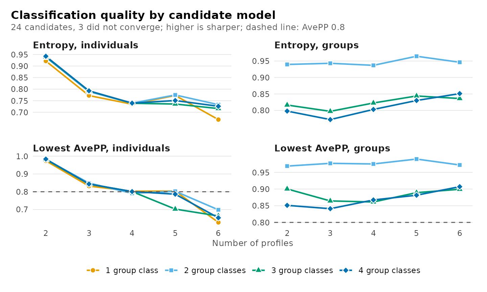

Entropy and AvePP may diverge, and the divergence is informative. AvePP
depends only on the posterior probability of each unit’s assigned class,
whereas entropy depends on the full vector of posterior probabilities. A
unit with posterior probabilities of 0.70, 0.10, 0.10 and 0.10 and a
unit with 0.70 and 0.30 contribute equally to AvePP, but the former,
whose uncertainty is distributed across all classes, reduces entropy
considerably more. Moreover, entropy is more sensitive to a minority of
highly uncertain units than to a majority of nearly certain ones. A
level comprising mostly well-classified units and a tail of uncertain
ones therefore exhibits moderate AvePP together with low entropy.

The two levels of a two-level model are classified on the basis of
different amounts of information. A group’s class is inferred from all
of its observations jointly, whereas an observation’s profile is
inferred from its own responses alone; group classes are consequently
classified with considerably greater certainty. For a single candidate,
[`plot_diagnostics()`](https://pak.dynasite.org/latents/reference/latents-plots.md)
displays both levels:

``` r

plot_diagnostics(get_candidate(models, "profiles4_groups3"),
                 what = "group_posteriors")
```


When all candidates separate their profiles poorly, such that no number
of classes yields adequate entropy or minimum AvePP, the indicators do
not discriminate well among individual observations. The number of
classes is then determined from the information criteria and substantive
interpretation, and the limited separation is reported as a limitation.
In this situation modal class assignments are an unreliable substitute
for the latent classes in subsequent analyses, and bias-corrected
three-step estimators
([`r3step()`](https://pak.dynasite.org/latents/reference/r3step.md),
[`three_step()`](https://pak.dynasite.org/latents/reference/three_step.md))
should be used instead.

Classification quality is not in itself a criterion for the number of
classes: models with fewer classes are generally better separated, so
selection on entropy alone favours too few classes. It serves to
discriminate between candidates that the information criteria do not
distinguish, and it determines how the selected classes may be used, for
example whether modal assignments can represent them in subsequent
analyses.

## Can the estimate be trusted?

### Estimation checks

Because the likelihood is multimodal, a solution replicated from several
random starts is more credible than one obtained from a single start. An
estimate on the boundary of the parameter space, such as a variance at
its lower bound or a class with negligible membership, indicates a model
too complex for the data. `plot_selection(x, what = "trust")` represents
each candidate by a tile labelled with the number of starts that reached
its maximum likelihood and shaded by the first problem detected:

| Status | Meaning |
|----|----|
| best replicated | converged within the interior of the parameter space, with the maximum likelihood reached by more than one start |
| best found once | as above, but the maximum likelihood was reached by a single start |
| on a boundary | an estimate lies on the boundary of the parameter space |
| not converged | the EM algorithm terminated before meeting its convergence criterion |
| not fitted (`x`) | not identified, or estimation failed (the error is retained in the table) |

``` r

plot_selection(models, what = "trust")
```


A candidate whose maximum was found only once should be re-estimated
with more starts before it is selected, together with the remainder of
the grid (see *Random starts*). If re-estimation increases its
likelihood, the earlier solution was a local maximum and is superseded;
entropy and AvePP often increase as well. A higher AvePP is never a
ground for preferring one solution of a given candidate over another:
the maximum likelihood solution is the estimate. The columns
`converged`, `boundary`, `n_best_replicated`, `warnings` and `error` of
the table of candidates report the same diagnostics. A candidate on a
boundary whose smallest class holds about one observation is a
degenerate solution rather than a class; re-estimating the grid with
`boundary = "exclude"` replaces it with the best solution in the
interior of the parameter space (see *Random starts*).

### The smallest class

A class comprising a very small proportion of units is difficult to
interpret and is estimated from little data.
`plot_selection(x, what = "smallest")` displays the estimated proportion
of the smallest class of every candidate, with a reference line at 5%, a
conventional threshold rather than a rule.

``` r

plot_selection(models, what = "smallest")
```


## All of the plots together

`plot_selection(x)` returns the deltas, the heatmap, the smallest class,
the estimation diagnostics and the classification diagnostics as a list
of plots displayed in sequence. `using` sets the criterion for the first
two and `cutoff` the AvePP threshold for the last.

``` r

plot_selection(models)
```

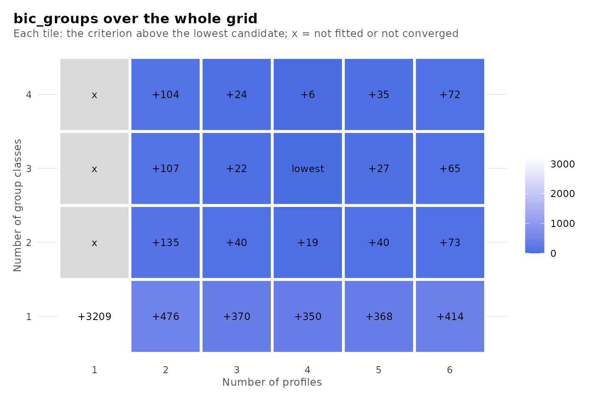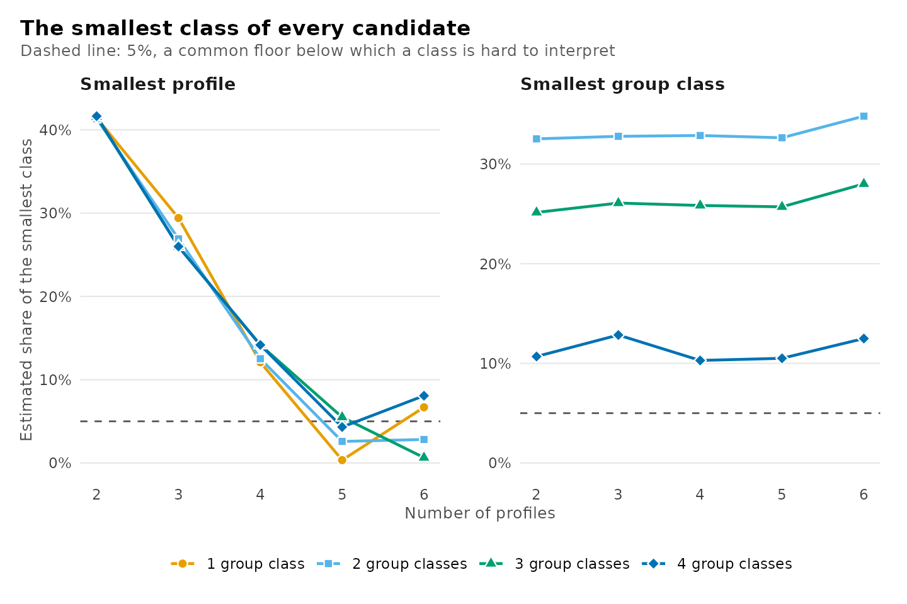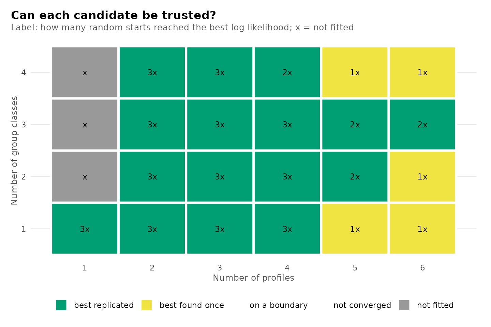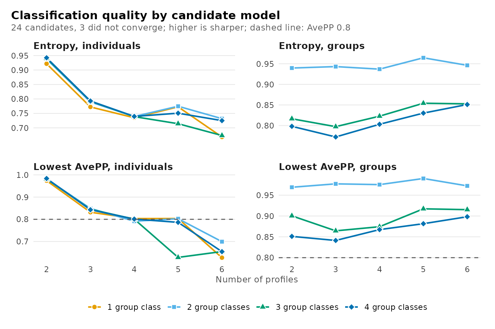

## How the profiles divide

The clustering tree shows how the profiles of each model are partitioned
in the model with one additional profile: each profile is linked to the
profiles of the larger model that receive its observations (Zappia and
Oshlack, 2018). A profile that divides cleanly into two suggests a
substantive distinction, whereas a profile formed from several profiles
of the smaller model suggests a reallocation of observations rather than
a refinement. Each number of group classes has its own tree, selected
with `n_group_classes`; the guide *Tree plot* compares solutions at one
number of profiles.

``` r

plot_tree(models, n_group_classes = 1)
```


## Comparing chosen candidates

Once the evidence has reduced the choice to a few candidates,
[`compare_models()`](https://pak.dynasite.org/latents/reference/compare_models.md)
tabulates them side by side, specified by label or by numbers of
classes. The table adds each candidate’s difference in BIC from the
smallest value among those compared (`delta_bic`) and its BIC weight,
`exp(-delta_bic / 2)` normalized over the compared candidates, which
approximates the posterior probability of each model under equal prior
probabilities, assuming one of them is correct (Wagenmakers and Farrell,
2004). The weights are conditional on the set of candidates compared.

``` r

comparison <- compare_models(models, "profiles3_groups3", "profiles4_groups3",
                             "profiles4_groups2")
comparison
#> Model comparison
#> 
#> Model              Profiles  Group classes   k    LogLik       BIC   ΔBIC  Weight       ICL  Entropy  Min AvePP  < 0.8  Group entropy  Group min AvePP
#> -----------------  --------  -------------  --  --------  --------  -----  ------  --------  -------  ---------  -----  -------------  ---------------
#> profiles3_groups3         3              3  38  -8348.43  16874.07  21.92   0.000  17622.03     0.79       0.85      0           0.80             0.86
#> profiles4_groups3         4              3  51  -8307.15  16852.14   0.00   1.000  18014.13     0.74       0.80      0           0.82             0.87
#> profiles4_groups2         4              2  47  -8326.19  16871.57  19.43   0.000  18021.23     0.74       0.79      1           0.94             0.98
plot(comparison)
```

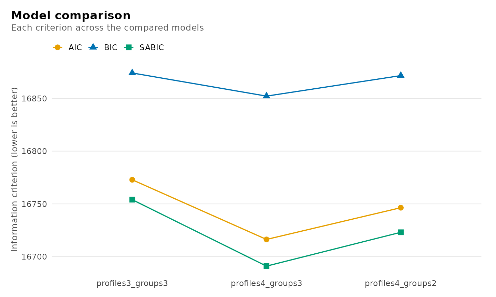

The fitted model corresponding to a row is extracted with
[`get_candidate()`](https://pak.dynasite.org/latents/reference/get_candidate.md),
by label or by numbers of classes.

``` r

chosen <- get_candidate(models, "profiles4_groups3")
chosen
#> Two-level latent profile analysis: 4 profiles, 3 group classes
#> 1422 individuals in 106 groups; varying diagonal residual covariance (VVI)
#> Log likelihood: -8307.154320 | AIC: 16716.309 | BIC (groups): 16852.144
#> Converged: TRUE | iterations: 48 | best start: 3/3
#> Smallest standardized Gaussian eigenvalue: 0.195 (profiles, profile_4); Gaussian mass: 330.8; weight effective n: 434.9.
#> 
#>  profile browse lectures forum_read forum_post attendance count proportion
#>        1  0.412    0.232      0.490      0.383      0.309   497      0.350
#>        2 -0.564   -0.561     -0.695     -0.676     -0.656   392      0.276
#>        3 -1.113   -0.685     -1.200     -0.880     -1.417   202      0.142
#>        4  0.728    0.734      0.821      0.763      1.180   331      0.233
#> 
#> Variances and standard errors: get_results(x, "profiles"). 
#> Every other table: get_results(x, what = ), or get_results(x, "all").
```

## Testing one more class

The conventional likelihood ratio test is invalid for comparing mixtures
with `k` and `k + 1` classes, because the null model lies on the
boundary of the parameter space of the alternative, where the test
statistic does not follow its usual asymptotic distribution.
[`bootstrap_lrt()`](https://pak.dynasite.org/latents/reference/bootstrap_lrt.md)
approximates the null distribution by parametric bootstrap (McLachlan,
1987; Nylund, Asparouhov and Muthén, 2007): data sets are simulated from
the fitted null model, both models are re-estimated on each, and the
observed statistic is referred to the simulated distribution. With `B`
simulated data sets of which `b` yield a statistic at least as large as
the observed one, the p-value is `(b + 1) / (B + 1)`, which is bounded
below by `1 / (B + 1)`. If any replicate fails an estimation check, the
p-value is withheld rather than computed from the remaining replicates.
The example uses 19 replicates, for which the smallest attainable
p-value is 0.05; applied analyses should use 99 or more.

``` r

smaller <- get_candidate(models, "profiles3_groups3")
larger <- get_candidate(models, "profiles4_groups3")
test <- bootstrap_lrt(smaller, larger, data = course_engagement,
                      iter = 19, n_starts = 2, seed = 1)
test
#> Parametric bootstrap likelihood-ratio comparison
#> Null: 3 profiles, 3 group classes; alternative: 4 profiles, 3 group classes
#> Observed statistic: 82.548767
#> p-value: 0.05 (Monte Carlo SE 0.0487) from 19 of 19 valid replicates
plot(test)
```

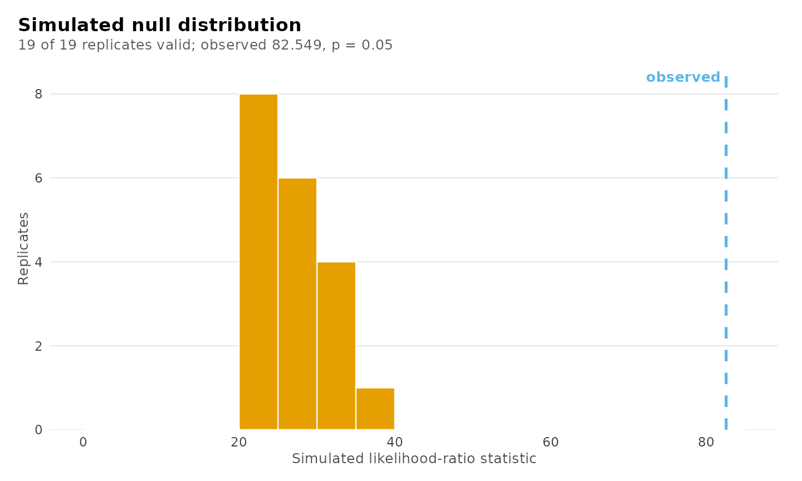

The Vuong-Lo-Mendell-Rubin test refers the same statistic to an
asymptotic approximation of its distribution (Vuong, 1989; Lo, Mendell
and Rubin, 2001): a weighted sum of chi-square variables with one degree
of freedom, whose weights are the eigenvalues of a matrix formed from
the scores and second derivatives of both models. The test requires no
simulation. Its adjusted version (aLMR) divides the statistic by
`1 + 1 / (d log n)`, with `d` the number of added parameters and `n` the
number of independent units, and refers it to the same distribution.
[`get_results()`](https://pak.dynasite.org/latents/reference/get_results.md)
with `"lmr"` reports both for every pair of converged candidates that
differ by one profile or one group class. A pair whose information
matrix is singular, here the candidates with five and six profiles, is
kept with its reason in `note`.

``` r

subset(get_results(models, "lmr"), n_group_classes == 3)
#>        direction    null_candidate alternative_candidate n_profiles n_group_classes model n_units
#> 12 group_classes profiles2_groups2     profiles2_groups3          2               3   VVI     106
#> 14 group_classes profiles3_groups2     profiles3_groups3          3               3   VVI     106
#> 16 group_classes profiles4_groups2     profiles4_groups3          4               3   VVI     106
#> 18 group_classes profiles5_groups2     profiles5_groups3          5               3   VVI      NA
#> 19 group_classes profiles6_groups2     profiles6_groups3          6               3   VVI      NA
#> 20      profiles profiles2_groups3     profiles3_groups3          3               3   VVI     106
#> 22      profiles profiles3_groups3     profiles4_groups3          4               3   VVI     106
#> 24      profiles profiles4_groups3     profiles5_groups3          5               3   VVI      NA
#> 26      profiles profiles5_groups3     profiles6_groups3          6               3   VVI      NA
#>    parameters_added    lr   vlmr_p adjusted_lr   almr_p reference_mean reference_sd
#> 12                2  37.5 3.43e-07        33.9 1.32e-06           0.76         3.37
#> 14                3  32.2 6.29e-05        30.0 1.21e-04           2.95         4.15
#> 16                4  38.1 2.63e-04        36.1 4.06e-04           4.70         5.86
#> 18               NA    NA       NA          NA       NA             NA           NA
#> 19               NA    NA       NA          NA       NA             NA           NA
#> 20               13 145.3 4.15e-13       142.9 6.80e-13          13.74         6.38
#> 22               13  82.5 5.18e-05        81.2 6.12e-05          14.94         8.15
#> 24               NA    NA       NA          NA       NA             NA           NA
#> 26               NA    NA       NA          NA       NA             NA           NA
#>                                                                                                                                                                                                                                                  note
#> 12                                                                                                                                                                                                                                               <NA>
#> 14                                                                                                                                                                                                                                               <NA>
#> 16                                                                                                                                                                                                                                               <NA>
#> 18 null model: Observed information is not positive definite or is numerically singular; Wald inference is unavailable. | alternative model: Observed information is not positive definite or is numerically singular; Wald inference is unavailable.
#> 19 null model: Observed information is not positive definite or is numerically singular; Wald inference is unavailable. | alternative model: Observed information is not positive definite or is numerically singular; Wald inference is unavailable.
#> 20                                                                                                                                                                                                                                               <NA>
#> 22                                                                                                                                                                                                                                               <NA>
#> 24                                                                                                                        alternative model: Observed information is not positive definite or is numerically singular; Wald inference is unavailable.
#> 26 null model: Observed information is not positive definite or is numerically singular; Wald inference is unavailable. | alternative model: Observed information is not positive definite or is numerically singular; Wald inference is unavailable.
```

The regularity conditions of Vuong’s theorem do not hold for mixture
models (Jeffries, 2003), and the test’s p-values are not uniformly
distributed when the smaller model is true (Vermunt, 2024). It is one
piece of evidence beside the criteria, the classification and the
bootstrap.

## Putting the evidence together

No algorithm converts this evidence into a number of classes, and
latents applies none. A defensible decision is reached by examining the
evidence in a fixed sequence and reporting each step:

0.  **Analytic decisions**: report the number of random starts, whether
    starts at a variance bound were excluded (`boundary`), any centring
    or scaling, the treatment of missing values, and the number of
    observations with no observed indicator.
1.  **Sample-size convention**: specify the convention before examining
    any criterion and apply it consistently.
2.  **Criterion minima**: examine the minima under that convention,
    noting where the criteria agree and the direction in which they
    disagree. A minimum at the boundary of the grid requires an extended
    grid.
3.  **Deltas and knees**: where the criteria decrease throughout,
    examine the magnitude of successive decreases and report the knee
    with its `distance` and stability.
4.  **Classification quality**: for the remaining candidates, report
    relative entropy and the minimum AvePP and OCC at each level.
5.  **Estimation diagnostics**: verify replication of the maximum
    likelihood, the absence of boundary estimates and the size of the
    smallest class; re-estimate candidates whose maximum was found only
    once.
6.  **Likelihood ratio test**: when the evidence is equivocal, test the
    leading candidate against its neighbour with the bootstrap
    likelihood ratio test.
7.  **Substantive interpretation**: among candidates that the statistics
    do not distinguish, select the one whose classes are distinct and
    substantively meaningful for the research question, and state the
    rationale.

The tables underlying each step are returned by the functions above, so
that the reported decision can be reproduced from the reported evidence.

## Functions

| Call | Result |
|:---|:---|
| enumerate_classes(…, n_starts = , centering = , scaling = , missing = “fiml”) | The same starts, centring, scaling and missing-data handling for every candidate |
| enumerate_classes(…, boundary = “exclude”) | Starts with a variance at its lower bound set aside for every candidate |
| as.data.frame(models) | One row per candidate: every criterion, classification summaries and checks |
| get_results(models, “best”) | The candidate at the minimum of each criterion and convention |
| plot_enumeration(models), plot_enumeration(models, what = “bic_groups”), what = “all” | Criteria across the candidates, lowest ringed |
| get_results(models, “deltas”, using = ) | Decrease in a criterion from one profile fewer and one group class fewer |
| plot_selection(models, what = “deltas”, using = ) | The decreases along profiles and along group classes |
| get_results(models, “knees”, using = ) | Chord-distance knee of each line, with its stability |
| plot_selection(models, what = “heatmap”, using = ) | Distance of every candidate from the lowest criterion |
| get_results(models, “classification”) | Size, AvePP, OCC and entropy of every class of every candidate |
| get_results(models, “candidates”, cutoff = ) | The table of candidates with another AvePP cutoff |
| plot_enumeration(models, what = “diagnostics”, “entropy” or “avepp”, cutoff = ) | Relative entropy and lowest AvePP across the candidates |
| get_results(fit, “entropy”) | Relative entropy of one fit at each level, over the classified units |
| plot_diagnostics(fit), what = “group_posteriors” and the like | Certainty, uncertainty, sizes and AvePP of one fit, profiles and group classes |
| plot_selection(models, what = “trust”) | Convergence, boundary and replication of every candidate |
| plot_selection(models, what = “smallest”) | Share of the smallest class of every candidate |
| plot_selection(models) | Deltas, heatmap, smallest class, trust and diagnostics together |
| plot_tree(models) | How the profiles divide as more are added |
| compare_models(models, “name”, …) | Chosen candidates side by side, with BIC weights |
| get_candidate(models, “name”) | One fitted candidate |
| bootstrap_lrt(smaller, larger, data, iter) | Bootstrap likelihood ratio test of k against k + 1 classes |
| get_results(models, “lmr”) | VLMR and adjusted LMR tests of every pair of neighbouring candidates |

## References

Akaike, H. (1974). A new look at the statistical model identification.
*IEEE Transactions on Automatic Control*, 19, 716–723.

Banfield, J. D., & Raftery, A. E. (1993). Model-based Gaussian and
non-Gaussian clustering. *Biometrics*, 49, 803–821.

Biernacki, C., Celeux, G., & Govaert, G. (2000). Assessing a mixture
model for clustering with the integrated completed likelihood. *IEEE
Transactions on Pattern Analysis and Machine Intelligence*, 22, 719–725.

Biernacki, C., & Govaert, G. (1997). Using the classification likelihood
to choose the number of clusters. *Computing Science and Statistics*,
29, 451–457.

Bozdogan, H. (1987). Model selection and Akaike’s information criterion.
*Psychometrika*, 52, 345–370.

Cavanaugh, J. E. (1999). A large-sample model selection criterion based
on Kullback’s symmetric divergence. *Statistics and Probability
Letters*, 42, 333–343.

Jeffries, N. O. (2003). A note on ‘Testing the number of components in a
normal mixture’. *Biometrika*, 90, 991–994.

Lo, Y., Mendell, N. R., & Rubin, D. B. (2001). Testing the number of
components in a normal mixture. *Biometrika*, 88, 767–778.

McLachlan, G. J. (1987). On bootstrapping the likelihood ratio test
statistic for the number of components in a normal mixture. *Applied
Statistics*, 36, 318–324.

Nagin, D. S. (2005). *Group-based modeling of development*. Harvard
University Press.

Nylund, K. L., Asparouhov, T., & Muthén, B. O. (2007). Deciding on the
number of classes in latent class analysis and growth mixture modeling:
A Monte Carlo simulation study. *Structural Equation Modeling*, 14,
535–569.

Satopää, V., Albrecht, J., Irwin, D., & Raghavan, B. (2011). Finding a
“kneedle” in a haystack: detecting knee points in system behavior. *31st
International Conference on Distributed Computing Systems Workshops*,
166–171.

Schwarz, G. (1978). Estimating the dimension of a model. *The Annals of
Statistics*, 6, 461–464.

Sclove, S. L. (1987). Application of model-selection criteria to some
problems in multivariate analysis. *Psychometrika*, 52, 333–343.

Vermunt, J. K. (2024). The Vuong-Lo-Mendell-Rubin test for latent class
and latent profile analysis: A note on the different implementations in
Mplus and LatentGOLD. *Methodology*, 20(1), 72–83.
<https://doi.org/10.5964/meth.12467>

Vuong, Q. H. (1989). Likelihood ratio tests for model selection and
non-nested hypotheses. *Econometrica*, 57, 307–333.

Wagenmakers, E.-J., & Farrell, S. (2004). AIC model selection using
Akaike weights. *Psychonomic Bulletin & Review*, 11, 192–196.

Zappia, L., & Oshlack, A. (2018). Clustering trees: a visualization for
evaluating clusterings at multiple resolutions. *GigaScience*, 7(7),
giy083.
