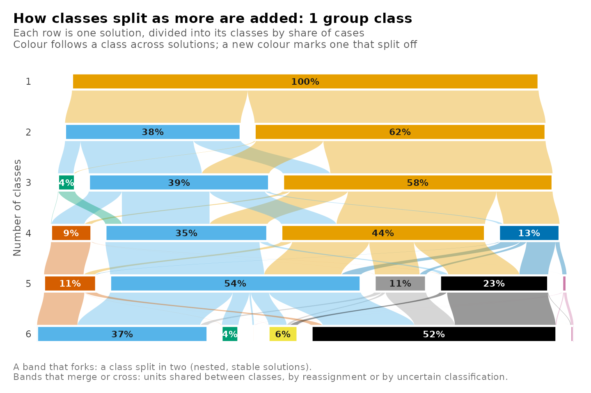
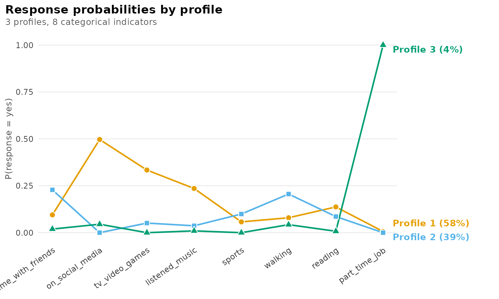
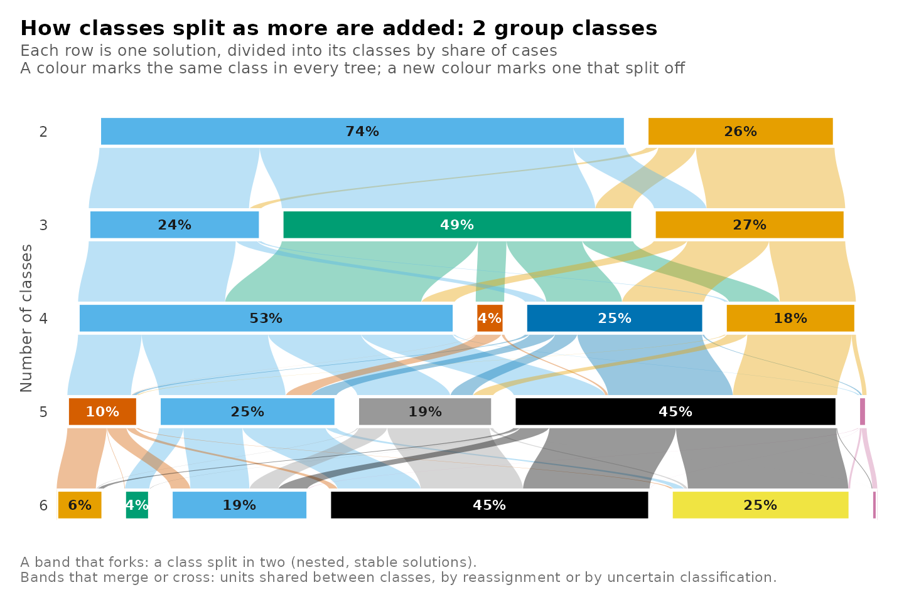
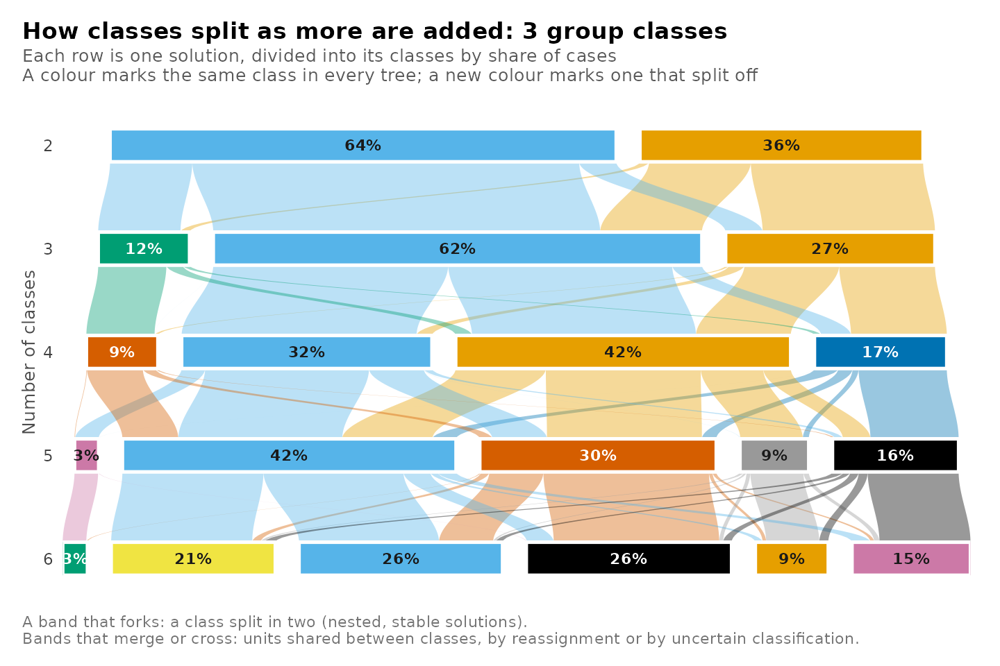
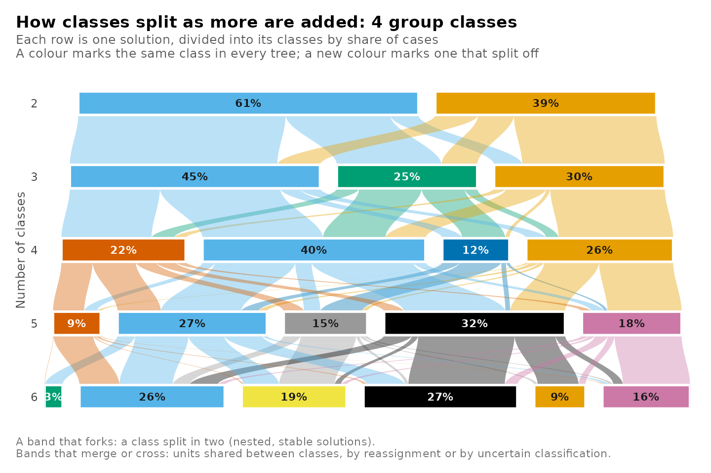
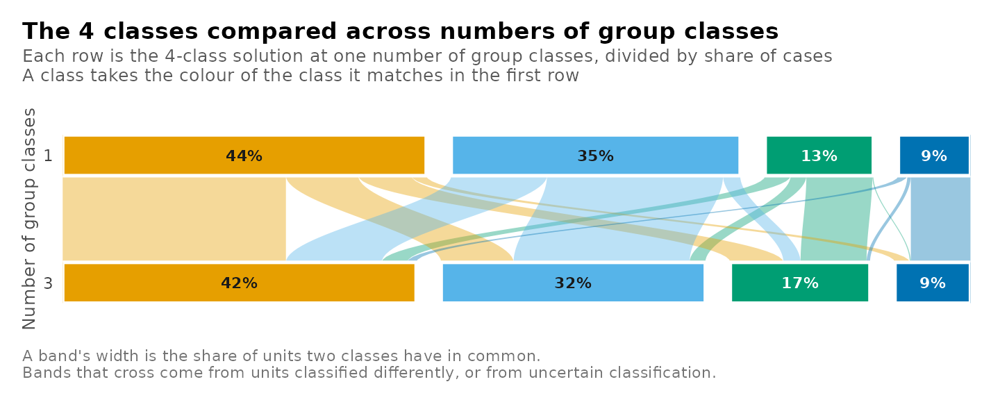
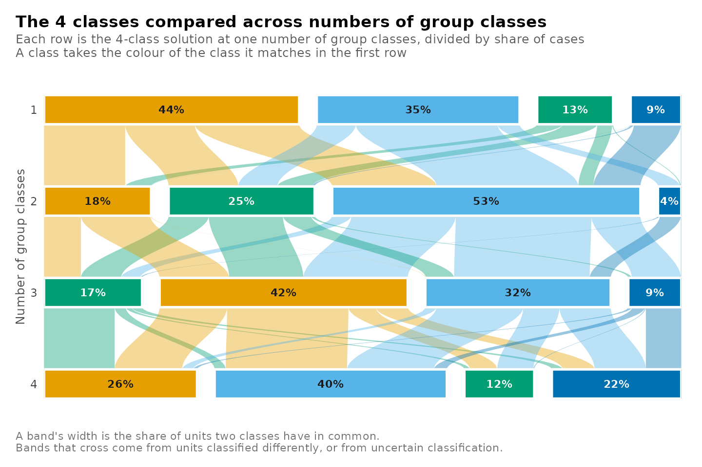
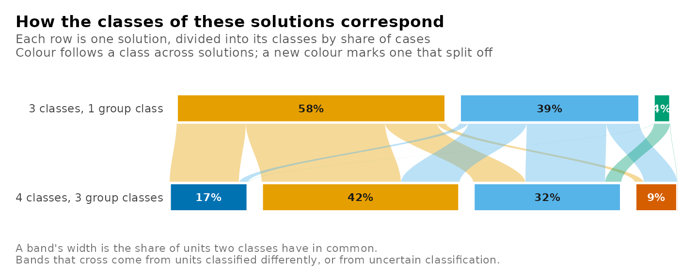
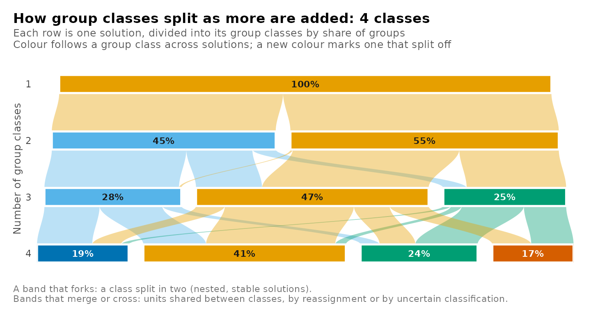

# Tree plot

Class enumeration estimates one mixture model for each number of
classes. Each model is fitted from its own starting values, and the
numbering of its classes is arbitrary, so class 2 of a three-class
solution has no defined relation to class 2 of a four-class solution.
The relation between two solutions is carried by the observations they
classify. When the classes of the larger solution subdivide those of the
smaller one, each class of the smaller solution passes its members to
one or more classes of the larger, and the solutions are nested. When
the larger solution redistributes observations across class boundaries,
the classes of the two solutions overlap without nesting. A clustering
tree represents these relations for a sequence of solutions (Zappia and
Oshlack, 2018). Each row of the tree is one solution, divided into its
classes in proportion to their size, and the band between two classes in
adjacent rows is proportional to the observations they share.

In a mixture model each observation belongs to every class with a
posterior probability. For two solutions $`A`$ and $`B`$ fitted to the
same $`N`$ observations, with posterior probabilities $`p_{ia}`$ and
$`q_{ib}`$ and observation weights $`w_i`$, the shared posterior mass of
class $`a`$ of $`A`$ and class $`b`$ of $`B`$ is

``` math
m_{ab} = \frac{\sum_{i=1}^{N} w_i \, p_{ia} \, q_{ib}}{\sum_{i=1}^{N} w_i}.
```

The masses form a joint distribution over the pairs of classes. Summed
over the classes of $`B`$, they give the posterior share of class $`a`$,
and summed over the classes of $`A`$, the posterior share of class
$`b`$. The ratio of $`m_{ab}`$ to the share of $`a`$ is the part of
class $`a`$ that the larger solution places in class $`b`$. A tree built
from posterior probabilities retains the uncertainty of the
classification, which a tree built from modal assignments discards.

A two-level mixture model has two sequences of solutions (Vermunt,
2003). Observations are classified into classes, and the groups that
contain them are classified into group classes by their distribution
over those classes. The classes form a tree at each number of group
classes, and the group classes form a tree at each number of classes.
Solutions can also be compared at a single level, for example the
four-class solutions estimated with different numbers of group classes,
whose classes need not coincide.

## Data and candidates

`student_esm` holds experience-sampling data from 100 university
students (Neubauer and Schmiedek, 2024). At each prompt when they had
not studied since the previous one, the students reported which of eight
leisure activities they had done. The prompts are the observations and
the students the groups. The candidates combine one to six classes of
prompts with one to four group classes of students.

``` r

library(latents)
activities <- c("time_with_friends", "on_social_media", "tv_video_games",
                "listened_music", "sports", "walking", "reading",
                "part_time_job")
models <- enumerate_classes(student_esm, activities, "student",
                            n_profiles = 1:6, n_group_classes = 1:4,
                            categorical = activities, n_starts = 3, seed = 1)
```

The grid holds 24 candidates. Their classes of prompts are counted by
`n_profiles`, the name the package uses at both levels of a two-level
model. The 3 candidates with one class and several group classes could
not be estimated. A group class is defined by its distribution over the
classes, and with a single class every group has the same distribution.
Every tree with two or more group classes therefore begins at two
classes.

## The tree at one number of group classes

At one group class the model is a single-level latent class model of the
prompts. Its tree shows how the classes of prompts divide as classes are
added.

``` r

plot_tree(models, n_group_classes = 1)
```



``` r

plot_responses(get_candidate(models, n_profiles = 3, n_group_classes = 1),
               intervals = FALSE)
```



The two-class solution separates prompts with media use (social media,
television or games, music) from prompts with offline activities. In the
three-class solution the media class keeps 76% of its posterior mass.
The offline class divides into three parts. The largest, 64%, forms a
class of time with friends and walking, 27% joins the media class, and
the remainder forms a class of 4% of prompts in which the probability of
a part-time job is 1.00. The part-time job class passes 98% of its mass
to a single class of the four-class solution, so it persists as further
classes are added.

## Every tree

Without a choice of group classes, each number of group classes has its
own tree, returned as a separate plot. On an interactive screen device
the plots are shown one at a time.

``` r

plot_tree(models)
```



A class in a later tree takes the colour of the class of the first tree
with which it shares the most posterior mass, at the same number of
classes, so a colour marks corresponding classes across the trees.
`combine = TRUE` plots every tree as a panel of one figure.

## Comparing solutions at one level

A single value of `n_profiles` selects one level of every tree. The rows
of the plot are then the solutions with that number of classes, one for
each number of group classes, and the bands show where the same prompts
are classified in each.

``` r

plot_tree(models, n_profiles = 4, n_group_classes = c(1, 3))
```



The values behind the plot are returned by
[`get_results()`](https://pak.dynasite.org/latents/reference/get_results.md)
with the same arguments, one row per pair of classes.

``` r

get_results(models, "tree", n_profiles = 4, n_group_classes = c(1, 3))
#>        tree       level   from_candidate from_class from_share     to_candidate to_class to_share
#> 1  classes4 individuals classes4_groups1          1     0.1299 classes4_groups3        1   0.1677
#> 2  classes4 individuals classes4_groups1          2     0.4365 classes4_groups3        1   0.1677
#> 3  classes4 individuals classes4_groups1          3     0.3470 classes4_groups3        1   0.1677
#> 4  classes4 individuals classes4_groups1          4     0.0866 classes4_groups3        1   0.1677
#> 5  classes4 individuals classes4_groups1          1     0.1299 classes4_groups3        2   0.4244
#> 6  classes4 individuals classes4_groups1          2     0.4365 classes4_groups3        2   0.4244
#> 7  classes4 individuals classes4_groups1          3     0.3470 classes4_groups3        2   0.4244
#> 8  classes4 individuals classes4_groups1          4     0.0866 classes4_groups3        2   0.4244
#> 9  classes4 individuals classes4_groups1          1     0.1299 classes4_groups3        3   0.3172
#> 10 classes4 individuals classes4_groups1          2     0.4365 classes4_groups3        3   0.3172
#> 11 classes4 individuals classes4_groups1          3     0.3470 classes4_groups3        3   0.3172
#> 12 classes4 individuals classes4_groups1          4     0.0866 classes4_groups3        3   0.3172
#> 13 classes4 individuals classes4_groups1          1     0.1299 classes4_groups3        4   0.0907
#> 14 classes4 individuals classes4_groups1          2     0.4365 classes4_groups3        4   0.0907
#> 15 classes4 individuals classes4_groups1          3     0.3470 classes4_groups3        4   0.0907
#> 16 classes4 individuals classes4_groups1          4     0.0866 classes4_groups3        4   0.0907
#>        mass share_of_from share_of_to
#> 1  7.92e-02      6.10e-01    4.72e-01
#> 2  6.37e-02      1.46e-01    3.80e-01
#> 3  2.06e-02      5.93e-02    1.23e-01
#> 4  4.18e-03      4.82e-02    2.49e-02
#> 5  3.06e-02      2.35e-01    7.20e-02
#> 6  2.68e-01      6.14e-01    6.32e-01
#> 7  1.15e-01      3.31e-01    2.71e-01
#> 8  1.08e-02      1.25e-01    2.55e-02
#> 9  1.89e-02      1.45e-01    5.95e-02
#> 10 8.69e-02      1.99e-01    2.74e-01
#> 11 2.11e-01      6.09e-01    6.66e-01
#> 12 6.32e-09      7.30e-08    1.99e-08
#> 13 1.26e-03      9.68e-03    1.39e-02
#> 14 1.78e-02      4.07e-02    1.96e-01
#> 15 2.02e-08      5.83e-08    2.23e-07
#> 16 7.16e-02      8.27e-01    7.90e-01
```

Each class of the four-class solution with one group class places
between 61% and 83% of its posterior mass in a single class of the
solution with three group classes. The two solutions describe similar
classes, and the group classes shift a part of the prompts between them.
Omitting `n_group_classes` compares the same level across every number
of group classes.

``` r

plot_tree(models, n_profiles = 4)
```



## Comparing two solutions

Any two candidates are compared with `from` and `to`, each given by its
number of classes and number of group classes.

``` r

plot_tree(models, from = c(3, 1), to = c(4, 3))
```



The candidates can also be given by name, in the order of the rows, with
`candidates = c("classes3_groups1", "classes4_groups3")`.

## The tree of group classes

With `level = "groups"` the units are the students and the classes are
the group classes. A tree then runs down the numbers of group classes at
one number of classes of prompts.

``` r

plot_tree(models, level = "groups", n_profiles = 4)
```



From two to three group classes, one group class of the
three-group-class solution receives 98% of its students from a single
group class of the two-group-class solution. The other group classes
draw their students from both. The tree of group classes is read in the
same way as the tree of classes. With `level = "groups"`, a single value
of `n_group_classes` compares one level of group classes across numbers
of classes, as `n_profiles` does for the classes.

## Summary of calls

| Question | Call |
|----|----|
| How do the classes divide as classes are added? | `plot_tree(models, n_group_classes = 1)` |
| The same for every number of group classes | `plot_tree(models)`, `combine = TRUE` for one figure |
| How do the solutions with four classes differ across group classes? | `plot_tree(models, n_profiles = 4, n_group_classes = c(1, 3))` |
| How do two chosen solutions correspond? | `plot_tree(models, from = c(3, 1), to = c(4, 3))` |
| How do the group classes divide? | `plot_tree(models, level = "groups", n_profiles = 4)` |
| The shared masses behind any of these | `get_results(models, "tree", ...)` with the same arguments |

## References

Neubauer, A. B., & Schmiedek, F. (2024). Approaching academic adjustment
on multiple time scales. *Zeitschrift für Erziehungswissenschaft,
27*(1), 147-168. <https://doi.org/10.1007/s11618-023-01182-8>

Vermunt, J. K. (2003). Multilevel latent class models. *Sociological
Methodology*, 33, 213–239.

Zappia, L., & Oshlack, A. (2018). Clustering trees: A visualization for
evaluating clusterings at multiple resolutions. *GigaScience*, 7(7),
giy083.
