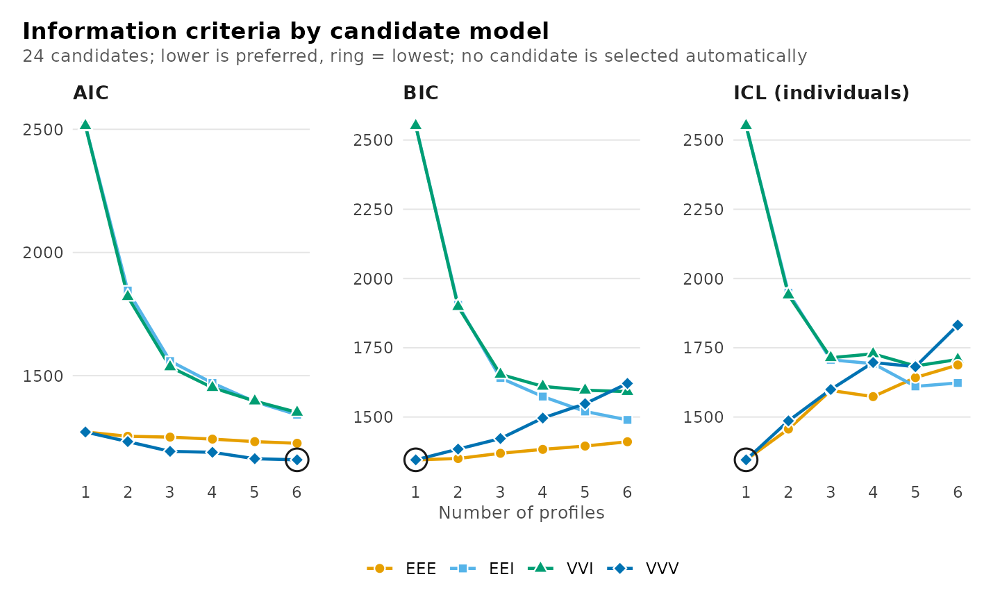
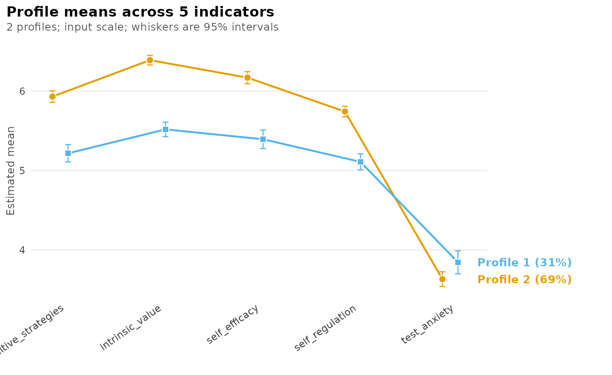
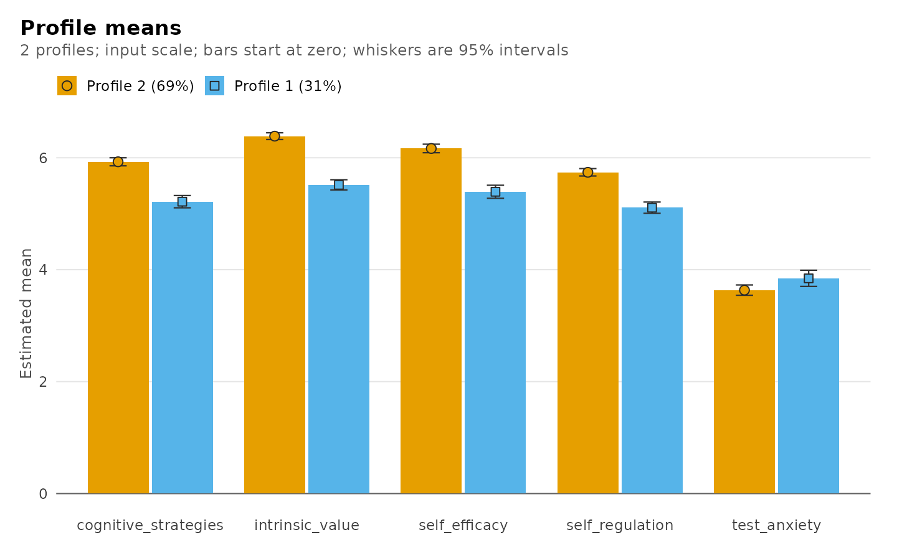
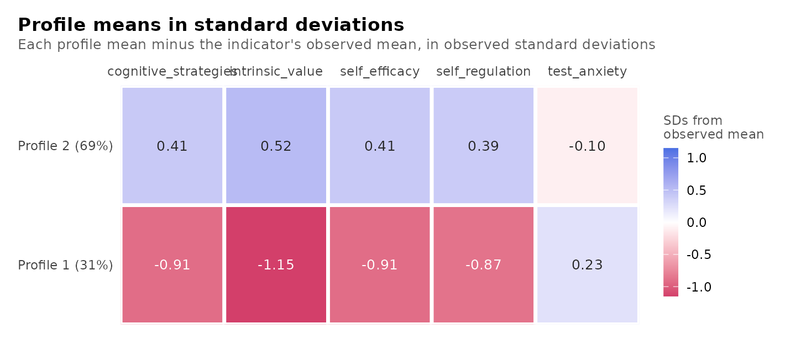
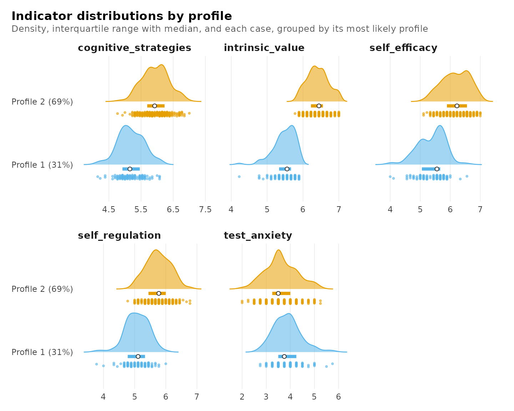
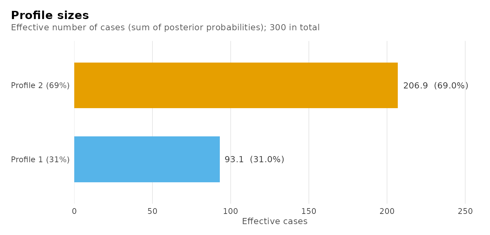
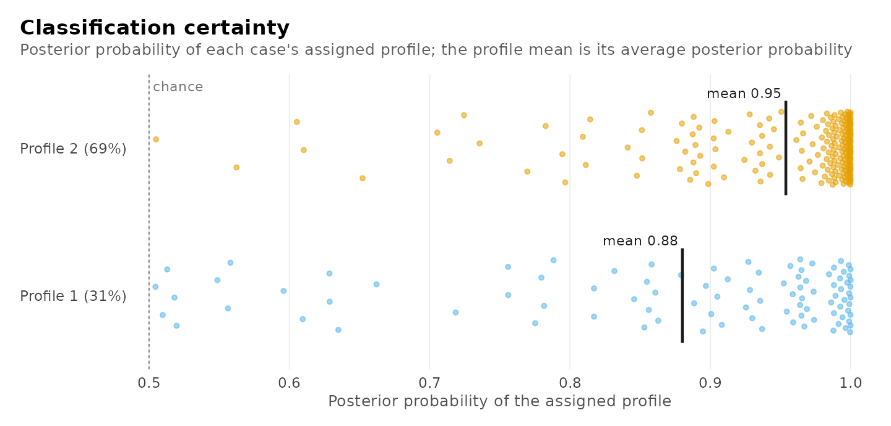
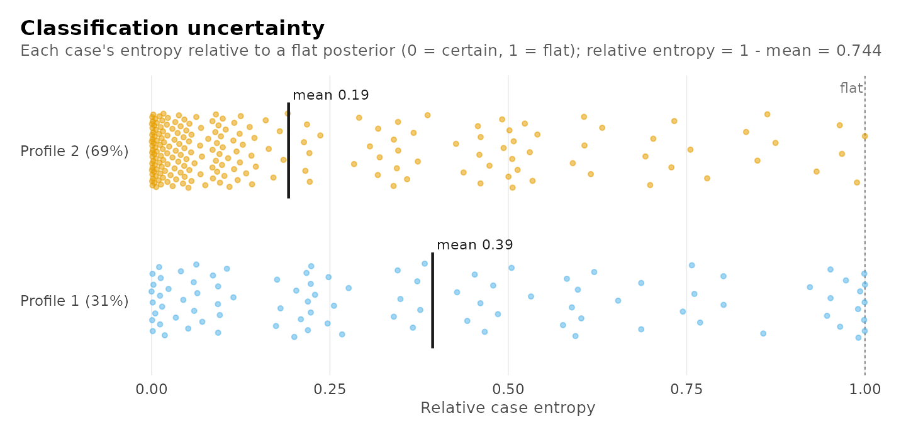
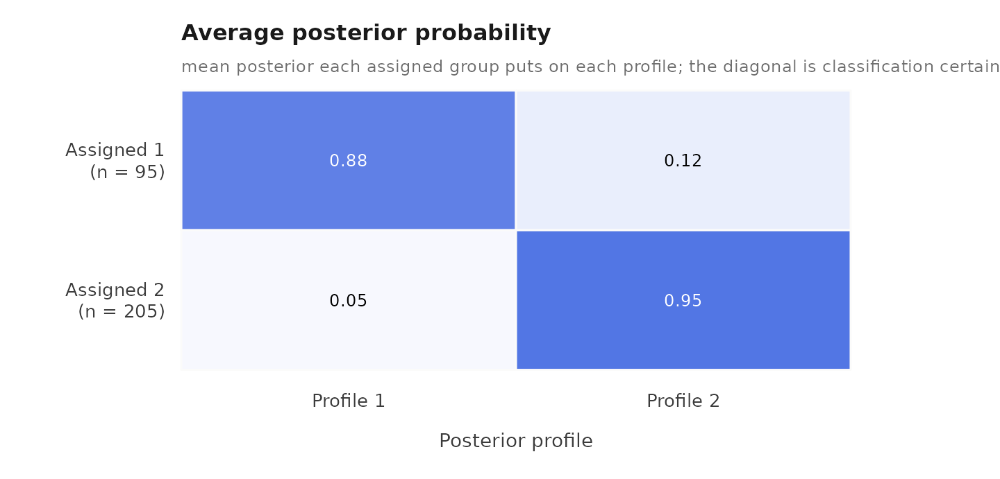

# Latent profile analysis: a complete workflow

Latent profile analysis (LPA) is a mixture model for continuous
indicators. It assumes that the observations come from a small number of
unobserved subpopulations, called profiles, each with its own mean on
every indicator. This vignette presents a complete analysis: description
of the data, selection of the covariance structure and the number of
profiles, estimation, interpretation, and evaluation of the
classification.

``` r

library(latents)
set.seed(1)
```

The estimation uses random starting values, so the seed is set once to
make the results reproducible.

## Data

The `srl` data contain the scores of 300 respondents on five constructs
of the Motivated Strategies for Learning Questionnaire: cognitive
strategy use, intrinsic value, self-efficacy, self-regulation, and test
anxiety. Each score is the mean of the construct’s items on a scale from
1 to 7. The responses were generated by a large language model (GPT) in
a study of how such models answer psychological surveys; they serve here
as a well-structured example and are not evidence about students.

``` r

indicators <- c("cognitive_strategies", "intrinsic_value", "self_efficacy",
                "self_regulation", "test_anxiety")
descriptives(srl, indicators)
#>               variable   n n_missing mean    sd  min  max n_distinct
#> 1 cognitive_strategies 300         0 5.71 0.541 4.15 7.00         34
#> 2      intrinsic_value 300         0 6.12 0.523 4.22 7.00         22
#> 3        self_efficacy 300         0 5.93 0.587 4.00 7.00         25
#> 4      self_regulation 300         0 5.54 0.500 3.78 6.78         25
#> 5         test_anxiety 300         0 3.70 0.644 2.00 5.75         16
```

## Selecting the covariance structure and the number of profiles

A latent profile model must specify, besides the number of profiles, how
the indicators vary within a profile: whether the variances are equal
across profiles or differ between them, and whether the indicators are
allowed to covary within a profile. The four combinations are named by
the volume, shape and orientation of each profile’s covariance matrix,
each equal (`E`) or varying (`V`) across profiles, with `I` for no
covariances (Celeux and Govaert, 1995): `EEI` has equal variances and no
covariances, `VVI` varying variances and no covariances, `EEE` one
covariance matrix shared by all profiles, and `VVV` a covariance matrix
for each profile.
[`enumerate_lpa()`](https://pak.dynasite.org/latents/reference/enumerate_lpa.md)
estimates these four structures with every number of profiles requested.

``` r

models <- enumerate_lpa(srl, indicators, n_profiles = 1:6)
#> Warning: A variance reached min_variance; this is a bound-active constrained fit.
#> Warning: Profile 4: 9.8 Gaussian membership mass for 10 free means and variances. This is
#> a conservative diagnostic, not an identification test; inspect the Gaussian covariance
#> diagnostics.
#> Warning: Profile 2: 12.4 Gaussian membership mass for 20 free means and variances. This
#> is a conservative diagnostic, not an identification test; inspect the Gaussian covariance
#> diagnostics.
plot_enumeration(models)
```



The choice of structure matters here because four of the five constructs
are strongly correlated. The structures without covariances (`EEI`,
`VVI`) can reproduce these correlations only by adding profiles. BIC
falls through six profiles for `EEI`. For `VVI`, it is lowest at five
profiles, but that fit reaches the variance floor; BIC rises again at
six profiles. The warnings printed during the enumeration report
candidates with low Gaussian membership mass relative to the number of
profile-specific means and variances (`latents_thin_profiles`). This is
a conservative support diagnostic, not an identification test; inspect
the covariance diagnostics as well. The `EEE` structure shares one
covariance matrix and does not receive this profile-specific warning.
The structures with covariances account for the correlations directly,
and reach far lower BIC values with one or two profiles. The `EEE`
structure attains the lowest values; its candidates are:

``` r

summary(enumerate_lpa(srl, indicators, n_profiles = 1:6, model = "EEE"))
#> Class enumeration: 6 candidates, 6 converged, 0 failed to fit
#> 2 distinct candidate(s) are minimal under some criterion.
#> No candidate is selected automatically. Choose one convention and keep it.
#> The candidates table shows 13 of its 37 columns; get_results(x, what = "candidates") returns all of them.
#> 
#> -- candidates ------------------------------------------------------
#>  candidate n_profiles log_likelihood n_parameters  aic  bic icl_individual
#>  profiles1          1         -615.7           20 1271 1345           1345
#>  profiles2          2         -600.9           26 1254 1350           1457
#>  profiles3          3         -593.1           32 1250 1369           1609
#>  profiles4          4         -582.1           38 1240 1381           1574
#>  profiles5          5         -572.1           44 1232 1395           1642
#>  profiles6          6         -562.8           50 1226 1411           1688
#>  profile_entropy avepp_min avepp_mean avepp_below converged boundary
#>               NA        NA         NA          NA      TRUE    FALSE
#>           0.7440    0.8801     0.9169           0      TRUE    FALSE
#>           0.6347    0.7966     0.8340           1      TRUE    FALSE
#>           0.7686    0.8180     0.8777           0      TRUE    FALSE
#>           0.7440    0.8046     0.8427           0      TRUE    FALSE
#>           0.7422    0.7602     0.8214           2      TRUE    FALSE
#> 
#> -- best ------------------------------------------------------------
#>  criterion  convention candidate n_profiles n_group_classes model value
#>        aic        <NA> profiles6          6               1   EEE  1226
#>        kic        <NA> profiles6          6               1   EEE  1279
#>        bic      groups profiles1          1               1   EEE  1345
#>        bic individuals profiles1          1               1   EEE  1345
#>      sabic      groups profiles6          6               1   EEE  1252
#>      sabic individuals profiles6          6               1   EEE  1252
#>       caic      groups profiles1          1               1   EEE  1365
#>       caic individuals profiles1          1               1   EEE  1365
#>        awe      groups profiles1          1               1   EEE  1520
#>        awe individuals profiles1          1               1   EEE  1520
#>    ... 4 more rows.  get_results(x, what = "best")
#> 
#> -- criteria --------------------------------------------------------
#>  criterion  convention candidate n_profiles n_group_classes model value
#>        aic        <NA> profiles6          6               1   EEE  1226
#>        kic        <NA> profiles6          6               1   EEE  1279
#>        bic      groups profiles1          1               1   EEE  1345
#>        bic individuals profiles1          1               1   EEE  1345
#>      sabic      groups profiles6          6               1   EEE  1252
#>      sabic individuals profiles6          6               1   EEE  1252
#>       caic      groups profiles1          1               1   EEE  1365
#>       caic individuals profiles1          1               1   EEE  1365
#>        awe      groups profiles1          1               1   EEE  1520
#>        awe individuals profiles1          1               1   EEE  1520
#>    ... 4 more rows.  get_results(x, what = "criteria")
#> 
#> -- classification --------------------------------------------------
#>  candidate n_profiles n_group_classes model       level class n_modal proportion_modal
#>  profiles2          2               1   EEE individuals     1      95           0.3167
#>  profiles2          2               1   EEE individuals     2     205           0.6833
#>  profiles3          3               1   EEE individuals     1     126           0.4200
#>  profiles3          3               1   EEE individuals     2      82           0.2733
#>  profiles3          3               1   EEE individuals     3      92           0.3067
#>  profiles4          4               1   EEE individuals     1      91           0.3033
#>  profiles4          4               1   EEE individuals     2      60           0.2000
#>  profiles4          4               1   EEE individuals     3      33           0.1100
#>  profiles4          4               1   EEE individuals     4     116           0.3867
#>  profiles5          5               1   EEE individuals     1      64           0.2133
#>  estimated_n estimated_proportion average_posterior odds_correct_classification
#>        93.07               0.3102            0.8801                      16.315
#>       206.93               0.6898            0.9538                       9.290
#>       129.81               0.4327            0.8242                       6.149
#>        80.37               0.2679            0.7966                      10.705
#>        89.82               0.2994            0.8810                      17.327
#>        84.23               0.2808            0.8180                      11.514
#>        66.74               0.2225            0.8793                      25.451
#>        33.29               0.1110            0.8961                      69.070
#>       115.74               0.3858            0.9175                      17.715
#>        68.24               0.2275            0.8764                      24.072
#>  relative_entropy
#>            0.7440
#>            0.7440
#>            0.6347
#>            0.6347
#>            0.6347
#>            0.7686
#>            0.7686
#>            0.7686
#>            0.7686
#>            0.7440
#>    ... 10 more rows.  get_results(x, what = "classification")
#> 
#> -- deltas ----------------------------------------------------------
#>  candidate n_profiles n_group_classes model  criterion value delta_profile from_profile
#>  profiles1          1               1   EEE bic_groups  1345            NA         <NA>
#>  profiles2          2               1   EEE bic_groups  1350        -4.704    profiles1
#>  profiles3          3               1   EEE bic_groups  1369       -18.531    profiles2
#>  profiles4          4               1   EEE bic_groups  1381       -12.349    profiles3
#>  profiles5          5               1   EEE bic_groups  1395       -14.143    profiles4
#>  profiles6          6               1   EEE bic_groups  1411       -15.520    profiles5
#>  delta_group_class from_group_class
#>                 NA             <NA>
#>                 NA             <NA>
#>                 NA             <NA>
#>                 NA             <NA>
#>                 NA             <NA>
#>                 NA             <NA>
#> 
#> -- knees -----------------------------------------------------------
#>   direction           line  criterion      from        to n_points knee_candidate
#>    profiles  1 group class bic_groups profiles1 profiles6        6           <NA>
#>  parameters all candidates bic_groups profiles1 profiles6        6           <NA>
#>  distance knee_without_largest stable                                        note
#>        NA                 <NA>     NA the criterion does not fall along this line
#>        NA                 <NA>     NA the criterion does not fall along this line
#> 
#> -- tree ------------------------------------------------------------
#>  tree       level from_candidate from_class from_share to_candidate to_class to_share
#>  tree individuals      profiles1          1     1.0000    profiles2        1   0.3102
#>  tree individuals      profiles1          1     1.0000    profiles2        2   0.6898
#>  tree individuals      profiles2          1     0.3102    profiles3        1   0.4327
#>  tree individuals      profiles2          2     0.6898    profiles3        1   0.4327
#>  tree individuals      profiles2          1     0.3102    profiles3        2   0.2679
#>  tree individuals      profiles2          2     0.6898    profiles3        2   0.2679
#>  tree individuals      profiles2          1     0.3102    profiles3        3   0.2994
#>  tree individuals      profiles2          2     0.6898    profiles3        3   0.2994
#>  tree individuals      profiles3          1     0.4327    profiles4        1   0.2808
#>  tree individuals      profiles3          2     0.2679    profiles4        1   0.2808
#>     mass share_of_from share_of_to
#>  0.31025       0.31025     1.00000
#>  0.68975       0.68975     1.00000
#>  0.04628       0.14917     0.10696
#>  0.38641       0.56021     0.89304
#>  0.01008       0.03249     0.03763
#>  0.25782       0.37379     0.96237
#>  0.25389       0.81834     0.84796
#>  0.04552       0.06600     0.15204
#>  0.17826       0.41199     0.63493
#>  0.07619       0.28441     0.27139
#>    ... 60 more rows.  get_results(x, what = "tree")
#> 
#> 7 tables above, truncated to fit. get_results(x, what = ) returns any
#> of them whole, and get_results(x, what = "all") returns every one.
```

The BIC is lowest for one profile, and the two-profile model is 4.7
points higher; the information criteria therefore do not decide between
one and two profiles. The parametric bootstrap likelihood ratio test
compares the two models directly.

``` r

one <- lpa(srl, indicators, n_profiles = 1, model = "EEE")
fit <- lpa(srl, indicators, n_profiles = 2, model = "EEE")
lrt <- bootstrap_lrt(one, fit)
lrt
#> Parametric bootstrap likelihood-ratio comparison
#> Null: 1 profile; alternative: 2 profiles
#> Observed statistic: 29.518785
#> p-value: 0.005 (Monte Carlo SE 0.00499) from 199 of 199 valid replicates (0 invalid)
```

The test rejects the one-profile model (p = 0.005), and the two-profile
model with the `EEE` structure is retained.

## Estimation

[`lpa()`](https://pak.dynasite.org/latents/reference/lpa.md) fits a
single-level latent profile model. The fitted model:

``` r

fit
#> Latent profile analysis: 2 profiles
#> 300 observations; equal full residual covariance (EEE)
#> Log likelihood: -600.924999 | AIC: 1253.850 | BIC: 1350.148
#> Converged: TRUE | iterations: 18 | best log likelihood reached by 10 of 10 starts (10 converged; emEM: 50 screened)
#> Smallest standardized Gaussian eigenvalue: 0.1025 (profiles, profile_1); Gaussian mass: 93.07; weight effective n: 111.8.
#> 
#> Class sizes   profile_1 31.0% (93)   profile_2 69.0% (207)
#> 
#> Means
#>             indicator profile_1 profile_2
#>  cognitive_strategies      5.21      5.93
#>       intrinsic_value      5.52      6.39
#>         self_efficacy      5.39      6.17
#>       self_regulation      5.11      5.74
#>          test_anxiety      3.85      3.63
#> 
#> Variances and standard errors: get_results(x, "profiles").
#> Every other table: get_results(x, what = ), or get_results(x, "all").
```

## Interpretation of the profiles

The profile plot shows the estimated mean of each profile on each
indicator with its 95% confidence interval.

``` r

plot_profiles(fit)
```



The larger profile, comprising 69% of the respondents, has higher means
on cognitive strategy use, intrinsic value, self-efficacy and
self-regulation than the smaller profile, comprising 31%. The two
profiles differ little in test anxiety. The profiles can be described as
high and moderate self-regulated learning. The estimates with their
standard errors:

``` r

get_results(fit, "profiles")
#>    profile            indicator mean variance standard_deviation mean_standard_error
#> 1        1 cognitive_strategies 5.22    0.183              0.427              0.0559
#> 2        1      intrinsic_value 5.52    0.110              0.332              0.0467
#> 3        1        self_efficacy 5.39    0.215              0.464              0.0595
#> 4        1      self_regulation 5.11    0.164              0.405              0.0514
#> 5        1         test_anxiety 3.85    0.404              0.636              0.0737
#> 6        2 cognitive_strategies 5.93    0.183              0.427              0.0368
#> 7        2      intrinsic_value 6.39    0.110              0.332              0.0307
#> 8        2        self_efficacy 6.17    0.215              0.464              0.0389
#> 9        2      self_regulation 5.74    0.164              0.405              0.0336
#> 10       2         test_anxiety 3.63    0.404              0.636              0.0470
#>    variance_standard_error
#> 1                   0.0202
#> 2                   0.0130
#> 3                   0.0223
#> 4                   0.0166
#> 5                   0.0333
#> 6                   0.0202
#> 7                   0.0130
#> 8                   0.0223
#> 9                   0.0166
#> 10                  0.0333
```

The same means as bars with their confidence intervals:

``` r

plot_profiles(fit, what = "bars")
```



The heatmap expresses each mean as a distance from the indicator’s grand
mean in standard deviations, which makes the differences comparable
across indicators:

``` r

plot_profiles(fit, what = "heatmap")
```



The means summarize distributions. The raincloud plot shows, for the
respondents assigned to each profile, the density of each indicator, a
bar from its first to its third quartile with the median marked, and the
individual scores. It shows how much the profiles overlap on each
indicator: they are well separated on intrinsic value and self-efficacy,
and overlap almost completely on test anxiety.

``` r

plot_profiles(fit, what = "raincloud")
```



## Classification quality

The usefulness of a profile solution depends on how accurately the
observations can be assigned to the profiles.
[`diagnostics()`](https://pak.dynasite.org/latents/reference/diagnostics.md)
reports the relative entropy, the size of the smallest profile, the
average posterior probabilities, and the largest residual correlation
within a profile, and draws the four classification plots: the effective
size of each profile (the sum of the posterior probabilities of
belonging to it), the distribution of the posterior probability of each
respondent’s assigned profile, each respondent’s contribution to the
classification entropy, and the average posterior probability matrix, in
which each row contains the respondents assigned to one profile and each
column the average posterior probability they place on each profile.

``` r

diagnostics(fit)
```



    #> Diagnostics: Latent profile analysis, 2 profiles
    #> 1 check needs attention: pairs dependent within a class
    #> 
    #> Estimation
    #>   ok     best start converged                                yes                      
    #>   info   best log likelihood reached by                      10 of 10 starts          
    #>   ok     starts failed or unfinished                         0 of 10 (40 screened)    
    #>   ok     estimates at a bound                                no                       
    #> 
    #> Class size
    #>   info   smallest class                         individuals  31.0% (n = 93, class 1)  
    #>   info   modal vs estimated proportions         individuals  largest gap 0.006        
    #>   ok     classes with no assigned unit          individuals  0 of 2                   
    #> 
    #> Classification
    #>   info   relative entropy                       individuals  0.744                    
    #>   info   lowest average posterior               individuals  0.880 (class 1)          
    #>   info   lowest odds of correct classification  individuals  9.3 (class 2)            
    #> 
    #> Local independence
    #>   check  pairs dependent within a class                      1 of 20 tested pairs     BH-adjusted p < 0.05
    #>          largest: self_efficacy x self_regulation in profile_1, residual 0.103, adjusted p 0.049; consider local_dependence = or a full covariance model
    #> 
    #> Information
    #>   info   log likelihood, parameters, BIC                     -600.92, 26, 1350.15     
    #> 
    #> Every check with its reference: get_results(x, "checks"). Other tables: get_results(x, what = ).

A relative entropy of 0.74 and average posterior probabilities of at
least 0.88 indicate an acceptable classification.

## Posterior assignments

`get_results(fit, "assignments")` returns each respondent with the
assigned profile, the posterior probability of every profile, and the
classification uncertainty, in the row order of the data.

``` r

head(get_results(fit, "assignments"))
#>   cognitive_strategies intrinsic_value self_efficacy self_regulation test_anxiety profile
#> 1                 5.31            5.67          5.78            5.33         4.00       1
#> 2                 5.85            6.44          6.00            5.78         4.00       2
#> 3                 6.62            6.67          6.22            6.33         3.25       2
#> 4                 5.69            6.56          6.33            5.56         4.50       2
#> 5                 4.38            5.56          4.89            4.78         4.00       1
#> 6                 4.85            5.44          5.67            5.11         3.50       1
#>   uncertainty posterior_profile_1 posterior_profile_2
#> 1    0.154286            0.845714               0.154
#> 2    0.008309            0.008309               0.992
#> 3    0.005427            0.005427               0.995
#> 4    0.000982            0.000982               0.999
#> 5    0.281467            0.718533               0.281
#> 6    0.103158            0.896842               0.103
```

## Stability across starting values

The likelihood of a mixture model can have several local maxima.
[`sensitivity()`](https://pak.dynasite.org/latents/reference/sensitivity.md)
re-estimates the model with different random seeds and reports the
maximum reached by each run and the proportion of respondents assigned
to the same profile as in the reported solution. A solution in which a
profile holds about one respondent with its variances at the lower bound
is degenerate; `boundary = "exclude"` in
[`lpa()`](https://pak.dynasite.org/latents/reference/lpa.md) keeps the
best start without such a variance.

``` r

sensitivity(fit)
#>    seed log_likelihood converged iterations optimum best agreement
#> 1     1           -601      TRUE         18       1 TRUE         1
#> 2     2           -601      TRUE         18       1 TRUE         1
#> 3     3           -601      TRUE         18       1 TRUE         1
#> 4     4           -601      TRUE         18       1 TRUE         1
#> 5     5           -601      TRUE         18       1 TRUE         1
#> 6     6           -601      TRUE         18       1 TRUE         1
#> 7     7           -601      TRUE         18       1 TRUE         1
#> 8     8           -601      TRUE         18       1 TRUE         1
#> 9     9           -601      TRUE         18       1 TRUE         1
#> 10   10           -601      TRUE         18       1 TRUE         1
```

## Covariance between chosen indicators

Between local independence within profiles (EEI) and a full covariance
(EEE) lies a covariance for chosen pairs of indicators only.
`local_dependence` names the pairs, and every other covariance within a
profile stays zero. The bivariate residuals of the model without
covariances indicate which pairs carry the dependence.

``` r

independent <- lpa(srl, indicators, n_profiles = 2, model = "EEI")
head(subset(get_results(independent, "residuals"), statistic > 5))
#>     profile          indicator_1     indicator_2     kind observed expected residual
#> 1 profile_1 cognitive_strategies intrinsic_value gaussian    0.692        0    0.692
#> 2 profile_1 cognitive_strategies self_regulation gaussian    0.687        0    0.687
#> 3 profile_1 cognitive_strategies   self_efficacy gaussian    0.674        0    0.674
#> 4 profile_1      intrinsic_value self_regulation gaussian    0.664        0    0.664
#> 5 profile_1        self_efficacy self_regulation gaussian    0.644        0    0.644
#> 6 profile_2 cognitive_strategies self_regulation gaussian    0.604        0    0.604
#>   effective_n statistic df  p_value p_adjusted
#> 1         130      9.62 NA 6.59e-22   6.59e-22
#> 2         130      9.50 NA 2.03e-21   2.03e-21
#> 3         130      9.23 NA 2.63e-20   2.63e-20
#> 4         130      9.02 NA 1.80e-19   1.80e-19
#> 5         130      8.63 NA 6.22e-18   6.22e-18
#> 6         170      9.03 NA 1.77e-19   1.77e-19
```

``` r

paired <- lpa(srl, indicators, n_profiles = 2, variance_model = "equal",
              local_dependence = "cognitive_strategies:intrinsic_value")
compare_models(independent = independent, paired = paired, full = fit)
#> Model comparison
#> 
#> Model        Profiles   k   LogLik      BIC    ΔBIC  Weight      ICL  Entropy  Min AvePP  < 0.8
#> -----------  --------  --  -------  -------  ------  ------  -------  -------  ---------  -----
#> independent         2  16  -906.73  1904.71  554.56   0.000  1948.82     0.89       0.97      0
#> paired              2  17  -823.54  1744.04  393.90   0.000  1805.78     0.85       0.95      0
#> full                2  26  -600.92  1350.15    0.00   1.000  1456.62     0.74       0.88      0
```

12 pairs of indicators have a residual above 5 in the model without
covariances, so the dependence is not confined to one pair. The
covariance of one pair lowers BIC from 1904.7 to 1744, and the full
covariance lowers it to 1350.1. A covariance for chosen pairs suits a
dependence between one or two pairs of indicators; when every pair is
dependent, the full covariance is the model.

## Further analyses

The profiles can be related to covariates with
[`r3step()`](https://pak.dynasite.org/latents/reference/r3step.md) and
to distal outcomes with
[`three_step()`](https://pak.dynasite.org/latents/reference/three_step.md),
both of which correct for classification error. When the observations
are nested in groups,
[`multilpa()`](https://pak.dynasite.org/latents/reference/multilpa.md)
estimates the two-level model, in which the groups are in addition
grouped into latent classes, and
[`enumerate_classes()`](https://pak.dynasite.org/latents/reference/enumerate_classes.md)
compares its numbers of profiles and group classes; both are presented
in
[`vignette("lpa")`](https://pak.dynasite.org/latents/articles/lpa.md).
The ten other covariance structures, which constrain the shape and
orientation separately, are estimated with
`enumerate_lpa(model = "all")`.

## References

Celeux, G., & Govaert, G. (1995). Gaussian parsimonious clustering
models. *Pattern Recognition*, 28(5), 781–793.
